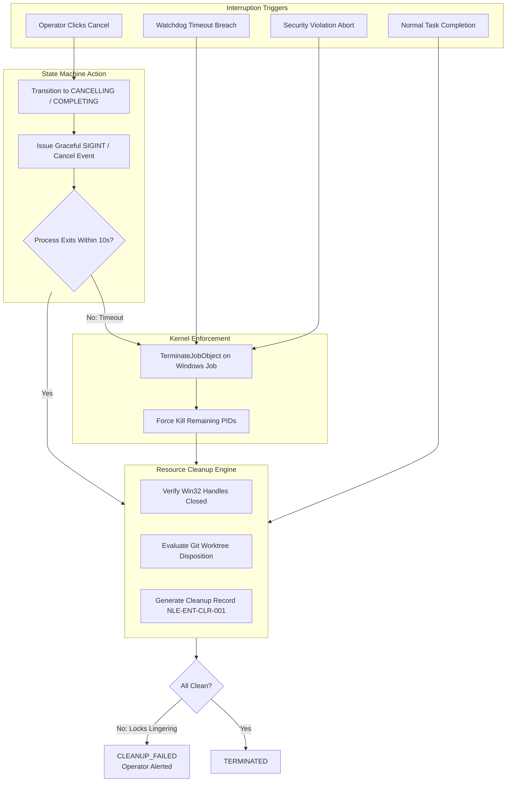

# NexLudic Engine: AI Agent Session Pause, Cancellation, Termination & Cleanup Policy

**Document ID:** `NLE-POL-APT-001`  
**Phase:** 7 of 12 (AI Coding-Agent Orchestration)  
**Step:** 57 of 100  
**Classification:** Operational Control & Resource Reclamation Policy  
**Status:** IMPLEMENTATION-READY SPECIFICATION  
**Upstream Dependencies:** `NLE-SPC-ASM-001` (State Machine), `NLE-SEC-ARI-001` (Runtime Isolation)  
**Downstream Dependents:** `NLE-CON-AAD-001` (Audit Contract), `NLE-CAT-AES-001` (Synthetic Scenarios)  

---

## 1. Lifecycle Interruption Architecture

An agent orchestration platform must be capable of pausing, resuming, cancelling, and forcibly terminating running tasks with mathematical certainty. Incomplete termination leaves zombie compiler processes consuming CPU, locked files preventing Git operations, and uncommitted changes corrupting workspaces.

NexLudic Engine enforces a **guaranteed resource reclamation protocol**:
Every session must resolve into either verified clean termination (`TERMINATED`) or an explicit quarantine state (`CLEANUP_FAILED`).

---

## 2. Interruption Modes & Procedures

### 2.1 Pause and Resume Protocol
- **Eligibility:** A session can be paused only when in state `RUNNING`.
- **Procedure:**
  1. The supervisor sends a `SESSION_PAUSE_REQUESTED` event to the agent worker.
  2. Any in-flight tool invocation is allowed to complete (up to 5 seconds); no new tool calls are accepted.
  3. The supervisor freezes the process tree using Windows Job Object thread suspension APIs (`NtSuspendProcess`).
  4. The session transitions to `PAUSED`. Watchdog countdown timers are suspended.
- **Resume Procedure:**
  1. Operator triggers resume.
  2. Supervisor re-validates that the task token has not expired and source files have not changed.
  3. Supervisor un-freezes process threads (`NtResumeProcess`).
  4. Session transitions to `RUNNING`.

### 2.2 Graceful Cancellation Protocol
- **Procedure:**
  1. Operator or safety trigger issues cancellation. Session transitions to `CANCELLING`.
  2. Supervisor delivers `CANCEL_SIGNAL` to agent worker.
  3. A **10-second grace countdown timer** begins.
  4. If the agent worker halts, flushes state, and exits within 10 seconds, the supervisor transitions the session to `CANCELLED` and proceeds to cleanup.

### 2.3 Forced Termination Protocol
- If the 10-second grace timer expires and worker processes remain active:
  1. The supervisor invokes `TerminateJobObject(hJob, EXIT_CODE_FORCED_CANCEL)`.
  2. Windows kernel forcefully terminates all processes associated with the job object without unwinding.
  3. The supervisor confirms process termination via `GetProcessIdListPtr`.

---

## 3. Cleanup & Resource Reclamation Engine

Upon entering `CLEANING_UP`:
1. **Process Tree Scrub:** Confirm zero running processes remain attached to the Job Object.
2. **File Lock Release:** Close all supervisor-held file handles, logging streams, and mutexes.
3. **Workspace Disposition:**
   - If session was `COMPLETED`: The Git worktree and branch (`nexludic/agent/...`) are preserved and sealed for verification handoff to Step 58.
   - If session was `FAILED` or `CANCELLED`: The supervisor archives diagnostic logs and deletes the scratch directory (`git worktree remove --force`).
4. **Environment Reuse Prohibition:**  
   **A workspace staging directory is NEVER reused across different sessions.** Every session receives a brand-new directory and worktree to prevent state pollution.

### 3.4 Cleanup Failure Governance (`CLEANUP_FAILED`)
If file locks persist (e.g. anti-virus scanner locking a `.dll` or compiler file) after 30 seconds:
- The session transitions to `CLEANUP_FAILED`.
- The directory is flagged as `QUARANTINED_CORRUPT`.
- A high-priority operator alert is raised with exact file handles preventing release.
