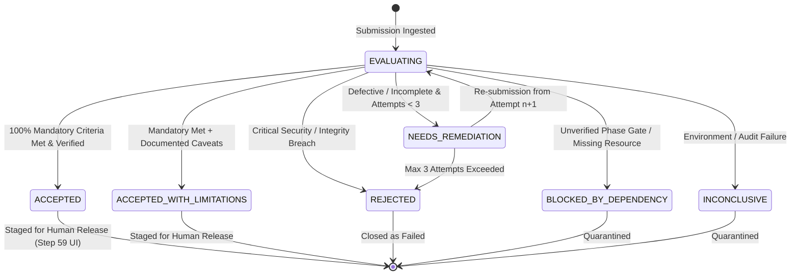

# NexLudic Engine: AI Agent Task Completion Acceptance & Terminal Outcome Contract

**Document ID:** `NLE-CON-ATC-002`  
**Phase:** 7 of 12 (AI Coding-Agent Orchestration)  
**Step:** 59 of 100  
**Classification:** Core Administrative Acceptance Contract  
**Status:** IMPLEMENTATION-READY SPECIFICATION  
**Upstream Dependencies:** `NLE-SPC-AOC-001` (Master Spec), `NLE-CON-AAC-001` (Acceptance Contract)  
**Downstream Dependents:** Step 60 (Phase 7 Orchestration Gate)  

---

## 1. Terminal Outcome State Machine

The final administrative determination of an authorized coding task is governed by an explicit 6-outcome state machine:

---

## 2. Terminal Outcome Definitions

| Terminal State | Definition & Operational Criteria | Downstream Action |
| :--- | :--- | :--- |
| **`ACCEPTED`** | All mandatory deliverables present, diffs conformant, tests passed with cryptographic proof, zero blocking defects. | Artifacts sealed; worktree preserved; ready for human staging. |
| **`ACCEPTED_WITH_LIMITATIONS`** | Mandatory criteria satisfied, but non-blocking minor caveats (e.g. TODO comments, non-critical doc typos) documented. | Artifacts sealed with limitation manifest; ready for staging. |
| **`NEEDS_REMEDIATION`** | Resolvable compilation errors, failing unit tests, or missing deliverables detected within attempt limits (<3). | Remediation request dispatched; session attempt counter bumped. |
| **`REJECTED`** | Security violation, scope breach, evidence fabrication, or persistent failure across 3 attempts. | Workspace discarded; failure diagnostics archived; task closed. |
| **`BLOCKED_BY_DEPENDENCY`** | Task depends on an unverified phase gate (e.g. Step 51 Phase 6 gate) or unavailable host hardware. | Task quarantined; operator alerted. |
| **`INCONCLUSIVE`** | Verification interrupted by power failure, audit ledger failure, or corrupted logs. | Task held in indeterminate status; re-verification required. |

---

## 3. Separation of Task Acceptance from Release Authorization

### Rule ATC-01: Acceptance is Not Release
- Achieving state `ACCEPTED` signifies solely that the agent's submitted work fulfills the technical task contract.
- Task acceptance **DOES NOT**:
  1. Merge the Git branch into `main` or production release branches.
  2. Commit code under the user's personal identity.
  3. Deploy code to live engine runtimes or publishing registries.
- **The Staging Boundary:** All accepted code remains isolated on its Git worktree branch (`nexludic/agent/<task_id>/...`) until an authorized developer explicitly initiates an interactive merge through the Step 59 Desktop UI.
