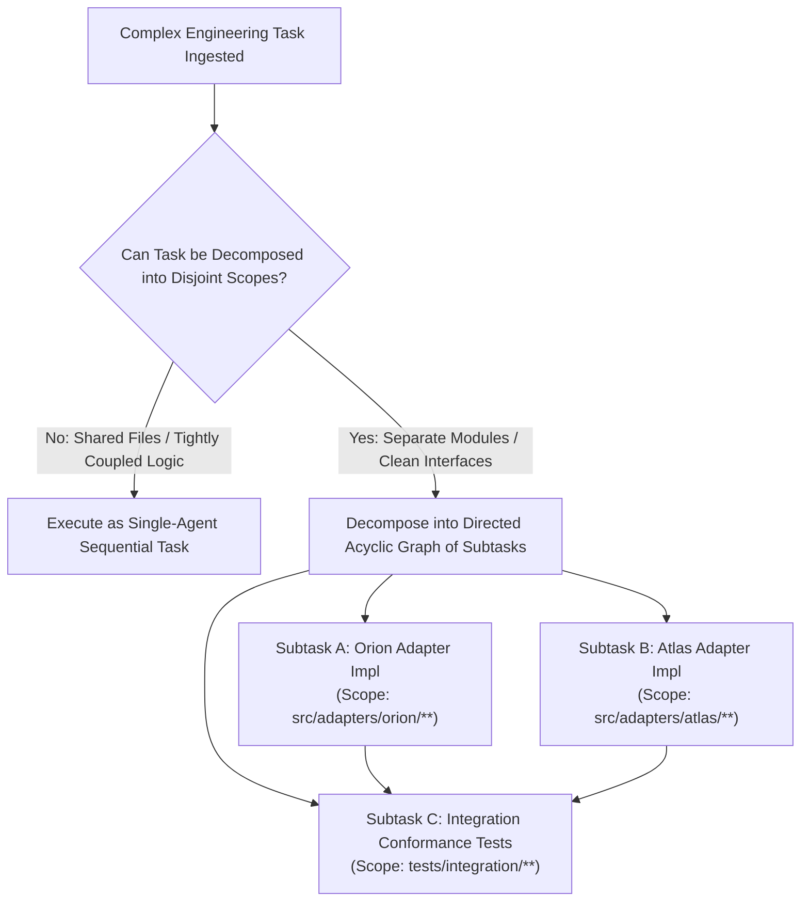

# NexLudic Engine: Task Decomposition & Multi-Agent Coordination Specification

**Document ID:** `NLE-SPC-AMC-001`  
**Phase:** 7 of 12 (AI Coding-Agent Orchestration)  
**Step:** 52 of 100  
**Classification:** Multi-Agent Architecture & Coordination Specification  
**Status:** IMPLEMENTATION-READY SPECIFICATION  

---

## 1. Single-Agent vs. Multi-Agent Execution Governance

Within NexLudic Engine, multi-agent coordination is an engineering tool employed strictly when architectural separation of concerns justifies it. The orchestrator prohibits artificial decomposition:

> **Decomposition Principle:** A coding task must remain assigned to a **single agent** unless the task can be cleanly decomposed into distinct subtasks with **completely disjoint file write scopes** and independent verification criteria.



### 1.1 Multi-Agent Justification Matrix

| Engineering Scenario | Multi-Agent Justified? | Architectural Rationale | Coordination Mode |
| :--- | :---: | :--- | :--- |
| **Bilateral Adapter Scaffolding** | **YES** | Game Orion and Game Atlas adapters inhabit completely separate directories and target different game engines. | Parallel independent execution. |
| **Adapter + Test Authoring** | **YES** | One agent generates adapter implementation; a second independent agent authors test fixtures against specification. | Staged sequential execution. |
| **Refactoring Single Module** | **NO** | Modifying shared classes within the same directory creates merge conflicts and race conditions. | Single-agent execution. |
| **Doc + Code Generation** | **YES** | Markdown docs (`docs/**`) and C# code (`src/**`) have completely disjoint path boundaries. | Parallel independent execution. |

---

## 2. Subtask Contract & Confinement Invariants

Every subtask instantiated under a parent task inherits strict scope boundaries:

1. **Non-Expansion Invariant:** A subtask cannot expand the scope, path whitelist, or permissions of its parent task.
   $$\text{Scope}(\text{Subtask}_i) \subseteq \text{Scope}(\text{ParentTask})$$
2. **Disjoint Write-Scope Mandate:** Two concurrent subtasks ($A$ and $B$) must have mutually disjoint permitted path sets:
   $$\text{Paths}(A) \cap \text{Paths}(B) = \emptyset$$
   If two subtasks require modifying the same file or shared interface, they **must be serialized sequentially**.
3. **Subtask Provenance Tracking:** Every subtask descriptor records `parent_task_id`, `execution_sequence_index`, and its specific prerequisite subtask IDs.

---

## 3. Dependency-Aware Scheduling & Coordination

Subtasks are scheduled as a Directed Acyclic Graph (DAG) using the topological resolution rules established in Step 49 (`NLE-POL-IPD-001`):

```
+----------------------------------------------------------------------------------------------------+
| MULTI-AGENT SUBTASK SCHEDULE (Bilateral Telemetry Integration)                                     |
+----------------------------------------------------------------------------------------------------+
| STAGE 0 (Parallel Execution):                                                                      |
| - Subtask 01: [COMP-ORION-HOOK] -> Agent: Gemini-1.5-Pro (Scope: src/adapters/orion/**)           |
| - Subtask 02: [COMP-ATLAS-MOD]  -> Agent: Claude-3.5-Sonnet (Scope: src/adapters/atlas/**)        |
|                                                                                                    |
| STAGE 1 (Sequential Execution - Requires Stage 0 Outputs):                                         |
| - Subtask 03: [COMP-BRIDGE]     -> Agent: Gemini-1.5-Pro (Scope: src/core/bridge/**)               |
|                                                                                                    |
| STAGE 2 (Verification - Requires Stage 0 & 1 Completion):                                          |
| - Subtask 04: [TEST-SUITE-RUN]  -> Agent: Test Runner Agent (Scope: tests/integration/**)          |
+----------------------------------------------------------------------------------------------------+
```

### 3.1 Failure Propagation & Cascade Handling
- If `Subtask 01` fails its verification tests, dependent `Subtask 03` and `Subtask 04` are immediately transitioned to `BLOCKED`.
- Independent subtasks (e.g., `Subtask 02`) are permitted to finish their execution attempt and record artifacts.
- The parent task transitions to `AWAITING_PREREQUISITES` or `FAILED` until the root subtask defect is corrected.

---

## 4. Conflict Resolution & Independent Verification Mandate

When multiple agents participate in an engineering workflow, conflicts in interpretation, formatting, or contract assumptions may arise:

### 4.1 Shared Interface Conflict Resolution
- If Subtask A assumes coordinate order is $(X, Y, Z)$ while Subtask B assumes $(X, Z, Y)$, the conflict is resolved by binding to the authoritative Step 47 Data Mapping Specification (`NLE-SPC-DMT-001`).
- Neither agent's code is permitted to dictate the interface; both must conform to the upstream specification.

### 4.2 The Independent Verification Fallacy
NexLudic Engine explicitly rejects the notion that "Agent B verifying Agent A" constitutes true independent validation:
> **Core Principle:** An LLM reviewing the output of another LLM can share common blind spots, hallucinations, and biases. **True independent verification requires deterministic execution:** compilation via compiler toolchains (`dotnet build`), automated test suite passes (`dotnet test`), AST static analysis, and explicit human stakeholder review.
