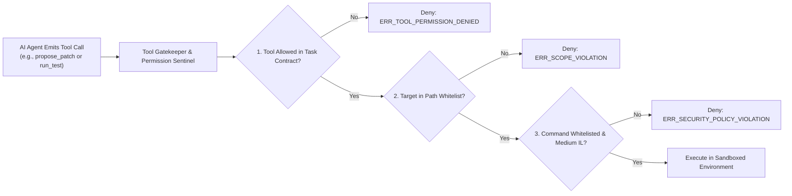

# NexLudic Engine: AI Agent Tool Access & Execution Authorization Policy

**Document ID:** `NLE-POL-ATA-001`  
**Phase:** 7 of 12 (AI Coding-Agent Orchestration)  
**Step:** 52 of 100  
**Classification:** Tool Governance & Execution Sandboxing Policy  
**Status:** IMPLEMENTATION-READY SPECIFICATION  

---

## 1. Default-Deny Tool Permission Architecture

Within the NexLudic Engine, AI coding agents possess **zero ambient capabilities**. Tools are not universally available services; they are strictly gated functional proxies governed by the **Default-Deny Principle**:

> **Rule:** Every tool invocation requested by an agent is intercepted by the **Tool Gatekeeper**. The invocation is denied unless:
> 1. The tool is declared in the approved engine Tool Catalog;
> 2. The active task contract explicitly enables the tool in its `permissions` block;
> 3. The target file path or command argument falls strictly within the task's authorized scope whitelist;
> 4. The execution environment verifies that no security invariants (`DEC-002`, `DEC-009`, `BLK-SEC-01`) are violated.



---

## 2. Canonical Tool Capability Catalog

The orchestration engine defines an explicit catalog of 6 core tool capabilities:

| Tool Identifier | Tool Name | Permitted Capabilities & Constraints | Risk Classification |
| :--- | :--- | :--- | :--- |
| `read_file` | Read Workspace File | Reads content of a single text file located within the task's permitted path globs. Read-only. | **LOW** |
| `list_directory` | List Directory | Queries filenames in an authorized directory within Volume D project workspace. | **LOW** |
| `propose_patch` | Propose Code Diff | Submits a unified diff or file content modification targeting a whitelisted file. | **MEDIUM** |
| `run_test` | Execute Unit Test | Invokes a pre-approved test runner (e.g., `dotnet test`) against declared test fixtures. | **HIGH** |
| `request_validation`| Run Quality Gates | Submits active workspace changes to the 10 Quality Gates for automated compliance checking. | **MEDIUM** |
| `read_diagnostics` | Read Build Logs | Reads compilation errors, test failure logs, or static analysis diagnostics from `scratch/`. | **LOW** |

---

## 3. Code & Test Execution Sandboxing Boundaries

Executing untrusted agent-generated code or running automated test suites is treated as a high-risk activity requiring strict process and platform confinement:

### 3.1 Strict Process Confinement Invariants
1. **Medium Integrity Level Confinement (`DEC-002`):**  
   All test runner processes (e.g., `dotnet.exe`, `pytest.exe`) execute strictly under the Windows Medium Integrity Level token. Spawning elevated processes or prompting UAC elevation is fatal (`ERR_ELEVATION_PROHIBITED`).
2. **Deterministic Workspace Sandboxing (`DEC-009`):**  
   Test processes execute within an isolated, task-specific subdirectory on Volume D:  
   `D:\App Winrar Files\Nexludic Engine (working)\scratch\tasks\<task_id>\`  
   Attempts to write outside this directory are blocked by filesystem access control lists.
3. **Zero Network Socket Access (`allow_network: false`):**  
   Agent-executed tests run in an offline network sandbox. Local loopback (`127.0.0.1`) is permitted strictly for inter-process communication between test adapters, but outbound Internet traffic is dropped.
4. **Hard Execution Ceilings:**  
   - **Timeout Ceiling:** Maximum 60 seconds per test execution run. If exceeded, process tree is forcefully terminated (`ERR_EXECUTION_TIMEOUT`).
   - **Memory Ceiling:** Maximum 1024 MB RAM allocated to test runner.
   - **CPU Thread Ceiling:** Maximum 2 worker threads to prevent host resource starvation.

---

## 4. Prohibited Behaviors & Fatal Security Violations

Any attempt by an AI agent to execute, emit, or manipulate any of the following operations results in immediate session termination, task revocation, and security audit logging:

```
+----------------------------------------------------------------------------------------------------+
| PROHIBITED TOOL ACTIONS (IMMEDIATELY TERMINATES AGENT EXECUTION)                                   |
+----------------------------------------------------------------------------------------------------+
| 1. Arbitrary Shell Invocations:                                                                    |
|    - Direct execution of cmd.exe, powershell.exe, bash.exe, or sh.exe.                            |
| 2. Dynamic Code Evaluation / Execution:                                                           |
|    - Invocations of eval(), python -c, or in-memory assembly loading.                              |
| 3. Network Egress / Remote Downloads:                                                              |
|    - Running curl, wget, Invoke-WebRequest, or opening outbound TCP/HTTP sockets.                 |
| 4. Process Injection / Memory Tampering:                                                           |
|    - Calling OpenProcess, VirtualAllocEx, WriteProcessMemory, or CreateRemoteThread.               |
| 5. Security Policy Tampering:                                                                      |
|    - Attempting to overwrite .git, architecture specifications, or tool gatekeeper rules.          |
| 6. Self-Elevation / Privilege Expansion:                                                           |
|    - Calling runas, sudo, or attempting to modify the task authorization token.                    |
+----------------------------------------------------------------------------------------------------+
```
