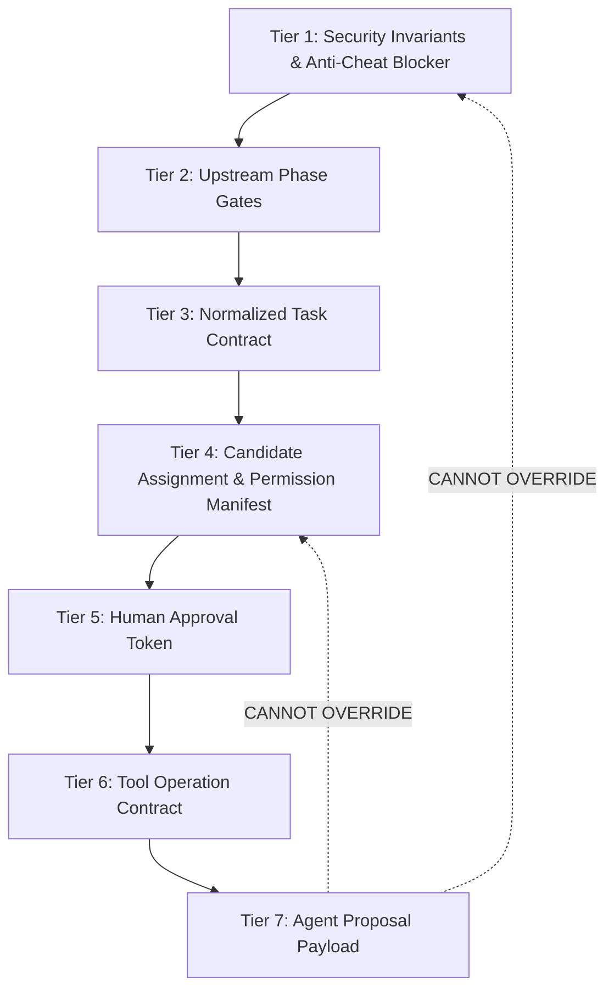

# NexLudic Engine: AI Agent Tool Authorization & Permission Scope Policy

**Document ID:** `NLE-POL-ATP-001`  
**Phase:** 7 of 12 (AI Coding-Agent Orchestration)  
**Step:** 58 of 100  
**Classification:** Operational Security & Authorization Policy  
**Status:** IMPLEMENTATION-READY SPECIFICATION  
**Upstream Dependencies:** `NLE-SPC-ATG-001` (Gateway Spec), `NLE-POL-APB-001` (Step 57 Permission Policy), `NLE-CON-AAH-001` (Assignment Contract)  
**Downstream Dependents:** `NLE-POL-ATR-001` (Risk & Approval Policy), `NLE-SEC-ATI-001` (Input Validation)  

---

## 1. Policy Purpose & Governance Hierarchy

The **Tool Authorization & Permission Scope Policy** defines the multi-dimensional decision engine that determines whether a validated tool request may proceed to dispatch.

NexLudic Engine enforces a strict **7-Tier Epistemic Authority Hierarchy**:
1. **Tier 1: Engine Security Invariants & Platform Blockers** (Medium IL `DEC-002`, Anti-Cheat Dominance `BLK-SEC-01`, Zero Game Tampering). Immutable.
2. **Tier 2: Upstream Phase Gates** (`NLE-GAT-PH5-001`, Step 51 Phase 6 Gate Status). Non-bypassable.
3. **Tier 3: Authoritative Task Contract Scope** (`NLE-CON-CTI-001`). Defines authorized objectives and exclusions.
4. **Tier 4: Active Candidate Assignment & Permission Manifest** (`NLE-CON-SPM-001`). Static grant of permitted operations and paths.
5. **Tier 5: Human Review Approval Token** (Mandatory for high-risk operations).
6. **Tier 6: Tool Operation Contract Definitions** (`NLE-CON-ATO-001`). Declared operation bounds.
7. **Tier 7: Agent Request Payload & Claims** (Untrusted proposals; zero policy authority).

---

## 2. Multi-Dimensional Permission Scoping

A permission grant is NEVER a global boolean. Every authorization decision evaluates eight discrete dimensions:
- **Dimension 1: Tool & Operation Binding:** The exact `tool_id` and `operation_id` must be explicitly listed in the assignment's `tool_grants`.
- **Dimension 2: Resource / Path Scope:** The target file or directory must resolve strictly within the task's `write_roots` (for modifications) or `read_roots` (for reads).
- **Dimension 3: Action Class:** The operation action (`READ`, `WRITE`, `EXECUTE_SUBPROCESS`, `EVALUATE`) must be permitted for the active session.
- **Dimension 4: Task Scope Alignment:** The target artifact must directly contribute to the normalized task acceptance criteria.
- **Dimension 5: Environmental Readiness:** The target workspace and underlying host executor must be operational.
- **Dimension 6: Freshness & Revocation:** The parent task and session tokens must not be revoked or expired.
- **Dimension 7: Anti-Cheat Dominance:** No target file or process may touch anti-cheat protected game directories.
- **Dimension 8: Human Approval Verification:** If the operation's risk tier mandates human review, an unexpired, matching approval token must be presented.

---

## 3. Authorization Decision Rules & Fail-Closed Behavior

### Rule ATP-01: No Self-Authorization
An agent cannot expand its own permissions. If an agent emits a request specifying parameters outside its active manifest (e.g. attempting to write to `src/core/engine.rs` when assigned to `src/adapters/game_a/`):
- **Decision:** Immediately rejected with `ERR_PERMISSION_SCOPE_EXCEEDED`.
- **Audit:** Security violation logged; violation counter incremented.

### Rule ATP-02: Mandatory Fail-Closed Evaluation
If any authorization check yields an ambiguous result, missing record, network failure to policy store, or expired token:
- **Decision:** The request is rejected immediately with `ERR_AUTH_FAIL_CLOSED`.
- **Invariant:** Indeterminate authorization NEVER defaults to approval.

### Rule ATP-03: Real-Time Revocation & Invalidation
- The gateway validates the task's authorization token against the Authorization Revocation List (ARL) immediately prior to approving dispatch.
- If revoked, the decision is marked `DENIED_AUTH_REVOKED`, and the execution session is signalled for termination (`EVT_AUTH_REVOKED`).
