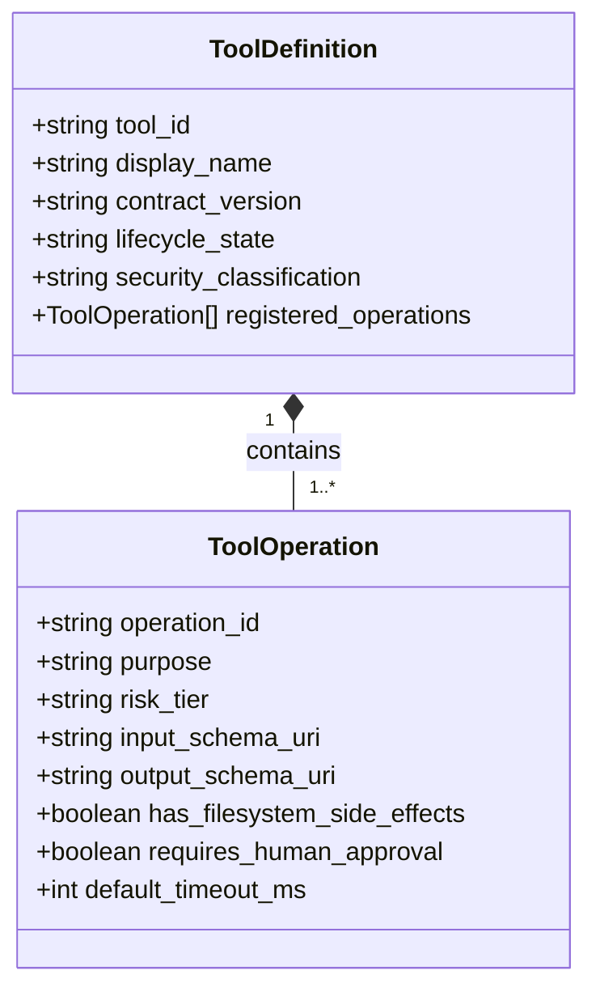
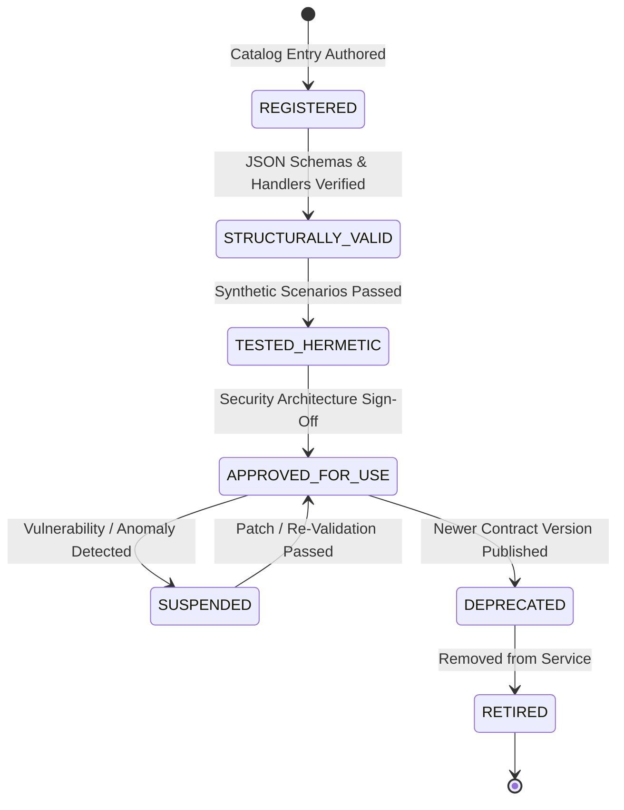

# NexLudic Engine: AI Agent Tool Catalog & Operation Contract

**Document ID:** `NLE-CON-ATO-001`  
**Phase:** 7 of 12 (AI Coding-Agent Orchestration)  
**Step:** 58 of 100  
**Classification:** Tool Contract & Catalog Specification  
**Status:** IMPLEMENTATION-READY SPECIFICATION  
**Upstream Dependencies:** `NLE-SPC-ATG-001` (Gateway Spec), `NLE-CON-ATC-001` (Step 57 Tool Control Boundary)  
**Downstream Dependents:** `NLE-MOD-ATO-001` (Domain Model), `NLE-SEC-ATI-001` (Input Validation)  

---

## 1. Tool Governance & Catalog Architecture

The **Tool Catalog** establishes the definitive registry of supported tools and their granular operations. A tool definition describes an approved interface exposed to AI coding agents.

### Deny-by-Default Governance
- An operation absent from the catalog is non-existent to the platform.
- Agents cannot dynamically register tools, propose synthetic tool definitions, or request generic "eval" tools.
- A tool's mere presence in the catalog confers **zero execution permission**. Permission requires explicit task binding, assignment authorization, and policy clearance.



---

## 2. Approved Tool Catalog & Operation Inventory

The engine exposes six canonical, sandboxed tool packages:

### 2.1 Tool: `tool:fs_read` (Filesystem Read Operations)
- **Tool ID:** `tool:fs_read` | **Contract Version:** `1.0.0` | **Classification:** `READ_ONLY`
- **Registered Operations:**
  1. `fs:read_file`: Reads text or binary content from an approved workspace file.
     - *Risk Tier:* Low | *Timeout:* 10,000 ms | *Max Buffer:* 2 MB
     - *Preconditions:* File exists, path canonicalized inside read whitelist.
  2. `fs:list_directory`: Lists directory entries, file metadata, and directory tree.
     - *Risk Tier:* Low | *Timeout:* 10,000 ms | *Max Depth:* 5
  3. `fs:file_stat`: Retrieves file size, timestamps, and SHA-256 hash.
     - *Risk Tier:* Low | *Timeout:* 5,000 ms

### 2.2 Tool: `tool:fs_write` (Filesystem Modification Operations)
- **Tool ID:** `tool:fs_write` | **Contract Version:** `1.0.0` | **Classification:** `WORKSPACE_MUTATION`
- **Registered Operations:**
  1. `fs:write_file`: Creates or overwrites a file inside the isolated scratch workspace.
     - *Risk Tier:* Medium | *Timeout:* 15,000 ms | *Max Payload:* 5 MB
     - *Preconditions:* Path strictly within `<workspace_root_path>`, not locked by another process.
  2. `fs:create_directory`: Creates directory structure inside scratch workspace.
     - *Risk Tier:* Low | *Timeout:* 5,000 ms
  3. `fs:delete_file`: Deletes an ephemeral file created during the active session.
     - *Risk Tier:* Medium-High | *Timeout:* 5,000 ms | *Approval Mandated:* If deleting outside `tmp/`.

### 2.3 Tool: `tool:git_ops` (Ephemeral Git Worktree Operations)
- **Tool ID:** `tool:git_ops` | **Contract Version:** `1.0.0` | **Classification:** `SOURCE_CONTROL`
- **Registered Operations:**
  1. `git:status`: Returns clean/dirty status and untracked files in the worktree.
     - *Risk Tier:* Low | *Timeout:* 10,000 ms
  2. `git:diff`: Computes unified diff against the session base commit.
     - *Risk Tier:* Low | *Timeout:* 15,000 ms
  3. `git:apply_patch`: Applies a structured unified diff patch to the worktree.
     - *Risk Tier:* Medium | *Timeout:* 20,000 ms | *Reversibility:* High (`git checkout`)

### 2.4 Tool: `tool:linter` (Static Code Analysis & Type Checking)
- **Tool ID:** `tool:linter` | **Contract Version:** `1.0.0` | **Classification:** `PROCESS_EXECUTION`
- **Registered Operations:**
  1. `lint:check_rust`: Executes `cargo check --message-format=json` in isolated worktree.
     - *Risk Tier:* Low | *Timeout:* 30,000 ms | *Job Object Bound:* Yes
  2. `lint:check_python`: Executes `mypy --output=json` in isolated worktree.
     - *Risk Tier:* Low | *Timeout:* 20,000 ms | *Job Object Bound:* Yes

### 2.5 Tool: `tool:test_runner` (Hermetic Unit Testing)
- **Tool ID:** `tool:test_runner` | **Contract Version:** `1.0.0` | **Classification:** `SANDBOXED_EXECUTION`
- **Registered Operations:**
  1. `test:run_unit`: Executes specified unit test target with network disabled.
     - *Risk Tier:* Medium | *Timeout:* 60,000 ms | *RAM Ceiling:* 2048 MB

### 2.6 Tool: `tool:schema_val` (Contract & Schema Validation)
- **Tool ID:** `tool:schema_val` | **Contract Version:** `1.0.0` | **Classification:** `DETERMINISTIC_EVAL`
- **Registered Operations:**
  1. `val:validate_contract`: Evaluates an adapter contract JSON against schema Draft 2020-12.
     - *Risk Tier:* Low | *Timeout:* 5,000 ms | *Side Effects:* None

---

## 3. Tool Lifecycle States



- **`APPROVED_FOR_USE`:** The only lifecycle state from which the gateway may authorize execution.
- If a tool is in any other state (e.g. `SUSPENDED` or `DEPRECATED`), requests fail at Stage 3 with `ERR_TOOL_NOT_APPROVED`.

---

## 4. Formal JSON Schema for Tool Operation Definition (`NLE-SCH-TOP-001`)

```json
{
  "$schema": "https://json-schema.org/draft/2020-12/schema",
  "$id": "https://schemas.nexludic.com/v1/orchestration/tool-operation-contract.json",
  "title": "NexLudicToolOperationContract",
  "type": "object",
  "required": [
    "schema_version",
    "tool_id",
    "operation_id",
    "contract_version",
    "purpose",
    "risk_tier",
    "input_schema_uri",
    "output_schema_uri",
    "default_timeout_ms"
  ],
  "properties": {
    "schema_version": { "type": "string", "const": "1.0.0" },
    "tool_id": { "type": "string", "pattern": "^tool:[a-z0-9_]+$" },
    "operation_id": { "type": "string", "pattern": "^[a-z0-9_]+:[a-z0-9_]+$" },
    "contract_version": { "type": "string", "pattern": "^[0-9]+\.[0-9]+\.[0-9]+$" },
    "purpose": { "type": "string" },
    "risk_tier": { "type": "string", "enum": ["LOW_READ", "LOW_METADATA", "MEDIUM_MUTATION", "HIGH_IMPACT", "CRITICAL_SYSTEM"] },
    "input_schema_uri": { "type": "string", "format": "uri" },
    "output_schema_uri": { "type": "string", "format": "uri" },
    "has_filesystem_side_effects": { "type": "boolean" },
    "requires_human_approval": { "type": "boolean" },
    "default_timeout_ms": { "type": "integer", "minimum": 1000, "maximum": 300000 }
  },
  "additionalProperties": false
}
```
