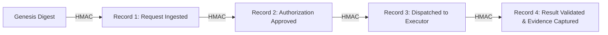

# NexLudic Engine: AI Agent Tool Execution Audit & Diagnostic Contract

**Document ID:** `NLE-CON-ATA-001`  
**Phase:** 7 of 12 (AI Coding-Agent Orchestration)  
**Step:** 58 of 100  
**Classification:** Audit Logging & Forensic Diagnostics Contract  
**Status:** IMPLEMENTATION-READY SPECIFICATION  
**Upstream Dependencies:** `NLE-MOD-ATO-001` (Domain Model), `NLE-CON-AAD-001` (Step 57 Audit Contract)  
**Downstream Dependents:** Step 58 Test Plan, Step 59 (Human Review UI)  

---

## 1. Audit Logging Architecture & Cryptographic Chaining

Every tool invocation request, authorization evaluation, dispatch event, and execution outcome is permanently recorded to an append-only JSON Lines ledger:
`.nexludic/audit/tools/<session_id>.jsonl`

### Cryptographic Chaining Specification
To guarantee that records cannot be retroactively modified, reordered, or deleted:
$$\text{record\_hash}_n = \text{HMAC-SHA256}(\text{record\_hash}_{n-1} \parallel \text{payload\_json}_n)$$
Where `record_hash_0` is initialized to the session genesis digest.



---

## 2. Audit Record Schema (`NLE-SCH-TAU-001`)

```json
{
  "$schema": "https://json-schema.org/draft/2020-12/schema",
  "$id": "https://schemas.nexludic.com/v1/orchestration/tool-audit-record.json",
  "title": "NexLudicToolAuditRecord",
  "type": "object",
  "required": [
    "audit_id",
    "session_id",
    "invocation_id",
    "sequence_id",
    "timestamp",
    "event_type",
    "tool_id",
    "operation_id",
    "decision_verdict",
    "execution_duration_ms",
    "prev_hash",
    "record_hash"
  ],
  "properties": {
    "audit_id": { "type": "string", "pattern": "^tau-[0-9a-f]{8}-[0-9a-f]{4}-4[0-9a-f]{3}-[89ab][0-9a-f]{3}-[0-9a-f]{12}$" },
    "session_id": { "type": "string" },
    "invocation_id": { "type": "string" },
    "sequence_id": { "type": "integer", "minimum": 1 },
    "timestamp": { "type": "string", "format": "date-time" },
    "event_type": { "type": "string", "enum": ["REQUEST_INGESTED", "AUTH_EVALUATED", "DISPATCHED", "RESULT_VALIDATED", "DISPATCH_FAILED", "EXECUTION_DENIED"] },
    "tool_id": { "type": "string" },
    "operation_id": { "type": "string" },
    "decision_verdict": { "type": "string", "enum": ["APPROVED", "DENIED", "HELD_FOR_HUMAN_APPROVAL"] },
    "execution_duration_ms": { "type": "integer", "minimum": 0 },
    "side_effect_digest": { "type": "string" },
    "prev_hash": { "type": "string", "pattern": "^[0-9a-f]{64}$" },
    "record_hash": { "type": "string", "pattern": "^[0-9a-f]{64}$" }
  },
  "additionalProperties": false
}
```

---

## 3. Diagnostic Bundle Integration & Data Privacy

1. **Local Forensic Storage:** Audit ledgers are stored exclusively on local disk (`%LOCALAPPDATA%\NexLudic\audit\tools\`).
2. **Retention Policy:** Retained for **30 days** before automatic local archiving.
3. **Zero Secret Leakage:** Tool inputs and outputs in audit records are scrubbed by the secret redaction engine before disk commit.
4. **Diagnostic Export:** When an error occurs, the gateway bundles the invocation request, authorization record, executor stderr, and partial diff into `tool_diag_<invocation_id>.zip` for developer inspection.
