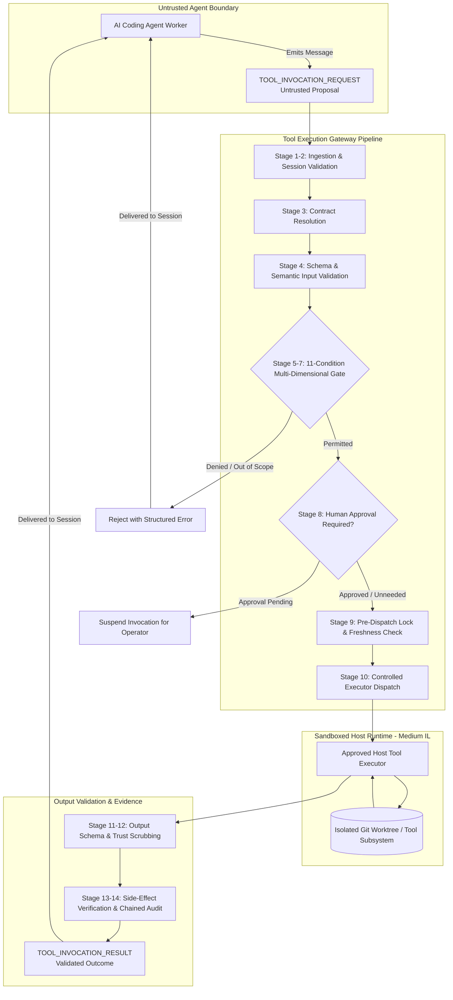

# NexLudic Engine: AI Agent Tool Execution Gateway & Permission Enforcement Specification

**Document ID:** `NLE-SPC-ATG-001`  
**Phase:** 7 of 12 (AI Coding-Agent Orchestration)  
**Step:** 58 of 100  
**Classification:** Core Execution Gateway Specification  
**Status:** IMPLEMENTATION-READY SPECIFICATION  
**Upstream Dependencies:** `NLE-SPC-ASL-001` (Step 57 Session Lifecycle), `NLE-CON-ATC-001` (Step 57 Tool Boundary), `NLE-POL-APB-001` (Step 57 Permission Policy), `NLE-CON-HAR-001` (Step 56 Handoff), `NLE-GAT-PH5-001` (Step 42 Phase 5 Gate), Step 51 Gate Audit (UNVERIFIED / BLOCKED)  
**Downstream Dependents:** Step 59 (Human Review & Auditing UI), Step 60 (Phase 7 Orchestration Gate)  

---

## 1. Executive Summary & Purpose

The **AI Agent Tool Execution Gateway & Permission Enforcement Specification** defines the authoritative runtime control boundary separating an AI agent's proposed actions from host execution.

In modern agentic architectures, an AI coding agent acts as a non-deterministic generator of intent. While an agent can synthesize instructions, file edits, and tool requests, it is fundamentally an **untrusted entity**. Under the NexLudic Engine architecture, an agent never possesses ambient authority, direct access to the host operating system, raw socket creation capability, or unfettered terminal shells.

The **Tool Execution Gateway** intercepts every tool invocation request emitted by an agent, validates its cryptographic session lineage, normalizes and verifies input arguments against strict JSON schemas, evaluates multi-dimensional task and security policies, verifies explicit human approvals where mandated, dispatches authorized operations to sandboxed host executors, validates output payloads, captures cryptographic evidence of side effects, and records tamper-evident audit records.

---

## 2. Core Architectural Invariants

The Tool Execution Gateway is governed by seven non-negotiable architectural invariants:

1. **`INV-ATG-01: Zero Direct Execution`**  
   An AI agent possesses zero ambient execution authority. An agent can never invoke shell interpreters (`cmd.exe`, `powershell.exe`, `bash`), Win32 APIs, filesystem APIs, or network sockets directly. All operations are mediated through host-brokered gateway dispatch.
2. **`INV-ATG-02: Non-Collapsible 11-Condition Evaluation`**  
   The system explicitly distinguishes the 11 discrete conditions governing an action (Section 3). These conditions must NEVER be collapsed into a single boolean (such as `allowed` or `toolAvailable`).
3. **`INV-ATG-03: Granular Operation-Level Authorization`**  
   Permissions are never granted at a broad tool level. Every authorization grant is strictly scoped to a specific `operation_id`, bounded by path whitelists, argument constraints, and risk classifications.
4. **`INV-ATG-04: Fail-Closed Gateway Directives`**  
   Any missing token, ambiguous schema match, unverified path, expired lease, or unhandled exception immediately halts dispatch and returns a structured denial (`ERR_GATEWAY_FAIL_CLOSED`).
5. **`INV-ATG-05: Untrusted Tool Output & Explicit Uncertainty`**  
   Output returned by a tool or executor is untrusted external data. Output is schema-validated, scrubbed for prompt injection, and checked for secrets. If an operation times out or response is lost, the outcome is marked `UNCERTAIN` and preserved until formally reconciled.
6. **`INV-ATG-06: Windows Medium IL & Anti-Cheat Dominance`**  
   The gateway and executors operate strictly at **Windows Medium Integrity Level** (`DEC-002`). Zero UAC escalation, zero kernel drivers, zero DLL injection, and zero memory access to third-party game processes (`BLK-SEC-01`).
7. **`INV-ATG-07: Separation of Claims from Verified Truth`**  
   An executor or agent asserting that an operation succeeded does not constitute system truth. State-changing operations require independent physical verification (e.g. disk inode hash, git worktree diff verification) before success is committed.

---

## 3. The 11 Non-Collapsible Conditions of Invocation

A critical design failure in naive tool execution layers is collapsing complex authorization, technical capability, and environmental readiness into a single flag. NexLudic Engine models and records each condition independently:

| Condition # | Architectural Dimension | Evaluator / Source of Truth | Independent Evaluation Criteria |
| :---: | :--- | :--- | :--- |
| **C1** | **Agent Description** | Agent Message Payload | The agent asserts or describes an intended action in natural language or reasoning trace. |
| **C2** | **Tool Invocation Request** | Inbound Gateway Ingest | The agent emits a structured, well-formed invocation request message (`NLE-CON-TRQ-001`). |
| **C3** | **Tool Operation Declaration** | Registered Tool Catalog | The registered tool definition explicitly declares support for the requested `operation_id` and contract version. |
| **C4** | **Task Requirement** | Normalized Task Contract | The authoritative normalized task contract (`NLE-CON-CTI-001`) actually requires this operation to fulfill objectives. |
| **C5** | **Environment Technical Support** | Runtime Environment (`NLE-ENT-RTE-001`) | The underlying OS, filesystem, and host software stack possess the physical capability to execute the tool. |
| **C6** | **Platform Security Policy** | Platform Security Governance | Engine-wide security policy (`DEC-002`, `BLK-SEC-01`) permits the operation (e.g. anti-cheat driver not active). |
| **C7** | **Assignment Authorization** | Candidate Assignment Contract | The active candidate assignment (`NLE-CON-AAH-001`) explicitly grants this specific operation in its permission manifest. |
| **C8** | **Human Approval Status** | Human Review Workflow | Required human approval for high-risk operations has been explicitly recorded and verified. |
| **C9** | **Gateway Authorization** | Tool Execution Gateway Evaluator | Pre-dispatch validation confirms token freshness, path containment, and lack of concurrent conflict. |
| **C10** | **Executor Dispatch** | Sandboxed Host Executor | The approved executor accepts the validated payload and initiates execution within the isolated workspace. |
| **C11** | **Outcome Verification** | Post-Execution Evidence Engine | Independent evidence (file hash, exit code, diff) confirms that the operation achieved its intended outcome. |

---

## 4. Structural Specification Decomposition

The Step 58 specification suite consists of 15 interlocking documents in `docs/ai-orchestration/`:

| Deliverable | Document ID | Purpose |
| :--- | :--- | :--- |
| **Deliverable 1** | `NLE-SPC-ATG-001` | Master Gateway Specification & Architectural Overview (This Document) |
| **Deliverable 2** | `NLE-CON-ATO-001` | Tool Catalog & Operation Contract Specification |
| **Deliverable 3** | `NLE-MOD-ATO-001` | Tool Invocation Request & Result Domain Model |
| **Deliverable 4** | `NLE-POL-ATP-001` | Tool Authorization & Permission Scope Policy |
| **Deliverable 5** | `NLE-POL-ATR-001` | Tool Risk Classification & Approval Policy |
| **Deliverable 6** | `NLE-SEC-ATI-001` | Tool Input Validation & Resource Boundary Specification |
| **Deliverable 7** | `NLE-POL-ATF-001` | Filesystem, Repository & Workspace Operation Policy |
| **Deliverable 8** | `NLE-SEC-ATE-001` | Process, Network & External Service Execution Boundary |
| **Deliverable 9** | `NLE-CON-ATV-001` | Tool Output Validation & Side-Effect Evidence Contract |
| **Deliverable 10** | `NLE-POL-ATI-001` | Tool Timeout, Retry, Idempotency & Concurrency Policy |
| **Deliverable 11** | `NLE-SEC-ATT-001` | Tool Execution Security Threat Model & Mitigations |
| **Deliverable 12** | `NLE-CON-ATA-001` | Tool Execution Audit & Diagnostic Contract |
| **Deliverable 13** | `NLE-CAT-ATS-001` | Tool Execution Synthetic Scenarios & Test Plan (Scenarios A through Z) |
| **Deliverable 14** | `NLE-MAT-STP-058` | Requirements Traceability Matrix (`ATG-REQ-001..032`) |
| **Deliverable 15** | `NLE-REP-STP-058` | Step 58 Completion & Verification Report |

---

## 5. Relationship to Upstream Gates & Phases

### 5.1 Phase 6 Mashup Planning Gate Status
The Phase 6 Mashup Integration Planning gate (Step 51) remains `UNVERIFIED / MISSING FORMAL SIGN-OFF`.
- **Gateway Enforcement:** Any tool invocation request targeting cross-game runtime workflow execution, multi-game plan deployment, or game-process hooking derived from Step 48/49 integration plans is **FAIL-CLOSED REJECTED** at Stage 5 with error `ERR_PRECONDITION_PHASE6_UNVERIFIED`.
- **Exemptions:** Discrete developer-assistance tool operations (e.g. reading isolated source files, authoring unit tests, compiling adapter serialization code fulfilling Phase 5 condition `P5-C01`) are permitted within isolated workspaces.

### 5.2 Phase 5 Universal Adapter SDK Gate Status
The Phase 5 Universal Adapter SDK Gate (`NLE-GAT-PH5-001`) holds status `READY WITH CONDITIONS` (`P5-C01`, `P5-C02`, `P5-C03`).
- The Tool Execution Gateway verifies that adapter scaffolding tools enforce wire protocol serialization validation (`P5-C01`) and memory safety bounds (`P5-C02`).
