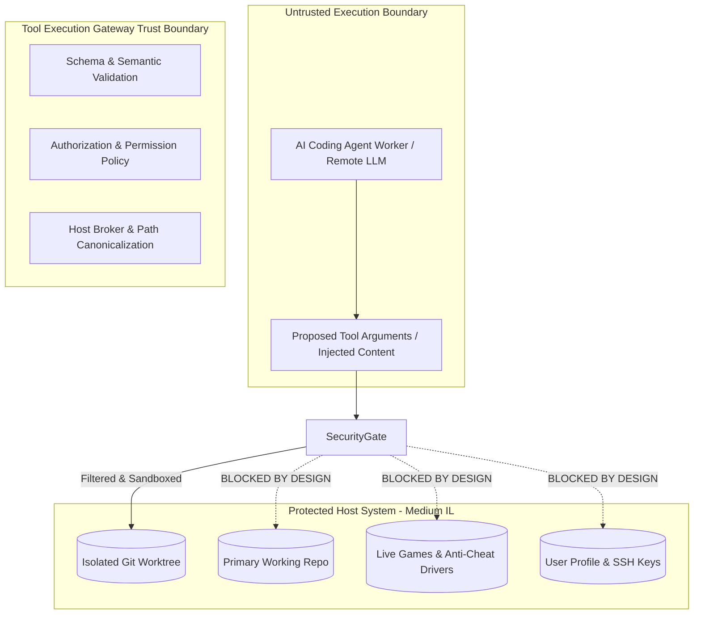

# NexLudic Engine: AI Agent Tool Execution Security Threat Model

**Document ID:** `NLE-SEC-ATT-001`  
**Phase:** 7 of 12 (AI Coding-Agent Orchestration)  
**Step:** 58 of 100  
**Classification:** Security Architecture & Threat Matrix  
**Status:** IMPLEMENTATION-READY SPECIFICATION  
**Upstream Dependencies:** `NLE-SPC-ATG-001` (Gateway Spec), `NLE-SEC-ARI-001` (Step 57 Isolation Boundary)  
**Downstream Dependents:** `NLE-CAT-ATS-001` (Synthetic Scenarios), Step 58 Traceability Matrix  

---

## 1. Threat Modeling Methodology & Trust Boundaries

The Tool Execution Gateway establishes an immutable security perimeter separating the **Untrusted Agent Boundary** from the **Protected Host Environment**.

---

## 2. Comprehensive Threat Matrix (Threats T-01 through T-23)

| Threat ID | Threat Name | Assets at Risk | Attack Vector / Mechanism | Mandatory Mitigation & Trusted Enforcement | Validating Scenario |
| :--- | :--- | :--- | :--- | :--- | :---: |
| **T-01** | **Prompt Injection via Input** | File system, Platform integrity | Malicious instructions hidden in comments or tool args. | Declarative JSON schema; no code execution during validation. | Scenario K |
| **T-02** | **Malicious Tool Arguments** | Host stability, Workspace integrity | Extremely long strings, invalid unicode, shell metachars. | Schema string length bounds, strict regex character whitelists. | Scenario E |
| **T-03** | **Unauthorized Tool Invocation** | System resources, File integrity | Agent requests tools not registered or authorized. | Deny-by-default catalog resolution; fail-closed authorization. | Scenario C |
| **T-04** | **Agent Identity Spoofing** | Audit ledger, Task boundaries | Request claims another session's identity or credentials. | Gateway derives identity strictly from cryptographic session token. | Scenario W |
| **T-05** | **Forged / Replayed Requests** | Workspace state, Audit trail | Replaying an old invocation request with new parameters. | Monotonic sequence numbering and deduplication hashes. | Scenario N |
| **T-06** | **Stale Authorization** | Repository files, Task governance | Utilizing an authorization token whose task was revoked. | Real-time 5s ARL polling; pre-dispatch token revalidation. | Scenario G |
| **T-07** | **Confused-Deputy Attack** | Primary repo, System files | Agent tricks host executor into modifying protected files. | Win32 path canonicalization; bounding to `<workspace_root_path>`. | Scenario B |
| **T-08** | **Privilege Escalation** | Host OS, Administrator privileges | Invoking `runas.exe`, triggering UAC, loading drivers. | Fixed Medium IL (`DEC-002`); stripped process tokens. | Scenario K |
| **T-09** | **Path Traversal Escape** | `%USERPROFILE%`, Windows system files | Using `../` or encoded traversal sequences in paths. | Canonicalization via `GetFullPathNameW`; boundary prefix check. | Scenario L |
| **T-10** | **Symlink / Junction Escape** | Host drive, User documents | Creating NTFS reparse points to bridge out of workspace. | Gateway detects and blocks all NTFS junction points and symlinks. | Scenario L |
| **T-11** | **Command Injection** | Host shell, Process boundaries | Appending `; rm -rf /` or `& net user` to arguments. | Zero raw shell execution; typed arguments passed directly to Win32. | Scenario K |
| **T-12** | **Argument Injection** | Compiler/test sub-processes | Passing flags like `--output-file C:\Windows\...`. | Argument regex whitelisting; flags restricted to approved set. | Scenario E |
| **T-13** | **Untrusted Code Execution** | Host CPU/RAM, Local files | Agent attempts to compile and run arbitrary malware. | Sandboxed Job Object (`KILL_ON_JOB_CLOSE`); network disabled. | Scenario H |
| **T-14** | **Malicious Tool Output** | Agent reasoning, Session safety | Compiler output containing adversarial prompt injections. | Output scrubbed, truncated; untrusted data classification. | Scenario J |
| **T-15** | **Secret Exposure in Results** | Cloud API keys, User SSH keys | Tool reads an inadvertent secret and echoes to logs. | Regex secret redaction engine sanitizes output buffers. | Scenario S |
| **T-16** | **Unauthorized Network Access** | Local network, Cloud metadata | Tool calls opening raw TCP sockets or making HTTP calls. | Default-deny air-gapped network boundary; port 443 whitelist only. | Scenario S |
| **T-17** | **Duplicate State Mutations** | Git worktree, Build state | Rapid re-submission of identical write operations. | Deduplication key caching; mutual-exclusion invocation lock. | Scenario N |
| **T-18** | **Policy Evasion via Tools** | Security policy, Filesystem | Trying `tool:git_ops` after `tool:fs_write` is denied. | Global path whitelist enforced uniformly across all tools. | Scenario C |
| **T-19** | **Approval Substitution** | High-impact operations, Deletions | Using an approval token from Task A to execute on Task B. | Approval tokens cryptographically bound to invocation UUID and hash. | Scenario I |
| **T-20** | **Audit Ledger Tampering** | Audit integrity, Forensic trace | Agent attempts to delete or alter `.nexludic/audit/`. | Append-only audit store; chained HMAC-SHA256 signatures. | Scenario T |
| **T-21** | **Resource Exhaustion (DoS)** | Desktop responsiveness, Host RAM | Spawning fork bombs or writing gigabytes to disk. | Windows Job Object RAM/Process limits; disk write quotas. | Scenario M |
| **T-22** | **Executor Compromise** | Supervisor process, Host OS | Sub-process exploits vulnerability in compiler binary. | Process isolation in Job Object; execution at Below Normal priority. | Scenario P |
| **T-23** | **Cross-Session Data Leakage**| Multi-task isolation, Secrets | Agent reads artifacts created by another active task. | Unique workspace per session; directory access strictly partitioned. | Scenario W |

---

## 3. Trusted Enforcement Invariant

All mitigations in the matrix are enforced by **trusted host code and Windows kernel controls** (`INV-ATG-01`, `DEC-002`, `BLK-SEC-01`). The system NEVER relies on natural-language system prompts or agent self-restraint to maintain security boundaries.
