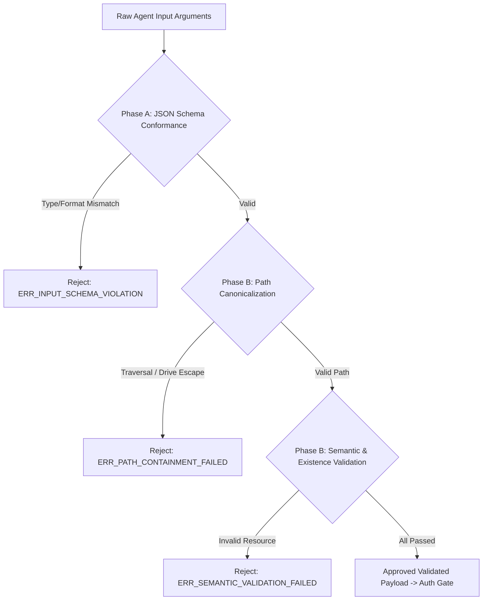

# NexLudic Engine: AI Agent Tool Input Validation & Resource Boundary Specification

**Document ID:** `NLE-SEC-ATI-001`  
**Phase:** 7 of 12 (AI Coding-Agent Orchestration)  
**Step:** 58 of 100  
**Classification:** Input Security & Path Containment Specification  
**Status:** IMPLEMENTATION-READY SPECIFICATION  
**Upstream Dependencies:** `NLE-CON-ATO-001` (Tool Catalog), `NLE-POL-ATP-001` (Permission Scope Policy)  
**Downstream Dependents:** `NLE-POL-ATF-001` (Filesystem Policy), `NLE-SEC-ATT-001` (Threat Model)  

---

## 1. Input Validation Architecture

All input arguments supplied by an AI coding agent must undergo rigorous **two-phase validation** before any authorization evaluation or host executor dispatch:
1. **Structural Validation (Phase A):** Strict schema conformance against the operation's registered JSON Schema (Draft 2020-12).
2. **Semantic & Path Containment Validation (Phase B):** Canonicalization, path containment verification, symlink escape detection, and resource existence validation.

---

## 2. Structural Schema Validation (Phase A)

- **Strict Property Whitelisting:** Every operation schema enforces `"additionalProperties": false`. Any unknown, deprecated, or injected JSON key triggers immediate rejection (`ERR_UNKNOWN_ARGUMENT_KEY`).
- **Type Safety & Bounds:** String lengths, array element counts, and numeric bounds are strictly enforced (e.g. `max_length: 5242880` for file content strings).
- **No Evaluation During Validation:** Input validation is purely declarative. The gateway NEVER executes an untrusted script, regex with polynomial complexity, or command string to determine its validity.

---

## 3. Path Containment & Canonicalization Rules (Phase B)

To guarantee that file operations cannot escape the designated scratch workspace:

### Rule ATI-01: Win32 Path Normalization
Before evaluating any path parameter:
1. Normalize path separators to Windows backslashes (`\\`).
2. Resolve relative navigation segments (`.` and `..`) using canonical Win32 `GetFullPathNameW`.
3. Check for Unicode homoglyph attacks or illegal Win32 device names (`CON`, `PRN`, `AUX`, `NUL`, `COM1..9`, `LPT1..9`).

### Rule ATI-02: Workspace Boundary Bounding
The normalized canonical path must satisfy:
$$\text{normalized\_path} = \text{workspace\_root\_path} \parallel \text{relative\_subpath}$$
- If the normalized path does not start with `<workspace_root_path>`, it is flagged as an escape attempt (`ERR_PATH_CONTAINMENT_FAILED`).
- Drive letters outside the workspace drive, UNC paths (`\\server\share`), and NTFS Alternate Data Streams (`file.txt:stream`) are permanently rejected.

### Rule ATI-03: Symlink and Reparse Point Neutralization
- The gateway verifies that no intermediate directory in the path is an NTFS reparse point or symbolic link pointing outside the workspace boundary.
- If a junction point is detected, the operation is blocked (`ERR_SYMLINK_ESCAPE_DETECTED`).
