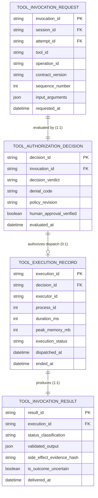

# NexLudic Engine: AI Agent Tool Invocation Request & Result Domain Model

**Document ID:** `NLE-MOD-ATO-001`  
**Phase:** 7 of 12 (AI Coding-Agent Orchestration)  
**Step:** 58 of 100  
**Classification:** Core Domain Model & Schema Specification  
**Status:** IMPLEMENTATION-READY SPECIFICATION  
**Upstream Dependencies:** `NLE-SPC-ATG-001` (Gateway Spec), `NLE-MOD-ASL-001` (Step 57 Session Domain Model)  
**Downstream Dependents:** `NLE-POL-ATP-001` (Permission Policy), `NLE-CON-ATV-001` (Result Evidence)  

---

## 1. Domain Entity Architecture

The Tool Invocation subsystem defines four distinct records spanning the lifecycle of an operation trial:
1. **Tool Invocation Request (`NLE-ENT-TRQ-001`):** The structured intent emitted by the agent.
2. **Tool Authorization Decision (`NLE-ENT-TAD-001`):** The authoritative decision produced by the gateway.
3. **Tool Execution Record (`NLE-ENT-TXR-001`):** The factual record of executor dispatch and telemetry.
4. **Tool Invocation Result (`NLE-ENT-TRS-001`):** The validated outcome returned to the session.



---

## 2. Entity Specifications

### 2.1 Tool Invocation Request (`NLE-ENT-TRQ-001`)
- **Immutability:** Strictly Immutable.
- **Attributes:**
  - `invocation_id`: Unique identifier (`inv-[0-9a-f]{8}-[0-9a-f]{4}-4[0-9a-f]{3}-[89ab][0-9a-f]{3}-[0-9a-f]{12}`).
  - `session_id`: Parent execution session ID (`exs-...`).
  - `attempt_id`: Active execution attempt ID (`exa-...`).
  - `task_id`: Authoritative normalized task contract ID (`tsk-...`).
  - `tool_id`: Target tool identifier (`tool:fs_write`).
  - `operation_id`: Target operation identifier (`fs:write_file`).
  - `contract_version`: SemVer string (`1.0.0`).
  - `sequence_number`: Monotonic session event sequence number.
  - `input_arguments`: Structured JSON dictionary matching input schema.
  - `requested_at`: ISO 8601 UTC timestamp.

### 2.2 Tool Authorization Decision (`NLE-ENT-TAD-001`)
- **Immutability:** Strictly Immutable.
- **Attributes:**
  - `decision_id`: Unique identifier (`tad-[0-9a-f]{8}...`).
  - `invocation_id`: Reference to parent request.
  - `decision_verdict`: Enum (`APPROVED`, `DENIED`, `HELD_FOR_HUMAN_APPROVAL`, `BLOCKED_BY_DEPENDENCY`).
  - `denial_code`: Standardized error code if denied (`ERR_PERMISSION_SCOPE_EXCEEDED`, etc.).
  - `evaluated_conditions`: Bitfield / array recording outcomes of Conditions C1 through C9.
  - `human_approval_token`: Cryptographic reference to human review approval if required.
  - `evaluated_at`: Timestamp of policy decision.

### 2.3 Tool Execution Record (`NLE-ENT-TXR-001`)
- **Attributes:**
  - `execution_id`: Unique identifier (`txr-[0-9a-f]{8}...`).
  - `decision_id`: Reference to approved authorization decision.
  - `executor_id`: Concrete executor identifier (`host:fs_executor`, `host:job_runner`).
  - `process_id`: OS PID of worker if sub-process launched.
  - `execution_status`: Enum (`RUNNING`, `SUCCEEDED`, `FAILED_EXECUTOR_ERROR`, `TIMED_OUT`, `CANCELLED`).
  - `duration_ms`: Wall-clock execution time in milliseconds.
  - `peak_memory_mb`: Measured peak RAM consumption.
  - `dispatched_at`: Timestamp when executor received call.
  - `ended_at`: Timestamp when executor exited.

### 2.4 Tool Invocation Result (`NLE-ENT-TRS-001`)
- **Attributes:**
  - `result_id`: Unique identifier (`trs-[0-9a-f]{8}...`).
  - `execution_id`: Reference to execution record.
  - `status_classification`: Enum (`CONFIRMED_SUCCESS`, `CONFIRMED_FAILURE`, `DENIED`, `UNCERTAIN_TIMEOUT`, `CANCELLED`).
  - `validated_output`: Scrubbed, schema-validated JSON payload returned to agent.
  - `side_effect_evidence_hash`: SHA-256 digest of post-execution diff or disk snapshot.
  - `is_outcome_uncertain`: Boolean flag indicating whether side-effect status is unconfirmed.
  - `delivered_at`: Timestamp when delivered to session event stream.

---

## 3. Formal JSON Schema for Tool Invocation Request (`NLE-SCH-TRQ-001`)

```json
{
  "$schema": "https://json-schema.org/draft/2020-12/schema",
  "$id": "https://schemas.nexludic.com/v1/orchestration/tool-invocation-request.json",
  "title": "NexLudicToolInvocationRequest",
  "type": "object",
  "required": [
    "schema_version",
    "invocation_id",
    "session_id",
    "attempt_id",
    "task_id",
    "tool_id",
    "operation_id",
    "contract_version",
    "sequence_number",
    "input_arguments",
    "requested_at"
  ],
  "properties": {
    "schema_version": { "type": "string", "const": "1.0.0" },
    "invocation_id": { "type": "string", "pattern": "^inv-[0-9a-f]{8}-[0-9a-f]{4}-4[0-9a-f]{3}-[89ab][0-9a-f]{3}-[0-9a-f]{12}$" },
    "session_id": { "type": "string", "pattern": "^exs-[0-9a-f]{8}-[0-9a-f]{4}-4[0-9a-f]{3}-[89ab][0-9a-f]{3}-[0-9a-f]{12}$" },
    "attempt_id": { "type": "string", "pattern": "^exa-[0-9a-f]{8}-[0-9a-f]{4}-4[0-9a-f]{3}-[89ab][0-9a-f]{3}-[0-9a-f]{12}$" },
    "task_id": { "type": "string", "pattern": "^tsk-[0-9a-f]{8}-[0-9a-f]{4}-4[0-9a-f]{3}-[89ab][0-9a-f]{3}-[0-9a-f]{12}$" },
    "tool_id": { "type": "string", "pattern": "^tool:[a-z0-9_]+$" },
    "operation_id": { "type": "string", "pattern": "^[a-z0-9_]+:[a-z0-9_]+$" },
    "contract_version": { "type": "string", "pattern": "^[0-9]+\.[0-9]+\.[0-9]+$" },
    "sequence_number": { "type": "integer", "minimum": 1 },
    "input_arguments": { "type": "object" },
    "requested_at": { "type": "string", "format": "date-time" }
  },
  "additionalProperties": false
}
```
