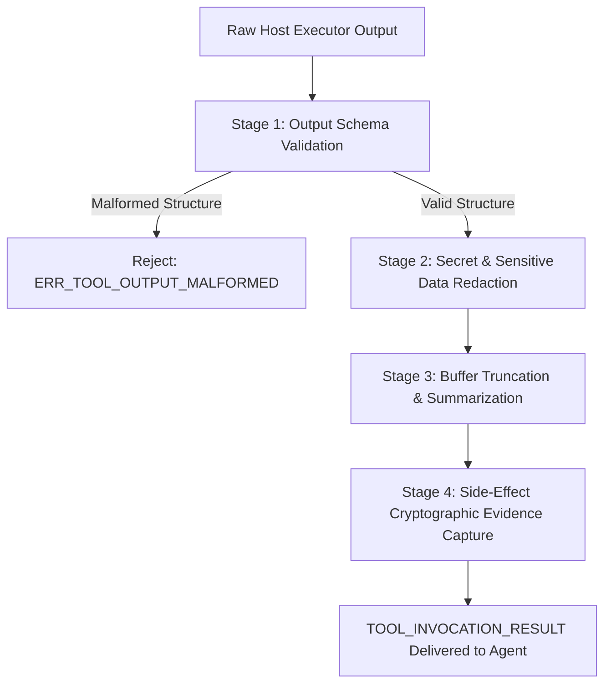

# NexLudic Engine: AI Agent Tool Output Validation & Side-Effect Evidence Contract

**Document ID:** `NLE-CON-ATV-001`  
**Phase:** 7 of 12 (AI Coding-Agent Orchestration)  
**Step:** 58 of 100  
**Classification:** Output Trust & Evidence Contract  
**Status:** IMPLEMENTATION-READY SPECIFICATION  
**Upstream Dependencies:** `NLE-MOD-ATO-001` (Domain Model), `NLE-CON-ATO-001` (Tool Catalog)  
**Downstream Dependents:** `NLE-CON-ATA-001` (Audit Contract), Step 58 Traceability Matrix  

---

## 1. Output Trust Architecture & Scrubbing Pipeline

Tool outputs returned by executors or external compilers are treated as **untrusted external data**. A tool response may contain malformed data, massive log dumps, sensitive host secrets, or adversarial prompt injection payloads designed to trick the agent into violating security policy.

NexLudic Engine subjects all tool outputs to a **4-stage post-execution validation pipeline**:

---

## 2. The 4-Stage Post-Execution Validation Pipeline

### Stage 1: Output Schema Validation
- The raw output payload is validated against the operation's registered output JSON schema (`output_schema_uri`).
- If an executor returns malformed JSON or invalid data types, the gateway wraps the error as `ERR_TOOL_OUTPUT_MALFORMED` and marks the invocation status `CONFIRMED_FAILURE`.

### Stage 2: Secret & Sensitive Data Redaction
- Output text is passed through the engine's regex-based secret redaction engine.
- Patterns matching API keys, JWT tokens, Windows user profile paths, and private network IPs are replaced with `[REDACTED_SECRET]`.

### Stage 3: Buffer Truncation & Summarization
- Tool stdout/stderr buffers are capped at **64 KB** for delivery back to the agent context.
- If a compiler output exceeds 64 KB, the supervisor truncates the middle lines, preserving the initial command summary and the trailing error lines, appending `[... TRUNCATED 450 LINES ...]`.

### Stage 4: Side-Effect Cryptographic Evidence Capture
- For state-changing operations (`fs:write_file`, `git:apply_patch`):
  1. The executor computes the SHA-256 hash of modified files on disk.
  2. The git worktree status is queried to record modified paths.
  3. A cryptographic evidence digest:
     $$\text{evidence\_digest} = \text{SHA256}(\text{file\_hashes} \parallel \text{git\_diff\_hash})$$
     is committed to the invocation result and the immutable audit ledger.

---

## 3. Explicit Handling of Partial & Uncertain Results

When an operation fails to complete cleanly (e.g. process terminated by timeout, socket dropped):
- **Explicit Uncertainty Invariant:** The gateway NEVER guesses success or failure.
- **Classification:** The result status is explicitly marked `UNCERTAIN_TIMEOUT` or `PARTIAL_EXECUTION`.
- **Preservation:** The partial state is captured in the diagnostic bundle, and the agent is notified that the operation's physical side effects are unconfirmed.
- **Reconciliation:** The session must execute an idempotent inspection (`git:status`, `fs:file_stat`) before attempting any further state mutation.
