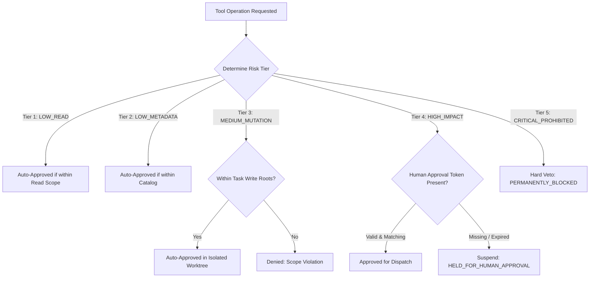

# NexLudic Engine: AI Agent Tool Risk Classification & Approval Policy

**Document ID:** `NLE-POL-ATR-001`  
**Phase:** 7 of 12 (AI Coding-Agent Orchestration)  
**Step:** 58 of 100  
**Classification:** Risk Governance & Human-in-the-Loop Policy  
**Status:** IMPLEMENTATION-READY SPECIFICATION  
**Upstream Dependencies:** `NLE-CON-ATO-001` (Tool Catalog), `NLE-POL-ATP-001` (Permission Scope Policy)  
**Downstream Dependents:** `NLE-SEC-ATI-001` (Input Validation), Step 59 (Human Review UI)  

---

## 1. Operation Risk Classification Framework

Every operation in the tool catalog is statically classified into one of five **Risk Tiers**. Risk tiers dictate the mandatory validation, isolation, and human approval controls required before dispatch.

---

## 2. Risk Tier Definitions & Mandatory Controls

| Risk Tier | Classification | Permitted Operations | Mandatory Controls | Approval Requirement |
| :--- | :--- | :--- | :--- | :--- |
| **Tier 1** | `LOW_READ` | `fs:read_file`, `fs:file_stat` | Read path whitelist; max buffer 2 MB. | Autonomous (Pre-authorized). |
| **Tier 2** | `LOW_METADATA` | `fs:list_directory`, `git:status`, `val:validate_contract` | Path whitelist; max directory depth 5. | Autonomous (Pre-authorized). |
| **Tier 3** | `MEDIUM_MUTATION` | `fs:write_file`, `git:apply_patch`, `lint:check_rust` | Isolated Git worktree; Job Object memory cap. | Autonomous if within task write roots. |
| **Tier 4** | `HIGH_IMPACT` | `fs:delete_file`, `test:run_unit`, dependency additions | Ephemeral diff capture; process job object; timeout. | **Mandatory Human Approval Token** (`NLE-CON-HAT-001`). |
| **Tier 5** | `CRITICAL_PROHIBITED` | Raw shell execution, game process injection, kernel driver access | Permanent platform veto (`BLK-SEC-01`, `DEC-002`). | **Permanently Forbidden (No Override Allowed)**. |

---

## 3. Human Approval Integration & Token Binding

For operations in `HIGH_IMPACT` (Tier 4):
1. **Interactive Suspension:** The gateway pauses the invocation request, transitions the decision to `HELD_FOR_HUMAN_APPROVAL`, and emits an alert to the desktop UI (Step 59).
2. **Approval Token Generation (`NLE-CON-HAT-001`):**  
   When the user reviews the exact proposed action (target path, diff, tool ID), the UI issues a signed token:
   - `token_id`: Cryptographically signed token (`hat-[0-9a-f]{8}...`).
   - `invocation_id`: Strictly bound to the active request UUID.
   - `target_digest`: SHA-256 digest of input arguments.
   - `expires_at`: Strict 15-minute TTL.
3. **No Approval Re-Use:** An approval token is single-use. If the agent amends arguments or retries, renewed approval is mandated.
4. **Avoidance of Approval Fatigue:** Routine file writes within authorized scratch workspaces (`Tier 3`) do not trigger human prompts, preserving developer velocity while maintaining absolute safety.
