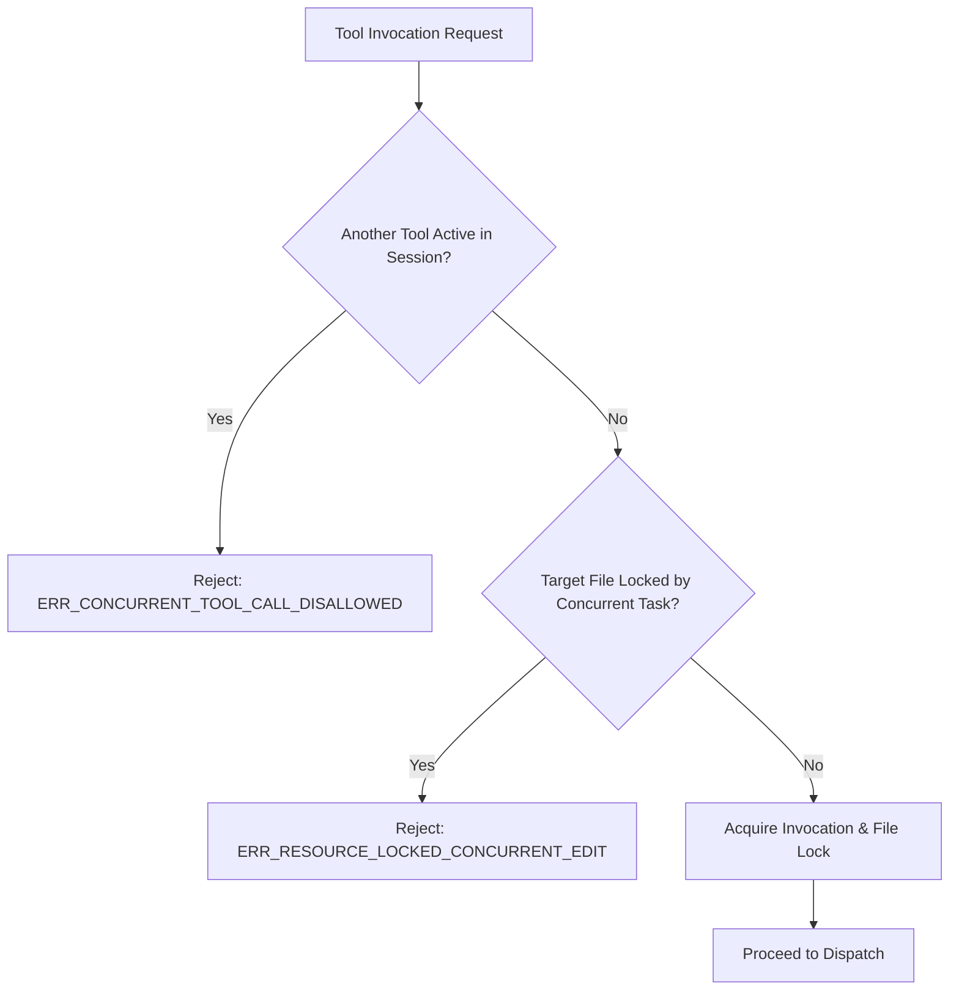

# NexLudic Engine: AI Agent Tool Timeout, Retry, Idempotency & Concurrency Policy

**Document ID:** `NLE-POL-ATI-001`  
**Phase:** 7 of 12 (AI Coding-Agent Orchestration)  
**Step:** 58 of 100  
**Classification:** Concurrency & Fault Governance Policy  
**Status:** IMPLEMENTATION-READY SPECIFICATION  
**Upstream Dependencies:** `NLE-SPC-ATG-001` (Gateway Spec), `NLE-POL-ARW-001` (Step 57 Resource Policy)  
**Downstream Dependents:** `NLE-CON-ATV-001` (Output & Evidence Contract), Step 58 Test Plan  

---

## 1. Concurrency Control & Mutual Exclusion

To prevent race conditions, corrupted file writes, and resource thrashing on the user's desktop:
1. **Single In-Flight Tool Invariant:** An execution session is permitted at most **ONE active, in-flight tool invocation** at any instant. A second tool call emitted while an operation is pending is rejected with `ERR_CONCURRENT_TOOL_CALL_DISALLOWED`.
2. **File Write Locking:** When a tool operation targets a file path for modification, an exclusive write lock is acquired in the workspace lock manager. If another concurrent session holds the lock, the request fails with `ERR_RESOURCE_LOCKED_CONCURRENT_EDIT`.

---

## 2. Idempotency Classification & Deduplication

Operations are strictly classified by their idempotency characteristics:

| Classification | Permitted Tools / Operations | Idempotency Guarantee | Safe Retry Mechanism |
| :--- | :--- | :--- | :--- |
| **Naturally Idempotent** | `fs:read_file`, `fs:list_directory`, `git:status`, `git:diff` | Multiple executions produce identical state and results without side effects. | Immediate safe retry permitted on transient failure. |
| **Idempotent by State Hash** | `fs:write_file`, `git:apply_patch` | Overwriting identical content produces identical disk state. | Permitted only if target file hash matches pre-condition state. |
| **Non-Idempotent / Stateful**| `fs:delete_file`, test executions with random seeds | Re-execution creates differing outcomes or errors (e.g. deleting already deleted file). | **Automatic retry forbidden**. Requires explicit status reconciliation. |

### Deduplication Key Specification
For state-changing operations, the gateway computes:
$$\text{dedup\_key} = \text{SHA256}(\text{session\_id} \parallel \text{operation\_id} \parallel \text{canonical\_args\_hash})$$
If a request with an identical `dedup_key` is received while an earlier dispatch is executing or within 30 seconds of completion, the gateway returns the cached response rather than re-executing.

---

## 3. Timeout Taxonomy & Enforcement Rules

| Timeout Dimension | Default Limit | Maximum Permitted | Enforcement Component | Terminal Action |
| :--- | :--- | :--- | :--- | :--- |
| **Validation Timeout** | 5,000 ms | 10,000 ms | Gateway Validator | Reject request (`ERR_VALIDATION_TIMEOUT`). |
| **Human Approval Timeout** | 900,000 ms (15m) | 1,800,000 ms (30m) | Approval Workflow Engine | Invalidate request (`ERR_APPROVAL_EXPIRED`). |
| **File Read / Stat Timeout** | 10,000 ms | 30,000 ms | Host File Executor | Cancel read stream (`ERR_TOOL_TIMEOUT`). |
| **File Write Timeout** | 15,000 ms | 60,000 ms | Host File Executor | Terminate write (`ERR_TOOL_TIMEOUT`). |
| **Linter Execution Timeout** | 30,000 ms | 120,000 ms | Windows Job Object | Terminate compiler PID (`STATUS_TIMEOUT`). |
| **Unit Test Execution Timeout**| 60,000 ms | 300,000 ms | Windows Job Object | Terminate test runner PID (`STATUS_TIMEOUT`). |

---

## 4. Safe Retry Boundaries

- **Retry Eligibility:** Automatic retries are restricted to **transient environment errors** (e.g. file lock contention, temporary Windows memory allocation failure).
- **Max Retries:** At most **2 automatic retries** per invocation.
- **Strict Prohibition on Policy Retries:** A policy denial (`ERR_PERMISSION_SCOPE_EXCEEDED`, `ERR_PATH_CONTAINMENT_FAILED`) can **NEVER be retried**. Retrying a denied operation through an alternate tool is flagged as adversarial evasion and freezes the session.
