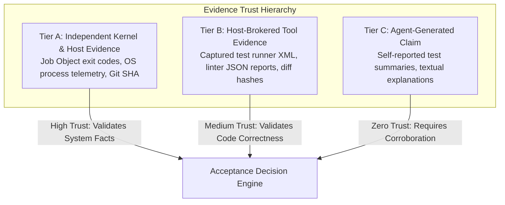

# NexLudic Engine: AI Agent Verification Evidence Provenance & Trust Policy

**Document ID:** `NLE-POL-AVE-001`  
**Phase:** 7 of 12 (AI Coding-Agent Orchestration)  
**Step:** 59 of 100  
**Classification:** Evidence Trust & Verification Provenance Policy  
**Status:** IMPLEMENTATION-READY SPECIFICATION  
**Upstream Dependencies:** `NLE-MOD-AOC-001` (Domain Model), `NLE-CON-ATV-001` (Step 58 Evidence Contract)  
**Downstream Dependents:** `NLE-CON-AAC-001` (Acceptance Contract), `NLE-CAT-AOS-001` (Synthetic Scenarios)  

---

## 1. Evidence Trust Hierarchy

In automated agent verification, evidence must be classified by its **objective independence and cryptographic provenance**.

---

## 2. Test Result Classification & Status Taxonomy

A test result is never a binary pass/fail without context. NexLudic Engine enforces an 11-state taxonomy:

| Status Code | Meaning & Evidentiary Standard | Permitted to Satisfy Criterion? |
| :--- | :--- | :---: |
| `NOT_PLANNED` | Test was not required or designed for this task. | No |
| `PLANNED` | Test case authored or specified; has not executed. | No |
| `NOT_EXECUTED` | Test was in scope but execution was never triggered. | **NO (Blocks Completion)** |
| `BLOCKED` | Test execution prevented by dependency or environment failure. | **NO (Blocks Completion)** |
| `RUNNING` | Test currently executing in Windows Job Object sandbox. | No |
| `PASSED` | Test executed cleanly with exit code 0, matching XML report and zero failed assertions. | **YES** |
| `FAILED` | Test executed and reported assertion failures or non-zero exit code. | **NO (Blocks Completion)** |
| `CANCELLED` | Test interrupted by timeout or operator cancellation. | **NO** |
| `TIMED_OUT` | Test process killed by watchdog after exceeding timeout limit. | **NO** |
| `INCONCLUSIVE_UNCERTAIN` | Test output corrupted, partial, or missing exit confirmation. | **NO** |
| `STALE_EVIDENCE` | Test passed on an earlier commit, but files were edited subsequently. | **NO (Re-Run Mandated)** |

---

## 3. Evidence Sufficiency & Provenance Binding

### Rule AVE-01: Claim-to-Evidence Alignment
Evidence must directly substantiate the specific claim made:
- A passing static analysis run (`cargo check`) proves syntactic and type validity, but **DOES NOT** satisfy a functional behavioral requirement.
- A clean markdown lint run proves format conformance, but **DOES NOT** prove architecture decision compliance.

### Rule AVE-02: Stale Evidence Invalidation
If a test passed at revision $R_1$, and any source file in the worktree was subsequently modified to produce revision $R_2$:
- The test evidence for $R_1$ is marked `STALE_EVIDENCE`.
- All acceptance criteria depending on that test are reverted to `NOT_EVALUATED` until the test is re-executed against $R_2$.

### Rule AVE-03: Zero Unexecuted Passes
A test that was not executed cannot under any circumstances be marked as `PASSED`. Claiming a test passed without physical execution logs is classified as **critical evidence fabrication**.
