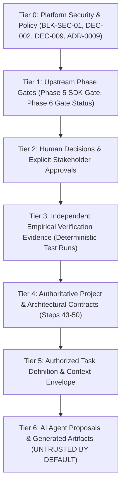
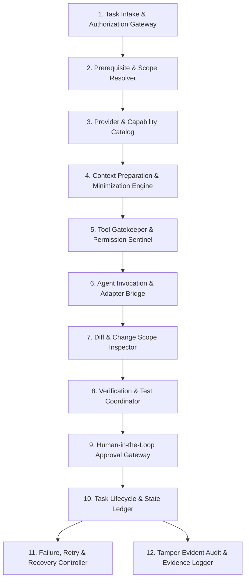

# NexLudic Engine: AI Coding-Agent Orchestration Architecture & Governance Specification

**Document ID:** `NLE-SPC-ACO-001`  
**Phase:** 7 of 12 (AI Coding-Agent Orchestration)  
**Step:** 52 of 100  
**Classification:** Foundational Architecture & Governance Specification  
**Status:** IMPLEMENTATION-READY SPECIFICATION  
**Authoritative Scope:** Specification, Architecture, and Governance Only (No Orchestrator Runtime, No Provider API Calls, No Code Generation, No Code Execution)

---

## 1. Executive Summary & Phase 7 Mission

The **AI Coding-Agent Orchestration Architecture & Governance Specification** establishes the authoritative framework within the NexLudic Engine for coordinating, constraining, supervising, and verifying AI coding agents. 

Within the NexLudic Engine platform, AI coding agents are intended to assist human creators and software engineers with complex, repetitive, and specialized software development tasks across the game-interoperability lifecycle:
1. **Implementation Planning:** Decomposing approved mashup integration plans into concrete engineering work items.
2. **Adapter Scaffolding & Development:** Authoring game-specific adapters conforming to the Universal Adapter SDK (`NLE-SDK-CAP-001`).
3. **Cross-Game Protocol & Code Generation:** Generating type-safe serialization wrappers, coordinate converters, and telemetry transformers from validated mappings (`NLE-SPC-DMT-001`).
4. **Test & Verification Authoring:** Generating unit tests, conformance fixtures, and synthetic integration tests.
5. **Defect & Diagnostics Analysis:** Analyzing compilation logs, IPC telemetry traces, and failure compensation events.
6. **Technical Documentation:** Generating API reference documents, changelogs, and integration guides.

### 1.1 The Fundamental Governance Invariant: Model Output is Untrusted
The central architectural pillar governing Phase 7 is the **Untrusted Model Output Principle**:
> **Core Invariant:** AI coding agents—regardless of model capability, provider sophistication, or perceived reasoning strength—are **untrusted code generators**. Model output possesses zero intrinsic authority. An agent's self-assertion that code is complete, correct, secure, or tested possesses **zero evidentiary value**. Every proposed workspace change must be validated against explicit task scopes, verified through independent deterministic execution, and approved by human stakeholders under strict default-deny governance.

---

## 2. Epistemic Authority Hierarchy & Source-of-Truth Primacy

To prevent model hallucinations, prompt injection, or agent errors from subverting engine security or architectural decisions, NexLudic Engine enforces a strict, unidirectional authority hierarchy:

### 2.1 Primacy Rules
1. **Security & Policy Dominance (Tier 0 Primacy):**  
   No task definition, human request, or agent prompt can override Windows Medium Integrity Level confinement (`DEC-002`), Anti-Cheat Dominance (`BLK-SEC-01`), Volume D storage sandboxing (`DEC-009`), or workspace isolation (`ADR-0009`). Any agent attempting privilege escalation or memory injection into protected games is halted immediately.
2. **Phase Gate Integrity (Tier 1 Primacy):**  
   Tasks may only consume upstream planning or SDK contracts whose governing gates are `READY` or `READY WITH CONDITIONS`. 
3. **Human Approval Superiority (Tier 2 Primacy):**  
   Decisions designated as requiring human sign-off (e.g., public API changes, new external dependencies, security boundary modifications) cannot be waived by an agent or automated script.
4. **Empirical Evidence over Agent Claims (Tier 3 Primacy):**  
   An agent stating "all tests passed" is null. Evidence requires a signed, deterministic test execution log generated by the engine's test runner in an isolated sandbox.
5. **Contract Binding (Tier 4 Primacy):**  
   Agents cannot alter upstream contracts (e.g., Step 46 blueprint interfaces or Step 47 data schemas) to make code generation easier. The code must conform to the contract, not vice-versa.
6. **Untrusted Model Output (Tier 6 Subordination):**  
   Agent output is strictly passive text/diff data until structurally validated, scope-inspected, test-verified, and human-approved.

---

## 3. Mandatory Upstream Gate Audit & Handoff Baseline

Before establishing Phase 7 orchestration contracts, the platform must verify its upstream dependencies across Phase 5 and Phase 6:

### 3.1 Phase 5 SDK & Capability System Gate Verification
- **Authoritative Gate Artifact:** `docs/adapters/STEP_42_COMPLETION_REPORT.md` (`NLE-GAT-PH5-001`).
- **Gate Outcome:** **`READY WITH CONDITIONS`**.
- **Applicable Conditions Governing Phase 7:**
  - **`P5-C01` (Native Language SDK Bindings):** Concrete C++, Rust, and C# wire protocol wrapper libraries were deferred to Phase 7/8. *Implication for Phase 7:* Coding agents assigned to develop adapters must implement the concrete serialization bindings conforming to the Step 34–41 wire protocol schemas.
  - **`P5-C02` (Desktop UI Telemetry Widget Integration):** Non-blocking for agent orchestration.
  - **`P5-C03` (Adapter Health & Heartbeat Verification):** Agents developing adapter runtimes must implement the 500ms heartbeat and watchdog protocol defined in `NLE-SPC-LFC-001`.

### 3.2 Phase 6 Mashup Designer & Planning Gate Audit
- **Audit Findings:** Steps 43 through 50 are fully completed and committed to the repository in `docs/mashup-designer/` (including domain models, requirements, strategy framework, blueprints, mappings, workflows, integration plan descriptor, and review UX).
- **Gate Status:** **`UNVERIFIED / MISSING FORMAL SIGN-OFF`**. Step 51 (Phase 6 Readiness Review) has not yet been executed in the repository.
- **Governing Phase 7 Action:** In accordance with Section 3.1 of the Step 52 directive (*"If the gate result is missing, unsupported, or unverifiable: Record the actual status and its implications. Never fabricate gate approval... Do not design an execution workflow that treats an unapproved integration plan as ready for implementation"*):
  1. Phase 7 foundational architecture and governance specifications proceed independently of specific mashup plans.
  2. Any coding task whose scope depends upon an assembled Phase 6 mashup integration plan is classified as **`PROVISIONAL — AWAITING PHASE 6 FORMAL SIGN-OFF`**.
  3. The orchestration task intake engine prohibits assigning or executing implementation tasks against an integration plan until the Phase 6 gate is formally reviewed and recorded.

---

## 4. Logical Orchestration Architecture & Responsibility Matrix

The NexLudic Engine AI Coding-Agent Orchestrator is modeled as 12 logical architectural subsystems. These represent distinct separation of concerns rather than separate microservices:

### 4.1 Subsystem Responsibility Matrix

| Subsystem ID | Logical Subsystem | Core Purpose & Responsibilities | Explicit Exclusions | Governing Invariant |
| :--- | :--- | :--- | :--- | :--- |
| **SUB-01** | **Task Intake Gateway** | Ingests engineering tasks; verifies user authorization token; assigns stable `task_id`. | Does not generate code or select models. | Authorized Tasks Only |
| **SUB-02** | **Prerequisite Resolver** | Verifies upstream phase gates, architecture decisions, and file freshness hashes. | Does not bypass missing gates. | Tier 1 Primacy |
| **SUB-03** | **Provider Catalog** | Maintains metadata on eligible coding-agent backends; assesses task-model capability fit. | Does not bind hardcoded vendor logic. | Provider Neutrality |
| **SUB-04** | **Context Engine** | Constructs minimal, sanitized context envelope; redacts secrets and unrelated files. | Does not transmit entire repository. | Least Privilege Context |
| **SUB-05** | **Tool Gatekeeper** | Enforces default-deny tool permissions; prevents privilege escalation and unauthorized I/O. | Does not grant ambient file writes. | Default-Deny Access |
| **SUB-06** | **Agent Adapter Bridge** | Normalizes JSON-RPC/REST prompts and responses across diverse AI backends. | Does not interpret model claims as truth. | Model Agnostic |
| **SUB-07** | **Diff Inspector** | Compares proposed file modifications against authorized task path whitelist; detects out-of-scope edits. | Does not apply patches automatically. | Scope Whitelisting |
| **SUB-08** | **Verification Coordinator**| Spawns isolated test runner; executes approved unit/conformance suites; captures signed logs. | Does not accept self-reported results. | Empirical Verification |
| **SUB-09** | **HITL Approval Gateway** | Presents structured diffs, test evidence, and open decisions to human reviewer for signature. | Does not permit automated self-approval. | Human Sign-Off |
| **SUB-10** | **Task State Ledger** | Manages 14-state task lifecycle state machine; rejects illegal transitions. | Does not collapse task and artifact state.| Formal State Transitions |
| **SUB-11** | **Recovery Controller** | Handles timeouts, network retries, exponential backoff, and atomic workspace rollback. | Does not blindly retry stateful writes. | Atomic Rollback |
| **SUB-12** | **Audit Logger** | Records immutable append-only JSON journal of all prompts, responses, tool calls, and diffs. | Does not log plaintext secrets. | Full Auditability |

---

## 5. Core Architectural Invariants

| Invariant ID | Principle | Architectural Enforcement Rule |
| :--- | :--- | :--- |
| **INV-ACO-01** | **Untrusted Model Output** | Generated code, patches, and documentation are treated as unverified candidate input until verified by independent deterministic tests. |
| **INV-ACO-02** | **Default-Deny Permissions** | An agent possesses zero ambient permissions. Every filesystem write, shell command, or tool invocation requires explicit contract authorization. |
| **INV-ACO-03** | **Strict Scope Confinement** | Modifications are strictly restricted to the authorized file path whitelist. Any modification outside this boundary triggers immediate task suspension (`ERR_SCOPE_VIOLATION`). |
| **INV-ACO-04** | **Human-in-the-Loop Primacy** | No AI-generated code may be committed to the main branch or deployed to a game runtime without explicit, recorded human approval. |
| **INV-ACO-05** | **Medium Integrity Confinement (`DEC-002`)** | All agent processes, tool runners, and verification harnesses execute strictly at Windows Medium Integrity Level. UAC elevation is prohibited. |
| **INV-ACO-06** | **Volume D Sandboxing (`DEC-009`, `ADR-0009`)** | Agent workspaces, patches, caches, and test fixtures reside exclusively within the project directory tree on Volume D (`D:\App Winrar Files\Nexludic Engine (working)`). |
| **INV-ACO-07** | **Anti-Cheat Dominance (`BLK-SEC-01`)** | Agents are prohibited from generating or executing code that performs direct memory injection, thread hijacking, or hooking into anti-cheat protected game processes. |
| **INV-ACO-08** | **Provider Neutrality** | The orchestration engine defines abstract contracts for task submission, tool invocation, and diff inspection, preventing architectural coupling to any single AI vendor. |

---

## 6. Specification Suite Directory

The Step 52 specification suite consists of 14 interconnected documentation artifacts located in `docs/ai-orchestration/`:

| # | Deliverable File Link | Ref ID | Scope & Architectural Focus |
| :-: | :--- | :--- | :--- |
| 1 | [AI_CODING_AGENT_ORCHESTRATION_ARCHITECTURE_AND_GOVERNANCE.md](file:///d:/App%20Winrar%20Files/Nexludic%20Engine%20(working)/docs/ai-orchestration/AI_CODING_AGENT_ORCHESTRATION_ARCHITECTURE_AND_GOVERNANCE.md) | `NLE-SPC-ACO-001` | Foundational architecture, governance hierarchy, 12 subsystems, platform invariants. |
| 2 | [AI_AGENT_ORCHESTRATION_DOMAIN_MODEL_AND_LIFECYCLE.md](file:///d:/App%20Winrar%20Files/Nexludic%20Engine%20(working)/docs/ai-orchestration/AI_AGENT_ORCHESTRATION_DOMAIN_MODEL_AND_LIFECYCLE.md) | `NLE-MOD-ACO-001` | Entity model, 14-state task lifecycle state machine, JSON Schema Draft 2020-12. |
| 3 | [AI_CODING_TASK_CONTRACT_AND_AUTHORIZATION_RULES.md](file:///d:/App%20Winrar%20Files/Nexludic%20Engine%20(working)/docs/ai-orchestration/AI_CODING_TASK_CONTRACT_AND_AUTHORIZATION_RULES.md) | `NLE-CON-ACT-001` | Task contract specification, scope bounds, prerequisite assertions, stop conditions. |
| 4 | [AI_AGENT_PROVIDER_ADAPTER_AND_CAPABILITY_CONTRACT.md](file:///d:/App%20Winrar%20Files/Nexludic%20Engine%20(working)/docs/ai-orchestration/AI_AGENT_PROVIDER_ADAPTER_AND_CAPABILITY_CONTRACT.md) | `NLE-CON-APA-001` | Provider-neutral adapter ABI, eligibility matrix, capability negotiation, normalized results. |
| 5 | [AI_AGENT_CONTEXT_PREPARATION_AND_DATA_MINIMIZATION_POLICY.md](file:///d:/App%20Winrar%20Files/Nexludic%20Engine%20(working)/docs/ai-orchestration/AI_AGENT_CONTEXT_PREPARATION_AND_DATA_MINIMIZATION_POLICY.md) | `NLE-POL-ACX-001` | Context minimization, secret scrubbing, prompt injection defense, external disclosure policy. |
| 6 | [AI_AGENT_TOOL_ACCESS_AND_EXECUTION_AUTHORIZATION_POLICY.md](file:///d:/App%20Winrar%20Files/Nexludic%20Engine%20(working)/docs/ai-orchestration/AI_AGENT_TOOL_ACCESS_AND_EXECUTION_AUTHORIZATION_POLICY.md) | `NLE-POL-ATA-001` | Tool catalog, default-deny permissions, execution sandboxing, prohibited actions. |
| 7 | [AI_AGENT_TASK_DECOMPOSITION_AND_MULTI_AGENT_COORDINATION_SPECIFICATION.md](file:///d:/App%20Winrar%20Files/Nexludic%20Engine%20(working)/docs/ai-orchestration/AI_AGENT_TASK_DECOMPOSITION_AND_MULTI_AGENT_COORDINATION_SPECIFICATION.md) | `NLE-SPC-AMC-001` | Multi-agent coordination, subtask contracts, dependency scheduling, conflict resolution. |
| 8 | [AI_AGENT_OUTPUT_VERIFICATION_AND_EVIDENCE_CONTRACT.md](file:///d:/App%20Winrar%20Files/Nexludic%20Engine%20(working)/docs/ai-orchestration/AI_AGENT_OUTPUT_VERIFICATION_AND_EVIDENCE_CONTRACT.md) | `NLE-CON-AOV-001` | Diff inspection, 10-tier evidence hierarchy, deterministic test execution, acceptance rules. |
| 9 | [AI_AGENT_HUMAN_REVIEW_APPROVAL_AND_CHANGE_CONTROL_POLICY.md](file:///d:/App%20Winrar%20Files/Nexludic%20Engine%20(working)/docs/ai-orchestration/AI_AGENT_HUMAN_REVIEW_APPROVAL_AND_CHANGE_CONTROL_POLICY.md) | `NLE-POL-AHC-001` | Human-in-the-loop sign-off, approval thresholds, feedback loops, rollback and baseline protection. |
| 10 | [AI_AGENT_ORCHESTRATION_SECURITY_PRIVACY_AND_THREAT_MODEL.md](file:///d:/App%20Winrar%20Files/Nexludic%20Engine%20(working)/docs/ai-orchestration/AI_AGENT_ORCHESTRATION_SECURITY_PRIVACY_AND_THREAT_MODEL.md) | `NLE-SEC-ACO-001` | Threat model, STRIDE evaluation, prompt injection, supply chain defense, game integrity. |
| 11 | [AI_AGENT_ORCHESTRATION_FAILURE_RESOURCE_AND_RECOVERY_POLICY.md](file:///d:/App%20Winrar%20Files/Nexludic%20Engine%20(working)/docs/ai-orchestration/AI_AGENT_ORCHESTRATION_FAILURE_RESOURCE_AND_RECOVERY_POLICY.md) | `NLE-POL-AFR-001` | Timeouts, retry budgets, circuit breakers, resource accounting, cancellation cleanup. |
| 12 | [AI_AGENT_ORCHESTRATION_SYNTHETIC_SCENARIOS_AND_TEST_PLAN.md](file:///d:/App%20Winrar%20Files/Nexludic%20Engine%20(working)/docs/ai-orchestration/AI_AGENT_ORCHESTRATION_SYNTHETIC_SCENARIOS_AND_TEST_PLAN.md) | `NLE-CAT-ACS-001` | 15 synthetic verification scenarios (Scenarios A through O) testing edge cases and governance. |
| 13 | [STEP_52_ORCHESTRATION_REQUIREMENTS_TRACEABILITY_MATRIX.md](file:///d:/App%20Winrar%20Files/Nexludic%20Engine%20(working)/docs/ai-orchestration/STEP_52_ORCHESTRATION_REQUIREMENTS_TRACEABILITY_MATRIX.md) | `NLE-MAT-STP-052` | Bidirectional traceability matrix verifying all 24 orchestration requirements (`ACO-REQ-001..024`). |
| 14 | [STEP_52_COMPLETION_REPORT.md](file:///d:/App%20Winrar%20Files/Nexludic%20Engine%20(working)/docs/ai-orchestration/STEP_52_COMPLETION_REPORT.md) | `NLE-REP-STP-052` | Milestone completion audit, 20 acceptance criteria verification (`AC-01..20`), sign-off verdict. |

---

## 7. Implementation Readiness & Boundary Statement

This specification suite defines the architecture, domain entities, task contracts, tool policies, security threat models, and verification protocols necessary for engineering teams to implement the AI coding-agent orchestrator in subsequent steps.

In strict accordance with project roadmap governance, **no orchestrator runtime, background agent daemon, AI provider API client, code-generation script, or sandbox execution engine has been implemented.**
