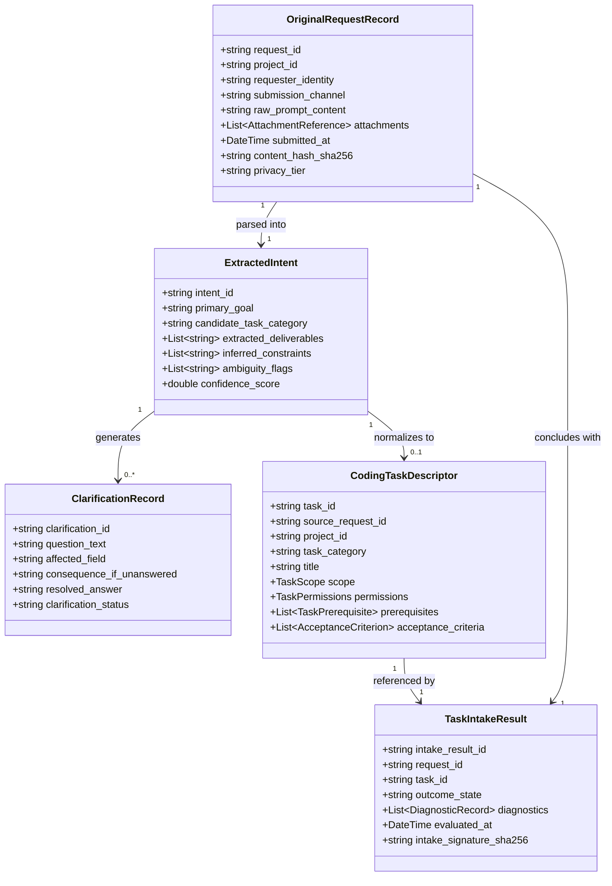

# NexLudic Engine: AI Coding Request & Normalized Task Domain Model

**Document ID:** `NLE-MOD-TIN-001`  
**JSON Schema ID:** `NLE-SCH-TIN-001`  
**Phase:** 7 of 12 (AI Coding-Agent Orchestration)  
**Step:** 53 of 100  
**Classification:** Domain Model & Schema Specification  
**Status:** IMPLEMENTATION-READY SPECIFICATION  

---

## 1. Domain Entity Architecture & Hierarchy

The **Task Intake & Normalization** domain establishes a clear boundary between what a user or external system submits, how the platform interprets it, and the normalized, versioned task contract produced for downstream agent orchestration.



---

## 2. Request vs. Task Separation Contract

To prevent revision ambiguity, scope drift, and loss of original intent, NexLudic Engine enforces strict separation between request and task:

| Dimension | `OriginalRequestRecord` | `CodingTaskDescriptor` |
| :--- | :--- | :--- |
| **Origin** | Human creator, maintenance script, or diagnostic alert. | The engine's intake normalization pipeline. |
| **Mutability** | **Strictly Immutable (Read-Only).** Content hash computed on arrival. | Versioned via SemVer (`v1.0.0` $\rightarrow$ `v1.1.0`) upon approved change. |
| **Authority** | Expresses requested outcome / human intent. | Expresses bounded engineering contract, scope, and permissions. |
| **Scope Definition**| Natural language or high-level issue summary. | Whitelisted file path globs and quantitative diff ceilings. |
| **Permissions** | Desired outcome (e.g., "fix the bug"). | Explicit boolean tool flags (`allow_read`, `allow_write`). |
| **Evidentiary Role**| Input for provenance and intent verification. | Authoritative baseline for diff inspection and test execution. |

### 2.1 Traceability Invariant
Every `CodingTaskDescriptor` must maintain an immutable backlink to its originating `source_request_id`. Deleting, rewriting, or unlinking the original request is structurally prohibited.

---

## 3. Entity Field Dictionary

### 3.1 `OriginalRequestRecord`
- `request_id` (`string`, UUIDv4, mandatory): Unique identifier.
- `project_id` (`string`, UUIDv4, mandatory): Bound mashup project.
- `requester_identity` (`string`, mandatory): Sanitized username or subsystem role.
- `submission_channel` (`string`, enum: `UI_WORKSPACE_PROMPT`, `DIAGNOSTIC_LEDGER`, `MAINTENANCE_HOOK`, `API_IMPORT`, mandatory).
- `raw_prompt_content` (`string`, mandatory): Exact verbatim text submitted.
- `attachments` (`array` of `AttachmentReference`, optional): Referenced logs or spec files.
- `submitted_at` (`string`, RFC 3339 timestamp, mandatory): Timestamp of intake.
- `content_hash_sha256` (`string`, hex 64, mandatory): SHA-256 hash of verbatim text.
- `privacy_tier` (`string`, enum: `INTERNAL_ONLY`, `CONFIDENTIAL_GAME_ASSET`, `PUBLIC_OPEN_SOURCE`, mandatory).

### 3.2 `ExtractedIntent`
- `intent_id` (`string`, UUIDv4, mandatory): Unique identifier.
- `primary_goal` (`string`, mandatory): Synthesized 1-sentence statement of desired outcome.
- `candidate_task_category` (`string`, enum of 10 categories, mandatory).
- `extracted_deliverables` (`array` of `string`, mandatory): Explicit deliverables identified.
- `inferred_constraints` (`array` of `string`, mandatory): Discovered constraints (e.g., "Must run under Medium IL").
- `ambiguity_flags` (`array` of `string`, mandatory): List of detected ambiguities.
- `confidence_score` (`number`, 0.0 to 1.0, mandatory): Automated parsing certainty.

### 3.3 `TaskIntakeResult`
- `intake_result_id` (`string`, UUIDv4, mandatory): Unique evaluation record identifier.
- `request_id` (`string`, UUIDv4, mandatory): References `OriginalRequestRecord`.
- `task_id` (`string`, UUIDv4, optional): References generated `CodingTaskDescriptor` if normalized.
- `outcome_state` (`string`, enum of 8 intake states, mandatory): Final gate verdict.
- `diagnostics` (`array` of `DiagnosticRecord`, mandatory): List of emitted info, warnings, or errors.
- `evaluated_at` (`string`, RFC 3339 timestamp, mandatory).
- `intake_signature_sha256` (`string`, hex 64, mandatory): Cryptographic checksum of result.

---

## 4. Formal JSON Schema (Draft 2020-12)

```json
{
  "$schema": "https://json-schema.org/draft/2020-12/schema",
  "$id": "https://nexludic.engine/schemas/v1/task-intake-records.json",
  "title": "TaskIntakeDomainModel",
  "description": "Schemas for OriginalRequestRecord and TaskIntakeResult.",
  "definitions": {
    "OriginalRequestRecord": {
      "type": "object",
      "required": [
        "schema_version",
        "request_id",
        "project_id",
        "requester_identity",
        "submission_channel",
        "raw_prompt_content",
        "submitted_at",
        "content_hash_sha256",
        "privacy_tier"
      ],
      "properties": {
        "schema_version": { "type": "string", "const": "1.0.0" },
        "request_id": { "type": "string", "format": "uuid" },
        "project_id": { "type": "string", "format": "uuid" },
        "requester_identity": { "type": "string", "minLength": 1, "maxLength": 128 },
        "submission_channel": {
          "type": "string",
          "enum": ["UI_WORKSPACE_PROMPT", "DIAGNOSTIC_LEDGER", "MAINTENANCE_HOOK", "API_IMPORT"]
        },
        "raw_prompt_content": { "type": "string", "minLength": 1, "maxLength": 32768 },
        "attachments": {
          "type": "array",
          "items": {
            "type": "object",
            "required": ["file_path", "file_hash_sha256"],
            "properties": {
              "file_path": { "type": "string" },
              "file_hash_sha256": { "type": "string", "pattern": "^[a-f0-9]{64}$" }
            }
          }
        },
        "submitted_at": { "type": "string", "format": "date-time" },
        "content_hash_sha256": { "type": "string", "pattern": "^[a-f0-9]{64}$" },
        "privacy_tier": {
          "type": "string",
          "enum": ["INTERNAL_ONLY", "CONFIDENTIAL_GAME_ASSET", "PUBLIC_OPEN_SOURCE"]
        }
      },
      "additionalProperties": false
    },
    "TaskIntakeResult": {
      "type": "object",
      "required": [
        "schema_version",
        "intake_result_id",
        "request_id",
        "outcome_state",
        "diagnostics",
        "evaluated_at",
        "intake_signature_sha256"
      ],
      "properties": {
        "schema_version": { "type": "string", "const": "1.0.0" },
        "intake_result_id": { "type": "string", "format": "uuid" },
        "request_id": { "type": "string", "format": "uuid" },
        "task_id": { "type": ["string", "null"], "format": "uuid" },
        "outcome_state": {
          "type": "string",
          "enum": [
            "ACCEPTED_FOR_NORMALIZATION",
            "NEEDS_CLARIFICATION",
            "INVALID_REQUEST",
            "BLOCKED_BY_DEPENDENCY",
            "AWAITING_APPROVAL",
            "NOT_ELIGIBLE",
            "REJECTED_BY_POLICY",
            "NORMALIZED"
          ]
        },
        "diagnostics": {
          "type": "array",
          "items": {
            "type": "object",
            "required": ["code", "severity", "message"],
            "properties": {
              "code": { "type": "string" },
              "severity": { "type": "string", "enum": ["INFO", "WARNING", "FATAL"] },
              "message": { "type": "string" },
              "target_field": { "type": "string" }
            }
          }
        },
        "evaluated_at": { "type": "string", "format": "date-time" },
        "intake_signature_sha256": { "type": "string", "pattern": "^[a-f0-9]{64}$" }
      },
      "additionalProperties": false
    }
  }
}
```
