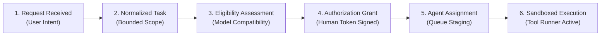

# NexLudic Engine: AI Coding Task Authorization & Phase Gate Policy

**Document ID:** `NLE-POL-TIN-001`  
**Phase:** 7 of 12 (AI Coding-Agent Orchestration)  
**Step:** 53 of 100  
**Classification:** Authorization Governance & Phase Gate Policy  
**Status:** IMPLEMENTATION-READY SPECIFICATION  

---

## 1. Separation of Concerns in the Authorization Chain

NexLudic Engine enforces strict epistemic separation across the 6 stages of task progression:

> **Core Invariant:** Achieving a successful normalization result (Stage 2) or verifying agent compatibility (Stage 3) **never constitutes authorization** (Stage 4). A task cannot be assigned to an agent or executed without an explicit, cryptographically signed authorization token.

---

## 2. Authorization Authority Matrix

Different task categories and scope boundaries require distinct authorization levels:

| Scope & Action Category | Required Authorizing Authority | Authorization Artifact | Automated Self-Grant Permitted? |
| :--- | :--- | :--- | :---: |
| **Documentation / Spec Review** | Project Creator / Developer | Signed `TaskAuthorizationToken` | **NO** |
| **Read-Only Defect Analysis** | Project Developer | Signed `TaskAuthorizationToken` | **NO** |
| **Adapter Code Modification** | Integration Architect | Signed `TaskAuthorizationToken` (Scoped) | **NO** |
| **New Package Dependency** | Systems Architect | Explicit Dependency Waiver Token | **NO** |
| **Public Contract / Schema Edit**| Systems Architect | Architectural Change Sign-Off | **NO** |
| **External Cloud AI Disclosure**| Project Owner / Security Lead | Privacy Consent Grant Token | **NO** |
| **Anti-Cheat Memory Hooking** | *None (Prohibited by Policy)*| **PROHIBITED BY PLATFORM INVARIANT** | **STRICT VETO** |

---

## 3. Upstream Phase Gate Enforcement Policy

Task authorization directly evaluates the status of upstream project phase gates:

### 3.1 Phase 5 SDK Gate (`READY WITH CONDITIONS`)
- The Universal Adapter SDK Phase 5 gate (`NLE-GAT-PH5-001`) has approved condition `P5-C01` (Native Language SDK Bindings) for implementation in Phase 7/8.
- Tasks categorized under `ADAPTER_DEVELOPMENT` that implement C#/Rust/C++ serialization wrappers for approved wire schemas are authorized to proceed.

### 3.2 Phase 6 Mashup Planning Gate (`UNVERIFIED / BLOCKED`)
- Step 51 (Phase 6 Readiness Review) has not yet been executed in the repository.
- Therefore:
  > **Hard Gate Policy:** Any coding task whose objective is to generate or modify runtime implementation code for an assembled Phase 6 Mashup Integration Plan (`MashupIntegrationPlanDescriptor`) is **BLOCKED AT THE AUTHORIZATION GATE**. 
- The intake engine emits diagnostic `ERR_PRECONDITION_PHASE6_UNVERIFIED` and assigns outcome state `BLOCKED_BY_DEPENDENCY`.
- The task contract remains normalized as a draft, but cannot receive an authorization token or be queued for agent assignment until Step 51 is formally reviewed and recorded.

---

## 4. Authorization Token Revocation & Invalidation

An authorization grant is not a permanent license. The token is immediately revoked under any of the following conditions:
1. **User Cancellation:** The user clicks "Abort" or revokes permissions in the desktop UI (`INFO_AUTH_REVOKED_BY_USER`).
2. **Scope Hash Mismatch:** Any change to the task's `permitted_path_globs` or acceptance criteria invalidates the token's `scope_hash_sha256`.
3. **Upstream Artifact Invalidation:** If an upstream specification file on disk is modified after authorization, `EVT-INV-XX` fires and invalidates the token.
4. **Token Expiration:** The token exceeds its 4-hour time-to-live (`ERR_TOKEN_EXPIRED`).

When a token is revoked, the task transitions immediately to `CANCELLED` (or `READY_FOR_AUTHORIZATION`), active model streams are killed, and the sandbox is rolled back.
