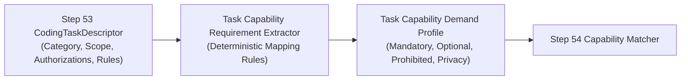

# NexLudic Engine: AI Coding Task Capability Requirement Binding Specification

**Document ID:** `NLE-SPC-TCR-001`  
**Phase:** 7 of 12 (AI Coding-Agent Orchestration)  
**Step:** 54 of 100  
**Classification:** Task Contract to Capability Requirement Binding Specification  
**Status:** IMPLEMENTATION-READY SPECIFICATION  

---

## 1. Scope & System Interface

This specification defines the binding mechanism by which the **Capability Requirement Extractor** translates a validated, authorized `CodingTaskDescriptor` from Step 53 (`NLE-MOD-TIN-001`) into a formal **Task Capability Demand Profile**.

The extractor acts as a deterministic, read-only bridge between Step 53 and Step 54:



> **GOVERNANCE INVARIANT (`INV-TCR-01`):**  
> The requirement extractor operates strictly on normalized task contracts. It **never** reads raw un-normalized user prompts, never invents unrequested capabilities, and never relaxes security constraints.

---

## 2. Requirement Extraction Mapping by Task Category

Every authorized task category from Step 53 (`NLE-CAT-TIN-001`) deterministically derives a baseline set of **Mandatory Capabilities**, **Prohibited Capabilities**, and **Required Tool Interfaces**:

| Step 53 Task Category | Mandatory Capabilities (`required_capabilities`) | Strictly Prohibited Capabilities (`prohibited_capabilities`) | Required Tool Interfaces |
| :--- | :--- | :--- | :--- |
| **`DOCUMENTATION_AUTHORING`** | `CAP_DOC_AUTHORING`, `CAP_TOOL_FS_READ` | `CAP_TOOL_EXEC_CMD`, `CAP_CODE_GEN_CSHARP` | `tool.fs.read`, `tool.fs.write` |
| **`SPECIFICATION_ANALYSIS`** | `CAP_SPEC_REVIEW`, `CAP_REQ_ANALYSIS`, `CAP_TOOL_FS_READ` | `CAP_TOOL_FS_WRITE_DIFF`, `CAP_TOOL_EXEC_CMD` | `tool.fs.read` |
| **`ARCHITECTURE_REVIEW`** | `CAP_ARCH_ANALYSIS`, `CAP_TRADEOFF_ANALYSIS`, `CAP_TOOL_FS_READ` | `CAP_TOOL_FS_WRITE_DIFF`, `CAP_TOOL_EXEC_CMD` | `tool.fs.read` |
| **`TEST_CASE_DESIGN`** | `CAP_TEST_CASE_DESIGN`, `CAP_DOC_AUTHORING`, `CAP_TOOL_FS_READ` | `CAP_TOOL_EXEC_CMD`, `CAP_SOURCE_EDIT_DIFF` | `tool.fs.read`, `tool.fs.write` |
| **`TEST_AUTHORING`** | `CAP_UNIT_TEST_AUTHORING`, `CAP_TOOL_FS_READ`, `CAP_TOOL_FS_WRITE_DIFF` | `CAP_TOOL_EXEC_CMD` (unless authorized) | `tool.fs.read`, `tool.fs.patch` |
| **`CODE_MODIFICATION`** | `CAP_CODE_COMPREHENSION`, `CAP_SOURCE_EDIT_DIFF`, `CAP_TOOL_FS_READ`, `CAP_TOOL_FS_WRITE_DIFF` | `CAP_TOOL_EXEC_CMD` (unless authorized) | `tool.fs.read`, `tool.fs.patch` |
| **`DEFECT_INVESTIGATION`** | `CAP_CODE_COMPREHENSION`, `CAP_STATIC_ANALYSIS`, `CAP_TOOL_FS_READ` | `CAP_TOOL_FS_WRITE_DIFF`, `CAP_TOOL_EXEC_CMD` | `tool.fs.read` |
| **`ADAPTER_DEVELOPMENT`** | `CAP_ADAPTER_CONTRACT_ANALYSIS`, `CAP_ADAPTER_WIRE_SERIALIZATION`, `CAP_CODE_GEN_CSHARP`, `CAP_SOURCE_EDIT_DIFF` | `CAP_TOOL_EXEC_CMD` (unless authorized) | `tool.fs.read`, `tool.fs.patch` |
| **`DEPENDENCY_ANALYSIS`** | `CAP_DEP_ANALYSIS`, `CAP_TOOL_FS_READ` | `CAP_TOOL_FS_WRITE_DIFF`, `CAP_TOOL_EXEC_CMD` | `tool.fs.read` |
| **`VERIFICATION_EXECUTION`**| `CAP_TEST_EXECUTION`, `CAP_TEST_LOG_INTERPRETATION`, `CAP_TOOL_EXEC_CMD` | `CAP_SOURCE_EDIT_DIFF` (Verifier cannot edit) | `tool.fs.read`, `tool.cmd.exec` |

---

## 3. Extraction of Permission & Privacy Bounds

### 3.1 Permission Scope Derivation
The extractor derives hard execution boundaries from the task's `tool_permissions` block:
- If `allow_write == false`: The extractor injects `CAP_TOOL_FS_WRITE_DIFF` into `prohibited_capabilities`.
- If `allow_exec == false`: The extractor injects `CAP_TOOL_EXEC_CMD` and `CAP_BUILD_EXECUTION` into `prohibited_capabilities`.
- If `permitted_path_globs` is specified: The extractor attaches the path whitelist to the demand profile. Any candidate agent whose tools do not support path-restricted writes is disqualified.

### 3.2 Data Residency & Privacy Derivation
The extractor inspects the task's `data_residency_classification`:
- **`CONFIDENTIAL_GAME_ASSET` or `PRIVATE_SOURCE_CODE`:** The extractor sets `allowed_provider_types: ["LOCAL_DEVICE"]` or requires `data_processing_tier: "ZERO_RETENTION_AIR_GAPPED"`.
- **`COMMERCIAL_ENGINE_SOURCE`:** Requires `data_processing_tier: "COMMERCIAL_NO_TRAINING"`.
- **`PUBLIC_SPECIFICATION`:** Allows `STANDARD_CLOUD` or `PUBLIC_CLOUD`.

---

## 4. Formal Task Capability Demand Profile Schema

The output generated by the extractor is a structured, versioned **Demand Profile**:

```json
{
  "demand_profile_id": "dmd-task-c7a8b3f1-v1",
  "task_id": "c7a8b3f1-9d2e-4b8a-b1f4-8e7c6d5a4b3c",
  "task_version": "1.0.0",
  "task_category": "ADAPTER_DEVELOPMENT",
  "mandatory_capabilities": [
    "CAP_ADAPTER_CONTRACT_ANALYSIS",
    "CAP_ADAPTER_WIRE_SERIALIZATION",
    "CAP_CODE_GEN_CSHARP",
    "CAP_SOURCE_EDIT_DIFF",
    "CAP_TOOL_FS_READ",
    "CAP_TOOL_FS_WRITE_DIFF"
  ],
  "optional_capabilities": [
    "CAP_REPO_AST_SEARCH",
    "CAP_STATIC_ANALYSIS"
  ],
  "prohibited_capabilities": [
    "CAP_TOOL_EXEC_CMD",
    "CAP_BUILD_EXECUTION"
  ],
  "required_tool_interfaces": [
    "tool.fs.read",
    "tool.fs.patch",
    "tool.git.diff"
  ],
  "required_environment": {
    "isolation_tier": "LOCAL_PROCESS_MEDIUM_IL",
    "integrity_level": "MediumIL",
    "path_whitelist": ["docs/adapters/**", "src/adapters/orion/**"]
  },
  "privacy_constraints": {
    "data_residency_tier": "COMMERCIAL_NO_TRAINING",
    "allow_public_cloud": false
  },
  "evidence_freshness_requirement": {
    "max_evidence_age_days": 30,
    "require_active_conformance_evidence": true
  },
  "upstream_gate_dependencies": [
    {
      "gate_id": "NLE-GAT-PH5-001",
      "required_status": "READY_WITH_CONDITIONS",
      "condition_ref": "P5-C01"
    }
  ]
}
```

---

## 5. Requirement Provenance & Traceability

Every field in the `Task Capability Demand Profile` must explicitly trace to its authoritative source in the Step 53 contract:
1. `mandatory_capabilities` $\leftarrow$ `task_category` and `required_deliverables`.
2. `prohibited_capabilities` $\leftarrow$ `tool_permissions` negative assertions and `explicit_exclusions`.
3. `path_whitelist` $\leftarrow$ `scope_boundaries.permitted_path_globs`.
4. `privacy_constraints` $\leftarrow$ `security_screening.data_residency_tier`.
5. `upstream_gate_dependencies` $\leftarrow$ `prerequisites.upstream_phase_gates`.

If an incoming task contains contradictory directives (e.g., requests C# code modification but sets `allow_write: false`), the extractor does **not** attempt to guess intent; it immediately halts and returns diagnostic `ERR_TASK_CONTRACT_INTERNAL_CONTRADICTION`.
