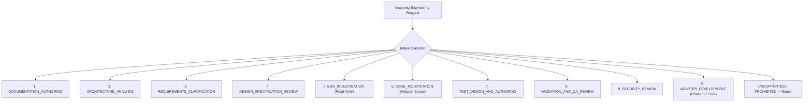

# NexLudic Engine: AI Coding Task Category & Eligibility Catalog

**Document ID:** `NLE-CAT-TIN-001`  
**Phase:** 7 of 12 (AI Coding-Agent Orchestration)  
**Step:** 53 of 100  
**Classification:** Task Taxonomy & Capability Eligibility Catalog  
**Status:** IMPLEMENTATION-READY SPECIFICATION  

---

## 1. The 10 Controlled Task Categories

NexLudic Engine defines an explicit taxonomy of 10 approved task categories. Tasks outside this catalog cannot be normalized or dispatched to coding agents without formal architectural extension:



---

## 2. Category Specification Matrix

| Category Key | Primary Activity & Expected Deliverables | Typical Tool Permissions | Prerequisite Constraints | Prohibited Operations |
| :--- | :--- | :--- | :--- | :--- |
| **`DOCUMENTATION_AUTHORING`** | Writes/updates markdown specifications, API references, architecture guides. | `allow_read: true`<br>`allow_write: true (docs/**)`<br>`allow_exec: false` | Verified upstream source specs exist. | Compiling code; editing source files. |
| **`ARCHITECTURE_ANALYSIS`** | Analyzes code structure, AST, dependency coupling, and provides review reports. | `allow_read: true`<br>`allow_write: false`<br>`allow_exec: false` | Read-only repository access. | Modifying any file on disk. |
| **`REQUIREMENTS_CLARIFICATION`** | Decomposes raw creator intent into atomic `FeatureRequirement` items (Step 44). | `allow_read: true`<br>`allow_write: true (requirements.json)`<br>`allow_exec: false` | Active mashup project exists (`Step 43`). | Committing implementation code. |
| **`DESIGN_SPECIFICATION_REVIEW`** | Audits blueprints (Step 46) against data mappings (Step 47) and workflows (Step 48). | `allow_read: true`<br>`allow_write: false`<br>`allow_exec: false` | Phase 6 planning specifications present. | Applying unreviewed patches. |
| **`BUG_INVESTIGATION`** | Analyzes crash dumps, `.trx` test failures, or IPC disconnect logs; drafts diagnosis. | `allow_read: true`<br>`allow_write: false`<br>`allow_exec: false` | Relevant diagnostic log in `scratch/`. | Patching code without authorization. |
| **`CODE_MODIFICATION`** | Refactors or patches existing adapter code within whitelisted directory paths. | `allow_read: true`<br>`allow_write: true (src/adapters/**)`<br>`allow_exec: true (tests only)`| Clean baseline commit; unit test suite exists. | Editing `src/core/**` or security policies. |
| **`TEST_DESIGN_AND_AUTHORING`** | Authors NUnit/xUnit test fixtures, mock stubs, and conformance assertions. | `allow_read: true`<br>`allow_write: true (tests/**)`<br>`allow_exec: true (run test)` | Target class interfaces exist. | Modifying implementation to make tests pass. |
| **`VALIDATION_AND_QA_REVIEW`** | Audits test execution logs, Quality Gate results, and compiles QA scorecard. | `allow_read: true`<br>`allow_write: true (docs/reports/**)`<br>`allow_exec: false` | Test runner logs present in `scratch/`. | Waiving failing acceptance criteria. |
| **`SECURITY_REVIEW`** | Performs AST taint analysis, checks `BLK-SEC-01` anti-cheat rules, audits secrets. | `allow_read: true`<br>`allow_write: false`<br>`allow_exec: false` | Full read access to task scope. | Disclosing code to public cloud AI. |
| **`ADAPTER_DEVELOPMENT`** | Implements concrete wire protocol wrappers and SDK interfaces (`P5-C01`). | `allow_read: true`<br>`allow_write: true (src/adapters/**)`<br>`allow_exec: true (dotnet test)`| Phase 5 SDK wire schemas (`Step 34-41`). | Direct memory injection or hooking. |

---

## 3. The Category $\neq$ Permission Invariant

The intake engine enforces strict orthogonal separation between **Task Classification** and **Permission Granting**:

> **Rule:** Assigning a task to `CODE_MODIFICATION` or `ADAPTER_DEVELOPMENT` describes the *nature* of the engineering activity. It does **not** grant ambient write access, shell execution permissions, or network access. Permissions are granted strictly through the task's explicit `permissions` block, locked by an authorized human token, and enforced by the Tool Gatekeeper.

---

## 4. Unsupported Task Category Handling

When an incoming request cannot be mapped to the 10 supported categories:

```mermaid
flowchart LR
    Req["Request: 'Crack game DRM to allow modding'"] --> Eval{"Matches Category Catalog?"}
    Eval -->|No: Prohibited Activity| Veto["Reject: ERR_PROHIBITED_OPERATION (BLK-SEC-01)"]
    Eval -->|No: Out of Scope (e.g. 'Build 3D Engine')| Unsup["Reject: ERR_TASK_CATEGORY_UNSUPPORTED"]
    
    Unsup --> Result["TaskIntakeResult: REJECTED_BY_POLICY"]
    Veto --> Result
```

1. **Rejection Verdict:** The intake pipeline assigns outcome state `REJECTED_BY_POLICY`.
2. **Diagnostic Explanation:** Emits diagnostic `ERR_TASK_CATEGORY_UNSUPPORTED` explaining why the request is outside platform boundaries.
3. **No Silent Reclassification:** The engine is structurally prohibited from "downgrading" an unsupported request (e.g., reclassifying a DRM-crack request as "Documentation") to force it through the pipeline.
