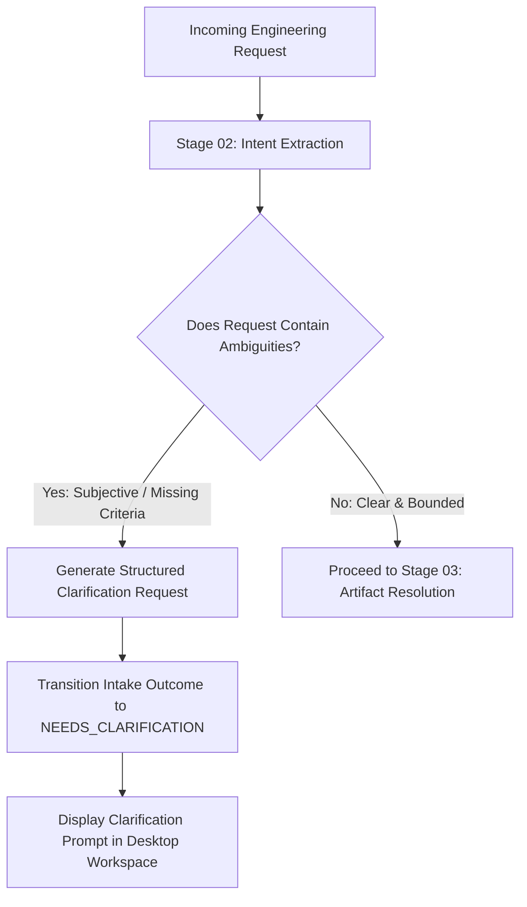
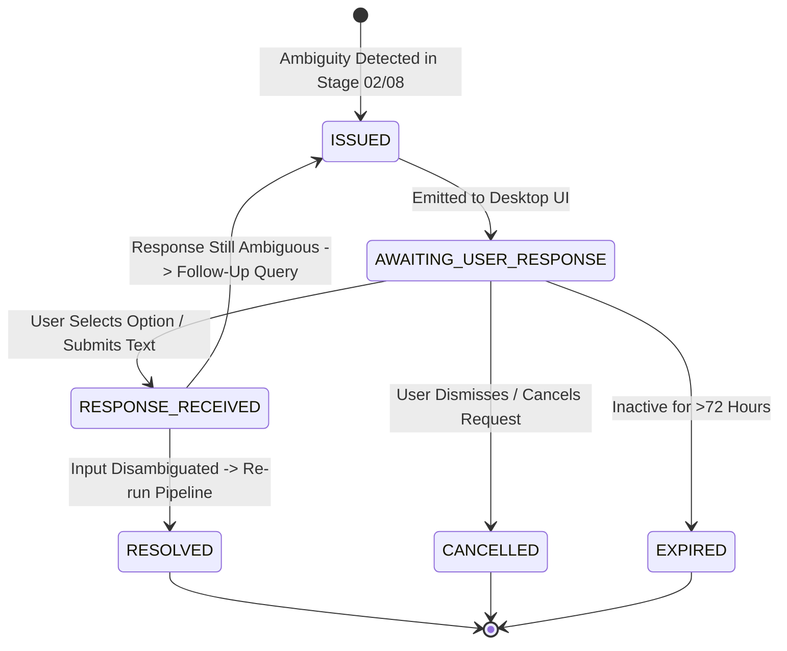

# NexLudic Engine: AI Coding Task Clarification & Ambiguity Handling Policy

**Document ID:** `NLE-POL-TCA-001`  
**Phase:** 7 of 12 (AI Coding-Agent Orchestration)  
**Step:** 53 of 100  
**Classification:** Ambiguity Governance & Clarification Protocol  
**Status:** IMPLEMENTATION-READY SPECIFICATION  

---

## 1. Ambiguity Detection & Trigger Conditions

The task intake engine evaluates incoming requests for semantic completeness and testability. If an essential engineering detail is missing, ambiguous, or contradictory, the pipeline halts progression to prevent model hallucination:



### 1.1 Canonical Ambiguity Triggers

| Trigger Key | Ambiguity Description | Example Submitted Expression | Mandatory Action |
| :--- | :--- | :--- | :--- |
| **`AMB-01`** | **Subjective / Unmeasurable Goal** | *"Make the vehicle speed sync super smooth."* | Request quantitative latency or refresh ceiling ($\le 16.6\text{ ms}$). |
| **`AMB-02`** | **Unspecified Target Project** | *"Fix the telemetry hook in the racing game."* | Request project selection (`project_id`). |
| **`AMB-03`** | **Missing Acceptance Criteria** | *"Update the Orion adapter to latest specs."* | Request specific test fixtures or criteria to verify. |
| **`AMB-04`** | **Contradictory Scope** | *"Review documentation but update the C# hook."* | Clarify whether task is doc-only or code modification. |
| **`AMB-05`** | **Ambiguous Participant Role** | *"Connect Orion and Atlas without saying which is host."* | Resolve host vs guest game roles (Step 43). |
| **`AMB-06`** | **Low Classification Confidence** | Classifier confidence score evaluates $<0.70$. | Present top-2 candidate categories for user selection. |

---

## 2. Structured Clarification Request Contract

When ambiguity is detected, the engine emits a structured `ClarificationRecord`:

```json
{
  "clarification_id": "clr-9a8b-7c6d-5e4f-0123456789ab",
  "request_id": "req-1234-5678-9abc-def012345678",
  "affected_field": "acceptance_criteria",
  "question_text": "You requested 'smooth telemetry synchronization', but did not specify a maximum latency ceiling. Which latency budget should the automated unit tests enforce?",
  "available_options": [
    { "option_id": "OPT-A", "text": "16.6 milliseconds (60 Hz target - Recommended)" },
    { "option_id": "OPT-B", "text": "33.3 milliseconds (30 Hz target)" },
    { "option_id": "OPT-C", "text": "Custom threshold specified by user" }
  ],
  "consequence_if_unanswered": "Task cannot establish automated verification fixtures and cannot be authorized.",
  "blocks_intake_entirely": true,
  "status": "AWAITING_USER_RESPONSE"
}
```

---

## 3. Partial Progress & Sub-Task Decoupling Rules

If an engineering request contains multiple distinct items (e.g., *"Update the documentation for the Orion adapter, and also recompile the native C++ hook"*):

1. **Disjoint Scope Decoupling:**  
   If the documentation component and the C++ hook component inhabit completely disjoint paths (`docs/**` vs `src/**`), the intake pipeline is permitted to normalize the documentation portion into an authorized task (`NORMALIZED`), while holding the code portion in `NEEDS_CLARIFICATION`.
2. **Coupled Scope Prohibition:**  
   If the ambiguous item is an architectural prerequisite for the other items (e.g., coordinate origin definition affects both mappings and workflows), **partial progress is strictly prohibited**. The entire request remains in `NEEDS_CLARIFICATION`.

---

## 4. Clarification Lifecycle & User Feedback Loop



### 4.1 Injection & Expansion Defense on Feedback
When a user responds to a clarification prompt, the response passes through Stage 01 secret scrubbing and prompt injection screening. If a user response attempts to inject unrelated sensitive operations (e.g., adding an unrequested DLL hook), the response is rejected with `ERR_UNAUTHORIZED_SCOPE_EXPANSION`.
