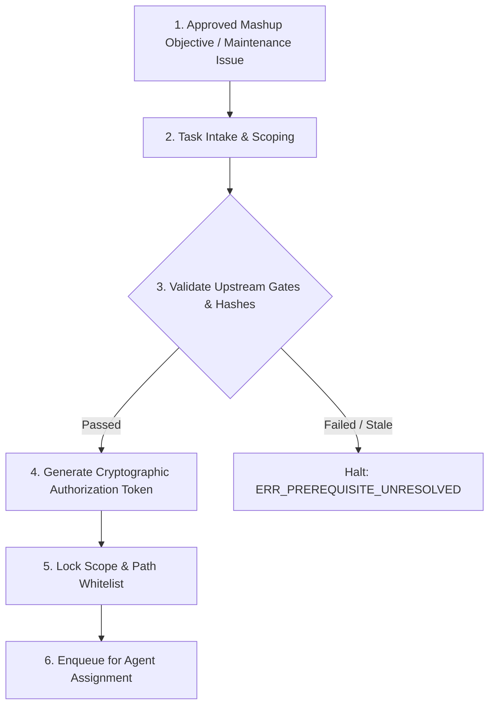

# NexLudic Engine: AI Coding Task Contract & Authorization Rules

**Document ID:** `NLE-CON-ACT-001`  
**Phase:** 7 of 12 (AI Coding-Agent Orchestration)  
**Step:** 52 of 100  
**Classification:** Task Contract & Authorization Policy  
**Status:** IMPLEMENTATION-READY SPECIFICATION  

---

## 1. Task Provenance & Origin Governance

Every AI coding task executed within the NexLudic Engine must originate from an authorized engineering or project activity. Autonomous "free-roaming" or unprompted agent self-direction is strictly prohibited.



### 1.1 Permitted Task Origins
A `CodingTask` may only be instantiated through one of four approved provenance channels:
1. **Plan Implementation Decomposition:** Decomposing an accepted Step 49 Mashup Integration Plan (`ACCEPTED_FOR_PLANNING`) into concrete adapter or bridge components.
2. **SDK Conformance Remediation:** Implementing or updating an adapter to resolve failures identified by the Step 41 Conformance Test Harness (`NLE-SPC-CTH-001`).
3. **Defect & Diagnostics Resolution:** Addressing a verified defect logged in the engine's diagnostic ledger.
4. **Specification & Documentation Scaffolding:** Authoring markdown documentation, API specifications, or synthetic test suites.

---

## 2. Objective, Scope & Path Confinement Invariants

To prevent accidental code corruption, regressions, or malicious supply chain alterations, every task enforces rigorous **Path Whitelisting**:

### 2.1 Path Confinement Rules
- **Permitted Path Globs (`permitted_path_globs`):**  
  The task contract defines an explicit whitelist of relative file paths that the agent is authorized to create or modify (e.g., `["src/adapters/game-orion/**", "tests/adapters/game-orion/**"]`).
- **Prohibited Path Globs (`prohibited_path_globs`):**  
  A platform-wide permanent blacklist overrides any permitted path:
  ```
  .git/**
  .gemini/**
  src/core/security/**
  docs/architecture/decisions/**
  **/*.exe
  **/*.dll
  **/*.sys
  **/*.bat
  **/*.ps1
  **/.env
  ```
- **Quantitative Diff Ceilings:**  
  - `max_files_modified`: Maximum number of files touched in a single attempt (default: 5, hard ceiling: 20).
  - `max_diff_lines`: Maximum lines of code added or deleted (default: 500, hard ceiling: 2000).
  - If a proposed patch exceeds these thresholds, the diff inspector halts the task with `ERR_SCOPE_THRESHOLD_EXCEEDED`.

---

## 3. Prerequisite Verification Contract

Before a task can transition from `AWAITING_PREREQUISITES` to `READY_FOR_AUTHORIZATION`, the orchestrator executes a strict prerequisite audit:

| Prerequisite Check | Verification Rule | Failure Diagnostic Code |
| :--- | :--- | :--- |
| **Phase 5 SDK Gate** | Phase 5 gate must be `READY` or `READY WITH CONDITIONS`. | `ERR_PRECONDITION_PHASE5_BLOCKED` |
| **Phase 6 Planning Gate** | If task targets a mashup plan, Phase 6 gate must be formally signed off. | `ERR_PRECONDITION_PHASE6_UNVERIFIED` |
| **Input Hash Freshness** | All input specification files on disk must match recorded snapshot SHA-256 hashes. | `ERR_PRECONDITION_STALE_SPECIFICATION` |
| **Parent Task State** | If task is a subtask, parent task must be in state `RUNNING`. | `ERR_PARENT_TASK_INACTIVE` |
| **Tool Availability** | All declared verification tools (e.g., `dotnet test`, `clang-format`) must be locally installed. | `ERR_TOOL_UNAVAILABLE` |

### 3.1 Phase 6 Gate Enforcement Policy
Because Step 51 (Phase 6 Readiness Review) is currently unverified in the repository:
> **Hard Invariant:** Any coding task attempting to generate or modify runtime bridge or mod code for a Phase 6 mashup integration plan is held in state **`BLOCKED`** under diagnostic `ERR_PRECONDITION_PHASE6_UNVERIFIED` until the formal Phase 6 readiness review is executed and recorded.

---

## 4. Cryptographic Authorization Grant Tokens

Human authorization is recorded as an immutable **Task Authorization Grant Token**:

```json
{
  "authorization_token_id": "auth-7b89-4a12-89cd-3fa85f645717",
  "task_id": "c7a8b3f1-4e92-4a7b-8912-3f1d8e0a1234",
  "project_id": "3fa85f64-5717-4562-b3fc-2c963f66afa6",
  "scope_hash_sha256": "e3b0c44298fc1c149afbf4c8996fb92427ae41e4649b934ca495991b7852b855",
  "authorized_permissions": {
    "allow_read": true,
    "allow_write": true,
    "allow_command_execution": true,
    "allow_network": false
  },
  "authorized_by_role": "SYSTEMS_ARCHITECT",
  "authorized_at": "2026-11-19T14:30:00Z",
  "token_expires_at": "2026-11-19T18:30:00Z",
  "integrity_signature_sha256": "a1b2c3d4e5f60718293a4b5c6d7e8f90123456789abcdef0123456789abcdef0"
}
```

### 4.1 Non-Transferability & Lifetime
- An authorization token is bound strictly to `task_id` and the SHA-256 hash of its scope definition (`scope_hash_sha256`).
- If an agent or user alters the task scope after authorization, the token is invalidated immediately.
- Tokens have a maximum time-to-live (TTL) of 4 hours. Expired tokens transition running tasks to `CANCELLED`.

---

## 5. Stop Conditions & Prohibited Actions

The orchestrator enforces hard operational guardrails. If an agent emits commands, prompts, or patches matching any of the following prohibited behaviors, the execution attempt is terminated immediately:

| Prohibited Action | Detection Point | Action Taken by Orchestrator | Diagnostic Code |
| :--- | :--- | :--- | :--- |
| **Writing Outside Path Whitelist** | Diff Inspector | Patches discarded; task moved to `FAILED`. | `ERR_SCOPE_VIOLATION` |
| **Requesting UAC Elevation / Admin Token** | Tool Gatekeeper | Command blocked; agent terminated. | `ERR_ELEVATION_PROHIBITED` |
| **Direct Memory Injection on EAC Title** | Tool Gatekeeper / Diff | Vetoed under `BLK-SEC-01`; task moved to `BLOCKED`.| `ERR_ANTI_CHEAT_POLICY_VIOLATION`|
| **Modifying Security Policies or Dec Logs**| Diff Inspector | Patches discarded; security incident logged. | `ERR_SECURITY_POLICY_TAMPERING` |
| **Executing Arbitrary Shell / Download** | Tool Gatekeeper | Network access blocked; process killed. | `ERR_UNAUTHORIZED_NETWORK_CALL` |
| **Exceeding Execution Timeout Ceiling** | State Machine Watchdog| Task aborted; workspace restored to baseline. | `ERR_TASK_TIMEOUT` |
