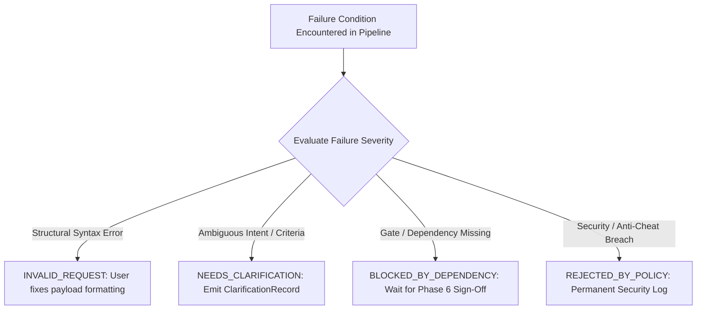
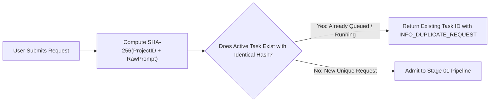

# NexLudic Engine: Task Intake Failure, Resource & Diagnostic Specification

**Document ID:** `NLE-SPC-TFD-001`  
**Phase:** 7 of 12 (AI Coding-Agent Orchestration)  
**Step:** 53 of 100  
**Classification:** Failure Taxonomy, Resource Quotas & Diagnostic Contract  
**Status:** IMPLEMENTATION-READY SPECIFICATION  

---

## 1. Intake Failure Classification Taxonomy

The task intake pipeline classifies failures into three operational severity tiers:
1. **Structural Failures (FATAL):** Malformed syntax, corrupted payloads, or missing identifiers. Request cannot be parsed.
2. **Semantic / Dependency Blockers (FATAL / CONDITIONAL):** Unresolved phase gates, stale specification hashes, or ambiguous goals. Requires clarification or gate clearance.
3. **Security Vetoes (PERMANENT REJECTION):** Violations of anti-cheat rules, attempts to access kernel memory, or UAC elevation.



---

## 2. Canonical Diagnostic Code Ledger

Every error or warning emitted by the intake pipeline conforms to the structured diagnostic schema:

| Diagnostic Code | Severity | Source Pipeline Stage | Description & Remediation |
| :--- | :---: | :--- | :--- |
| `ERR_REQUEST_PAYLOAD_EMPTY` | FATAL | Stage 01: Ingestion | Submitted prompt payload is empty or whitespace only. |
| `ERR_REQUEST_PAYLOAD_TOO_LARGE`| FATAL | Stage 01: Ingestion | Request payload exceeds 32 KB ceiling. Trim prompt text. |
| `ERR_MALFORMED_ENCODING` | FATAL | Stage 01: Ingestion | Payload contains non-UTF8 binary characters or corrupted bytes. |
| `ERR_AMBIGUOUS_INTENT` | FATAL | Stage 02: Classification | Objective is subjective or ambiguous. User must clarify goals. |
| `ERR_TASK_CATEGORY_UNSUPPORTED`| FATAL | Stage 02: Classification | Request falls outside the 10 approved task categories. |
| `ERR_PROJECT_NOT_FOUND` | FATAL | Stage 03: Resolution | Referenced `project_id` does not exist in workspace directory. |
| `ERR_STALE_UPSTREAM_ARTIFACT` | FATAL | Stage 03: Resolution | Upstream spec file hash on disk differs from recorded snapshot. |
| `ERR_SCOPE_PROHIBITED_INTERSECTION`| FATAL | Stage 04: Scoping | Permitted path globs intersect blacklisted system/git files. |
| `ERR_PRECONDITION_PHASE6_UNVERIFIED`| FATAL | Stage 05: Gate Audit | Phase 6 gate (Step 51) unverified. Mashup plan tasks blocked. |
| `ERR_PRECONDITION_PHASE5_BLOCKED`| FATAL | Stage 05: Gate Audit | Phase 5 SDK gate is in BLOCKED state. Adapter tasks halted. |
| `ERR_ANTI_CHEAT_POLICY_VIOLATION`| FATAL | Stage 06: Security | Direct memory hooking requested on anti-cheat game (`BLK-SEC-01`). |
| `ERR_ELEVATION_PROHIBITED` | FATAL | Stage 06: Security | UAC elevation or Administrator privileges requested (`DEC-002`). |
| `ERR_VAGUE_ACCEPTANCE_CRITERIA`| FATAL | Stage 08: Acceptance | Acceptance criteria lack objective, testable verification method. |
| `ERR_TASK_SCHEMA_VALIDATION_FAILED`| FATAL | Stage 09: Normalization | Assembled task descriptor fails JSON Schema `NLE-SCH-ACO-001`. |
| `ERR_TOKEN_EXPIRED` | FATAL | Stage 10: Authorization | Task authorization token exceeded 4-hour time-to-live. |
| `WARN_SECRET_SCRUBBED` | WARNING | Stage 01: Ingestion | Detected high-entropy secret; redacted before processing. |
| `WARN_NEW_DEPENDENCY_DETECTED` | WARNING | Stage 04: Scoping | Task proposes adding new third-party dependency; needs review. |

---

## 3. Safe Retries, Idempotency & Duplicate Request Handling

To prevent duplicate task generation when requests are submitted multiple times:



1. **Idempotency Fingerprinting:** Every request generates a fingerprint:
   $$\text{Fingerprint} = \text{SHA-256}(\text{project\_id} \parallel \text{requester\_identity} \parallel \text{raw\_prompt\_content})$$
2. **Duplicate Detection:** If a request with an identical fingerprint is received while a task is in state `QUEUED`, `ASSIGNED`, or `RUNNING`, the intake engine returns the existing `task_id` with diagnostic `INFO_DUPLICATE_REQUEST_COALESCED`. It does not instantiate a parallel competing task.

---

## 4. Resource Governance & Intake Workload Quotas

To protect the desktop application host from denial-of-service, memory bloat, and runaway loops:

```
+----------------------------------------------------------------------------------------------------+
| INTAKE WORKLOAD QUOTAS & SYSTEM CEILINGS                                                           |
+----------------------------------------------------------------------------------------------------+
| 1. Payload Size Ceilings:                                                                          |
|    - Maximum Raw Prompt Payload: 32 KB (approx. 8,000 words).                                      |
|    - Maximum Attachment Count: 5 files (cumulative size <= 1 MB).                                  |
| 2. Processing Time Limits:                                                                         |
|    - 11-Stage Pipeline Execution Timeout: 10.0 seconds.                                             |
|    - Regex & Secret Scrubbing Watchdog: 2.0 seconds.                                               |
| 3. Concurrency Limits:                                                                             |
|    - Maximum 5 concurrent intake validation runs.                                                  |
| 4. Clarification Iteration Ceiling:                                                                |
|    - Maximum 3 clarification question cycles per request. If still ambiguous, request is REJECTED. |
+----------------------------------------------------------------------------------------------------+
```
