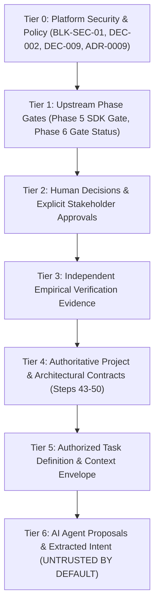
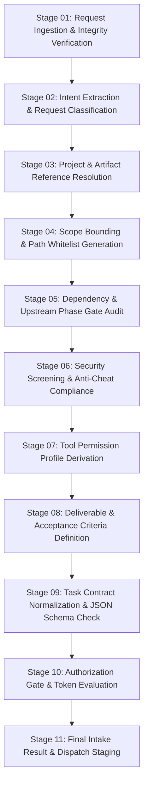

# NexLudic Engine: AI Coding Task Intake, Normalization & Authorization Gate Specification

**Document ID:** `NLE-SPC-TIN-001`  
**Phase:** 7 of 12 (AI Coding-Agent Orchestration)  
**Step:** 53 of 100  
**Classification:** Task Intake & Authorization Architecture Specification  
**Status:** IMPLEMENTATION-READY SPECIFICATION  
**Authoritative Scope:** Specification, Architecture, and Policy Only (No Intake Implementation, No AI Provider Calls, No Code Generation, No Code Execution)

---

## 1. Executive Summary & Purpose

The **AI Coding Task Intake, Normalization & Authorization Gate Specification** establishes the authoritative entry-point architecture for the NexLudic Engine AI Coding-Agent Orchestrator. 

Before an AI coding agent can be assigned, provided context, or invoked with tools, raw engineering requests—originating from human developers, creators, automated diagnostic monitors, or maintenance queues—must be ingested, disambiguated, parsed, normalized into a structured `CodingTaskDescriptor`, validated against project constraints, screened against security policies, and formally authorized by human stakeholders.

The intake pipeline enforces two foundational governance principles:
1. **Separation of Intent from Authority:** A user's expressed desire ("make the vehicle sync work") is an expression of intent; it does **not** grant ambient authority, bypass safety constraints, or authorize arbitrary filesystem modifications.
2. **Deterministic Pre-Flight Gating:** Tasks are evaluated against an 11-stage validation pipeline and formal gate checks. If a request is ambiguous, unsupported, stale, or prohibited under security invariants (`DEC-002`, `DEC-009`, `BLK-SEC-01`), the pipeline emits structured diagnostics and halts progression *before* untrusted model invocation.

---

## 2. Epistemic Hierarchy & Source-of-Truth Governance

Task intake operates under the 7-tier epistemic hierarchy established in Step 52 (`NLE-SPC-ACO-001`):

### 2.1 The Request vs. Task Separation Principle
The intake subsystem enforces absolute structural separation between:
- **`OriginalRequestRecord`:** The immutable raw request as submitted by the user or upstream subsystem (capturing exact words, attachments, and timestamps).
- **`ExtractedIntent`:** The system's semantic interpretation of what the user desires.
- **`CodingTaskDescriptor`:** The formal, bounded, and versioned task contract defining explicit path whitelists, required deliverables, prerequisites, and test acceptance criteria.

Normalizing a request must **never** overwrite or mutate the original request record. Furthermore, an AI-assisted interpretation of a request remains untrusted (Tier 6) until validated against authoritative contracts (Tier 4) and approved by a human (Tier 2).

---

## 3. Mandatory Upstream Gate & Handoff Audit

Before authoring task intake contracts, the platform must verify its upstream dependencies across Phase 5 and Phase 6:

### 3.1 Phase 5 Universal Adapter SDK Gate
- **Authoritative Gate Artifact:** `docs/adapters/STEP_42_COMPLETION_REPORT.md` (`NLE-GAT-PH5-001`).
- **Gate Outcome:** **`READY WITH CONDITIONS`**.
- **Impact on Intake:** Condition `P5-C01` (Native Language SDK Bindings) is actively allocated to Phase 7/8. Task intake recognizes `ADAPTER_DEVELOPMENT` tasks implementing wire protocol serialization wrappers as eligible for intake.

### 3.2 Phase 6 Mashup Designer & Planning Gate Audit
- **Audit Findings:** Step 51 (Phase 6 Readiness Review) was not conducted in the repository. As recorded in Step 52 (`NLE-SPC-ACO-001`), Phase 6 gate status is **`UNVERIFIED / MISSING FORMAL SIGN-OFF`**.
- **Impact on Task Intake (`ERR_PRECONDITION_PHASE6_UNVERIFIED`):**  
  In strict accordance with roadmap governance:
  > **Hard Intake Invariant:** Any incoming request targeting the implementation of a Step 49 Mashup Integration Plan (`ACCEPTED_FOR_PLANNING`) is accepted for normalization, but **its authorization gate evaluates to `BLOCKED BY DEPENDENCY`**. The task cannot transition to `READY_FOR_ASSIGNMENT` until the formal Phase 6 gate sign-off is completed and recorded.

---

## 4. The 11-Stage Intake & Authorization Pipeline

Every engineering request passes through an 11-stage deterministic pipeline:

### Stage Summary
1. **Stage 01 (Request Ingestion):** Captures raw payload, validates encoding, assigns stable `request_id`, scrubs secrets.
2. **Stage 02 (Intent Extraction & Classification):** Maps request to one of 10 approved task categories; flags ambiguous intents.
3. **Stage 03 (Project & Artifact Resolution):** Verifies that referenced `project_id`, `requirement_id`, or `blueprint_id` exists on Volume D and is fresh.
4. **Stage 04 (Scope Bounding):** Derives `permitted_path_globs` and enforces `prohibited_path_globs` and diff line ceilings.
5. **Stage 05 (Dependency & Gate Audit):** Asserts Phase 5 conditions (`P5-C01`) and checks Phase 6 gate status.
6. **Stage 06 (Security Screening):** Asserts Windows Medium IL (`DEC-002`) and Anti-Cheat Dominance (`BLK-SEC-01`); vetoes direct memory hooks.
7. **Stage 07 (Permission Derivation):** Derives default-deny tool permissions (`allow_read`, `allow_write`, `allow_command_execution`).
8. **Stage 08 (Deliverable & Acceptance Criteria):** Establishes explicit, testable criteria (e.g., unit test pass, diff inspection).
9. **Stage 09 (Contract Normalization):** Validates the assembled descriptor against JSON Schema `NLE-SCH-ACO-001`.
10. **Stage 10 (Authorization Gate):** Evaluates whether existing user token covers the scope or human sign-off is required.
11. **Stage 11 (Final Intake Result):** Emits immutable `TaskIntakeResult` with status, diagnostics, and next-action guidance.

---

## 5. Specification Suite Directory

The Step 53 documentation suite consists of 14 interconnected documentation artifacts located in `docs/ai-orchestration/`:

| # | Deliverable File Link | Ref ID | Scope & Architectural Focus |
| :-: | :--- | :--- | :--- |
| 1 | [AI_CODING_TASK_INTAKE_NORMALIZATION_AND_AUTHORIZATION_GATE_SPECIFICATION.md](file:///d:/App%20Winrar%20Files/Nexludic%20Engine%20(working)/docs/ai-orchestration/AI_CODING_TASK_INTAKE_NORMALIZATION_AND_AUTHORIZATION_GATE_SPECIFICATION.md) | `NLE-SPC-TIN-001` | Foundational intake architecture, pipeline stages, authority rules, platform invariants. |
| 2 | [AI_CODING_REQUEST_AND_NORMALIZED_TASK_DOMAIN_MODEL.md](file:///d:/App%20Winrar%20Files/Nexludic%20Engine%20(working)/docs/ai-orchestration/AI_CODING_REQUEST_AND_NORMALIZED_TASK_DOMAIN_MODEL.md) | `NLE-MOD-TIN-001` | Entity definitions: `OriginalRequestRecord`, `ExtractedIntent`, `CodingTaskDescriptor`, schemas. |
| 3 | [AI_CODING_TASK_CATEGORY_AND_ELIGIBILITY_CATALOG.md](file:///d:/App%20Winrar%20Files/Nexludic%20Engine%20(working)/docs/ai-orchestration/AI_CODING_TASK_CATEGORY_AND_ELIGIBILITY_CATALOG.md) | `NLE-CAT-TIN-001` | 10 task categories, activity boundaries, prohibited actions, agent capability prerequisites. |
| 4 | [AI_CODING_TASK_NORMALIZATION_AND_SCOPE_VALIDATION_RULES.md](file:///d:/App%20Winrar%20Files/Nexludic%20Engine%20(working)/docs/ai-orchestration/AI_CODING_TASK_NORMALIZATION_AND_SCOPE_VALIDATION_RULES.md) | `NLE-RUL-TIN-001` | Intent preservation, path whitelisting, quantitative ceilings, ungrounded expansion defense. |
| 5 | [AI_CODING_TASK_INTAKE_VALIDATION_PIPELINE.md](file:///d:/App%20Winrar%20Files/Nexludic%20Engine%20(working)/docs/ai-orchestration/AI_CODING_TASK_INTAKE_VALIDATION_PIPELINE.md) | `NLE-PIP-TIN-001` | Detailed 11-stage pipeline, stage preconditions, validation ordering, diagnostic codes. |
| 6 | [AI_CODING_TASK_AUTHORIZATION_AND_PHASE_GATE_POLICY.md](file:///d:/App%20Winrar%20Files/Nexludic%20Engine%20(working)/docs/ai-orchestration/AI_CODING_TASK_AUTHORIZATION_AND_PHASE_GATE_POLICY.md) | `NLE-POL-TIN-001` | Authorization token governance, Phase 6 gate blocking, approval boundaries, privilege limits. |
| 7 | [AI_CODING_TASK_CLARIFICATION_AND_AMBIGUITY_HANDLING_POLICY.md](file:///d:/App%20Winrar%20Files/Nexludic%20Engine%20(working)/docs/ai-orchestration/AI_CODING_TASK_CLARIFICATION_AND_AMBIGUITY_HANDLING_POLICY.md) | `NLE-POL-TCA-001` | Ambiguity detection triggers, structured clarification request contracts, partial progress rules. |
| 8 | [AI_CODING_TASK_STATUS_AND_INTAKE_RESULT_CONTRACT.md](file:///d:/App%20Winrar%20Files/Nexludic%20Engine%20(working)/docs/ai-orchestration/AI_CODING_TASK_STATUS_AND_INTAKE_RESULT_CONTRACT.md) | `NLE-CON-TIR-001` | 8 intake outcome states (`NORMALIZED`, `NEEDS_CLARIFICATION`, `BLOCKED`, `REJECTED`), result schema. |
| 9 | [AI_CODING_TASK_VERSIONING_AND_AUTHORIZATION_INVALIDATION_POLICY.md](file:///d:/App%20Winrar%20Files/Nexludic%20Engine%20(working)/docs/ai-orchestration/AI_CODING_TASK_VERSIONING_AND_AUTHORIZATION_INVALIDATION_POLICY.md) | `NLE-POL-TVI-001` | SemVer revisions, snapshot freshness tracking, authorization invalidation cascade. |
| 10 | [AI_CODING_TASK_INTAKE_SECURITY_PRIVACY_AND_INPUT_TRUST_POLICY.md](file:///d:/App%20Winrar%20Files/Nexludic%20Engine%20(working)/docs/ai-orchestration/AI_CODING_TASK_INTAKE_SECURITY_PRIVACY_AND_INPUT_TRUST_POLICY.md) | `NLE-SEC-TIN-001` | Untrusted input handling, prompt injection neutralization, secret scrubbing, data residency. |
| 11 | [AI_CODING_TASK_INTAKE_FAILURE_RESOURCE_AND_DIAGNOSTIC_SPECIFICATION.md](file:///d:/App%20Winrar%20Files/Nexludic%20Engine%20(working)/docs/ai-orchestration/AI_CODING_TASK_INTAKE_FAILURE_RESOURCE_AND_DIAGNOSTIC_SPECIFICATION.md) | `NLE-SPC-TFD-001` | Malformed inputs, quota exhaustion, safe retries, deduplication, diagnostics catalog. |
| 12 | [AI_CODING_TASK_INTAKE_SYNTHETIC_SCENARIOS_AND_TEST_PLAN.md](file:///d:/App%20Winrar%20Files/Nexludic%20Engine%20(working)/docs/ai-orchestration/AI_CODING_TASK_INTAKE_SYNTHETIC_SCENARIOS_AND_TEST_PLAN.md) | `NLE-CAT-TIS-001` | 18 synthetic verification scenarios (Scenarios A through R) testing edge cases and gates. |
| 13 | [STEP_53_INTAKE_REQUIREMENTS_TRACEABILITY_MATRIX.md](file:///d:/App%20Winrar%20Files/Nexludic%20Engine%20(working)/docs/ai-orchestration/STEP_53_INTAKE_REQUIREMENTS_TRACEABILITY_MATRIX.md) | `NLE-MAT-STP-053` | Bidirectional traceability matrix verifying all 24 intake requirements (`TIN-REQ-001..024`). |
| 14 | [STEP_53_COMPLETION_REPORT.md](file:///d:/App%20Winrar%20Files/Nexludic%20Engine%20(working)/docs/ai-orchestration/STEP_53_COMPLETION_REPORT.md) | `NLE-REP-STP-053` | Milestone completion audit, 19 acceptance criteria verification (`AC-01..19`), sign-off verdict. |

---

## 6. Implementation Readiness & Boundary Statement

This specification suite defines the domain models, intake stages, normalization rules, authorization gates, and diagnostic ledgers required to build the task intake engine in subsequent implementation phases.

In strict adherence to the project roadmap, **no application code, task parser service, policy engine, AI provider connector, or code execution engine has been implemented.**
