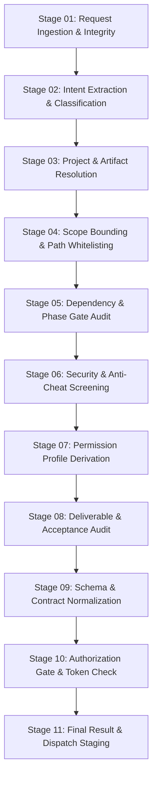

# NexLudic Engine: AI Coding Task Intake Validation Pipeline

**Document ID:** `NLE-PIP-TIN-001`  
**Phase:** 7 of 12 (AI Coding-Agent Orchestration)  
**Step:** 53 of 100  
**Classification:** Intake Pipeline & Staged Validation Specification  
**Status:** IMPLEMENTATION-READY SPECIFICATION  

---

## 1. Pipeline Architecture & Execution Flow

The **Task Intake Validation Pipeline** is an automated, deterministic 11-stage evaluation engine. Every engineering request must pass through all 11 stages sequentially. If any stage discovers a fatal condition or policy violation, the pipeline halts immediately, records structured diagnostics, and assigns the appropriate outcome state.

---

## 2. Stage-by-Stage Verification Protocols

### Stage 01: Request Ingestion & Integrity Verification
- **Objective:** Ingest raw payload; verify UTF-8 encoding; assert payload size ($\le 32\text{ KB}$); execute Shannon entropy secret scrubber; compute `content_hash_sha256`.
- **Preconditions:** Payload stream non-empty.
- **Fatal Exit Codes:** `ERR_REQUEST_PAYLOAD_EMPTY`, `ERR_REQUEST_PAYLOAD_TOO_LARGE`, `ERR_MALFORMED_ENCODING`.

### Stage 02: Intent Extraction & Request Classification
- **Objective:** Extract primary objective, candidate deliverables, and map request to one of 10 approved task categories (`NLE-CAT-TIN-001`). Calculate classification confidence score.
- **Preconditions:** Stage 01 passed.
- **Branching / Early Exit:**  
  - If confidence $<0.70$ or objective is ambiguous $\rightarrow$ Halt with outcome `NEEDS_CLARIFICATION` (`ERR_AMBIGUOUS_INTENT`).  
  - If request matches prohibited activity (e.g., DRM crack) $\rightarrow$ Halt with outcome `REJECTED_BY_POLICY` (`ERR_TASK_CATEGORY_UNSUPPORTED`).

### Stage 03: Project & Artifact Reference Resolution
- **Objective:** Verify that referenced `project_id` exists on Volume D. For any referenced upstream files (e.g., `requirements.json`, `blueprint.json`), verify file exists and compute SHA-256 hash. Compare against snapshot hash.
- **Fatal Exit Codes:** `ERR_PROJECT_NOT_FOUND`, `ERR_STALE_UPSTREAM_ARTIFACT`, `ERR_REFERENCED_FILE_MISSING`.

### Stage 04: Scope Bounding & Path Whitelisting
- **Objective:** Derive `permitted_path_globs` based on task category and module. Assert that permitted paths do not intersect `prohibited_path_globs`. Establish `max_files_modified` and `max_diff_lines`.
- **Fatal Exit Codes:** `ERR_SCOPE_PROHIBITED_INTERSECTION`, `ERR_SCOPE_UNBOUNDED`.

### Stage 05: Dependency & Upstream Phase Gate Audit
- **Objective:** Ingest Phase 5 SDK gate (`NLE-GAT-PH5-001`) and Phase 6 planning gate status.
- **Hard Gate Rule (`ERR_PRECONDITION_PHASE6_UNVERIFIED`):**  
  If the task aims to generate or modify runtime code for a Step 49 Mashup Integration Plan, check Step 51 readiness review. Because Step 51 is unverified, **the pipeline halts with outcome `BLOCKED_BY_DEPENDENCY`**.

### Stage 06: Security Screening & Anti-Cheat Compliance
- **Objective:** Check participating games against anti-cheat registry (`BLK-SEC-01`). If a target game employs EAC, BattlEye, or Vanguard, assert that task scope contains **zero memory hooking or DLL injection**. Assert Windows Medium IL (`DEC-002`).
- **Fatal Exit Codes:** `ERR_ANTI_CHEAT_POLICY_VIOLATION`, `ERR_ELEVATION_PROHIBITED`.

### Stage 07: Tool Permission Profile Derivation
- **Objective:** Derive default-deny tool permissions. Enforce `allow_network: false`. Assign `allow_write` and `allow_command_execution` strictly based on task category.
- **Fatal Exit Codes:** `ERR_INVALID_PERMISSION_COMBINATION`.

### Stage 08: Deliverable & Acceptance Criteria Validation
- **Objective:** Audit extracted acceptance criteria. Assert that every criterion specifies an objective, deterministic verification method (`AUTOMATED_UNIT_TEST`, `SCHEMA_VALIDATION`, `DIFF_INSPECTION`).
- **Fatal Exit Codes:** `ERR_VAGUE_ACCEPTANCE_CRITERIA`, `ERR_DELIVERABLES_UNDEFINED`.

### Stage 09: Task Contract Normalization & JSON Schema Check
- **Objective:** Assemble `CodingTaskDescriptor` entity. Validate 100% against JSON Schema Draft 2020-12 (`NLE-SCH-ACO-001`).
- **Fatal Exit Codes:** `ERR_TASK_SCHEMA_VALIDATION_FAILED`.

### Stage 10: Authorization Gate & Token Evaluation
- **Objective:** Check if task is covered by an active, valid `TaskAuthorizationGrantToken`. If no token exists or scope hash differs, transition task to state `READY_FOR_AUTHORIZATION` or outcome `AWAITING_APPROVAL`.
- **Exit Outcomes:** `NORMALIZED` (if authorized) or `AWAITING_APPROVAL`.

### Stage 11: Final Intake Result & Dispatch Staging
- **Objective:** Serialize `TaskIntakeResult` with outcome state, diagnostics, and timestamp. Compute `intake_signature_sha256`. Store record in `projects/<id>/logs/intake_audit.jsonl`.
- **Final Verdicts:** Emits formal intake verdict.
