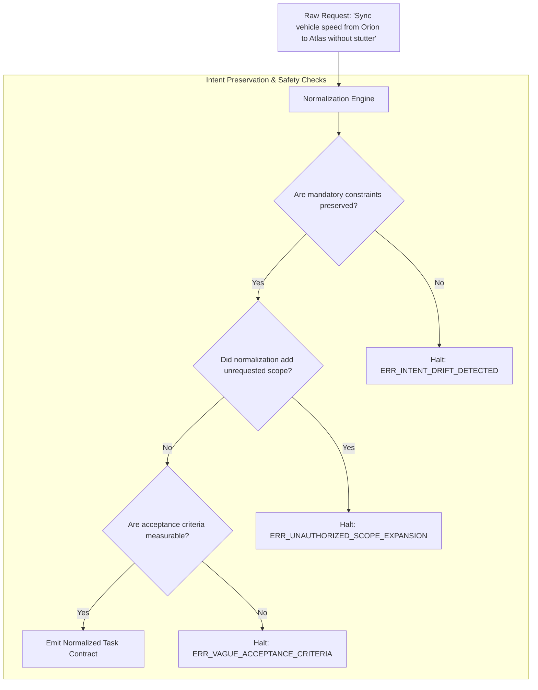

# NexLudic Engine: AI Coding Task Normalization & Scope Validation Rules

**Document ID:** `NLE-RUL-TIN-001`  
**Phase:** 7 of 12 (AI Coding-Agent Orchestration)  
**Step:** 53 of 100  
**Classification:** Normalization Protocol & Scope Bounding Specification  
**Status:** IMPLEMENTATION-READY SPECIFICATION  

---

## 1. Intent Preservation & Semantic Fidelity Rules

When converting an informal, natural-language request into a formal `CodingTaskDescriptor`, the normalization engine must preserve the requester's intent with strict fidelity:



### 1.1 Intent Preservation Invariants
1. **Zero Silent Constraint Omission (`INV-TIN-01`):**  
   If the requester specifies constraints (e.g., "Must run offline", "Do not modify Atlas DLLs", "Keep latency under 16ms"), these constraints must be explicitly mapped into the task's `constraints` array. Silently omitting constraints to make agent implementation easier is prohibited.
2. **Zero Unsolicited Scope Expansion (`INV-TIN-02`):**  
   If the requester asks for a documentation update, the normalization engine must **not** add code modification paths. If a user asks for a telemetry fix in Game Orion, the engine must not expand scope to touch Game Atlas.
3. **No Inference of Elevation (`INV-TIN-03`):**  
   A user stating "fix the game crash" does **not** authorize requesting Windows Administrator privileges, kernel hooking, or disabling anti-cheat services.

---

## 2. Scope Bounding & Path Whitelisting Rules

Task scope is enforced via explicit path whitelisting and quantitative thresholds:

### 2.1 Path Whitelist Derivation Algorithm
```
ALGORITHM DeriveTaskPathWhitelist(TaskCategory, ProjectId, TargetModule):
    1. Base permitted set P = []
    2. SWITCH TaskCategory:
         CASE "DOCUMENTATION_AUTHORING":
             P.add("docs/projects/" + ProjectId + "/**")
         CASE "ADAPTER_DEVELOPMENT":
             P.add("src/adapters/" + TargetModule + "/**")
             P.add("tests/adapters/" + TargetModule + "/**")
         CASE "PROTOCOL_CODEGEN":
             P.add("src/shared/protocols/" + TargetModule + "/**")
         DEFAULT:
             P.add("scratch/tasks/" + TaskId + "/**")
             
    3. Assert that P does NOT intersect with ProhibitedBlacklist:
         ProhibitedBlacklist = [
             ".git/**", 
             ".gemini/**", 
             "src/core/security/**", 
             "docs/architecture/decisions/**",
             "**/*.exe", 
             "**/*.dll", 
             "**/*.sys",
             "**/.env"
         ]
    4. IF (P intersects ProhibitedBlacklist):
         THROW Error("ERR_SCOPE_PROHIBITED_INTERSECTION")
    5. RETURN P
```

### 2.2 Quantitative Scope Ceilings
To prevent runaway model edits across large codebases, every task enforces:
- `max_files_modified`: Maximum number of files touched (Default: 5, Maximum allowed: 20).
- `max_diff_lines`: Maximum cumulative diff lines (Default: 500 lines, Maximum allowed: 2,000 lines).

---

## 3. Measurable Acceptance Criteria & Verifiable Deliverables

A coding task cannot proceed to an agent if its success criteria are subjective, ambiguous, or unverifiable:

### 3.1 Valid vs. Invalid Acceptance Criteria

| Submitted Expression | Verdict | Rejection Reason | Normalized Formulation Required |
| :--- | :---: | :--- | :--- |
| *"Make the vehicle sync fast and smooth."* | **INVALID** | Subjective; lacks quantitative threshold. | *"Vehicle telemetry update latency must not exceed 16.6ms at 60Hz."* |
| *"Ensure the adapter code is good quality."* | **INVALID** | Unverifiable quality statement. | *"Code must compile with 0 warnings under -Werror; passes clang-format."* |
| *"Implement unit tests for coordinate conversion."*| **VALID** | Verifiable; maps to concrete test fixture. | *"Unit tests in `tests/orion/CoordTests.cs` must achieve 100% pass rate."* |
| *"Make sure anti-cheat doesn't complain."* | **INVALID** | Negative unproven assertion. | *"Adapter must utilize non-invasive Named Pipe transport; zero memory hooks."* |

---

## 4. Explicit Exclusions (Non-Goals)

Every normalized task contract must contain an `explicit_exclusions` array defining what the agent is **expressly prohibited** from touching:
- Example: For an adapter development task:
  ```json
  "explicit_exclusions": [
    "Do NOT modify shared core memory allocation in src/core/ringbuffer/",
    "Do NOT alter Step 47 cross-game coordinate mapping formulas",
    "Do NOT introduce new external third-party NuGet dependencies",
    "Do NOT alter active game installation binaries on disk"
  ]
  ```
The Diff Inspector evaluates these exclusions as hard boundaries during Stage 08 post-execution verification.
