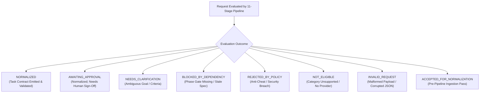

# NexLudic Engine: AI Coding Task Status & Intake Result Contract

**Document ID:** `NLE-CON-TIR-001`  
**Phase:** 7 of 12 (AI Coding-Agent Orchestration)  
**Step:** 53 of 100  
**Classification:** Intake Outcome Taxonomy & Result Contract Specification  
**Status:** IMPLEMENTATION-READY SPECIFICATION  

---

## 1. The 8 Controlled Intake Outcome States

The task intake pipeline concludes its evaluation by assigning the request exactly one of 8 mutually exclusive **Intake Outcome States**:



### 1.1 State Definitions & Next Operational Actions

| Outcome Key | Outcome State Name | Meaning & Criteria | Permitted Next Action | Agent Assignment Allowed? |
| :--- | :--- | :--- | :--- | :---: |
| **OUT-01** | `ACCEPTED_FOR_NORMALIZATION` | Raw payload admitted to pipeline; schema valid. | Run Stages 02–11. | **NO** |
| **OUT-02** | `NEEDS_CLARIFICATION` | Goal or acceptance criteria ambiguous; questions issued. | User answers clarification prompt. | **NO** |
| **OUT-03** | `INVALID_REQUEST` | Malformed UTF-8, oversized payload, or missing ID. | User fixes request syntax. | **NO** |
| **OUT-04** | `BLOCKED_BY_DEPENDENCY` | Blocked by missing upstream gate (e.g. Phase 6 review). | Wait for gate/spec clearance. | **NO** |
| **OUT-05** | `AWAITING_APPROVAL` | Normalized task ready; requires human authorization token. | Human signs token in UI. | **NO** |
| **OUT-06** | `NOT_ELIGIBLE` | Request category unsupported by platform. | Inform user; close request. | **NO** |
| **OUT-07** | `REJECTED_BY_POLICY` | Violates Anti-Cheat (`BLK-SEC-01`) or Medium IL. | Permanent rejection log. | **NO** |
| **OUT-08** | `NORMALIZED` | Task fully validated, authorized, and staged. | Enqueue for agent assignment. | **YES** |

---

## 2. Rejection vs. Blocking Semantics

The engine strictly distinguishes temporary blockers from permanent policy rejections:

```
+----------------------------------------------------------------------------------------------------+
| BLOCKED_BY_DEPENDENCY (Temporary Gate / Prerequisite Gap)                                          |
| - Meaning: The request is architecturally legitimate, but prerequisite contracts are not ready.    |
| - Example: Step 51 Phase 6 readiness review has not been performed in the repository.             |
| - Behavior: Task is preserved as a draft; monitors for Phase 6 gate clearance; resumes when ready.  |
+----------------------------------------------------------------------------------------------------+
| REJECTED_BY_POLICY (Permanent Security / Legal Violation)                                          |
| - Meaning: The requested action violates platform safety, licensing, or security invariants.       |
| - Example: Agent requested to write a kernel driver or inject memory into an EAC-protected title.  |
| - Behavior: Task is permanently rejected; never retried; security audit log emitted.               |
+----------------------------------------------------------------------------------------------------+
```

---

## 3. Separation of Intake State from Execution State

To prevent race conditions and misleading status indicators in the user interface:
- **Intake Outcome State (`outcome_state`):** Describes whether the request passed the intake gate (`NORMALIZED`, `BLOCKED`, `REJECTED`).
- **Task Lifecycle State (`lifecycle_state`):** Describes where the task lives in the Step 52 state machine (`AUTHORIZED`, `QUEUED`, `RUNNING`).
- **Verification State (`verification_state`):** Describes test runner results (`TESTS_PASSED`, `TESTS_FAILED`).
- **Acceptance State (`acceptance_state`):** Describes final human sign-off (`ACCEPTED`, `REVISION_REQUESTED`).

A task being `NORMALIZED` does **not** mean it is `AUTHORIZED`, `RUNNING`, or `ACCEPTED`.

---

## 4. Formal `TaskIntakeResult` Payload Specification

Every intake pipeline execution emits an immutable `TaskIntakeResult` JSON record:

```json
{
  "schema_version": "1.0.0",
  "intake_result_id": "res-01a2-3b4c-5d6e-7f8a9b0c1d2e",
  "request_id": "req-1234-5678-9abc-def012345678",
  "task_id": "c7a8b3f1-4e92-4a7b-8912-3f1d8e0a1234",
  "outcome_state": "BLOCKED_BY_DEPENDENCY",
  "diagnostics": [
    {
      "code": "ERR_PRECONDITION_PHASE6_UNVERIFIED",
      "severity": "FATAL",
      "message": "Task targets implementation of a Step 49 mashup integration plan, but Phase 6 readiness review (Step 51) has not been executed in the repository.",
      "target_field": "prerequisites"
    }
  ],
  "evaluated_at": "2026-11-19T14:40:00Z",
  "intake_signature_sha256": "3e9b7a4c1d2f08a6b5c4d3e2f1a09b8c7d6e5f4a3b2c1d0e9f8a7b6c5d4e3f2a"
}
```
