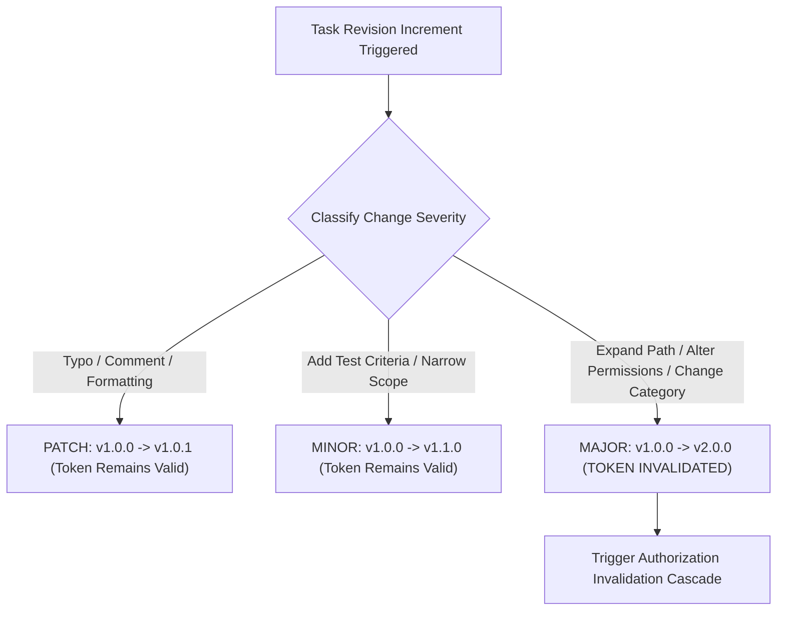

# NexLudic Engine: AI Coding Task Versioning & Invalidation Policy

**Document ID:** `NLE-POL-TVI-001`  
**Phase:** 7 of 12 (AI Coding-Agent Orchestration)  
**Step:** 53 of 100  
**Classification:** Versioning Governance & Invalidation Protocol  
**Status:** IMPLEMENTATION-READY SPECIFICATION  

---

## 1. Task Semantic Versioning Protocol

Every normalized `CodingTaskDescriptor` is versioned using strict Semantic Versioning (`MAJOR.MINOR.PATCH`):



### 1.1 Version Increment Rules
- **PATCH Increment (`v1.0.0` $\rightarrow$ `v1.0.1`):**  
  Cosmetic clarifications in the task objective or notes that do not alter the path whitelist, tool permissions, or acceptance criteria. *Impact:* Existing `TaskAuthorizationGrantToken` remains valid.
- **MINOR Increment (`v1.0.0` $\rightarrow$ `v1.1.0`):**  
  Adding a new non-critical unit test fixture or narrowing the permitted path whitelist. *Impact:* Existing token remains valid, provided scope hash is updated with user consent.
- **MAJOR Increment (`v1.0.0` $\rightarrow$ `v2.0.0`):**  
  Adding new files to `permitted_path_globs`, enabling `allow_command_execution`, modifying the target project, or changing the task category. *Impact:* **Immediate authorization invalidation.** A new human authorization token must be granted.

---

## 2. The 6 Invalidation Trigger Events

The orchestrator actively monitors the validity of authorized tasks. If any of the following 6 events occur, task authorization is atomically revoked:

| Event ID | Invalidation Trigger Event | Detection Point | Automated Action Taken |
| :--- | :--- | :--- | :--- |
| **`EVT-TIN-01`** | **Path Whitelist Expanded** | Task edit in UI / API | Invalidate token; transition task to `READY_FOR_AUTHORIZATION`. |
| **`EVT-TIN-02`** | **Upstream File Hash Modified** | File watcher on Volume D | Task marked stale; transition to `BLOCKED_BY_DEPENDENCY`. |
| **`EVT-TIN-03`** | **Upstream Phase Gate Revoked** | Phase gate audit poll | Block all tasks targeting revoked gate. |
| **`EVT-TIN-04`** | **Tool Permissions Escalated** | Contract mutation | Invalidate token; emit `WARN_PERMISSION_ESCALATION`. |
| **`EVT-TIN-05`** | **Authorization Token Expired** | Watchdog (TTL $>4\text{ hours}$) | Revoke token; transition task to `AWAITING_APPROVAL`. |
| **`EVT-TIN-06`** | **User Revocation Action** | UI "Abort" / "Revoke" click | Abort active agent stream; rollback sandbox; task `CANCELLED`. |

---

## 3. Invalidation Cascade Protocol

When an invalidation event fires:
1. **Token Invalidation:** The active `TaskAuthorizationGrantToken` is cryptographically marked `REVOKED` in the project ledger.
2. **Execution Halt:** If an agent is actively generating code or running tools for this task, the `IAgentProviderAdapter` session is aborted via `AbortExecutionAsync()`.
3. **Sandbox Purge:** Any unverified files written to `scratch/tasks/<task_id>/` are purged, and the working tree is asserted to match the pre-task baseline.
4. **State Transition:** The task transitions out of `RUNNING` or `QUEUED` into `READY_FOR_AUTHORIZATION` or `BLOCKED`.

---

## 4. Historical Snapshot Archiving on Volume D

In accordance with `DEC-009` and auditability invariants, prior task revisions are never overwritten or deleted:

```
D:\App Winrar Files\Nexludic Engine (working)\
└── projects\
    └── <project_id>\
        └── tasks\
            ├── active_tasks\
            │   └── task_c7a8b3f1.json                 # Active revision (v1.1.0)
            └── history\
                ├── task_c7a8b3f1_v1.0.0_20261119T120000Z.json
                └── task_c7a8b3f1_v1.1.0_20261119T143000Z.json
```

All archived task revisions are marked read-only on the filesystem and include their originating `content_hash_sha256` for forensic auditability.
