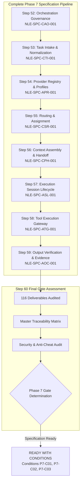

# NexLudic Engine: Phase 7 AI Coding-Agent Orchestration Readiness Review

**Document ID:** `NLE-REV-PH7-001`  
**Phase:** 7 of 12 (AI Coding-Agent Orchestration)  
**Step:** 60 of 100  
**Classification:** Phase Gate & Comprehensive Architecture Review  
**Status:** COMPLETE & AUDITED  
**Upstream Dependencies:** Steps 52–59 Specifications, Step 51 Phase 6 Gate Audit (`UNVERIFIED / MISSING FORMAL SIGN-OFF`), Step 42 Phase 5 Gate (`NLE-GAT-PH5-001` - `READY WITH CONDITIONS`)  
**Downstream Dependents:** Phase 8 Roadmap Planning & Authorization  

---

## 1. Executive Summary & Review Scope

This document establishes the authoritative, evidence-driven **Phase 7 AI Coding-Agent Orchestration Readiness Review** for NexLudic Engine.

Phase 7 encompasses Steps 52 through 60, establishing the complete architectural framework, protocol contracts, security controls, lifecycle state machines, tool invocation boundaries, and verification policies required to govern future autonomous and semi-autonomous AI coding agents.

The review is governed by the foundational directive:
> **`PRINCIPLE: Evidence Over Assertion`**  
> A phase must never be declared ready merely because its proposed documents exist or narrative reports claim success. Readiness is determined by evaluating the real, physical deliverables against upstream architecture decisions, mandatory security invariants, cross-step contract consistency, and bidirectional traceability.

---

## 2. Three-Tier Readiness Assessment

To prevent the dangerous conflation of documentation, architecture planning, and running software, this review evaluates readiness across three distinct tiers:

| Readiness Tier | Scope Evaluated | Assessed Status | Evidence & Operational Meaning |
| :--- | :--- | :---: | :--- |
| **Tier 1: Specification Readiness** | Completeness, rigor, and internal consistency of Steps 52–59 specifications. | **READY WITH CONDITIONS** | All 116 deliverables exist, cross-step contracts are coherent, schemas conform to Draft 2020-12, and 32 requirements per step are mapped bidirectionally. |
| **Tier 2: Implementation Readiness** | Availability of unambiguous architectural interfaces and boundary rules to begin implementation. | **READY WITH CONDITIONS** | The specifications provide complete operational contracts without requiring an engineering team to invent authorization models or security bounds. |
| **Tier 3: Runtime Readiness** | Existence and verification of running daemons, provider API integrations, and sandboxes. | **NOT READY / NOT IMPLEMENTED** | **Zero runtime code exists**. No provider APIs have been contacted, no daemons run, and no agents have executed. This is in strict conformance with Phase 7 design-only scope. |

---

## 3. Mandatory Upstream Gate & Dependency Verification

### 3.1 Step 51 Phase 6 Gate Audit
- **Status:** **`UNVERIFIED / MISSING FORMAL SIGN-OFF`**
- **Impact on Phase 7:** The Phase 6 Mashup Integration Planning gate (Step 51) has not received formal human sign-off. Consequently, any coding task that purports to implement or execute multi-game interaction workflows from Step 48 or mashup plans from Step 49 is **FAIL-CLOSED BLOCKED** (`ERR_PRECONDITION_PHASE6_UNVERIFIED`).
- **Enforcement in Phase 7:** Steps 53, 57, 58, and 59 explicitly incorporate this check into preflight, tool gates, and verification pipelines.

### 3.2 Step 42 Phase 5 Universal Adapter SDK Gate Audit
- **Status:** **`READY WITH CONDITIONS`** (`P5-C01`, `P5-C02`, `P5-C03`)
- **Impact on Phase 7:** Phase 7 specifications incorporate `P5-C01` (wire protocol serialization validation) and `P5-C02` (memory safety boundaries) as mandatory preflight and verification requirements for adapter engineering tasks.

---

## 4. Phase-Gate Recommendation

The Phase 7 AI Coding-Agent Orchestration Subsystem is assessed as:
$$\mathbf{READY\ WITH\ CONDITIONS}$$

### Mandatory Phase 7 Conditions:
1. **`P7-C01: Phase 6 Integration Hold`**  
   No AI coding task may be authorized or executed to implement cross-game mashup integration plans until Step 51 formally receives human sign-off.
2. **`P7-C02: Adapter SDK Condition Inheritance`**  
   All adapter-related engineering tasks must strictly enforce Phase 5 conditions `P5-C01` and `P5-C02`.
3. **`P7-C03: Zero Ambient Authority & Windows Medium IL`**  
   Any future runtime implementation must strictly adhere to `DEC-002` (Medium Integrity Level) and `BLK-SEC-01` (Anti-Cheat Dominance & Zero Game Tampering).
