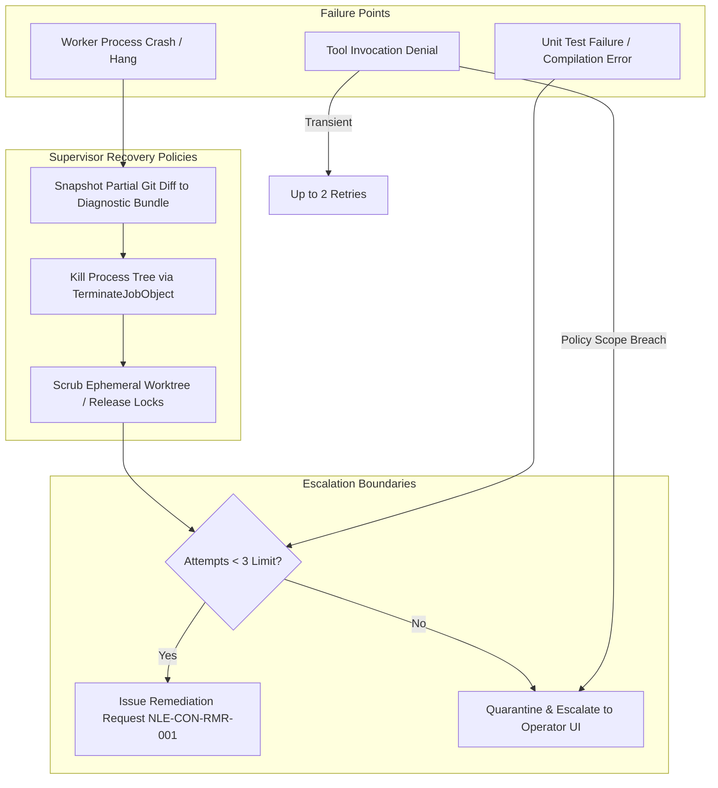

# NexLudic Engine: Phase 7 Failure, Recovery & Reliability Coverage Review

**Document ID:** `NLE-REV-PH7-002`  
**Phase:** 7 of 12 (AI Coding-Agent Orchestration)  
**Step:** 60 of 100  
**Classification:** Reliability & Fault Tolerance Review  
**Status:** COMPLETE & AUDITED  

---

## 1. Master Failure Architecture & Taxonomy

A critical attribute of an enterprise-grade agent orchestration framework is predictable, deterministic behavior during failures, crashes, network interruptions, and corrupted submissions.

The audit verified that across Steps 52 through 59, the architecture defines **exhaustive, non-overlapping failure taxonomies**:
1. **Intake & Gate Failures (Step 53):** 18 failure codes (`ERR_TASK_AMBIGUOUS`, `ERR_PRECONDITION_PHASE6_UNVERIFIED`, etc.).
2. **Registry & Matching Failures (Step 54):** 14 ineligibility codes (`ERR_CAPABILITY_UNSUPPORTED`, `ERR_EVIDENCE_STALE`, etc.).
3. **Routing & Assignment Failures (Step 55):** 16 routing failure codes (`ERR_NO_ELIGIBLE_CANDIDATE`, `ERR_BUDGET_EXCEEDED`, etc.).
4. **Context & Packaging Failures (Step 56):** 16 context codes (`ERR_SECRET_DETECTED`, `ERR_CONTEXT_TOKEN_OVERFLOW`, etc.).
5. **Execution Session Failures (Step 57):** 22 runtime codes (`ERR_PREFLIGHT_FAIL_CLOSED`, `ERR_WATCHDOG_TIMEOUT`, etc.).
6. **Tool Gateway Failures (Step 58):** 24 tool execution codes (`ERR_PATH_CONTAINMENT_FAILED`, `ERR_TOOL_NOT_FOUND`, etc.).
7. **Output & Acceptance Failures (Step 59):** 28 verification codes (`ERR_MANDATORY_DELIVERABLE_MISSING`, `ERR_UNEXECUTED_TEST_CLAIMED`, etc.).

---

## 2. Cross-Lifecycle Recovery & Remediation Flows

---

## 3. Explicit Uncertainty Preservation Invariant

The audit confirmed that **indeterminate outcomes are never converted into assumed success**:
- If a tool invocation times out while modifying disk, the outcome is recorded as `UNCERTAIN_TIMEOUT`.
- If an audit ledger cannot write a record, the supervisor halts execution (`PAUSED`) rather than proceeding un-audited.
- If a test report lacks an authenticated process exit code, the test is classified as `INCONCLUSIVE_UNCERTAIN` and blocks task completion.
