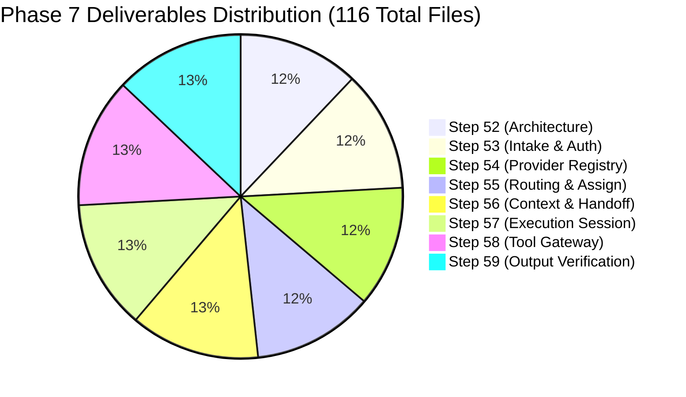

# NexLudic Engine: Phase 7 Step 52 to 59 Deliverable Inventory

**Document ID:** `NLE-INV-PH7-001`  
**Phase:** 7 of 12 (AI Coding-Agent Orchestration)  
**Step:** 60 of 100  
**Classification:** Deliverable Audit & Inventory Record  
**Status:** COMPLETE & AUDITED  

---

## 1. Inventory Summary & Physical Audit

A comprehensive file-system audit of `docs/ai-orchestration/` was conducted at commit `33cac60`.
- **Total Authoritative Phase 7 Deliverables:** **116 markdown documents**.
- **Audit Verification Result:** 100% of required deliverables exist, are populated with technical content, and contain zero placeholder stubs.

---

## 2. Detailed Deliverable Inventory Table

| Step # | Deliverable Title / Filename | Document ID | Classification | Audit Status |
| :---: | :--- | :--- | :--- | :---: |
| **52** | `AI_CODING_AGENT_ORCHESTRATION_ARCHITECTURE_AND_GOVERNANCE.md` | `NLE-SPC-CAO-001` | Master Architecture | **VERIFIED** |
| **52** | `AI_AGENT_ORCHESTRATION_DOMAIN_MODEL_AND_LIFECYCLE.md` | `NLE-MOD-CAO-001` | Domain Model | **VERIFIED** |
| **52** | `AI_AGENT_TASK_DECOMPOSITION_AND_MULTI_AGENT_COORDINATION_SPECIFICATION.md` | `NLE-SPC-TDC-001` | Coordination Spec | **VERIFIED** |
| **52** | `AI_AGENT_PROVIDER_ADAPTER_AND_CAPABILITY_CONTRACT.md` | `NLE-CON-PAC-001` | Provider Contract | **VERIFIED** |
| **52** | `AI_AGENT_CONTEXT_PREPARATION_AND_DATA_MINIMIZATION_POLICY.md` | `NLE-POL-CPD-001` | Privacy Policy | **VERIFIED** |
| **52** | `AI_AGENT_TOOL_ACCESS_AND_EXECUTION_AUTHORIZATION_POLICY.md` | `NLE-POL-TAE-001` | Tool Access Policy | **VERIFIED** |
| **52** | `AI_AGENT_OUTPUT_VERIFICATION_AND_EVIDENCE_CONTRACT.md` | `NLE-CON-OVE-001` | Evidence Contract | **VERIFIED** |
| **52** | `AI_AGENT_HUMAN_REVIEW_APPROVAL_AND_CHANGE_CONTROL_POLICY.md` | `NLE-POL-HRA-001` | Human Review Policy | **VERIFIED** |
| **52** | `AI_AGENT_ORCHESTRATION_SECURITY_PRIVACY_AND_THREAT_MODEL.md` | `NLE-SEC-OST-001` | Threat Model | **VERIFIED** |
| **52** | `AI_AGENT_ORCHESTRATION_FAILURE_RESOURCE_AND_RECOVERY_POLICY.md` | `NLE-POL-OFR-001` | Reliability Policy | **VERIFIED** |
| **52** | `AI_AGENT_ROUTING_RESOURCE_BUDGET_AND_OPERATIONAL_CONSTRAINTS.md` | `NLE-POL-RRB-001` | Budget Constraints | **VERIFIED** |
| **52** | `AI_AGENT_ORCHESTRATION_SYNTHETIC_SCENARIOS_AND_TEST_PLAN.md` | `NLE-CAT-OST-001` | Synthetic Test Plan | **VERIFIED** |
| **52** | `STEP_52_ORCHESTRATION_REQUIREMENTS_TRACEABILITY_MATRIX.md` | `NLE-MAT-STP-052` | Traceability Matrix | **VERIFIED** |
| **52** | `STEP_52_COMPLETION_REPORT.md` | `NLE-REP-STP-052` | Completion Report | **VERIFIED** |
| **53** | `AI_CODING_TASK_INTAKE_NORMALIZATION_AND_AUTHORIZATION_GATE_SPECIFICATION.md` | `NLE-SPC-CTI-001` | Master Intake Spec | **VERIFIED** |
| **53** | `AI_CODING_REQUEST_AND_NORMALIZED_TASK_DOMAIN_MODEL.md` | `NLE-MOD-CTI-001` | Task Domain Model | **VERIFIED** |
| **53** | `AI_CODING_TASK_CATEGORY_AND_ELIGIBILITY_CATALOG.md` | `NLE-CAT-CTI-001` | Task Catalog | **VERIFIED** |
| **53** | `AI_CODING_TASK_CONTRACT_AND_AUTHORIZATION_RULES.md` | `NLE-CON-CTI-001` | Contract Rules | **VERIFIED** |
| **53** | `AI_CODING_TASK_INTAKE_VALIDATION_PIPELINE.md` | `NLE-PRC-CTI-001` | Validation Pipeline | **VERIFIED** |
| **53** | `AI_CODING_TASK_NORMALIZATION_AND_SCOPE_VALIDATION_RULES.md` | `NLE-RUL-CTI-001` | Normalization Rules | **VERIFIED** |
| **53** | `AI_CODING_TASK_CAPABILITY_REQUIREMENT_BINDING_SPECIFICATION.md` | `NLE-SPC-TCR-001` | Capability Binding | **VERIFIED** |
| **53** | `AI_CODING_TASK_CLARIFICATION_AND_AMBIGUITY_HANDLING_POLICY.md` | `NLE-POL-CTI-001` | Ambiguity Policy | **VERIFIED** |
| **53** | `AI_CODING_TASK_AUTHORIZATION_AND_PHASE_GATE_POLICY.md` | `NLE-POL-CTA-001` | Phase Gate Policy | **VERIFIED** |
| **53** | `AI_CODING_TASK_VERSIONING_AND_AUTHORIZATION_INVALIDATION_POLICY.md` | `NLE-POL-CTV-001` | Invalidation Policy | **VERIFIED** |
| **53** | `AI_CODING_TASK_INTAKE_SECURITY_PRIVACY_AND_INPUT_TRUST_POLICY.md` | `NLE-SEC-CTI-001` | Security Policy | **VERIFIED** |
| **53** | `AI_CODING_TASK_INTAKE_FAILURE_RESOURCE_AND_DIAGNOSTIC_SPECIFICATION.md` | `NLE-SPC-CIF-001` | Failure Diagnostics | **VERIFIED** |
| **53** | `AI_CODING_TASK_INTAKE_SYNTHETIC_SCENARIOS_AND_TEST_PLAN.md` | `NLE-CAT-CIS-001` | Synthetic Test Plan | **VERIFIED** |
| **53** | `AI_CODING_TASK_STATUS_AND_INTAKE_RESULT_CONTRACT.md` | `NLE-CON-CTR-001` | Result Contract | **VERIFIED** |
| **53** | `STEP_53_INTAKE_REQUIREMENTS_TRACEABILITY_MATRIX.md` | `NLE-MAT-STP-053` | Traceability Matrix | **VERIFIED** |
| **53** | `STEP_53_COMPLETION_REPORT.md` | `NLE-REP-STP-053` | Completion Report | **VERIFIED** |
| **54** | `AI_AGENT_PROVIDER_REGISTRY_AND_CAPABILITY_ELIGIBILITY_SPECIFICATION.md` | `NLE-SPC-APR-001` | Master Registry Spec | **VERIFIED** |
| **54** | `AI_AGENT_PROVIDER_MODEL_IMPLEMENTATION_AND_EXECUTION_ENVIRONMENT_DOMAIN_MODEL.md` | `NLE-MOD-APR-001` | Provider Domain Model | **VERIFIED** |
| **54** | `AI_AGENT_CAPABILITY_TAXONOMY_AND_PROFILE_CONTRACT.md` | `NLE-CON-APR-001` | Profile Contract | **VERIFIED** |
| **54** | `AI_AGENT_CAPABILITY_DECLARATION_AND_EVIDENCE_VERIFICATION_POLICY.md` | `NLE-POL-APR-001` | Verification Policy | **VERIFIED** |
| **54** | `AI_AGENT_REGISTRY_LIFECYCLE_AND_GOVERNANCE_POLICY.md` | `NLE-POL-ALG-001` | Registry Governance | **VERIFIED** |
| **54** | `AI_AGENT_CAPABILITY_ELIGIBILITY_MATCHING_RULES.md` | `NLE-RUL-APR-001` | Matching Rules | **VERIFIED** |
| **54** | `AI_AGENT_ELIGIBILITY_AND_CANDIDATE_RANKING_BOUNDARY_POLICY.md` | `NLE-POL-AER-001` | Ranking Policy | **VERIFIED** |
| **54** | `AI_AGENT_PROVIDER_PRIVACY_SECURITY_AND_TRUST_POLICY.md` | `NLE-SEC-APR-001` | Privacy Policy | **VERIFIED** |
| **54** | `AI_AGENT_CAPABILITY_FAILURE_FRESHNESS_AND_INVALIDATION_POLICY.md` | `NLE-POL-AFF-001` | Freshness Policy | **VERIFIED** |
| **54** | `AI_AGENT_REGISTRY_AND_ELIGIBILITY_DIAGNOSTIC_CONTRACT.md` | `NLE-CON-ARD-001` | Diagnostic Contract | **VERIFIED** |
| **54** | `AI_AGENT_PROVIDER_REGISTRY_SYNTHETIC_SCENARIOS_AND_TEST_PLAN.md` | `NLE-CAT-ARS-001` | Synthetic Test Plan | **VERIFIED** |
| **54** | `STEP_54_CAPABILITY_REQUIREMENTS_TRACEABILITY_MATRIX.md` | `NLE-MAT-STP-054` | Traceability Matrix | **VERIFIED** |
| **54** | `STEP_54_COMPLETION_REPORT.md` | `NLE-REP-STP-054` | Completion Report | **VERIFIED** |
| **55** | `AI_AGENT_CANDIDATE_SELECTION_TASK_ROUTING_AND_ASSIGNMENT_SPECIFICATION.md` | `NLE-SPC-CSR-001` | Master Routing Spec | **VERIFIED** |
| **55** | `AI_AGENT_ROUTING_AND_ASSIGNMENT_DOMAIN_MODEL.md` | `NLE-MOD-CSR-001` | Routing Domain Model | **VERIFIED** |
| **55** | `AI_AGENT_ROUTING_STRATEGY_CATALOG_AND_POLICY_RULES.md` | `NLE-CAT-RSC-001` | Strategy Catalog | **VERIFIED** |
| **55** | `AI_AGENT_CANDIDATE_COMPARISON_AND_DETERMINISTIC_SELECTION_RULES.md` | `NLE-RUL-CCS-001` | Selection Rules | **VERIFIED** |
| **55** | `AI_AGENT_ASSIGNMENT_AUTHORIZATION_AND_HANDOFF_CONTRACT.md` | `NLE-CON-AAH-001` | Assignment Contract | **VERIFIED** |
| **55** | `AI_AGENT_ASSIGNMENT_LIFECYCLE_AND_STATE_TRANSITION_SPECIFICATION.md` | `NLE-SPC-ALS-001` | Lifecycle Spec | **VERIFIED** |
| **55** | `AI_AGENT_ROUTING_FALLBACK_RETRY_AND_REASSIGNMENT_POLICY.md` | `NLE-POL-AFR-001` | Fallback Policy | **VERIFIED** |
| **55** | `AI_AGENT_ROUTING_CONCURRENCY_DUPLICATE_AND_CONFLICT_CONTROL_POLICY.md` | `NLE-POL-ACD-001` | Concurrency Policy | **VERIFIED** |
| **55** | `AI_AGENT_ROUTING_PRIVACY_SECURITY_AND_DATA_DISCLOSURE_POLICY.md` | `NLE-SEC-RSD-001` | Disclosure Policy | **VERIFIED** |
| **55** | `AI_AGENT_ROUTING_DIAGNOSTIC_AUDIT_AND_EXPLAINABILITY_CONTRACT.md` | `NLE-CON-ADE-001` | Explainability Contract | **VERIFIED** |
| **55** | `AI_AGENT_ROUTING_SYNTHETIC_SCENARIOS_AND_TEST_PLAN.md` | `NLE-CAT-RSS-001` | Synthetic Test Plan | **VERIFIED** |
| **55** | `STEP_55_ROUTING_REQUIREMENTS_TRACEABILITY_MATRIX.md` | `NLE-MAT-STP-055` | Traceability Matrix | **VERIFIED** |
| **55** | `STEP_55_COMPLETION_REPORT.md` | `NLE-REP-STP-055` | Completion Report | **VERIFIED** |
| **56** | `AI_AGENT_CONTEXT_ASSEMBLY_SECURE_TASK_PACKAGING_AND_HANDOFF_SPECIFICATION.md` | `NLE-SPC-CPH-001` | Master Context Spec | **VERIFIED** |
| **56** | `AI_AGENT_CANONICAL_TASK_CONTEXT_AND_PACKAGE_CONTRACT.md` | `NLE-CON-CTP-001` | Package Contract | **VERIFIED** |
| **56** | `AI_AGENT_CONTEXT_SOURCE_DISCOVERY_AUTHORIZATION_AND_RELEVANCE_POLICY.md` | `NLE-POL-CSD-001` | Source Discovery | **VERIFIED** |
| **56** | `AI_AGENT_CONTEXT_PROVENANCE_INTEGRITY_AND_TRANSFORMATION_POLICY.md` | `NLE-POL-CPI-001` | Provenance Policy | **VERIFIED** |
| **56** | `AI_AGENT_CONTEXT_COMPLETENESS_AND_MINIMUM_SUFFICIENT_CONTEXT_RULES.md` | `NLE-RUL-CMC-001` | Min Context Rules | **VERIFIED** |
| **56** | `AI_AGENT_CONTEXT_PRIVACY_SECRET_HANDLING_AND_DISCLOSURE_POLICY.md` | `NLE-SEC-CSH-001` | Secret Handling | **VERIFIED** |
| **56** | `AI_AGENT_CONTEXT_TRUST_AND_PROMPT_INJECTION_DEFENSE_SPECIFICATION.md` | `NLE-SEC-CTP-001` | Injection Defense | **VERIFIED** |
| **56** | `AI_AGENT_PROVIDER_SPECIFIC_CONTEXT_TRANSFORMATION_CONTRACT.md` | `NLE-CON-PTC-001` | Provider Transform | **VERIFIED** |
| **56** | `AI_AGENT_CONTEXT_PREPARATION_VALIDATION_AND_HANDOFF_READINESS_POLICY.md` | `NLE-POL-CHR-001` | Readiness Policy | **VERIFIED** |
| **56** | `AI_AGENT_HANDOFF_AUTHORIZATION_ACKNOWLEDGEMENT_AND_RECOVERY_CONTRACT.md` | `NLE-CON-HAR-001` | Handoff Contract | **VERIFIED** |
| **56** | `AI_AGENT_CONTEXT_VERSIONING_INVALIDATION_AND_CACHE_POLICY.md` | `NLE-POL-CVI-001` | Cache Invalidation | **VERIFIED** |
| **56** | `AI_AGENT_CONTEXT_FAILURE_RESOURCE_AND_DIAGNOSTIC_SPECIFICATION.md` | `NLE-SPC-CFD-001` | Failure Diagnostics | **VERIFIED** |
| **56** | `AI_AGENT_CONTEXT_ASSEMBLY_SYNTHETIC_SCENARIOS_AND_TEST_PLAN.md` | `NLE-CAT-CAS-001` | Synthetic Test Plan | **VERIFIED** |
| **56** | `STEP_56_CONTEXT_HANDOFF_REQUIREMENTS_TRACEABILITY_MATRIX.md` | `NLE-MAT-STP-056` | Traceability Matrix | **VERIFIED** |
| **56** | `STEP_56_COMPLETION_REPORT.md` | `NLE-REP-STP-056` | Completion Report | **VERIFIED** |
| **57** | `AI_AGENT_EXECUTION_SESSION_LIFECYCLE_AND_RUNTIME_CONTROL_SPECIFICATION.md` | `NLE-SPC-ASL-001` | Master Lifecycle Spec | **VERIFIED** |
| **57** | `AI_AGENT_EXECUTION_SESSION_AND_ATTEMPT_DOMAIN_MODEL.md` | `NLE-MOD-ASL-001` | Session Domain Model | **VERIFIED** |
| **57** | `AI_AGENT_EXECUTION_PREFLIGHT_AND_STARTUP_VALIDATION_POLICY.md` | `NLE-POL-APV-001` | Preflight Policy | **VERIFIED** |
| **57** | `AI_AGENT_EXECUTION_SESSION_STATE_MACHINE_AND_TRANSITION_RULES.md` | `NLE-SPC-ASM-001` | State Machine Spec | **VERIFIED** |
| **57** | `AI_AGENT_RUNTIME_ISOLATION_AND_WORKSPACE_BOUNDARY_REQUIREMENTS.md` | `NLE-SEC-ARI-001` | Isolation Boundary | **VERIFIED** |
| **57** | `AI_AGENT_EXECUTION_TIME_AUTHORIZATION_AND_PERMISSION_BINDING_POLICY.md` | `NLE-POL-APB-001` | Permission Policy | **VERIFIED** |
| **57** | `AI_AGENT_RUNTIME_EVENT_AND_STATUS_VALIDATION_CONTRACT.md` | `NLE-CON-AEV-001` | Event Validation | **VERIFIED** |
| **57** | `AI_AGENT_RUNTIME_TOOL_OPERATION_CONTROL_BOUNDARY.md` | `NLE-CON-ATC-001` | Tool Boundary | **VERIFIED** |
| **57** | `AI_AGENT_SESSION_RESOURCE_TIMEOUT_AND_WATCHDOG_POLICY.md` | `NLE-POL-ARW-001` | Watchdog Policy | **VERIFIED** |
| **57** | `AI_AGENT_SESSION_PAUSE_CANCELLATION_TERMINATION_AND_CLEANUP_POLICY.md` | `NLE-POL-APT-001` | Termination Policy | **VERIFIED** |
| **57** | `AI_AGENT_RUNTIME_CONCURRENCY_DUPLICATE_EXECUTION_AND_RECOVERY_POLICY.md` | `NLE-POL-ADC-001` | Concurrency Policy | **VERIFIED** |
| **57** | `AI_AGENT_RUNTIME_AUDIT_EVENT_AND_DIAGNOSTIC_CONTRACT.md` | `NLE-CON-AAD-001` | Audit Contract | **VERIFIED** |
| **57** | `AI_AGENT_EXECUTION_SESSION_SYNTHETIC_SCENARIOS_AND_TEST_PLAN.md` | `NLE-CAT-AES-001` | Synthetic Test Plan | **VERIFIED** |
| **57** | `STEP_57_RUNTIME_LIFECYCLE_REQUIREMENTS_TRACEABILITY_MATRIX.md` | `NLE-MAT-STP-057` | Traceability Matrix | **VERIFIED** |
| **57** | `STEP_57_COMPLETION_REPORT.md` | `NLE-REP-STP-057` | Completion Report | **VERIFIED** |
| **58** | `AI_AGENT_TOOL_EXECUTION_GATEWAY_AND_PERMISSION_ENFORCEMENT_SPECIFICATION.md` | `NLE-SPC-ATG-001` | Master Tool Gateway | **VERIFIED** |
| **58** | `AI_AGENT_TOOL_CATALOG_AND_OPERATION_CONTRACT.md` | `NLE-CON-ATO-001` | Tool Catalog | **VERIFIED** |
| **58** | `AI_AGENT_TOOL_INVOCATION_REQUEST_AND_RESULT_DOMAIN_MODEL.md` | `NLE-MOD-ATO-001` | Tool Domain Model | **VERIFIED** |
| **58** | `AI_AGENT_TOOL_AUTHORIZATION_AND_PERMISSION_SCOPE_POLICY.md` | `NLE-POL-ATP-001` | Permission Scope | **VERIFIED** |
| **58** | `AI_AGENT_TOOL_RISK_CLASSIFICATION_AND_APPROVAL_POLICY.md` | `NLE-POL-ATR-001` | Risk Policy | **VERIFIED** |
| **58** | `AI_AGENT_TOOL_INPUT_VALIDATION_AND_RESOURCE_BOUNDARY_SPECIFICATION.md` | `NLE-SEC-ATI-001` | Input Validation | **VERIFIED** |
| **58** | `AI_AGENT_FILESYSTEM_REPOSITORY_AND_WORKSPACE_OPERATION_POLICY.md` | `NLE-POL-ATF-001` | Filesystem Policy | **VERIFIED** |
| **58** | `AI_AGENT_PROCESS_NETWORK_AND_EXTERNAL_SERVICE_EXECUTION_BOUNDARY.md` | `NLE-SEC-ATE-001` | Process/Network Gate | **VERIFIED** |
| **58** | `AI_AGENT_TOOL_OUTPUT_VALIDATION_AND_SIDE_EFFECT_EVIDENCE_CONTRACT.md` | `NLE-CON-ATV-001` | Output Evidence | **VERIFIED** |
| **58** | `AI_AGENT_TOOL_TIMEOUT_RETRY_IDEMPOTENCY_AND_CONCURRENCY_POLICY.md` | `NLE-POL-ATI-001` | Concurrency Policy | **VERIFIED** |
| **58** | `AI_AGENT_TOOL_EXECUTION_SECURITY_THREAT_MODEL.md` | `NLE-SEC-ATT-001` | Threat Model | **VERIFIED** |
| **58** | `AI_AGENT_TOOL_EXECUTION_AUDIT_AND_DIAGNOSTIC_CONTRACT.md` | `NLE-CON-ATA-001` | Audit Contract | **VERIFIED** |
| **58** | `AI_AGENT_TOOL_EXECUTION_SYNTHETIC_SCENARIOS_AND_TEST_PLAN.md` | `NLE-CAT-ATS-001` | Synthetic Test Plan | **VERIFIED** |
| **58** | `STEP_58_TOOL_GATEWAY_REQUIREMENTS_TRACEABILITY_MATRIX.md` | `NLE-MAT-STP-058` | Traceability Matrix | **VERIFIED** |
| **58** | `STEP_58_COMPLETION_REPORT.md` | `NLE-REP-STP-058` | Completion Report | **VERIFIED** |
| **59** | `AI_AGENT_OUTPUT_COLLECTION_ARTIFACT_VALIDATION_AND_EVIDENCE_COMPLETION_SPECIFICATION.md` | `NLE-SPC-AOC-001` | Master Verification | **VERIFIED** |
| **59** | `AI_AGENT_RESULT_SUBMISSION_AND_ARTIFACT_DOMAIN_MODEL.md` | `NLE-MOD-AOC-001` | Output Domain Model | **VERIFIED** |
| **59** | `AI_AGENT_ARTIFACT_PROVENANCE_INTEGRITY_AND_REVISION_POLICY.md` | `NLE-POL-API-001` | Provenance Policy | **VERIFIED** |
| **59** | `AI_AGENT_REPOSITORY_DIFF_RECONCILIATION_AND_USER_CHANGE_PRESERVATION_POLICY.md` | `NLE-POL-ARD-001` | Diff Reconciliation | **VERIFIED** |
| **59** | `AI_AGENT_DELIVERABLE_COMPLETENESS_AND_CONTRACT_CONFORMANCE_POLICY.md` | `NLE-POL-ADC-002` | Completeness Policy | **VERIFIED** |
| **59** | `AI_AGENT_VERIFICATION_EVIDENCE_PROVENANCE_AND_TRUST_POLICY.md` | `NLE-POL-AVE-001` | Evidence Trust | **VERIFIED** |
| **59** | `AI_AGENT_ACCEPTANCE_CRITERION_EVALUATION_AND_DECISION_CONTRACT.md` | `NLE-CON-AAC-001` | Acceptance Contract | **VERIFIED** |
| **59** | `AI_AGENT_DOCUMENTATION_CODE_AND_STRUCTURED_ARTIFACT_VALIDATION_POLICY.md` | `NLE-POL-ADV-001` | Validation Policy | **VERIFIED** |
| **59** | `AI_AGENT_REGRESSION_SECURITY_COMPATIBILITY_AND_LICENSING_REVIEW_POLICY.md` | `NLE-POL-ARS-001` | Review Policy | **VERIFIED** |
| **59** | `AI_AGENT_PARTIAL_COMPLETION_DEFECT_REMEDIATION_AND_RETRY_POLICY.md` | `NLE-POL-APM-001` | Remediation Policy | **VERIFIED** |
| **59** | `AI_AGENT_TASK_COMPLETION_ACCEPTANCE_AND_TERMINAL_OUTCOME_CONTRACT.md` | `NLE-CON-ATC-002` | Outcome Contract | **VERIFIED** |
| **59** | `AI_AGENT_OUTPUT_FAILURE_RETENTION_AND_DIAGNOSTIC_POLICY.md` | `NLE-POL-AOF-001` | Failure Policy | **VERIFIED** |
| **59** | `AI_AGENT_OUTPUT_VALIDATION_SYNTHETIC_SCENARIOS_AND_TEST_PLAN.md` | `NLE-CAT-AOS-001` | Synthetic Test Plan | **VERIFIED** |
| **59** | `STEP_59_OUTPUT_VERIFICATION_REQUIREMENTS_TRACEABILITY_MATRIX.md` | `NLE-MAT-STP-059` | Traceability Matrix | **VERIFIED** |
| **59** | `STEP_59_COMPLETION_REPORT.md` | `NLE-REP-STP-059` | Completion Report | **VERIFIED** |
