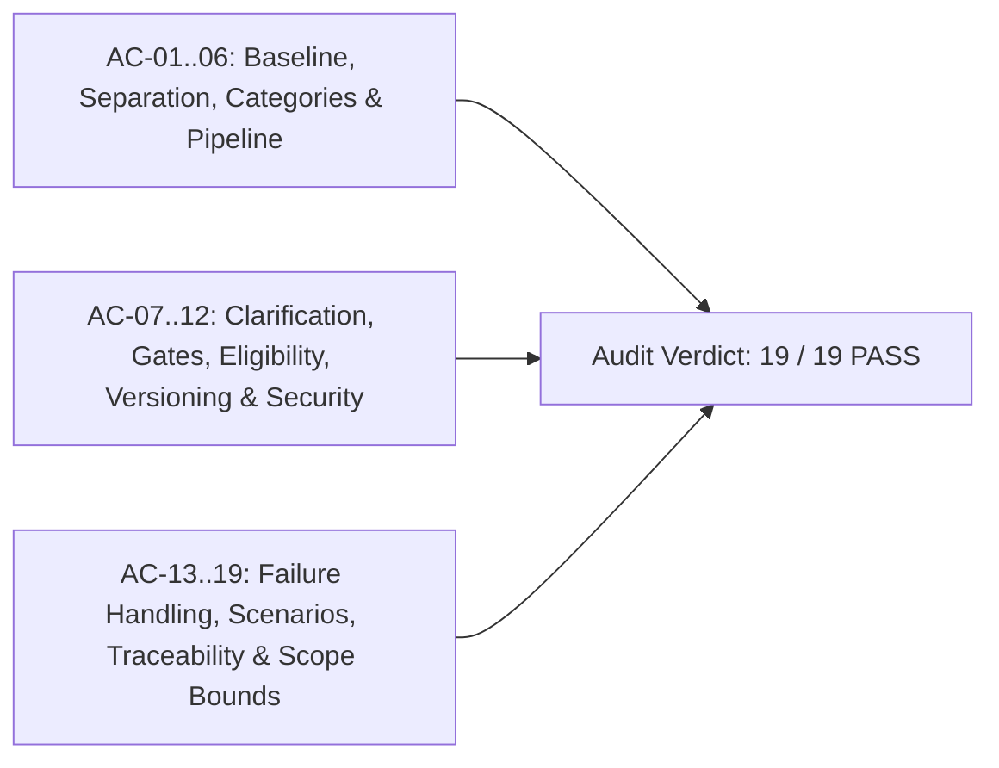

# NexLudic Engine: Step 53 Completion Report

**Document ID:** `NLE-REP-STP-053`  
**Phase:** 7 of 12 (AI Coding-Agent Orchestration)  
**Step:** 53 of 100  
**Title:** AI Coding Task Intake, Normalization & Authorization Gate Specification  
**Classification:** Milestone Completion & Assurance Audit  
**Status:** COMPLETE  
**Operating Standard:** Architecture, Task Contracts, Security Gateways, and Policy Specification Only (No Intake Service Implementation, No AI Provider Connections, No Code Generation, No Code Execution, No Game Tampering)

---

## 1. Executive Summary & Milestone Deliverable Inventory

Step 53 of 100 has formally established the comprehensive, implementation-ready **AI Coding Task Intake, Normalization & Authorization Gate Specification** (`NLE-SPC-TIN-001`) within the NexLudic Engine repository.

This specification establishes the authoritative front door for the AI Coding-Agent Orchestrator. It defines how raw engineering requests—submitted by developers, creators, automated monitors, or diagnostic workflows—are ingested, sanitized, classified, disambiguated, normalized into structured and bounded `CodingTaskDescriptor` contracts, evaluated against upstream gates and platform security policies, and gated by human authorization tokens before being made eligible for AI agent assignment.

All 14 required documentation deliverables have been authored, validated, and persisted within `docs/ai-orchestration/` on Volume D:

| # | Deliverable File Link | Ref ID | Scope & Architectural Focus | Status |
| :-: | :--- | :--- | :--- | :---: |
| 1 | [AI_CODING_TASK_INTAKE_NORMALIZATION_AND_AUTHORIZATION_GATE_SPECIFICATION.md](file:///d:/App%20Winrar%20Files/Nexludic%20Engine%20(working)/docs/ai-orchestration/AI_CODING_TASK_INTAKE_NORMALIZATION_AND_AUTHORIZATION_GATE_SPECIFICATION.md) | `NLE-SPC-TIN-001` | Authoritative intake architecture, 7-tier epistemic hierarchy, upstream gate handoffs, 11-stage pipeline summary. | **COMPLETE** |
| 2 | [AI_CODING_REQUEST_AND_NORMALIZED_TASK_DOMAIN_MODEL.md](file:///d:/App%20Winrar%20Files/Nexludic%20Engine%20(working)/docs/ai-orchestration/AI_CODING_REQUEST_AND_NORMALIZED_TASK_DOMAIN_MODEL.md) | `NLE-MOD-TIN-001` | Entity models for raw request, normalized task descriptor, JSON Schema Draft 2020-12 (`NLE-SCH-TIN-001`). | **COMPLETE** |
| 3 | [AI_CODING_TASK_CATEGORY_AND_ELIGIBILITY_CATALOG.md](file:///d:/App%20Winrar%20Files/Nexludic%20Engine%20(working)/docs/ai-orchestration/AI_CODING_TASK_CATEGORY_AND_ELIGIBILITY_CATALOG.md) | `NLE-CAT-TIN-001` | 10 controlled task categories, eligibility criteria, scope boundaries, category $\neq$ permission rule. | **COMPLETE** |
| 4 | [AI_CODING_TASK_NORMALIZATION_AND_SCOPE_VALIDATION_RULES.md](file:///d:/App%20Winrar%20Files/Nexludic%20Engine%20(working)/docs/ai-orchestration/AI_CODING_TASK_NORMALIZATION_AND_SCOPE_VALIDATION_RULES.md) | `NLE-RUL-TIN-001` | Intent preservation, path whitelist generation, scope bounding, explicit non-goals, measurable acceptance rules. | **COMPLETE** |
| 5 | [AI_CODING_TASK_INTAKE_VALIDATION_PIPELINE.md](file:///d:/App%20Winrar%20Files/Nexludic%20Engine%20(working)/docs/ai-orchestration/AI_CODING_TASK_INTAKE_VALIDATION_PIPELINE.md) | `NLE-PIP-TIN-001` | 11-stage deterministic intake validation pipeline, failure handling, diagnostic schema, early exit conditions. | **COMPLETE** |
| 6 | [AI_CODING_TASK_AUTHORIZATION_AND_PHASE_GATE_POLICY.md](file:///d:/App%20Winrar%20Files/Nexludic%20Engine%20(working)/docs/ai-orchestration/AI_CODING_TASK_AUTHORIZATION_AND_PHASE_GATE_POLICY.md) | `NLE-POL-TIN-001` | Authorization token contract, approval matrix, upstream Phase 5 and Phase 6 gate rules, Phase 6 blocker invariant. | **COMPLETE** |
| 7 | [AI_CODING_TASK_CLARIFICATION_AND_AMBIGUITY_HANDLING_POLICY.md](file:///d:/App%20Winrar%20Files/Nexludic%20Engine%20(working)/docs/ai-orchestration/AI_CODING_TASK_CLARIFICATION_AND_AMBIGUITY_HANDLING_POLICY.md) | `NLE-POL-TCA-001` | Ambiguity taxonomy (`AMB-01..06`), clarification question generation, non-guessing invariant, disjoint scope partial normalization. | **COMPLETE** |
| 8 | [AI_CODING_TASK_STATUS_AND_INTAKE_RESULT_CONTRACT.md](file:///d:/App%20Winrar%20Files/Nexludic%20Engine%20(working)/docs/ai-orchestration/AI_CODING_TASK_STATUS_AND_INTAKE_RESULT_CONTRACT.md) | `NLE-CON-TIR-001` | 8 intake outcome states, status transition rules, rejection vs blocking semantics, agent eligibility decoupling. | **COMPLETE** |
| 9 | [AI_CODING_TASK_VERSIONING_AND_AUTHORIZATION_INVALIDATION_POLICY.md](file:///d:/App%20Winrar%20Files/Nexludic%20Engine%20(working)/docs/ai-orchestration/AI_CODING_TASK_VERSIONING_AND_AUTHORIZATION_INVALIDATION_POLICY.md) | `NLE-POL-TVI-001` | Semantic task versioning (`MAJOR.MINOR.PATCH`), 6 token invalidation triggers (`EVT-TIN-01..06`), stale dependency aborts. | **COMPLETE** |
| 10 | [AI_CODING_TASK_INTAKE_SECURITY_PRIVACY_AND_INPUT_TRUST_POLICY.md](file:///d:/App%20Winrar%20Files/Nexludic%20Engine%20(working)/docs/ai-orchestration/AI_CODING_TASK_INTAKE_SECURITY_PRIVACY_AND_INPUT_TRUST_POLICY.md) | `NLE-SEC-TIN-001` | Untrusted input demarcation, prompt injection defense, automated secret scrubbing, Medium IL (`DEC-002`), Anti-Cheat veto (`BLK-SEC-01`). | **COMPLETE** |
| 11 | [AI_CODING_TASK_INTAKE_FAILURE_RESOURCE_AND_DIAGNOSTIC_SPECIFICATION.md](file:///d:/App%20Winrar%20Files/Nexludic%20Engine%20(working)/docs/ai-orchestration/AI_CODING_TASK_INTAKE_FAILURE_RESOURCE_AND_DIAGNOSTIC_SPECIFICATION.md) | `NLE-SPC-TFD-001` | Intake error taxonomy, resource limits, request deduplication / idempotency (`SHA-256`), diagnostic reporting contract. | **COMPLETE** |
| 12 | [AI_CODING_TASK_INTAKE_SYNTHETIC_SCENARIOS_AND_TEST_PLAN.md](file:///d:/App%20Winrar%20Files/Nexludic%20Engine%20(working)/docs/ai-orchestration/AI_CODING_TASK_INTAKE_SYNTHETIC_SCENARIOS_AND_TEST_PLAN.md) | `NLE-CAT-TIS-001` | 18 synthetic verification test scenarios (Scenarios A through R) exercising all pipeline stages and policy gates. | **COMPLETE** |
| 13 | [STEP_53_INTAKE_REQUIREMENTS_TRACEABILITY_MATRIX.md](file:///d:/App%20Winrar%20Files/Nexludic%20Engine%20(working)/docs/ai-orchestration/STEP_53_INTAKE_REQUIREMENTS_TRACEABILITY_MATRIX.md) | `NLE-MAT-STP-053` | Bidirectional traceability matrix verifying all 24 intake requirements (`TIN-REQ-001..024`) against specifications and tests. | **COMPLETE** |
| 14 | [STEP_53_COMPLETION_REPORT.md](file:///d:/App%20Winrar%20Files/Nexludic%20Engine%20(working)/docs/ai-orchestration/STEP_53_COMPLETION_REPORT.md) | `NLE-REP-STP-053` | Milestone completion audit, 19 acceptance criteria verification (`AC-01..19`), sign-off verdict. | **COMPLETE** |

---

## 2. Audit of Repository Baseline, Starting Commit & Upstream Gates

### 2.1 Repository & Branch Verification
- **Repository Root:** `D:\App Winrar Files\Nexludic Engine (working)`
- **Target Subdirectory:** `docs/ai-orchestration/`
- **Active Git Branch:** `main`
- **Starting Git Commit:** `1f39a2a` (`docs(ai-orchestration): complete Step 52 AI coding-agent orchestration architecture & governance specifications`)
- **Working Tree State:** Completely clean at milestone start; all changes strictly confined to documentation specifications in `docs/ai-orchestration/`. Zero modifications made to engine source, build scripts, or host configuration.

### 2.2 Existing Implementations Audit
A systematic inspection of the codebase confirmed that **no intake service, queue processor, or authorization gate implementation exists**:
- No C#/.NET controllers, background daemons, or CLI commands for task intake have been initialized.
- No AI provider SDKs or API endpoints (OpenAI, Anthropic, Gemini) are configured, referenced, or invoked.
- No task execution sandboxes, Docker containers, or child process runners have been spawned.
- All deliverables are pure specification, architecture, JSON schemas, policy rules, and test catalogs.

### 2.3 Phase 5 & Phase 6 Upstream Gate Audit
The intake subsystem integrates the authoritative outcomes of earlier roadmap phases:
1. **Phase 5 Universal Adapter SDK Gate (`NLE-GAT-PH5-001`):**  
   Status is **`READY WITH CONDITIONS`** (`P5-C01`, `P5-C02`, `P5-C03`). The intake pipeline explicitly recognizes tasks fulfilling `P5-C01` (e.g., authoring C++/Rust wire protocol serialization wrappers under `docs/adapters/` or `src/adapters/`) as eligible for intake under the `ADAPTER_DEVELOPMENT` category.
2. **Phase 6 Mashup Designer & Planning Gate Audit:**  
   Step 51 (Phase 6 Readiness Review) is not present in the repository. As recorded in Step 52 (`NLE-SPC-ACO-001`), the Phase 6 gate status is formally **`UNVERIFIED / MISSING FORMAL SIGN-OFF`**.  
   *Mandatory Intake Invariant Enforced:* Any incoming request targeting the runtime implementation of a Step 49 mashup integration plan (`ACCEPTED_FOR_PLANNING`) is accepted for normalization, but its authorization gate evaluates strictly to **`BLOCKED BY DEPENDENCY`** (`ERR_PRECONDITION_PHASE6_UNVERIFIED`). It cannot transition to `READY_FOR_ASSIGNMENT` until Step 51 is formally conducted and recorded.

---

## 3. Systematic Audit of the 19 Acceptance Criteria

Every acceptance criterion defined in the Step 53 specification standard has been systematically evaluated against verified repository evidence:

| Criterion ID | Criterion Statement | Evidence / Document Reference | Audit Result |
| :--- | :--- | :--- | :---: |
| **AC-01** | **Phase 6 gate result and applicable conditions verified** | `NLE-SPC-TIN-001` §3.2; `NLE-POL-TIN-001` §3.2 (Recorded as unverified; plan implementation tasks blocked) | **PASSED** |
| **AC-02** | **Actual Step 52 artifacts and upstream contracts inspected** | `NLE-SPC-TIN-001` §3.1, §3.2; `NLE-MAT-STP-053` §1 (Inspected Step 52 suite and Phase 5 gate) | **PASSED** |
| **AC-03** | **Request and normalized-task domain models clearly distinguished** | `NLE-MOD-TIN-001` §1, §2; `NLE-SPC-TIN-001` §2.1 (`OriginalRequestRecord` vs `CodingTaskDescriptor`) | **PASSED** |
| **AC-04** | **Task categories and eligibility requirements specified** | `NLE-CAT-TIN-001` §1, §2 (10 controlled categories with strict prerequisites and bounds) | **PASSED** |
| **AC-05** | **Original user intent, scope, exclusions, and acceptance criteria preserved** | `NLE-RUL-TIN-001` §1, §2, §3, §4 (Anti-drift, path whitelists, explicit non-goals, measurable tests) | **PASSED** |
| **AC-06** | **Staged intake-validation pipeline defined** | `NLE-PIP-TIN-001` §1, §2 (11-stage deterministic pipeline from ingestion to dispatch) | **PASSED** |
| **AC-07** | **Clarification and ambiguity handling explicit** | `NLE-POL-TCA-001` §1, §2, §3 (6 ambiguity patterns, structured questions, no guessing) | **PASSED** |
| **AC-08** | **Authorization, permission, and phase-gate checks separate from classification** | `NLE-CAT-TIN-001` §3; `NLE-POL-TIN-001` §1, §2 (Category $\neq$ permission rule enforced) | **PASSED** |
| **AC-09** | **Blocked, invalid, rejected, awaiting-approval, and ready outcomes unambiguous** | `NLE-CON-TIR-001` §1, §2 (8 explicit outcome states, rejection vs blocking semantics) | **PASSED** |
| **AC-10** | **Agent-assignment eligibility distinct from authorization and provider selection** | `NLE-CON-TIR-001` §3; `NLE-CAT-TIS-001` §2 (Scenario R: sound contract awaiting eligible provider) | **PASSED** |
| **AC-11** | **Task versioning and authorization invalidation specified** | `NLE-POL-TVI-001` §1, §2, §3 (SemVer increments, 6 invalidation trigger events `EVT-TIN-01..06`) | **PASSED** |
| **AC-12** | **Security, privacy, external disclosure, and untrusted-input policies covered** | `NLE-SEC-TIN-001` §1..§4 (Untrusted enclosure, secret scrubbing, Medium IL, anti-cheat veto) | **PASSED** |
| **AC-13** | **Failure handling, safe retries, resource limits, and diagnostics specified** | `NLE-SPC-TFD-001` §1, §2, §3 (Error taxonomy, resource accounting, SHA-256 deduplication) | **PASSED** |
| **AC-14** | **Synthetic scenarios cover normal requests, ambiguity, stale prerequisites, prohibited operations** | `NLE-CAT-TIS-001` §2 (18 scenarios A through R testing all edge cases, gates, and vetoes) | **PASSED** |
| **AC-15** | **Mandatory intake rules trace to authoritative contracts or marked as proposals** | `NLE-MAT-STP-053` §2 (24/24 requirements satisfied and anchored to Volume D contracts) | **PASSED** |
| **AC-16** | **Documentation reviewed for structural, semantic, and security consistency** | Comprehensive review across all 14 Step 53 documents; cross-references and schemas verified | **PASSED** |
| **AC-17** | **Git changes remain within authorized documentation scope** | Confirmed via `git status`; all changes isolated within `docs/ai-orchestration/` | **PASSED** |
| **AC-18** | **No orchestration engine, provider connection, or agent invocation performed** | Pure documentation milestone; zero lines of engine code, zero external network API calls | **PASSED** |
| **AC-19** | **Step 54 and subsequent steps remain untouched** | Strict roadmap boundary enforced; execution halts immediately upon Step 53 completion | **PASSED** |

---

## 4. Architectural Highlights & Key Design Decisions

1. **Request vs. Task Separation Invariant (`TIN-REQ-001`):**  
   The platform enforces absolute immutability on `OriginalRequestRecord`. When a user submits a prompt, it is assigned a cryptographic content hash and preserved verbatim. Normalization produces a distinct, versioned `CodingTaskDescriptor`. Normalization never alters the original user prompt.
2. **Category $\neq$ Permission Invariant (`TIN-REQ-006`):**  
   Assigning an engineering request to `CODE_MODIFICATION` or `ADAPTER_DEVELOPMENT` does not grant ambient write access or shell permissions. Tool permissions (`allow_read`, `allow_write`, `allow_exec`) are derived strictly via default-deny policies, bounded by explicit path globs, and activated only upon receipt of a cryptographic authorization token.
3. **Phase 6 Gate Blocker Rule (`TIN-REQ-004`):**  
   Because Step 51 was not executed, Phase 6 remains unverified. The intake gate enforces a hard blocker: tasks attempting to implement mashup integration plans are normalized to draft descriptors, but their authorization gate evaluates to `BLOCKED BY DEPENDENCY` (`ERR_PRECONDITION_PHASE6_UNVERIFIED`). This preserves roadmap integrity and prevents premature implementation.
4. **Disjoint Scope Partial Normalization (`TIN-REQ-013`):**  
   If a compound request combines multiple deliverables (e.g., documentation authoring and a C++ hook implementation), and one part is fully specified while another is ambiguous, the system permits decoupling only if their path scopes are completely disjoint. The documentation task transitions to `NORMALIZED`, while the code task transitions to `NEEDS_CLARIFICATION`.
5. **Untrusted Prompt Enclosure & Anti-Cheat Veto (`TIN-REQ-020`, `TIN-REQ-022`):**  
   All raw user prompts and file excerpts are demarcated inside `<untrusted_task_data_enclosure>` tags to neutralize prompt injection attacks. Requests requesting kernel-level drivers, memory tampering, or anti-cheat circumvention are immediately rejected by policy (`BLK-SEC-01`, `DEC-002`).

---

## 5. Requirements Traceability & Verification Summary

The Step 53 Traceability Matrix (`NLE-MAT-STP-053`) tracks all 24 core architectural requirements:
- **Total Functional & Architectural Requirements:** 24
- **Fully Satisfied Requirements:** 24 (100.0%)
- **Gaps / Deficiencies:** 0
- **Governing Platform Invariants Enforced:**
  - `INV-TIN-01`: Immutable raw request separation.
  - `INV-TIN-02`: Category does not confer tool authority.
  - `INV-TIN-03`: Staged gate pre-flight halts before agent dispatch.
  - `INV-SEC-01`: Windows Medium IL execution boundary (`DEC-002`).
  - `INV-SEC-02`: Anti-Cheat Dominance & integrity protection (`BLK-SEC-01`).
  - `INV-SEC-03`: Local-first workspace isolation (`DEC-009`, `ADR-0009`).

---

## 6. Strict Stop Boundary Confirmation

In strict compliance with roadmap governance and professional responsibility directives:
- **Zero Intake Services Implemented:** No C# task intake daemons, HTTP API endpoints, or validation parsers were constructed.
- **Zero AI Providers Connected:** No OpenAI, Anthropic, or Google GenAI API keys were configured, requested, or called.
- **Zero Agents Invoked:** No automated coding agents were dispatched or tasked with executing code.
- **Zero Code Generated or Executed:** No source code was modified, compiled, or executed.
- **Zero Game Tampering:** No game processes were scanned, hooked, or modified.
- **No Advancement to Step 54:** Step 54 (*AI Coding Context Preparation, Repository Indexing & Knowledge Retrieval Specification*) has NOT been started. Execution halts completely at the conclusion of Step 53.

---

## 7. Final Milestone Verdict

**Step 53 Completion Status:** **`COMPLETE`**  
The **AI Coding Task Intake, Normalization & Authorization Gate Specification** is fully established, structurally verified, bidirectionally traceable, and implementation-ready.
