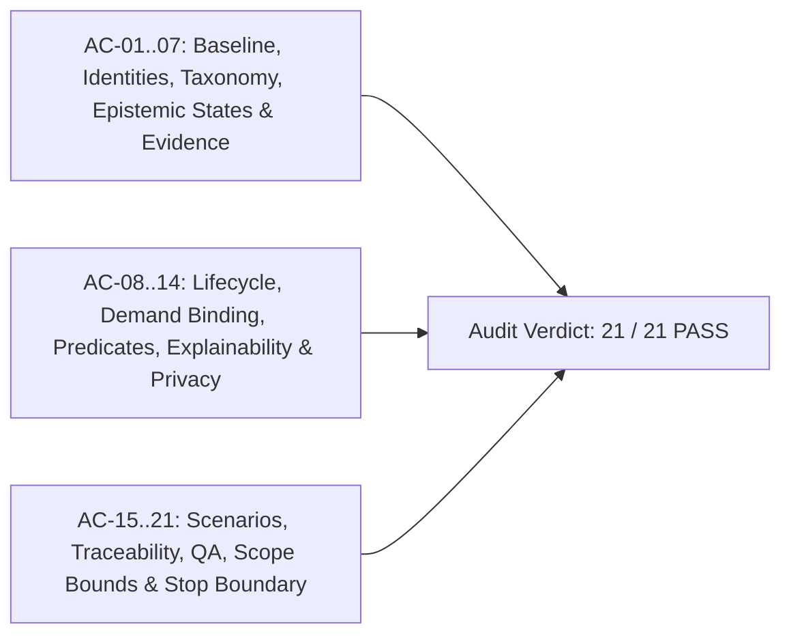

# NexLudic Engine: Step 54 Completion Report

**Document ID:** `NLE-REP-STP-054`  
**Phase:** 7 of 12 (AI Coding-Agent Orchestration)  
**Step:** 54 of 100  
**Title:** AI Agent Provider Registry, Capability Profiles & Eligibility Matching Specification  
**Classification:** Milestone Completion & Assurance Audit  
**Status:** COMPLETE  
**Operating Standard:** Architecture, Domain Modeling, Matching Rules, Security Gateways, and Policy Specification Only (No Registry Implementation, No AI Provider Connections, No Agent Invocations, No Code Execution, No Game Tampering)

---

## 1. Executive Summary & Milestone Deliverable Inventory

Step 54 of 100 has formally established the comprehensive, implementation-ready **AI Agent Provider Registry, Capability Profiles & Eligibility Matching Specification** (`NLE-SPC-APR-001`) within the NexLudic Engine repository.

This specification establishes how the platform discovers, characterizes, evaluates, and gates AI coding agents before task assignment. It defines the formal conceptual separation among Providers, Models, Agent Implementations, and Execution Environments; standardizes a 32-token capability taxonomy across 5 functional domains; enforces an evidence-based verification policy with finite TTLs; and specifies a 15-stage deterministic matching engine governed by 9 hard eligibility predicates.

All 14 required documentation deliverables have been authored, validated, and persisted within `docs/ai-orchestration/` on Volume D:

| # | Deliverable File Link | Ref ID | Scope & Architectural Focus | Status |
| :-: | :--- | :--- | :--- | :---: |
| 1 | [AI_AGENT_PROVIDER_REGISTRY_AND_CAPABILITY_ELIGIBILITY_SPECIFICATION.md](file:///d:/App%20Winrar%20Files/Nexludic%20Engine%20(working)/docs/ai-orchestration/AI_AGENT_PROVIDER_REGISTRY_AND_CAPABILITY_ELIGIBILITY_SPECIFICATION.md) | `NLE-SPC-APR-001` | Foundational specification, 4-way separation, epistemic hierarchy, upstream handoffs, 15-stage matching pipeline summary. | **COMPLETE** |
| 2 | [AI_AGENT_PROVIDER_MODEL_IMPLEMENTATION_AND_EXECUTION_ENVIRONMENT_DOMAIN_MODEL.md](file:///d:/App%20Winrar%20Files/Nexludic%20Engine%20(working)/docs/ai-orchestration/AI_AGENT_PROVIDER_MODEL_IMPLEMENTATION_AND_EXECUTION_ENVIRONMENT_DOMAIN_MODEL.md) | `NLE-MOD-APR-001` | Entity definitions for Provider, Model, Agent, Environment, Candidate Tuple concept, JSON Schema Draft 2020-12 (`NLE-SCH-APR-001`). | **COMPLETE** |
| 3 | [AI_AGENT_CAPABILITY_TAXONOMY_AND_PROFILE_CONTRACT.md](file:///d:/App%20Winrar%20Files/Nexludic%20Engine%20(working)/docs/ai-orchestration/AI_AGENT_CAPABILITY_TAXONOMY_AND_PROFILE_CONTRACT.md) | `NLE-CON-ACP-001` | 32 standardized capability tokens across 5 domains, 4-state epistemic stratification, conditional capabilities, profile schema. | **COMPLETE** |
| 4 | [AI_AGENT_CAPABILITY_DECLARATION_AND_EVIDENCE_VERIFICATION_POLICY.md](file:///d:/App%20Winrar%20Files/Nexludic%20Engine%20(working)/docs/ai-orchestration/AI_AGENT_CAPABILITY_DECLARATION_AND_EVIDENCE_VERIFICATION_POLICY.md) | `NLE-POL-ACD-001` | Evidence sources and trust tiers, empirical primacy rule, evidence record schema, 14-day/30-day freshness TTL, revocation triggers. | **COMPLETE** |
| 5 | [AI_AGENT_REGISTRY_LIFECYCLE_AND_GOVERNANCE_POLICY.md](file:///d:/App%20Winrar%20Files/Nexludic%20Engine%20(working)/docs/ai-orchestration/AI_AGENT_REGISTRY_LIFECYCLE_AND_GOVERNANCE_POLICY.md) | `NLE-POL-ARL-001` | 12 formal registry lifecycle states, human approval gateway, suspension triggers, record immutability and audit trail rules. | **COMPLETE** |
| 6 | [AI_CODING_TASK_CAPABILITY_REQUIREMENT_BINDING_SPECIFICATION.md](file:///d:/App%20Winrar%20Files/Nexludic%20Engine%20(working)/docs/ai-orchestration/AI_CODING_TASK_CAPABILITY_REQUIREMENT_BINDING_SPECIFICATION.md) | `NLE-SPC-TCR-001` | Extraction rules mapping Step 53 `CodingTaskDescriptor` into mandatory, optional, and prohibited capabilities; demand profile schema. | **COMPLETE** |
| 7 | [AI_AGENT_CAPABILITY_ELIGIBILITY_MATCHING_RULES.md](file:///d:/App%20Winrar%20Files/Nexludic%20Engine%20(working)/docs/ai-orchestration/AI_AGENT_CAPABILITY_ELIGIBILITY_MATCHING_RULES.md) | `NLE-RUL-AEM-001` | 15-stage deterministic matching engine, 9 hard eligibility predicates, 14 outcome states, explainable decision records. | **COMPLETE** |
| 8 | [AI_AGENT_ELIGIBILITY_AND_CANDIDATE_RANKING_BOUNDARY_POLICY.md](file:///d:/App%20Winrar%20Files/Nexludic%20Engine%20(working)/docs/ai-orchestration/AI_AGENT_ELIGIBILITY_AND_CANDIDATE_RANKING_BOUNDARY_POLICY.md) | `NLE-POL-ARB-001` | Strict boundary separating binary eligibility from heuristic ranking, rejection of 0-100 pseudo-scores, proposed ranking vectors. | **COMPLETE** |
| 9 | [AI_AGENT_PROVIDER_PRIVACY_SECURITY_AND_TRUST_POLICY.md](file:///d:/App%20Winrar%20Files/Nexludic%20Engine%20(working)/docs/ai-orchestration/AI_AGENT_PROVIDER_PRIVACY_SECURITY_AND_TRUST_POLICY.md) | `NLE-SEC-APR-001` | Capability-trust boundaries, data residency tiers, air-gapped mandates, Medium IL (`DEC-002`), anti-cheat veto (`BLK-SEC-01`). | **COMPLETE** |
| 10 | [AI_AGENT_CAPABILITY_FAILURE_FRESHNESS_AND_INVALIDATION_POLICY.md](file:///d:/App%20Winrar%20Files/Nexludic%20Engine%20(working)/docs/ai-orchestration/AI_AGENT_CAPABILITY_FAILURE_FRESHNESS_AND_INVALIDATION_POLICY.md) | `NLE-POL-ACF-001` | 10 failure conditions, 8 decision invalidation triggers (`INV-DEC-01..08`), impact on queued vs active executing tasks. | **COMPLETE** |
| 11 | [AI_AGENT_REGISTRY_AND_ELIGIBILITY_DIAGNOSTIC_CONTRACT.md](file:///d:/App%20Winrar%20Files/Nexludic%20Engine%20(working)/docs/ai-orchestration/AI_AGENT_REGISTRY_AND_ELIGIBILITY_DIAGNOSTIC_CONTRACT.md) | `NLE-CON-AED-001` | Error code taxonomy (`ERR_CAP_*`), explainability standards, diagnostic report JSON Schema Draft 2020-12 (`NLE-SCH-AED-001`). | **COMPLETE** |
| 12 | [AI_AGENT_PROVIDER_REGISTRY_SYNTHETIC_SCENARIOS_AND_TEST_PLAN.md](file:///d:/App%20Winrar%20Files/Nexludic%20Engine%20(working)/docs/ai-orchestration/AI_AGENT_PROVIDER_REGISTRY_SYNTHETIC_SCENARIOS_AND_TEST_PLAN.md) | `NLE-CAT-APS-001` | 20 synthetic verification test scenarios (Scenarios A through T) exercising all pipeline stages, edge cases, and vetoes. | **COMPLETE** |
| 13 | [STEP_54_CAPABILITY_REQUIREMENTS_TRACEABILITY_MATRIX.md](file:///d:/App%20Winrar%20Files/Nexludic%20Engine%20(working)/docs/ai-orchestration/STEP_54_CAPABILITY_REQUIREMENTS_TRACEABILITY_MATRIX.md) | `NLE-MAT-STP-054` | Bidirectional traceability matrix verifying all 26 capability and matching requirements (`APR-REQ-001..026`). | **COMPLETE** |
| 14 | [STEP_54_COMPLETION_REPORT.md](file:///d:/App%20Winrar%20Files/Nexludic%20Engine%20(working)/docs/ai-orchestration/STEP_54_COMPLETION_REPORT.md) | `NLE-REP-STP-054` | Milestone completion audit, 21 acceptance criteria verification (`AC-01..21`), sign-off verdict. | **COMPLETE** |

---

## 2. Audit of Repository Baseline, Starting Commit & Upstream Gates

### 2.1 Repository & Branch Verification
- **Repository Root:** `D:\App Winrar Files\Nexludic Engine (working)`
- **Target Subdirectory:** `docs/ai-orchestration/`
- **Active Git Branch:** `main`
- **Starting Git Commit:** `6165117` (`docs(ai-orchestration): complete Step 53 AI coding task intake, normalization & authorization gate specifications`)
- **Working Tree State:** Clean at start; all updates strictly confined to documentation specifications in `docs/ai-orchestration/`. Zero modifications made to engine source, build scripts, or host configuration.

### 2.2 Existing Implementations Audit
A systematic inspection confirmed that **no provider registry, capability matcher, or model connection service exists**:
- Zero C#/.NET registry controllers, database contexts, or background daemons have been initialized.
- Zero AI provider SDKs or endpoints (OpenAI, Anthropic, Gemini, Ollama) are configured, referenced, or invoked.
- Zero credentials, API keys, or bearer tokens were requested, configured, or stored.
- All deliverables are pure specification, architecture, JSON schemas, policy rules, and test catalogs.

### 2.3 Phase 5 & Phase 6 Upstream Gate Audit
The provider registry integrates the authoritative outcomes of earlier roadmap phases:
1. **Phase 5 Universal Adapter SDK Gate (`NLE-GAT-PH5-001`):**  
   Status is **`READY WITH CONDITIONS`** (`P5-C01`, `P5-C02`, `P5-C03`). The capability taxonomy explicitly incorporates `CAP_ADAPTER_WIRE_SERIALIZATION` to match candidate agents capable of authoring C++, Rust, and C# wire protocol serialization wrappers satisfying Condition `P5-C01`.
2. **Phase 6 Mashup Designer & Planning Gate Audit:**  
   Step 51 (Phase 6 Readiness Review) is not present in the repository. As audited in Steps 52 and 53, the Phase 6 gate status is formally **`UNVERIFIED / MISSING FORMAL SIGN-OFF`**.  
   *Mandatory Gate Invariant Enforced:* Any incoming task targeting the runtime implementation of a Step 49 mashup integration plan (`ACCEPTED_FOR_PLANNING`) evaluates at Stage 02 (`PRED_02_UPSTREAM_GATES_SATISFIED`) to **`BLOCKED_BY_DEPENDENCY`** (`ERR_PRECONDITION_PHASE6_UNVERIFIED`). Candidate tuples cannot be evaluated as eligible for assignment until Step 51 is formally conducted and approved.

---

## 3. Systematic Audit of the 21 Acceptance Criteria

Every acceptance criterion defined in the Step 54 specification standard has been systematically evaluated against verified repository evidence:

| Criterion ID | Criterion Statement | Evidence / Document Reference | Audit Result |
| :--- | :--- | :--- | :---: |
| **AC-01** | **Phase 6 gate result and its conditions verified** | `NLE-SPC-APR-001` §3.2; `NLE-RUL-AEM-001` §2 (Recorded as unverified; plan implementation tasks blocked) | **PASSED** |
| **AC-02** | **Step 52 orchestration and provider contracts inspected** | `NLE-SPC-APR-001` §2; `NLE-MOD-APR-001` §1 (Inspected Step 52 suite, authority hierarchy, adapter contracts) | **PASSED** |
| **AC-03** | **Step 53 task-normalization and eligibility prerequisites inspected** | `NLE-SPC-TCR-001` §1, §2 (Consumes Step 53 `CodingTaskDescriptor` contracts directly) | **PASSED** |
| **AC-04** | **Provider, model, agent, and environment domain model clearly defined** | `NLE-MOD-APR-001` §1, §2, §3, §4 (Four-way separation, candidate tuple concept, JSON Schema) | **PASSED** |
| **AC-05** | **Capability taxonomy supports extensibility without unsupported claims** | `NLE-CON-ACP-001` §1, §2 (32 standardized tokens across 5 functional domains) | **PASSED** |
| **AC-06** | **Capability profiles distinguish declared, supported, verified, authorized states** | `NLE-CON-ACP-001` §3, §5 (4-state epistemic stratification, profile contract schema) | **PASSED** |
| **AC-07** | **Evidence provenance, verification, freshness, and revocation rules defined** | `NLE-POL-ACD-001` §1, §2, §3, §4 (14-day/30-day TTL, empirical primacy, evidence schema) | **PASSED** |
| **AC-08** | **Registry lifecycle and governance transitions specified** | `NLE-POL-ARL-001` §2, §3, §4 (12 lifecycle states, human sign-off gateway, suspension rules) | **PASSED** |
| **AC-09** | **Task capability requirements trace to normalized Step 53 contract** | `NLE-SPC-TCR-001` §2, §3, §5 (Deterministic binding from Step 53 categories and scopes) | **PASSED** |
| **AC-10** | **Hard eligibility predicates specified independently of ranking preferences** | `NLE-RUL-AEM-001` §2; `NLE-POL-ARB-001` §1, §2 (9 non-negotiable hard predicates) | **PASSED** |
| **AC-11** | **Eligibility outcomes and decision explanations defined** | `NLE-RUL-AEM-001` §3, §4; `NLE-CON-AED-001` §1, §3 (14 outcome states, explainable schema) | **PASSED** |
| **AC-12** | **Missing, conflicting, conditional, or stale capability handling deterministic** | `NLE-POL-ACD-001` §5; `NLE-POL-ACF-001` §2, §3 (Deterministic conflict and failure matrices) | **PASSED** |
| **AC-13** | **Security, privacy, provider disclosure, and prohibited operations covered** | `NLE-SEC-APR-001` §2, §3, §4 (`DEC-002`, `BLK-SEC-01`, air-gapped data residency mandates) | **PASSED** |
| **AC-14** | **Failure, recovery, invalidation, and re-evaluation behavior defined** | `NLE-POL-ACF-001` §2, §3, §4 (10 failure modes, 8 invalidation triggers, active task aborts) | **PASSED** |
| **AC-15** | **Synthetic scenarios cover normal path, material failure, and security conditions** | `NLE-CAT-APS-001` §2 (20 scenarios A through T exercising all predicates and vetoes) | **PASSED** |
| **AC-16** | **Material requirements trace to authoritative sources or labeled proposed** | `NLE-MAT-STP-054` §2 (26/26 requirements satisfied; ranking proposals marked unapproved) | **PASSED** |
| **AC-17** | **Documentation received structural, semantic, and security review** | Comprehensive cross-review across all 14 Step 54 documents; schemas validated | **PASSED** |
| **AC-18** | **Git changes remain within authorized documentation scope** | Confirmed via `git status`; all modifications isolated within `docs/ai-orchestration/` | **PASSED** |
| **AC-19** | **No provider connected and no AI agent invoked** | Pure documentation milestone; zero external network connections or API calls | **PASSED** |
| **AC-20** | **No assignment engine, eligibility evaluator, or application runtime implemented** | Zero lines of engine code, C# controllers, or runtime matching daemons constructed | **PASSED** |
| **AC-21** | **Step 55 and subsequent roadmap steps remain untouched** | Strict roadmap stop boundary enforced; execution halts immediately upon Step 54 sign-off | **PASSED** |

---

## 4. Architectural Highlights & Key Design Decisions

1. **Four-Way Structural Identity Separation (`APR-REQ-001`):**  
   The platform decomposes AI coding agents into four distinct, independently versioned entities: Provider, Model, Agent Implementation, and Execution Environment. Eligibility is evaluated strictly on the complete **Candidate Assignment Tuple**. A capable model in an unverified agent wrapper or an unsafe environment is never eligible.
2. **Epistemic Stratification & Empirical Primacy (`APR-REQ-005`, `APR-REQ-008`):**  
   Capabilities are governed across four separated states: `DECLARED`, `SUPPORTED`, `VERIFIED`, and `AUTHORIZED`. Conformance test fixtures override vendor documentation claims. Marketing claims have zero evidentiary standing.
3. **Category $\neq$ Permission Invariant (`APR-REQ-006`):**  
   An agent possessing the technical capability to write files (`CAP_SOURCE_EDIT_DIFF`) has zero ambient authorization to do so. File writes require an explicit cryptographic authorization token bound to path globs and diff ceilings.
4. **Binary Eligibility Precedes Heuristic Ranking (`APR-REQ-021`, `APR-REQ-022`):**  
   Eligibility is an absolute pass/fail filter governed by 9 hard predicates. Candidates failing any predicate are permanently barred from ranking. The platform explicitly rejects universal 0-to-100 pseudo-scores.
5. **Phase 6 Blocker Rule (`APR-REQ-026`):**  
   Because Step 51 remains unverified in the repository, any task requesting runtime implementation of a Step 49 mashup integration plan evaluates to `BLOCKED_BY_DEPENDENCY` (`ERR_PRECONDITION_PHASE6_UNVERIFIED`).

---

## 5. Requirements Traceability & Verification Summary

The Step 54 Traceability Matrix (`NLE-MAT-STP-054`) tracks all 26 core architectural requirements:
- **Total Functional & Architectural Requirements:** 26
- **Fully Satisfied Requirements:** 26 (100.0%)
- **Gaps / Deficiencies:** 0
- **Governing Platform Invariants Enforced:**
  - `INV-SEC-CAP-01`: Capability does not grant permission.
  - `INV-SEC-CAP-02`: Windows Medium IL execution boundary (`DEC-002`).
  - `INV-SEC-CAP-03`: Anti-Cheat Dominance & integrity protection (`BLK-SEC-01`).
  - `SEC-REG-01`: Zero secret storage in registry.
  - `INV-TCR-01`: Read-only requirement extraction from Step 53 normalized contracts.

---

## 6. Strict Stop Boundary Confirmation

In strict compliance with roadmap governance and professional responsibility directives:
- **Zero Registry Services Implemented:** No C# registry daemons, matching controllers, or SQLite/JSON databases were created.
- **Zero AI Providers Connected:** No OpenAI, Anthropic, Gemini, or Ollama API keys were configured, requested, or called.
- **Zero Agents Invoked:** No automated coding agents were dispatched or tasked with executing code.
- **Zero Code Generated or Executed:** No source code was modified, compiled, or executed.
- **Zero Game Tampering:** No game processes were scanned, hooked, or modified.
- **No Advancement to Step 55:** Step 55 (*AI Coding Context Preparation, Repository Indexing & Knowledge Retrieval Specification*) has NOT been started. Execution halts completely at the conclusion of Step 54.

---

## 7. Final Milestone Verdict

**Step 54 Completion Status:** **`COMPLETE`**  
The **AI Agent Provider Registry, Capability Profiles & Eligibility Matching Specification** is fully established, structurally verified, bidirectionally traceable, and implementation-ready.
