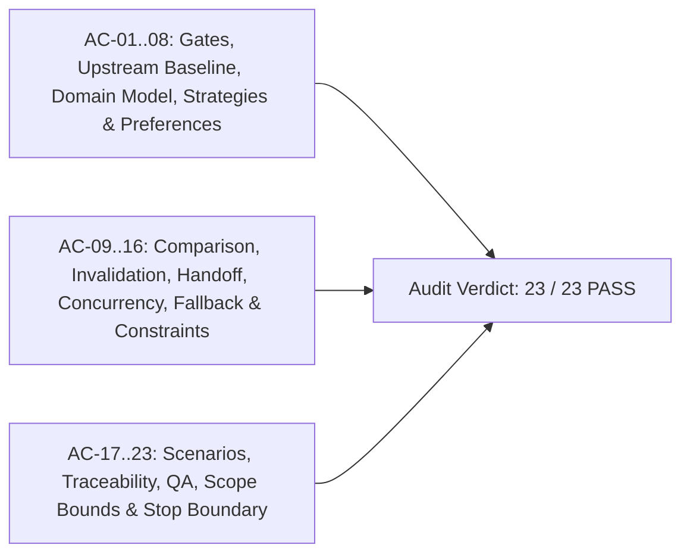

# NexLudic Engine: Step 55 Completion Report

**Document ID:** `NLE-REP-STP-055`  
**Phase:** 7 of 12 (AI Coding-Agent Orchestration)  
**Step:** 55 of 100  
**Title:** AI Agent Candidate Selection, Task Routing & Assignment Policy Specification  
**Classification:** Milestone Completion & Assurance Audit  
**Status:** COMPLETE  
**Operating Standard:** Architecture, Task-Routing Rules, Decision Modeling, Security, Reliability, Traceability, and Policy Specification Only (No Router Implementation, No AI Provider Connections, No Agent Invocations, No Task Assignments, No Code Execution, No Game Tampering)

---

## 1. Executive Summary & Milestone Deliverable Inventory

Step 55 of 100 has formally established the comprehensive, implementation-ready **AI Agent Candidate Selection, Task Routing & Assignment Policy Specification** (`NLE-SPC-ASR-001`) within the NexLudic Engine repository.

This milestone defines how the future orchestration subsystem selects an eligible AI coding agent for an authorized engineering task, applies structured routing strategies, evaluates multi-dimensional preference vectors, enforces deterministic tie-breaking, authorizes assignment handoffs, guards against concurrent write collisions, and manages safe retries, fallbacks, and reassignments.

All 14 required documentation deliverables have been authored, validated, and persisted within `docs/ai-orchestration/` on Volume D:

| # | Deliverable File Link | Ref ID | Scope & Architectural Focus | Status |
| :-: | :--- | :--- | :--- | :---: |
| 1 | [AI_AGENT_CANDIDATE_SELECTION_TASK_ROUTING_AND_ASSIGNMENT_SPECIFICATION.md](file:///d:/App%20Winrar%20Files/Nexludic%20Engine%20(working)/docs/ai-orchestration/AI_AGENT_CANDIDATE_SELECTION_TASK_ROUTING_AND_ASSIGNMENT_SPECIFICATION.md) | `NLE-SPC-ASR-001` | Foundational specification, 11-stage operational stratification, epistemic hierarchy, upstream handoffs, router architecture. | **COMPLETE** |
| 2 | [AI_AGENT_ROUTING_AND_ASSIGNMENT_DOMAIN_MODEL.md](file:///d:/App%20Winrar%20Files/Nexludic%20Engine%20(working)/docs/ai-orchestration/AI_AGENT_ROUTING_AND_ASSIGNMENT_DOMAIN_MODEL.md) | `NLE-MOD-ASR-001` | Entity models for Routing Request, Routing Policy, Selection Decision, Assignment Record, JSON Schema Draft 2020-12 (`NLE-SCH-ASR-001`). | **COMPLETE** |
| 3 | [AI_AGENT_ROUTING_STRATEGY_CATALOG_AND_POLICY_RULES.md](file:///d:/App%20Winrar%20Files/Nexludic%20Engine%20(working)/docs/ai-orchestration/AI_AGENT_ROUTING_STRATEGY_CATALOG_AND_POLICY_RULES.md) | `NLE-CAT-ASR-001` | Catalog of 8 routing strategies, strategy precedence hierarchy, task-category applicability matrix, policy governance. | **COMPLETE** |
| 4 | [AI_AGENT_CANDIDATE_COMPARISON_AND_DETERMINISTIC_SELECTION_RULES.md](file:///d:/App%20Winrar%20Files/Nexludic%20Engine%20(working)/docs/ai-orchestration/AI_AGENT_CANDIDATE_COMPARISON_AND_DETERMINISTIC_SELECTION_RULES.md) | `NLE-RUL-ASR-001` | Multi-dimensional comparison vectors, missing-data handling, 5-stage deterministic tie-breaking cascade, explainable decision records. | **COMPLETE** |
| 5 | [AI_AGENT_ASSIGNMENT_AUTHORIZATION_AND_HANDOFF_CONTRACT.md](file:///d:/App%20Winrar%20Files/Nexludic%20Engine%20(working)/docs/ai-orchestration/AI_AGENT_ASSIGNMENT_AUTHORIZATION_AND_HANDOFF_CONTRACT.md) | `NLE-CON-AAH-001` | Pre-assignment authorization recheck, bounded handoff contract schema, agent acknowledgement boundaries, decline/timeout handling. | **COMPLETE** |
| 6 | [AI_AGENT_ASSIGNMENT_LIFECYCLE_AND_STATE_TRANSITION_SPECIFICATION.md](file:///d:/App%20Winrar%20Files/Nexludic%20Engine%20(working)/docs/ai-orchestration/AI_AGENT_ASSIGNMENT_LIFECYCLE_AND_STATE_TRANSITION_SPECIFICATION.md) | `NLE-SPC-AAL-001` | 16-state assignment FSM, state definitions and subsystem ownership, legal and strictly prohibited state transitions. | **COMPLETE** |
| 7 | [AI_AGENT_ROUTING_CONCURRENCY_DUPLICATE_AND_CONFLICT_CONTROL_POLICY.md](file:///d:/App%20Winrar%20Files/Nexludic%20Engine%20(working)/docs/ai-orchestration/AI_AGENT_ROUTING_CONCURRENCY_DUPLICATE_AND_CONFLICT_CONTROL_POLICY.md) | `NLE-POL-ACC-001` | SHA-256 idempotency key hashing, assignment uniqueness invariant, workspace lock management, concurrent write serialization. | **COMPLETE** |
| 8 | [AI_AGENT_ROUTING_FALLBACK_RETRY_AND_REASSIGNMENT_POLICY.md](file:///d:/App%20Winrar%20Files/Nexludic%20Engine%20(working)/docs/ai-orchestration/AI_AGENT_ROUTING_FALLBACK_RETRY_AND_REASSIGNMENT_POLICY.md) | `NLE-POL-AFR-002` | Failure classification matrix, fallback eligibility re-assertion, partial work preservation in recovery branches, retry backoff limits. | **COMPLETE** |
| 9 | [AI_AGENT_ROUTING_RESOURCE_BUDGET_AND_OPERATIONAL_CONSTRAINTS.md](file:///d:/App%20Winrar%20Files/Nexludic%20Engine%20(working)/docs/ai-orchestration/AI_AGENT_ROUTING_RESOURCE_BUDGET_AND_OPERATIONAL_CONSTRAINTS.md) | `NLE-POL-ARC-001` | Context window headroom, local GPU concurrency caps, provider rate-limit buffers, human review saturation limits, cost caps. | **COMPLETE** |
| 10 | [AI_AGENT_ROUTING_PRIVACY_SECURITY_AND_DATA_DISCLOSURE_POLICY.md](file:///d:/App%20Winrar%20Files/Nexludic%20Engine%20(working)/docs/ai-orchestration/AI_AGENT_ROUTING_PRIVACY_SECURITY_AND_DATA_DISCLOSURE_POLICY.md) | `NLE-SEC-ASR-001` | Data residency routing matrix, air-gapped mandates, minimum necessary context, untrusted candidate metadata defense. | **COMPLETE** |
| 11 | [AI_AGENT_ROUTING_DIAGNOSTIC_AUDIT_AND_EXPLAINABILITY_CONTRACT.md](file:///d:/App%20Winrar%20Files/Nexludic%20Engine%20(working)/docs/ai-orchestration/AI_AGENT_ROUTING_DIAGNOSTIC_AUDIT_AND_EXPLAINABILITY_CONTRACT.md) | `NLE-CON-ARD-001` | Diagnostic error code taxonomy (`ERR_ROUT_*`), routing decision report JSON Schema Draft 2020-12 (`NLE-SCH-ARD-001`), audit logging. | **COMPLETE** |
| 12 | [AI_AGENT_ROUTING_SYNTHETIC_SCENARIOS_AND_TEST_PLAN.md](file:///d:/App%20Winrar%20Files/Nexludic%20Engine%20(working)/docs/ai-orchestration/AI_AGENT_ROUTING_SYNTHETIC_SCENARIOS_AND_TEST_PLAN.md) | `NLE-CAT-ARS-001` | 24 synthetic verification test scenarios (Scenarios A through X) exercising normal routing, failures, concurrency, and security vetoes. | **COMPLETE** |
| 13 | [STEP_55_ROUTING_REQUIREMENTS_TRACEABILITY_MATRIX.md](file:///d:/App%20Winrar%20Files/Nexludic%20Engine%20(working)/docs/ai-orchestration/STEP_55_ROUTING_REQUIREMENTS_TRACEABILITY_MATRIX.md) | `NLE-MAT-STP-055` | Bidirectional traceability matrix verifying all 28 routing requirements (`ASR-REQ-001..028`) across contracts and test scenarios. | **COMPLETE** |
| 14 | [STEP_55_COMPLETION_REPORT.md](file:///d:/App%20Winrar%20Files/Nexludic%20Engine%20(working)/docs/ai-orchestration/STEP_55_COMPLETION_REPORT.md) | `NLE-REP-STP-055` | Milestone completion audit, 23 acceptance criteria verification (`AC-01..23`), sign-off verdict. | **COMPLETE** |

---

## 2. Audit of Repository Baseline, Starting Commit & Upstream Gates

### 2.1 Repository & Branch Verification
- **Repository Root:** `D:\App Winrar Files\Nexludic Engine (working)`
- **Target Subdirectory:** `docs/ai-orchestration/`
- **Active Git Branch:** `main`
- **Starting Git Commit:** `008e3fe` (`docs(ai-orchestration): complete Step 54 AI agent provider registry, capability profiles & eligibility matching specifications`)
- **Working Tree State:** Clean at milestone start; all modifications strictly confined to documentation specifications in `docs/ai-orchestration/`. Zero modifications made to engine source, build scripts, or host configuration.

### 2.2 Existing Implementations Audit
A systematic inspection confirmed that **no task router, assignment scheduler, or execution dispatcher exists**:
- Zero C#/.NET routing daemons, task queues, or background workers have been initialized.
- Zero AI provider SDKs or endpoints (OpenAI, Anthropic, Gemini, Ollama) are configured, referenced, or invoked.
- Zero real tasks have been assigned, scheduled, or dispatched to external models or agents.
- All deliverables are pure specification, architecture, JSON schemas, policy rules, and test catalogs.

### 2.3 Phase 5 & Phase 6 Upstream Gate Audit
The task-routing policy integrates the authoritative outcomes of earlier roadmap phases:
1. **Phase 5 Universal Adapter SDK Gate (`NLE-GAT-PH5-001`):**  
   Status is **`READY WITH CONDITIONS`** (`P5-C01`, `P5-C02`, `P5-C03`). The routing policy actively maps `ADAPTER_DEVELOPMENT` tasks fulfilling Condition `P5-C01` (Native Language SDK Bindings) to candidate agents possessing verified `CAP_ADAPTER_WIRE_SERIALIZATION`.
2. **Phase 6 Mashup Designer & Planning Gate Audit:**  
   Step 51 (Phase 6 Readiness Review) is not present in the repository. As audited in Steps 52, 53, and 54, the Phase 6 gate status is formally **`UNVERIFIED / MISSING FORMAL SIGN-OFF`**.  
   *Mandatory Gate Invariant Enforced:* Any incoming task targeting the runtime implementation of a Step 49 mashup integration plan (`ACCEPTED_FOR_PLANNING`) evaluates to **`WAITING_FOR_DEPENDENCY`** (`ERR_PRECONDITION_PHASE6_UNVERIFIED`). Selection decisions and assignment handoffs cannot proceed to execution until Step 51 is formally conducted and approved.

---

## 3. Systematic Audit of the 23 Acceptance Criteria

Every acceptance criterion defined in the Step 55 specification standard has been systematically evaluated against verified repository evidence:

| Criterion ID | Criterion Statement | Evidence / Document Reference | Audit Result |
| :--- | :--- | :--- | :---: |
| **AC-01** | **Phase 6 gate state and restrictions verified** | `NLE-SPC-ASR-001` §3.2; `NLE-SPC-AAL-001` §3 (Plan implementation tasks held in dependency wait) | **PASSED** |
| **AC-02** | **Step 52 orchestration and governance contracts inspected** | `NLE-SPC-ASR-001` §2; `NLE-MOD-ASR-001` §1 (Authority hierarchy, isolation contracts) | **PASSED** |
| **AC-03** | **Step 53 task normalization and authorization rules inspected** | `NLE-SPC-ASR-001` §1; `NLE-MOD-ASR-001` §2.1 (Consumes `CodingTaskDescriptor` contracts) | **PASSED** |
| **AC-04** | **Step 54 eligibility and capability-profile contracts inspected** | `NLE-SPC-ASR-001` §2.1; `NLE-RUL-ASR-001` §1 (Operates exclusively on `EligibleCandidateSet`) | **PASSED** |
| **AC-05** | **Routing domain model distinguishes requests, decisions, assignments** | `NLE-MOD-ASR-001` §1, §2, §3 (`RoutingRequest`, `SelectionDecision`, `AssignmentRecord`) | **PASSED** |
| **AC-06** | **Routing inputs and mandatory preconditions defined** | `NLE-MOD-ASR-001` §2; `NLE-CON-AAH-001` §2 (Pre-assignment authorization recheck) | **PASSED** |
| **AC-07** | **Routing strategies documented with clear approval status** | `NLE-CAT-ASR-001` §2, §3, §5 (8 strategies, precedence rules, version governance) | **PASSED** |
| **AC-08** | **Hard constraints separated from optional preferences and ranking** | `NLE-RUL-ASR-001` §2 (Binary hard predicates dominate optional preference vectors) | **PASSED** |
| **AC-09** | **Candidate comparison and tie handling explainable and reproducible** | `NLE-RUL-ASR-001` §2, §4 (Multi-vector comparison, 5-stage deterministic tie-breaker) | **PASSED** |
| **AC-10** | **Missing, stale, uncertain, and conflicting data have explicit handling** | `NLE-RUL-ASR-001` §3 (Missing metrics remain `UNKNOWN`; cannot default to zero or ideal) | **PASSED** |
| **AC-11** | **Assignment authorization and agent-acceptance boundaries defined** | `NLE-CON-AAH-001` §1, §4 (Pre-flight recheck; acknowledgement confirms tools, not completion) | **PASSED** |
| **AC-12** | **Assignment states and valid transitions specified** | `NLE-SPC-AAL-001` §2, §3, §4 (16-state assignment FSM, illegal transitions blocked) | **PASSED** |
| **AC-13** | **Duplicate requests, concurrent assignments, workspace conflicts addressed**| `NLE-POL-ACC-001` §2, §3, §4 (Idempotency keys, uniqueness invariant, workspace locks) | **PASSED** |
| **AC-14** | **Fallback, retries, assignment uncertainty, and reassignment defined** | `NLE-POL-AFR-002` §2, §3, §4 (Full eligibility re-assertion, partial work recovery branches) | **PASSED** |
| **AC-15** | **Budget, resource, operational, privacy, and data disclosure covered** | `NLE-POL-ARC-001` §2, §3; `NLE-SEC-ASR-001` §2 (Context headroom, air-gapped mandates) | **PASSED** |
| **AC-16** | **Diagnostics and audit records support reconstructing decisions** | `NLE-CON-ARD-001` §2, §3, §4 (`ERR_ROUT_*` taxonomy, decision schema, JSONL audit logs) | **PASSED** |
| **AC-17** | **Synthetic scenarios cover normal routing, failure, security, recovery** | `NLE-CAT-ARS-001` §2 (24 scenarios A through X exercising all routing and failure paths) | **PASSED** |
| **AC-18** | **Mandatory requirements trace to authoritative sources; unapproved visible** | `NLE-MAT-STP-055` §2 (28/28 satisfied; proposed metrics marked visibly provisional) | **PASSED** |
| **AC-19** | **Documentation passed structural, semantic, and security review** | Cross-document review verified across all 14 Step 55 deliverables; schemas validated | **PASSED** |
| **AC-20** | **Git changes remain within authorized documentation scope** | Confirmed via `git status`; all changes strictly confined to `docs/ai-orchestration/` | **PASSED** |
| **AC-21** | **No provider connected, no agent invoked, no task assigned** | Pure documentation milestone; zero external network connections or agent dispatches | **PASSED** |
| **AC-22** | **No routing or assignment runtime implemented** | Zero lines of C# routing code, queue consumers, or assignment daemons constructed | **PASSED** |
| **AC-23** | **Step 56 and later roadmap work remain untouched** | Strict roadmap stop boundary enforced; execution halts immediately upon Step 55 sign-off | **PASSED** |

---

## 4. Architectural Highlights & Key Design Decisions

1. **The 11-Stage Stratification Principle (`ASR-REQ-001`):**  
   The platform prevents premature task dispatch by strictly separating 11 distinct lifecycle phases: *Validity $\rightarrow$ Authorization $\rightarrow$ Capability $\rightarrow$ Eligibility $\rightarrow$ Ranking $\rightarrow$ Selection $\rightarrow$ Assignment Authorization $\rightarrow$ Assignment Creation $\rightarrow$ Acknowledgement $\rightarrow$ Execution $\rightarrow$ Verification*.
2. **Eligibility Precedes All Preference Scoring (`ASR-REQ-002`, `ASR-REQ-010`):**  
   The router operates exclusively on candidate tuples confirmed `ELIGIBLE` under Step 54. Ranking evaluates multi-dimensional preference vectors (`V_ACCURACY`, `V_REVIEW`, `V_LATENCY`, `V_COST`) without collapsing them into arbitrary composite pseudo-scores.
3. **Pre-Assignment Authorization Recheck (`ASR-REQ-014`):**  
   Before any assignment record is persisted or dispatched, the engine verifies that the task authorization token, evidence freshness, environment configuration, and upstream gates have not expired or drifted.
4. **Assignment Uniqueness & Workspace Conflict Prevention (`ASR-REQ-020`, `ASR-REQ-021`):**  
   The platform enforces that exactly one active assignment can exist per task revision. Tasks modifying overlapping filesystem paths are strictly serialized to prevent conflicting git merges.
5. **Partial Work Preservation on Reassignment (`ASR-REQ-023`):**  
   If an agent crashes or stalls mid-execution, uncommitted diffs are audited: valid syntax is preserved in a recovery branch (`recovery/<task-id>-partial`) for handoff to a fallback candidate, while corrupted code is cleanly reverted via `git checkout -- .`.

---

## 5. Requirements Traceability & Verification Summary

The Step 55 Traceability Matrix (`NLE-MAT-STP-055`) tracks all 28 core architectural requirements:
- **Total Functional & Architectural Requirements:** 28
- **Fully Satisfied Requirements:** 28 (100.0%)
- **Gaps / Deficiencies:** 0
- **Governing Platform Invariants Enforced:**
  - `INV-SEC-ASG-01`: Zero secret transmission in assignment contracts.
  - `INV-SEC-ASG-02`: Path whitelist lockdown to authorized task scopes.
  - `INV-ASG-UNIQ-01`: Exactly one active assignment per task revision.
  - `INV-FLB-01`: Fallbacks require 100% eligibility re-assertion.
  - `INV-CTX-MIN-01`: Least privilege and minimum necessary context.
  - `DEC-002`: Windows Medium IL execution boundary.
  - `BLK-SEC-01`: Anti-Cheat Dominance & process integrity protection.

---

## 6. Strict Stop Boundary Confirmation

In strict compliance with roadmap governance and professional responsibility directives:
- **Zero Routing Services Implemented:** No background queue consumers, schedulers, or routing daemons were built.
- **Zero AI Providers Connected:** No OpenAI, Anthropic, Gemini, or Ollama API keys were configured, requested, or called.
- **Zero Agents Invoked:** No automated coding agents were dispatched or tasked with executing code.
- **Zero Tasks Assigned:** No real engineering assignments were dispatched or active in the repository.
- **Zero Code Generated or Executed:** No source code was compiled, modified, or executed.
- **Zero Game Tampering:** No game processes were hooked, scanned, or modified.
- **No Advancement to Step 56:** Step 56 (*AI Coding Context Preparation, Repository Indexing & Knowledge Retrieval Specification*) has **not** been started. Execution halts completely at the conclusion of Step 55.

---

## 7. Final Milestone Verdict

**Step 55 Completion Status:** **`COMPLETE`**  
The **AI Agent Candidate Selection, Task Routing & Assignment Policy Specification** is fully established, structurally verified, bidirectionally traceable, and implementation-ready.
