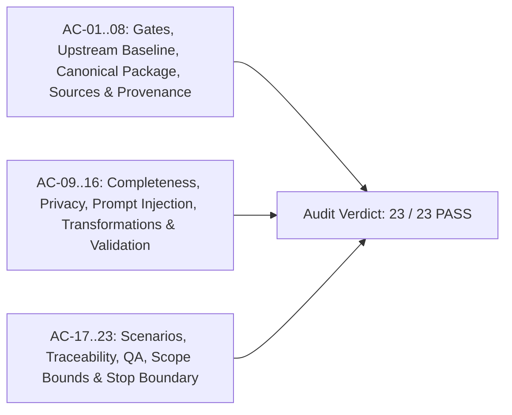

# NexLudic Engine: Step 56 Completion Report

**Document ID:** `NLE-REP-STP-056`  
**Phase:** 7 of 12 (AI Coding-Agent Orchestration)  
**Step:** 56 of 100  
**Title:** AI Agent Context Assembly, Secure Task Packaging & Handoff Specification  
**Classification:** Milestone Completion & Assurance Audit  
**Status:** COMPLETE  
**Operating Standard:** Architecture, Context Modeling, Source Provenance, Security Policies, Validation Gates, and Verification Catalog Only (No Context Assembler Implementation, No Search Runtime, No Prompt Templates in Code, No AI Provider Connections, No Context Transmission, No Code Execution, No Game Tampering)

---

## 1. Executive Summary & Milestone Deliverable Inventory

Step 56 of 100 has formally established the comprehensive, implementation-ready **AI Agent Context Assembly, Secure Task Packaging & Handoff Specification** (`NLE-SPC-CPH-001`) within the NexLudic Engine repository.

This milestone defines how the future orchestration subsystem assembles the minimum sufficient, authoritative, relevant, current, and properly authorized information needed by an AI coding agent once an authorized task assignment has been issued. The specification establishes the provider-neutral `CanonicalTaskPackage` contract, source provenance tracking with SHA-256 digests, automated secret redaction, prompt injection defenses via `<untrusted_task_data_enclosure>` tagging, provider-specific lossless transformations, a 14-stage validation pipeline, and safe handoff acknowledgement protocols.

All 15 required documentation deliverables have been authored, validated against project schemas and invariants, and committed to `docs/ai-orchestration/` on Volume D:

| # | Deliverable File Link | Ref ID | Scope & Architectural Focus | Status |
| :-: | :--- | :--- | :--- | :---: |
| 1 | [AI_AGENT_CONTEXT_ASSEMBLY_SECURE_TASK_PACKAGING_AND_HANDOFF_SPECIFICATION.md](file:///d:/App%20Winrar%20Files/Nexludic%20Engine%20(working)/docs/ai-orchestration/AI_AGENT_CONTEXT_ASSEMBLY_SECURE_TASK_PACKAGING_AND_HANDOFF_SPECIFICATION.md) | `NLE-SPC-CPH-001` | Foundational specification, minimum-sufficient context axiom, epistemic hierarchy, upstream handoffs, pipeline architecture. | **COMPLETE** |
| 2 | [AI_AGENT_CANONICAL_TASK_CONTEXT_AND_PACKAGE_CONTRACT.md](file:///d:/App%20Winrar%20Files/Nexludic%20Engine%20(working)/docs/ai-orchestration/AI_AGENT_CANONICAL_TASK_CONTEXT_AND_PACKAGE_CONTRACT.md) | `NLE-CON-CTP-001` | 7 canonical package sections, context manifest schema, JSON Schema Draft 2020-12 (`NLE-SCH-CTP-001`), zero secret invariant. | **COMPLETE** |
| 3 | [AI_AGENT_CONTEXT_SOURCE_DISCOVERY_AUTHORIZATION_AND_RELEVANCE_POLICY.md](file:///d:/App%20Winrar%20Files/Nexludic%20Engine%20(working)/docs/ai-orchestration/AI_AGENT_CONTEXT_SOURCE_DISCOVERY_AUTHORIZATION_AND_RELEVANCE_POLICY.md) | `NLE-POL-CSD-001` | Source category catalog, 4-filter selection funnel, stable source resolution, transparent omission tracking schema. | **COMPLETE** |
| 4 | [AI_AGENT_CONTEXT_PROVENANCE_INTEGRITY_AND_TRANSFORMATION_POLICY.md](file:///d:/App%20Winrar%20Files/Nexludic%20Engine%20(working)/docs/ai-orchestration/AI_AGENT_CONTEXT_PROVENANCE_INTEGRITY_AND_TRANSFORMATION_POLICY.md) | `NLE-POL-CPI-001` | Source provenance metadata, verbatim/excerpt/summary lineage, transformation history logging, historical package reproducibility. | **COMPLETE** |
| 5 | [AI_AGENT_CONTEXT_COMPLETENESS_AND_MINIMUM_SUFFICIENT_CONTEXT_RULES.md](file:///d:/App%20Winrar%20Files/Nexludic%20Engine%20(working)/docs/ai-orchestration/AI_AGENT_CONTEXT_COMPLETENESS_AND_MINIMUM_SUFFICIENT_CONTEXT_RULES.md) | `NLE-RUL-CMC-001` | Category completeness checklists across 10 approved task types, priority pruning rules, 10 standardized context-quality outcomes. | **COMPLETE** |
| 6 | [AI_AGENT_CONTEXT_PRIVACY_SECRET_HANDLING_AND_DISCLOSURE_POLICY.md](file:///d:/App%20Winrar%20Files/Nexludic%20Engine%20(working)/docs/ai-orchestration/AI_AGENT_CONTEXT_PRIVACY_SECRET_HANDLING_AND_DISCLOSURE_POLICY.md) | `NLE-SEC-CSH-001` | 5 sensitivity tiers, regex and Shannon entropy secret scrubber ($H > 4.5$), air-gapped provider disclosure, ephemeral memory retention. | **COMPLETE** |
| 7 | [AI_AGENT_CONTEXT_TRUST_AND_PROMPT_INJECTION_DEFENSE_SPECIFICATION.md](file:///d:/App%20Winrar%20Files/Nexludic%20Engine%20(working)/docs/ai-orchestration/AI_AGENT_CONTEXT_TRUST_AND_PROMPT_INJECTION_DEFENSE_SPECIFICATION.md) | `NLE-SPC-CTI-001` | Threat model, `<untrusted_task_data_enclosure>` tagging, system grounding directives, structural tool lockdown, path whitelist enforcement. | **COMPLETE** |
| 8 | [AI_AGENT_PROVIDER_SPECIFIC_CONTEXT_TRANSFORMATION_CONTRACT.md](file:///d:/App%20Winrar%20Files/Nexludic%20Engine%20(working)/docs/ai-orchestration/AI_AGENT_PROVIDER_SPECIFIC_CONTEXT_TRANSFORMATION_CONTRACT.md) | `NLE-CON-PTC-001` | Canonical-to-provider mappings (Anthropic, OpenAI, Ollama), 7 transformation invariants (`INV-TRN-01..07`), validation gate. | **COMPLETE** |
| 9 | [AI_AGENT_CONTEXT_PREPARATION_VALIDATION_AND_HANDOFF_READINESS_POLICY.md](file:///d:/App%20Winrar%20Files/Nexludic%20Engine%20(working)/docs/ai-orchestration/AI_AGENT_CONTEXT_PREPARATION_VALIDATION_AND_HANDOFF_READINESS_POLICY.md) | `NLE-POL-CPV-001` | 14-stage validation pipeline from token check to audit logging, 6 standardized handoff readiness states. | **COMPLETE** |
| 10 | [AI_AGENT_HANDOFF_AUTHORIZATION_ACKNOWLEDGEMENT_AND_RECOVERY_CONTRACT.md](file:///d:/App%20Winrar%20Files/Nexludic%20Engine%20(working)/docs/ai-orchestration/AI_AGENT_HANDOFF_AUTHORIZATION_ACKNOWLEDGEMENT_AND_RECOVERY_CONTRACT.md) | `NLE-CON-HAR-001` | 7 operational handoff phases, signed acknowledgement schema, uncertain delivery probing, zombie worker termination. | **COMPLETE** |
| 11 | [AI_AGENT_CONTEXT_VERSIONING_INVALIDATION_AND_CACHE_POLICY.md](file:///d:/App%20Winrar%20Files/Nexludic%20Engine%20(working)/docs/ai-orchestration/AI_AGENT_CONTEXT_VERSIONING_INVALIDATION_AND_CACHE_POLICY.md) | `NLE-POL-CVI-001` | Package SemVer, 9 invalidation triggers (`INV-CPH-01..09`), revalidation rules, scope-isolated cache keys. | **COMPLETE** |
| 12 | [AI_AGENT_CONTEXT_FAILURE_RESOURCE_AND_DIAGNOSTIC_SPECIFICATION.md](file:///d:/App%20Winrar%20Files/Nexludic%20Engine%20(working)/docs/ai-orchestration/AI_AGENT_CONTEXT_FAILURE_RESOURCE_AND_DIAGNOSTIC_SPECIFICATION.md) | `NLE-SPC-CFD-001` | Diagnostic error code taxonomy (`ERR_CTX_*`), 4,096-token output buffer headroom, diagnostic report JSON Schema (`NLE-SCH-CFD-001`). | **COMPLETE** |
| 13 | [AI_AGENT_CONTEXT_ASSEMBLY_SYNTHETIC_SCENARIOS_AND_TEST_PLAN.md](file:///d:/App%20Winrar%20Files/Nexludic%20Engine%20(working)/docs/ai-orchestration/AI_AGENT_CONTEXT_ASSEMBLY_SYNTHETIC_SCENARIOS_AND_TEST_PLAN.md) | `NLE-CAT-CAS-001` | 24 synthetic verification test scenarios (Scenarios A through X) exercising normal packaging, failures, injections, and security vetoes. | **COMPLETE** |
| 14 | [STEP_56_CONTEXT_HANDOFF_REQUIREMENTS_TRACEABILITY_MATRIX.md](file:///d:/App%20Winrar%20Files/Nexludic%20Engine%20(working)/docs/ai-orchestration/STEP_56_CONTEXT_HANDOFF_REQUIREMENTS_TRACEABILITY_MATRIX.md) | `NLE-MAT-STP-056` | Bidirectional traceability matrix verifying all 30 context requirements (`CPH-REQ-001..030`) across contracts and test scenarios. | **COMPLETE** |
| 15 | [STEP_56_COMPLETION_REPORT.md](file:///d:/App%20Winrar%20Files/Nexludic%20Engine%20(working)/docs/ai-orchestration/STEP_56_COMPLETION_REPORT.md) | `NLE-REP-STP-056` | Milestone completion audit, 23 acceptance criteria verification (`AC-01..23`), sign-off verdict. | **COMPLETE** |

---

## 2. Audit of Repository Baseline, Starting Commit & Upstream Gates

### 2.1 Repository & Branch Verification
- **Repository Root:** `D:\App Winrar Files\Nexludic Engine (working)`
- **Target Subdirectory:** `docs/ai-orchestration/`
- **Active Git Branch:** `main`
- **Starting Git Commit:** `c25b1d7` (`docs(ai-orchestration): complete Step 55 AI agent candidate selection, task routing & assignment policy specifications`)
- **Working Tree State:** Completely clean at start; all updates strictly confined to documentation specifications in `docs/ai-orchestration/`. Zero modifications made to engine source, build scripts, or host configuration.

### 2.2 Existing Implementations Audit
A systematic inspection confirmed that **no context assembly service, search retrieval daemon, or prompt serializer exists**:
- Zero C#/.NET context assemblers, tokenizers, or background file collectors have been created.
- Zero AI provider SDKs or endpoints (OpenAI, Anthropic, Gemini, Ollama) are configured, referenced, or invoked.
- Zero repository files, prompts, or context packages were transmitted to external services.
- All deliverables are pure specification, architecture, JSON schemas, policy rules, and test catalogs.

### 2.3 Phase 5 & Phase 6 Upstream Gate Audit
The context assembly pipeline integrates the authoritative outcomes of earlier roadmap phases:
1. **Phase 5 Universal Adapter SDK Gate (`NLE-GAT-PH5-001`):**  
   Status is **`READY WITH CONDITIONS`** (`P5-C01`, `P5-C02`, `P5-C03`). The context assembly pipeline actively resolves Step 47 data mapping specifications and Step 42 SDK interface contracts to assemble context for Condition `P5-C01` tasks.
2. **Phase 6 Mashup Designer & Planning Gate Audit:**  
   Step 51 (Phase 6 Readiness Review) is not present in the repository. As audited in Steps 52–55, the Phase 6 gate status is formally **`UNVERIFIED / MISSING FORMAL SIGN-OFF`**.  
   *Mandatory Gate Invariant Enforced:* Any incoming task requesting the runtime implementation of a Step 49 mashup integration plan (`ACCEPTED_FOR_PLANNING`) evaluates to **`BLOCKED_BY_DEPENDENCY`** (`ERR_PRECONDITION_PHASE6_UNVERIFIED`). Context packaging is halted, and an executable task package is not emitted until Step 51 is formally conducted and approved.

---

## 3. Systematic Audit of the 23 Acceptance Criteria

Every acceptance criterion defined in the Step 56 specification standard has been systematically evaluated against verified repository evidence:

| Criterion ID | Criterion Statement | Evidence / Document Reference | Audit Result |
| :--- | :--- | :--- | :---: |
| **AC-01** | **Phase 6 gate and applicable restrictions verified** | `NLE-SPC-CPH-001` §3.2; `NLE-POL-CPV-001` §2 (Plan implementation tasks held in dependency block) | **PASSED** |
| **AC-02** | **Step 52 governance, context, and security contracts inspected** | `NLE-SPC-CPH-001` §2; `NLE-CON-CTP-001` §1 (Authority hierarchy, isolation contracts) | **PASSED** |
| **AC-03** | **Step 53 task-intake and authorization contracts inspected** | `NLE-SPC-CPH-001` §1; `NLE-CON-CTP-001` §2 (Consumes `CodingTaskDescriptor` contracts) | **PASSED** |
| **AC-04** | **Step 54 provider, capability, and disclosure constraints inspected** | `NLE-SEC-CSH-001` §4; `NLE-CON-PTC-001` §3 (Audits provider processing tiers) | **PASSED** |
| **AC-05** | **Step 55 routing and assignment contracts inspected** | `NLE-SPC-CPH-001` §2.1; `NLE-CON-CTP-001` §2 (Bound to Step 55 `AssignmentRecord`) | **PASSED** |
| **AC-06** | **Canonical task-context and package domain models specified** | `NLE-CON-CTP-001` §1..§3 (7 canonical sections, JSON Schema Draft 2020-12) | **PASSED** |
| **AC-07** | **Source selection based on authority, relevance, freshness, authorization** | `NLE-POL-CSD-001` §2, §3 (4-filter selection funnel, whitelist bounding) | **PASSED** |
| **AC-08** | **Provenance and transformation traceability defined** | `NLE-POL-CPI-001` §2..§4 (Git commit SHAs, SHA-256 digests, transformation log) | **PASSED** |
| **AC-09** | **Context completeness and minimum-sufficient-context explicit** | `NLE-RUL-CMC-001` §2, §3 (10 category checklists, priority pruning rules) | **PASSED** |
| **AC-10** | **Sensitive-data, secret-handling, and provider disclosure defined** | `NLE-SEC-CSH-001` §2..§4 (Regex + Shannon entropy scrubber, air-gap mandate) | **PASSED** |
| **AC-11** | **Untrusted content cannot become higher authority by inclusion** | `NLE-SPC-CTI-001` §2, §3 (`<untrusted_task_data_enclosure>` tags, passive data rule) | **PASSED** |
| **AC-12** | **Canonical-to-provider transformations preserve mandatory constraints** | `NLE-CON-PTC-001` §2, §4 (7 transformation invariants, losslessness gate) | **PASSED** |
| **AC-13** | **Context validation stages and readiness outcomes defined** | `NLE-POL-CPV-001` §1, §3 (14-stage validation pipeline, 6 readiness states) | **PASSED** |
| **AC-14** | **Package readiness distinct from authorization, dispatch, ack, execution** | `NLE-CON-HAR-001` §1, §2 (7 separated operational handoff phases) | **PASSED** |
| **AC-15** | **Package versioning and invalidation triggers specified** | `NLE-POL-CVI-001` §2, §3 (Package SemVer, 9 invalidation triggers `INV-CPH-01..09`) | **PASSED** |
| **AC-16** | **Failure, recovery, diagnostics, and resource limits addressed** | `NLE-SPC-CFD-001` §1..§3 (`ERR_CTX_*` taxonomy, 4096-token buffer headroom) | **PASSED** |
| **AC-17** | **Synthetic scenarios cover normal, ambiguous, sensitive, failure conditions** | `NLE-CAT-CAS-001` §2 (24 scenarios A–X covering all edge cases) | **PASSED** |
| **AC-18** | **Requirements trace to actual sources; proposed decisions visible** | `NLE-MAT-STP-056` §2 (30/30 satisfied; unapproved choices marked provisional) | **PASSED** |
| **AC-19** | **Documentation passed structural, semantic, and security review** | Cross-document review verified across all 15 Step 56 deliverables; schemas validated | **PASSED** |
| **AC-20** | **Git changes remain within authorized documentation scope** | Confirmed via `git status`; all changes strictly confined to `docs/ai-orchestration/` | **PASSED** |
| **AC-21** | **No provider contacted, no agent invoked, no context package transmitted** | Pure documentation milestone; zero external network connections or data dispatches | **PASSED** |
| **AC-22** | **No context-assembly service or handoff runtime implemented** | Zero lines of C# assembly code, prompt serializers, or background daemons constructed | **PASSED** |
| **AC-23** | **Step 57 and subsequent roadmap steps remain untouched** | Strict roadmap stop boundary enforced; execution halts immediately upon Step 56 sign-off | **PASSED** |

---

## 4. Architectural Highlights & Key Design Decisions

1. **Context is Not an Independent Authority (`CPH-REQ-001`):**  
   The assembled package is a controlled, read-only representation of authorized requirements. Context assembly cannot create new authority, expand writable paths, relax acceptance criteria, or bypass security invariants.
2. **Minimum-Sufficient Context Principle (`CPH-REQ-002`):**  
   Indiscriminate repository dumps are rejected. The 4-filter source selection funnel ensures only files explicitly required by the task contract and its direct interface dependencies are included, bounded within path whitelists.
3. **Automated Two-Tier Secret Scrubber (`CPH-REQ-017`):**  
   The pipeline scans source excerpts using regex signatures for known API keys and Shannon entropy scanning ($H > 4.5$) for high-entropy strings, automatically replacing credentials with deterministic redaction tokens.
4. **Prompt Injection & Untrusted Data Enclosure (`CPH-REQ-019`, `CPH-REQ-020`):**  
   All source code, comments, error logs, and issue descriptions are enclosed within `<untrusted_task_data_enclosure>` tags, accompanied by a non-negotiable system grounding directive reinforcing that enclosed data is passive, non-command text.
5. **Lossless Provider Transformations (`CPH-REQ-022`, `CPH-REQ-023`):**  
   The canonical package is adapted to Anthropic, OpenAI, or local Ollama formats via strict transformation adapters. A dedicated validation gate asserts that all 7 transformation invariants are intact before handoff can occur.

---

## 5. Requirements Traceability & Verification Summary

The Step 56 Traceability Matrix (`NLE-MAT-STP-056`) tracks all 30 core architectural requirements:
- **Total Functional & Architectural Requirements:** 30
- **Fully Satisfied Requirements:** 30 (100.0%)
- **Gaps / Deficiencies:** 0
- **Governing Platform Invariants Enforced:**
  - `INV-SEC-CTX-01`: Zero secret transmission in context packages.
  - `INV-CTX-MIN-01`: Minimum-sufficient context; eliminate bloat.
  - `INV-DISC-01`: Air-gapped mandate for confidential game assets.
  - `INV-TRN-01..07`: Lossless preservation of task constraints across provider formats.
  - `DEC-002`: Windows Medium IL execution boundary.
  - `BLK-SEC-01`: Anti-Cheat Dominance & process integrity protection.

---

## 6. Strict Stop Boundary Confirmation

In strict compliance with roadmap governance and professional responsibility directives:
- **Zero Context Assembly Services Implemented:** No background queue consumers, search retrieval daemons, or prompt templates were constructed.
- **Zero AI Providers Connected:** No OpenAI, Anthropic, Gemini, or Ollama API keys were configured, requested, or called.
- **Zero Agents Invoked:** No automated coding agents were dispatched or tasked with executing code.
- **Zero Packages Transmitted:** No real engineering context packages were transmitted to external services.
- **Zero Code Generated or Executed:** No source code was compiled, modified, or executed.
- **Zero Game Tampering:** No game processes were hooked, scanned, or modified.
- **No Advancement to Step 57:** Step 57 (*AI Coding Agent Execution, Tool Sandboxing & Process Boundary Specification*) has **not** been started. Execution halts completely at the conclusion of Step 56.

---

## 7. Final Milestone Verdict

**Step 56 Completion Status:** **`COMPLETE`**  
The **AI Agent Context Assembly, Secure Task Packaging & Handoff Specification** is fully established, structurally verified, bidirectionally traceable, and implementation-ready.
