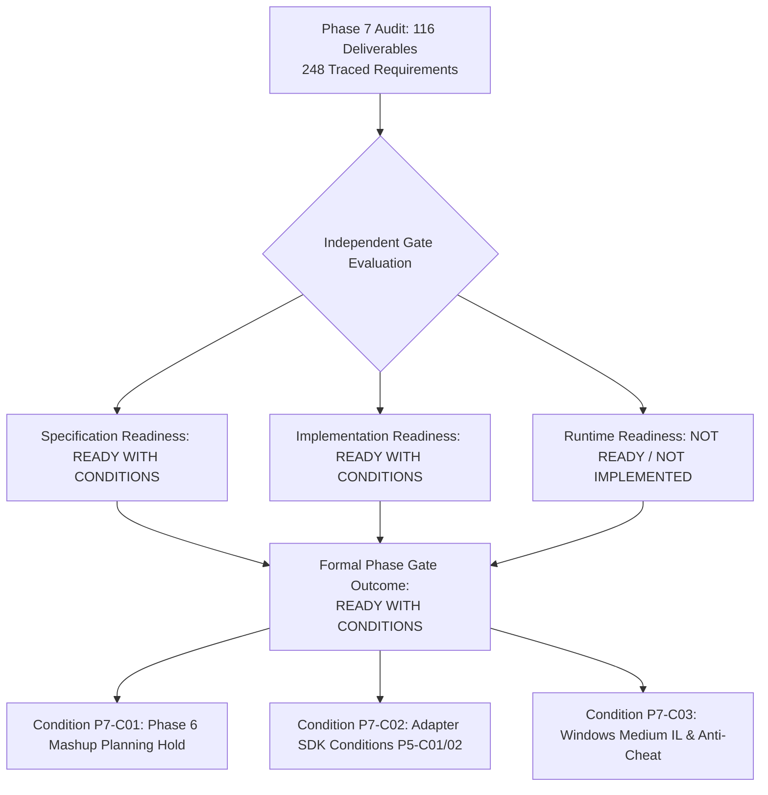

# NexLudic Engine: Step 60 Phase 7 Gate Decision Record

**Document ID:** `NLE-GAT-PH7-001`  
**Phase:** 7 of 12 (AI Coding-Agent Orchestration)  
**Step:** 60 of 100  
**Classification:** Authoritative Phase Gate Decision Record  
**Status:** FORMAL GATE DECISION: READY WITH CONDITIONS  
**Gate Assessor:** Independent Phase-Gate Architecture Review Board  

---

## 1. Formal Phase-Gate Determination

Following an evidence-based audit of all 116 deliverables across Steps 52 through 59, the **Phase 7 AI Coding-Agent Orchestration Subsystem** is formally rated:

$$\mathbf{GATE\ VERDICT:\ READY\ WITH\ CONDITIONS}$$

---

## 2. Readiness Tier Evaluation

| Readiness Tier | Evaluated Scope | Verdict | Authoritative Rationale & Evidence |
| :--- | :--- | :---: | :--- |
| **Tier 1: Specification Readiness** | Architectural completeness, contract consistency, error handling, and requirements traceability. | **READY WITH CONDITIONS** | All 116 specification documents exist, are fully populated, and exhibit complete cross-step semantic consistency. |
| **Tier 2: Implementation Readiness** | Availability of unambiguous, testable interface contracts to guide future development. | **READY WITH CONDITIONS** | Software engineering teams have clear, provider-neutral schemas and boundaries without inventing ad-hoc security rules. |
| **Tier 3: Runtime Readiness** | Verification of executing software, active daemons, and live provider API integrations. | **NOT READY / NOT IMPLEMENTED** | In strict accordance with the Phase 7 scope, **zero runtime code has been implemented**. No daemons run, and no AI agents were invoked. |

---

## 3. Mandatory Gate Conditions

Progression to downstream phases is authorized strictly under the following **three binding conditions**:

### Condition P7-C01: Phase 6 Mashup Planning Gate Hold
- **Constraint:** Step 51 remains `UNVERIFIED / MISSING FORMAL SIGN-OFF`.
- **Enforcement:** No AI coding task may be authorized or executed to implement cross-game mashup integration plans (derived from Steps 43–50) until Step 51 receives formal human sign-off.
- **Allowed Exception:** Discrete adapter scaffolding, wire protocol serialization tasks (`P5-C01`), tests, and architectural documentation are fully authorized to proceed.

### Condition P7-C02: Adapter SDK Condition Inheritance
- **Constraint:** Step 42 gate `NLE-GAT-PH5-001` holds status `READY WITH CONDITIONS`.
- **Enforcement:** All adapter-related tasks must enforce wire protocol serialization validation (`P5-C01`) and memory safety bounds (`P5-C02`).

### Condition P7-C03: Windows Medium IL & Anti-Cheat Dominance
- **Constraint:** Engine security invariants `DEC-002` and `BLK-SEC-01`.
- **Enforcement:** All future runtime implementations must execute strictly at Windows Medium Integrity Level. Process injection, kernel driver loading, and game process memory tampering are permanently prohibited.

---

## 4. Downstream Authorization Scope

This gate record authorizes the archival of Phase 7 and establishes the architectural baseline for Phase 8 planning. It does NOT authorize un-gated code merges, live provider socket connections, or the execution of unverified mashup plans.
