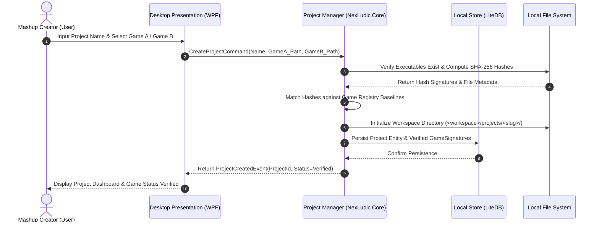
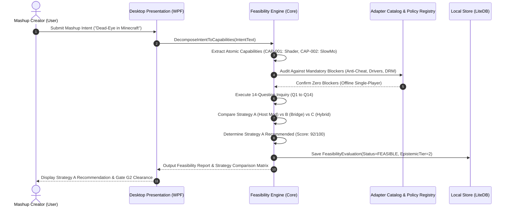
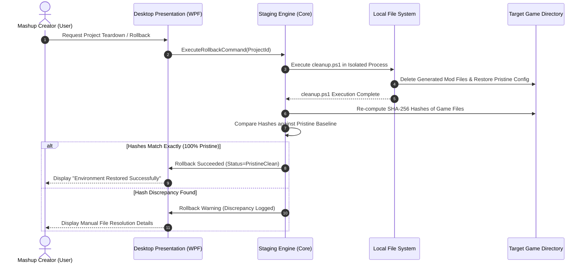

# NexLudic Engine — Architecture Data and Control Flows

**Document ID:** `NLE-ARC-FLW-001`  
**Version:** 1.0.0  
**Phase:** 2 — Architecture & Development Foundation (Step 9 of 100)  
**Status:** Approved Architecture Standard  
**Date:** November 16, 2026  
**Authority:** NexLudic Architecture Review Board (ARB) & Systems Architecture  

---

## 1. Executive Summary & Purpose

The **Architecture Data and Control Flows** specification defines the logical end-to-end execution sequences, data exchanges, trust boundary transitions, and error branches across the primary workflows of **NexLudic Engine**.

Every sequence explicitly distinguishes between:
1. **User Request / Intent:** Unverified action initiated by the user.
2. **AI-Generated Proposal:** Untrusted plan or code staged in the sandbox jail.
3. **Authorized Operation:** Operation validated against policy and confirmed by human approval.
4. **Empirically Observed Result:** Physical telemetry or test outcome recorded in persistent logs.

---

## 2. Core Workflow Sequences

---

### 2.1 Workflow 1: Project Creation & Game Verification



- **Initiator:** Mashup Creator (`USER-001`).
- **Preconditions:** Host machine running Windows 10/11 x64; target game executables readable.
- **Trust Boundary:** Local User $\to$ Core Engine (Boundary TB-04).
- **Failure Branch:** If executable hashes do not match supported baselines, project is created with `Status = UnverifiedVersion` and Gate G0 is held.

---

### 2.2 Workflow 2: Automated Feasibility Assessment & Strategy Assignment



- **Initiator:** Mashup Creator (`USER-001`).
- **Preconditions:** Project created with verified game signatures.
- **Data Exchanged:** Intent text decomposed into atomic `CAP-###` contracts.
- **Failure Branch:** If Game A or B enforces active anti-cheat (VAC/EAC), the engine issues an immediate `UNFEASIBLE (POLICY)` determination and blocks Gate G1.

---

### 2.3 Workflow 3: AI-Assisted Scaffolding & Human Diff Approval

```mermaid
sequenceDiagram
    autonumber
    participant Core as Scaffolding Engine (Core)
    participant Jail as Win32 Job Object Staging Jail
    participant AI as AI Agent Provider (LLM API)
    participant UI as Desktop Presentation (WPF)
    actor Human as Human Reviewer (User)
    participant GameDir as Target Game Directory

    Core->>AI: Send Scoped Prompt (CAP Contracts + API Headers)
    AI-->>Core: Return Proposed Mod Source Code (Java/Fabric)
    Core->>Jail: Write Code to <project>/staging/src/
    Core->>Jail: Invoke Compiler (gradlew build) inside Win32 Job Object
    Jail-->>Core: Build Succeeded (Mod.jar generated in staging)
    Core->>Core: Generate File Diff (Staging vs. Game Mod Directory)
    Core->>UI: Present HumanDiffApprovalPrompt(FileDiff, Hashes)
    Note over UI,Human: Mandatory Human-in-the-Loop Review
    Human->>UI: Confirm Diff & Authorize Deployment
    UI->>Core: DeployStagedModCommand(Authorized=True)
    Core->>GameDir: Copy Mod.jar to Game Mods Directory
    Core->>Core: Generate cleanup.ps1 Rollback Script
    Core-->>UI: Mod Deployed; Rollback Verified
```

- **Initiator:** Core Scaffolding Engine.
- **Trust Boundary:** External AI Provider $\to$ Core Monolith $\to$ Staging Jail (Boundary TB-01 & TB-03).
- **Safety Invariant:** Zero AI-generated files may be copied to game directories without explicit human diff approval (`REQ-F-009`).
- **Failure Branch:** If compiler hangs or exceeds $2\text{ GB}$ RAM, Win32 Job Object terminates the build process tree and returns `BuildFailed` diagnostics.

---

### 2.4 Workflow 4: Live Interoperability Bridge Lifecycle (Strategy B)

```mermaid
sequenceDiagram
    autonumber
    participant UI as Desktop Presentation (WPF)
    participant Host as Named Pipe IPC Host (Core)
    participant GameA as Game A Process (Rocket League / BakkesMod)
    participant GameB as Game B Process (Cyberpunk 2077 / CET)

    UI->>Host: StartBridgeSessionCommand(PipeName="\\.\pipe\nexludic_rl_cp")
    Host->>Host: Create Named Pipe Server with User SID ACL
    Host-->>UI: Pipe Server Listening
    Note over Host,GameA: Game A boots with BakkesMod plugin
    GameA->>Host: ConnectNamedPipe() & Handshake(ClientVersion, SHA-256)
    Host-->>GameA: Handshake Accepted (Session Established)
    Note over Host,GameB: Game B boots with CET Lua script
    GameB->>Host: ConnectNamedPipe() & Handshake(ClientVersion, SHA-256)
    Host-->>GameB: Handshake Accepted (Dual-Game Bridge Active)
    
    loop 60 Hz Telemetry Streaming
        GameA->>Host: SendTelemetryPacket(Boost, Coordinates, Speed)
        Host->>Host: Deserialize & Validate Schema (Protocol Buffers)
        Host->>GameB: ForwardEventPacket(DistortionFxTrigger)
    end

    alt Fault Injection: Game B Crashes Abruptly
        GameB-xHost: Process Terminated (EOF / Broken Pipe)
        Host->>Host: Catch BrokenPipeException; Close Pipe Handle
        Host->>Host: Log Disconnect Event (Timestamp, Code)
        Host->>GameA: SendBridgeDisconnectedNotification()
        Note over GameA: Game A continues running without crash
        Host-->>UI: Update Status: Bridge Degraded (Game B Reconnecting)
    end
```

- **Initiator:** Desktop Presentation UI.
- **Performance Budget:** End-to-end packet transport latency $\le 16.6\text{ ms}$ (Target $\le 4.0\text{ ms}$) (`REQ-NF-001`).
- **Fault Containment:** Abrupt termination of Game B triggers graceful pipe detachment. Game A loop remains 100% stable (`REQ-NF-005`).

---

### 2.5 Workflow 5: System Teardown & Rollback



- **Initiator:** Mashup Creator (`USER-001`).
- **Exit Verification:** Rollback is certified successful only when post-teardown file hashes match pre-test baselines byte-for-byte (`REQ-NF-006`).

---

*End of Architecture Data and Control Flows (NLE-ARC-FLW-001).*

