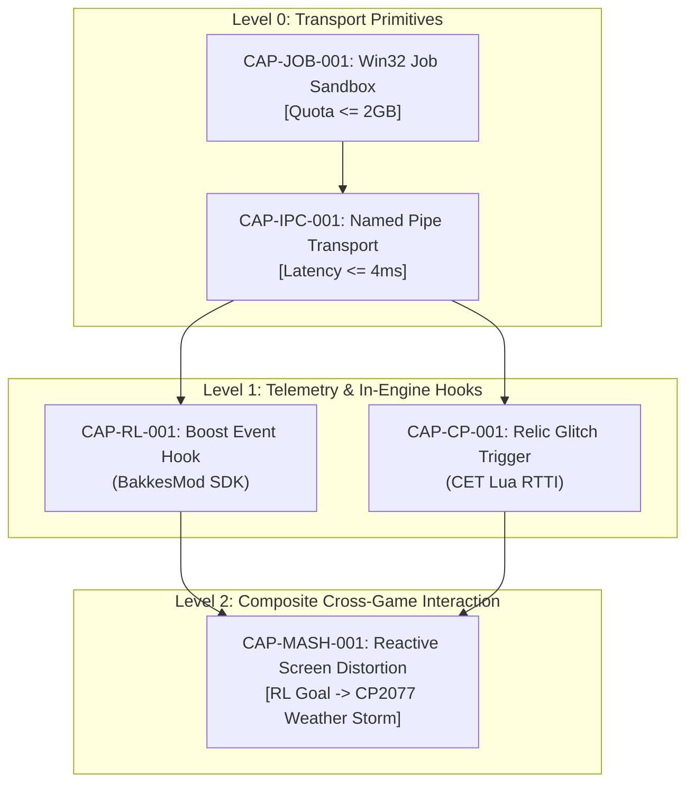
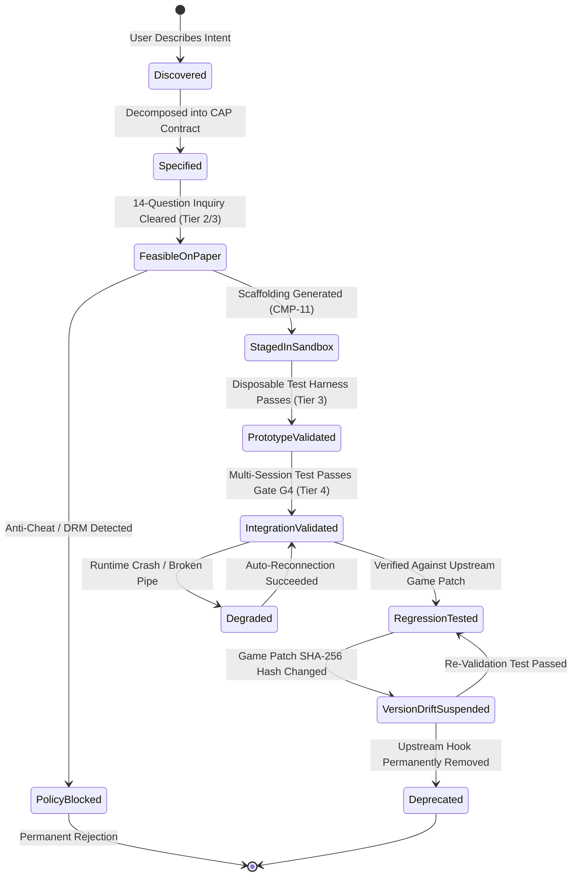

# NexLudic Engine — Capability Model and Status Lifecycle

**Document ID:** `NLE-DOM-CAP-001`  
**Version:** 1.0.0  
**Phase:** 2 — Architecture & Development Foundation (Step 11 of 100)  
**Status:** Approved Architecture Standard  
**Date:** November 16, 2026  
**Authority:** NexLudic Architecture Review Board (ARB) & Systems Architecture  

---

## 1. Executive Summary & Purpose

The **Capability Model and Status Lifecycle** specification establishes the authoritative schema, dependency rules, multi-dimensional status model, and transition state machines for **Capabilities (`CAP-###`)** in NexLudic Engine.

A central engineering principle of NexLudic Engine is that **a capability is an atomic, testable integration requirement**, not a vague marketing promise. This document strictly decouples:
1. **The User Request:** What the user desires (e.g. "Dead-Eye targeting in Minecraft").
2. **The Adapter Declaration:** What an adapter claims it can provide in its manifest.
3. **The Empirical Validation:** What has been proven via reproducible test logs.
4. **The Operational State:** Whether the adapter is currently running and healthy.

---

## 2. Multi-Dimensional Capability Status Framework

In accordance with Section 11 of the engineering specification, NexLudic Engine **strictly prohibits collapsing capability support into a single Boolean `supported` field**. A single Boolean cannot distinguish between an adapter that is not installed, an adapter that is crashing, a feature that is blocked by anti-cheat, and a feature that was validated on an older game version.

Every capability contract is evaluated across **five independent orthogonal status dimensions**:

```
+----------------------------------------------------------------------------------------------------+
|                                    FIVE CAPABILITY STATUS DIMENSIONS                               |
+----+-----------------------+-------------------------+---------------------------------------------+
| #  | Dimension Name        | Possible State Values   | Domain Meaning                              |
+----+-----------------------+-------------------------+---------------------------------------------+
| 01 | **Declaration State** | `Undeclared`,           | What the adapter manifest formally claims   |
|    |                       | `Declared_Supported`,   | regarding this capability.                  |
|    |                       | `Declared_Partial`      |                                             |
+----+-----------------------+-------------------------+---------------------------------------------+
| 02 | **Evidence State**    | `Tier_1_Hypothesized`,  | The highest verified epistemic tier backing |
|    |                       | `Tier_2_Sourced`,       | the capability claim.                       |
|    |                       | `Tier_3_Community`,     |                                             |
|    |                       | `Tier_4_Empirical`      |                                             |
+----+-----------------------+-------------------------+---------------------------------------------+
| 03 | **Operational State** | `Offline`,              | Real-time runtime availability of the       |
|    |                       | `Initializing`,         | executing adapter process.                  |
|    |                       | `Active_Ready`,         |                                             |
|    |                       | `Degraded`, `Crashed`   |                                             |
+----+-----------------------+-------------------------+---------------------------------------------+
| 04 | **Policy State**      | `Permitted_Offline`,    | Legal, anti-cheat, and licensing compliance |
|    |                       | `Permitted_SingleUser`, | determination.                              |
|    |                       | `Prohibited_AntiCheat`, |                                             |
|    |                       | `Prohibited_DRM`        |                                             |
+----+-----------------------+-------------------------+---------------------------------------------+
| 05 | **Compatibility State**| `Exact_Match_Qualified`,| Semantic version and binary hash alignment  |
|    |                       | `Version_Drift_Warning`,| with the running game executable.           |
|    |                       | `Incompatible_Version`  |                                             |
+----+-----------------------+-------------------------+---------------------------------------------+
```

### Critical Epistemic Rule:
A capability is certified **`INTEGRATION READY (Gate G5)`** if and only if:
- `Declaration State == Declared_Supported`
- `Evidence State == Tier_4_Empirical`
- `Policy State == Permitted_Offline`
- `Compatibility State == Exact_Match_Qualified`

---

## 3. Capability Contract Specification (`CAP-###`)

Every atomic integration requirement is defined as a structured `CapabilityContract` record:

```
+----------------------------------------------------------------------------------------------------+
|                                    CAPABILITY CONTRACT SCHEMA                                      |
+---------------------+-------------------+----------------------------------------------------------+
| Field Name          | Data Type         | Description & Invariant Rules                            |
+---------------------+-------------------+----------------------------------------------------------+
| `CapabilityId`      | String (`CAP-###`)| Unique immutable identifier (e.g. `CAP-MC-DEADEYE-001`). |
| `Name`              | String            | Human-readable feature name.                             |
| `Category`          | Enum              | `Content_Asset`, `Mechanic_Simulation`, `Telemetry_RPC`, |
|                     |                   | `Input_Forwarding`, `State_Synchronization`.             |
| `TargetGameId`      | GameId            | Identifies the primary game where the feature manifests. |
| `RequiredInputs`    | SchemaDefinition  | Parameter definitions with units (SI: meters, radians, s)|
| `ExpectedOutputs`   | SchemaDefinition  | Observable return values or physical in-game behaviors.  |
| `Preconditions`     | List<Constraint>  | Game execution state (e.g. `GameMode == SinglePlayer`).  |
| `Postconditions`    | List<Assertion>   | State mutations guaranteed upon successful execution.    |
| `Dependencies`      | List<CapRef>      | Prerequisite capabilities required before this can run.  |
| `QuantitativeBudget`| BudgetConstraint  | Maximum latency ($\le 16.6\text{ ms}$), FPS impact ($\le 2$).|
| `RequiredPrivilege` | PrivilegeLevel    | Must be `StandardUser_MediumIL` (Zero Admin).            |
| `Status`            | StatusVector      | The 5-dimensional status vector defined in §2.           |
+---------------------+-------------------+----------------------------------------------------------+
```

---

## 4. Capability Dependency Graph & Composition

Capabilities frequently depend on lower-level infrastructure capabilities. These relationships form a **Directed Acyclic Graph (DAG)**:



### Dependency Validation Invariants:
1. **Acyclicity Invariant:** The dependency graph must contain **zero circular dependencies**. Any cycle detected during decomposition triggers an immediate schema validation rejection (`ERR-004`).
2. **Inherited Uncertainty Invariant:** If `CAP-B` depends on `CAP-A`, and `CAP-A` has an Evidence State of `Tier 1 (Hypothesized)`, `CAP-B` **cannot be marked higher than Tier 1**, regardless of what its adapter declares.
3. **Policy Propagation Invariant:** If any prerequisite capability is marked `Prohibited_AntiCheat`, all dependent composite capabilities are immediately marked `Prohibited_AntiCheat`.

---

## 5. Capability Lifecycle State Machine

A capability progresses through a formal, evidence-driven state machine:



---

## 6. Granular Partial-Support Handling

When evaluating a multi-feature mashup request, NexLudic Engine enforces **granular partial capability reporting** (`REQ-F-013`):

| Requested Feature Scenario | Feasibility Engine Determination | Capability Contract Status Output |
| :--- | :--- | :--- |
| **Western Revolver Weapon Model & Audio** | Fully Feasible in Minecraft | `CAP-001` (Model): `IntegrationValidated`<br>`CAP-002` (Audio): `IntegrationValidated` |
| **Dead-Eye Screen Tint & Slow-Motion** | Fully Feasible in Minecraft | `CAP-003` (Shader): `IntegrationValidated`<br>`CAP-004` (TickRate): `IntegrationValidated` |
| **Real-time 3D Collision Mesh Injection** | Unfeasible in Closed Engine | `CAP-005` (3D Mesh): `UNFEASIBLE_TECHNICAL` (Rejected) |
| **Overall Mashup Project Status** | **PARTIAL SUPPORT (4 / 5 Capabilities Approved)** | Core gameplay proceeds; rejected mesh injection is isolated. |

### Partial-Support Invariant:
A rejection of an advanced, unfeasible sub-capability (such as real-time 3D voxel injection into a proprietary closed engine) **does not invalidate the feasible subset** (e.g. western weapon mechanics inside Minecraft). The platform explicitly articulates the supported boundaries to the user.

---

*End of Capability Model and Status Lifecycle (NLE-DOM-CAP-001).*

