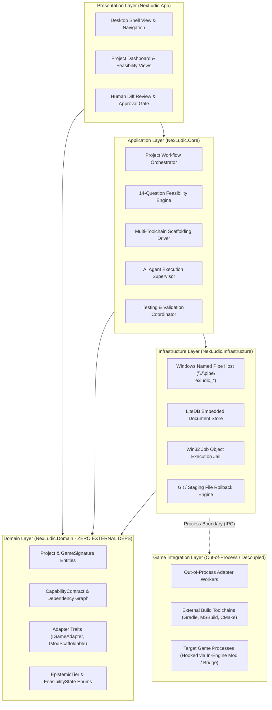

# NexLudic Engine — Core Component Architecture

**Document ID:** `NLE-ARC-COMP-001`  
**Version:** 1.0.0  
**Phase:** 2 — Architecture & Development Foundation (Step 10 of 100)  
**Status:** Approved Architecture Standard  
**Date:** November 16, 2026  
**Authority:** NexLudic Architecture Review Board (ARB) & Principal Software Architecture  

---

## 1. Executive Summary & Purpose

The **Core Component Architecture** refines the approved high-level architecture ([HIGH_LEVEL_ARCHITECTURE.md](file:///d:/App%20Winrar%20Files/Nexludic%20Engine%20(working)/docs/architecture/HIGH_LEVEL_ARCHITECTURE.md)) into an explicit, maintainable component model. It establishes precise component boundaries, responsibility allocations, data ownership rules, dependency constraints, and domain contracts for **NexLudic Engine**.

The primary architectural mandate is to ensure that NexLudic Engine can orchestrate, evaluate, scaffold, and bridge diverse game integrations across heterogeneous technologies (JVM/Java, Mono/C#, Native/C++, Scripting/Lua) **without permitting game-specific SDKs, tools, or binary dependencies to contaminate the universal platform core**.

---

## 2. Component Design Principles

The component architecture is governed by eleven foundational engineering principles:

```
+----------------------------------------------------------------------------------------------------+
|                                    COMPONENT DESIGN PRINCIPLES                                     |
+----+-----------------------------+-----------------------------------------------------------------+
| #  | Principle                   | Operational Mandate                                             |
+----+-----------------------------+-----------------------------------------------------------------+
| 01 | Single Clear Responsibility | Each component owns one cohesive domain or infrastructure role. |
| 02 | Explicit Data Ownership     | Every piece of state has exactly one authoritative owner.       |
| 03 | Strict Dependency Inversion | High-level domain logic never references infrastructure or SDKs.|
| 04 | Game-Agnostic Domain Model  | Domain entities represent universal contracts, not game types.  |
| 05 | Contract-Based Extensibility| Integrations interact via capability traits (IGameAdapter).     |
| 06 | Minimal Necessary Abstraction| Abstractions exist only for testability, isolation, or safety.  |
| 07 | Controlled Execution        | Untrusted code executes in Win32 Job Objects with quotas.       |
| 08 | Independent Failure Boundary| Adapter crashes are contained out-of-process without UI crash.  |
| 09 | Evidence-Backed Status      | Capability status is grounded in Epistemic Tiers, not claims.   |
| 10 | Testability & Isolation     | Domain rules are 100% testable without launching live games.    |
| 11 | Governed Technology Choices | Implementation adheres to ADR-0001 through ADR-0011 baselines. |
+----+-----------------------------+-----------------------------------------------------------------+
```

---

## 3. Logical Architecture Layers

The platform organizes components into five distinct logical layers:



---

## 4. Master Component Inventory & Status

The platform comprises 15 logical components distributed across the architectural layers:

```
+--------------------------------------------------------------------------------------------------------------------+
|                                              MASTER COMPONENT INVENTORY                                            |
+---------+------------------------------------+-------------------+---------------------+---------------------------+
| Comp ID | Component Name                     | Logical Layer     | Implementation Host | Architectural Status      |
+---------+------------------------------------+-------------------+---------------------+---------------------------+
| CMP-01  | Project Management Service         | Application       | NexLudic.Core       | **APPROVED (Core MVP)**   |
| CMP-02  | Game Registry & Version Catalog    | Domain / App      | NexLudic.Core       | **APPROVED (Core MVP)**   |
| CMP-03  | Capability & Requirements Service  | Domain / App      | NexLudic.Core       | **APPROVED (Core MVP)**   |
| CMP-04  | Feasibility Assessment Engine      | Application       | NexLudic.Core       | **APPROVED (Core MVP)**   |
| CMP-05  | Evidence & Provenance Tracker      | Domain / Infra    | NexLudic.Core       | **APPROVED (Core MVP)**   |
| CMP-06  | Architecture Decision Tracker      | Application       | NexLudic.Core       | **PROVISIONAL (Internal)**|
| CMP-07  | Adapter Catalog & Metadata Registry| Application       | NexLudic.Core       | **APPROVED (Core MVP)**   |
| CMP-08  | Adapter Lifecycle Supervisor       | Infrastructure    | NexLudic.Infrastr   | **APPROVED (Core MVP)**   |
| CMP-09  | Integration Coordination Service   | Application       | NexLudic.Core       | **APPROVED (Strategy B/C)**|
| CMP-10  | AI Agent Task Orchestrator         | Application       | NexLudic.Core       | **APPROVED (Core MVP)**   |
| CMP-11  | Workspace & Staging Manager        | Infrastructure    | NexLudic.Infrastr   | **APPROVED (Core MVP)**   |
| CMP-12  | Toolchain Execution Driver         | Infrastructure    | NexLudic.Infrastr   | **APPROVED (Core MVP)**   |
| CMP-13  | Testing & Validation Manager       | Application       | NexLudic.Core       | **APPROVED (Core MVP)**   |
| CMP-14  | Persistence & Config Engine        | Infrastructure    | NexLudic.Infrastr   | **APPROVED (LiteDB Store)**|
| CMP-15  | Diagnostics, Recovery & Rollback   | Infrastructure    | NexLudic.Infrastr   | **APPROVED (Core MVP)**   |
+---------+------------------------------------+-------------------+---------------------+---------------------------+
```

---

## 5. Architectural Boundaries & Cross-Cutting Concerns

### 5.1 Universal Core vs. Game-Specific Adapter Boundary
- **Core Platform:** Encapsulated in `NexLudic.Core` and `NexLudic.Domain`. Contains **zero references** to game assemblies, mod loaders, or proprietary file formats (`REQ-NF-007`).
- **Adapter Workers:** Standalone child executables implementing `IGameAdapter` traits. They translate game-specific state into universal contracts and communicate with the core via Named Pipes (`ADR-0002`, `ADR-0003`).

### 5.2 AI Agent Orchestration vs. Tool Execution Boundary
- **Planning vs. Execution:** The AI Agent Orchestrator (`CMP-10`) translates user intent into bounded tasks and staging proposals. It possesses **zero OS execution privileges**.
- **Execution Supervision:** The Toolchain Execution Driver (`CMP-12`) is the sole component authorized to spawn compilers or scripts. It executes strictly within Win32 Job Objects (`ADR-0009`) with hard limits:
  - Max Memory Working Set: $\le 2.0\text{ GB}$.
  - Max Execution Time: $\le 60.0\text{ seconds}$.
  - Process Tree Quota: Child processes cannot escape the Job Object.

### 5.3 Staging Jail vs. Production Game Directory Boundary
- All generated source files, manifests, and build outputs are written to `<project_root>/staging/`.
- Deployment from staging to game directories is **physically blocked** until the user confirms the file diff via the Human Diff Review UI (`CMP-01`, `REQ-F-009`).

---

## 6. Architectural Decision Tracing

Every component boundary in this architecture traces directly to approved Phase 1 ADRs:
- `ADR-0001` (Modular Monolith Baseline) $\to$ Layered assembly structure (`App`, `Core`, `Domain`, `Infrastructure`).
- `ADR-0002` (Out-of-Process Adapter Worker Model) $\to$ Decoupled Adapter Lifecycle Supervisor (`CMP-08`).
- `ADR-0003` (Windows Named Pipes Transport) $\to$ Integration Coordination Service (`CMP-09`).
- `ADR-0004` (Non-Invasive Game Integration) $\to$ Feasibility Assessment Engine (`CMP-04`).
- `ADR-0007` (Embedded LiteDB Store) $\to$ Persistence Engine (`CMP-14`).
- `ADR-0008` (Sandboxed File Staging & Human Diff Review) $\to$ Workspace & Staging Manager (`CMP-11`).
- `ADR-0009` (Win32 Job Object Execution Jail) $\to$ Toolchain Execution Driver (`CMP-12`).

---

*End of Core Component Architecture (NLE-ARC-COMP-001).*

