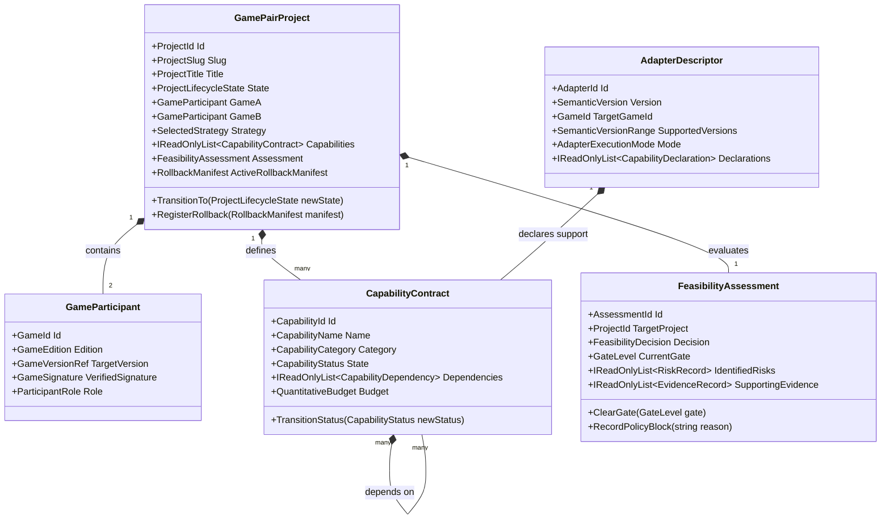
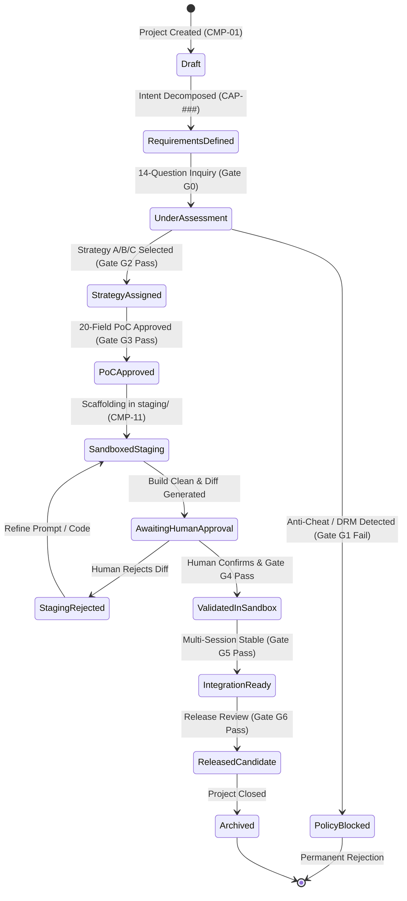

# NexLudic Engine — Core Domain Model Specification

**Document ID:** `NLE-DOM-SPEC-001`  
**Version:** 1.0.0  
**Phase:** 2 — Architecture & Development Foundation (Step 11 of 100)  
**Status:** Approved Domain Specification  
**Date:** November 16, 2026  
**Authority:** NexLudic Architecture Review Board (ARB) & Domain Architecture  

---

## 1. Executive Summary & Purpose

The **Core Domain Model Specification** establishes the authoritative, implementation-neutral domain model for **NexLudic Engine**. It formalizes the shared vocabulary, ubiquitous language, entity boundaries, aggregate roots, value objects, lifecycle state machines, and business invariants governing the universal platform core.

In strict adherence to Domain-Driven Design (DDD) principles and Clean Architecture ([ADR-0001](file:///d:/App%20Winrar%20Files/Nexludic%20Engine%20(working)/docs/architecture/decisions/ADR-0001.md)), the domain layer (`NexLudic.Domain`) contains **pure business logic and universal capability contracts**. It is mathematically decoupled from external dependencies, database schemas, UI frameworks, and proprietary game SDKs.

> [!NOTE]
> **Implementation-Neutral Specification Notice:**  
> This specification defines conceptual entities, structural invariants, and lifecycle transitions. It does **NOT** prescribe concrete C# classes, database tables, or serialization wire layouts. Implementation of these concepts is governed by future implementation steps.

---

## 2. Foundational Domain Modeling Principles

The domain model is governed by ten architectural principles:

```
+----------------------------------------------------------------------------------------------------+
|                                    DOMAIN MODELING PRINCIPLES                                      |
+----+-----------------------------+-----------------------------------------------------------------+
| #  | Principle                   | Operational Mandate                                             |
+----+-----------------------------+-----------------------------------------------------------------+
| 01 | Shared Language, No Forced  | Shared integration semantics without homogenizing internal game |
|    | Uniformity                  | mechanics (a voxel block $\ne$ a racing car physics model).     |
+----+-----------------------------+-----------------------------------------------------------------+
| 02 | Explicit Identity           | Entities have stable GUIDs/slugs; mutable titles never serve    |
|    |                             | as primary business keys.                                       |
+----+-----------------------------+-----------------------------------------------------------------+
| 03 | Explicit Lifecycle          | Entities progress through deterministic state machines with     |
|    |                             | formal entry/exit rules; split-brain states are impossible.     |
+----+-----------------------------+-----------------------------------------------------------------+
| 04 | Authoritative Ownership     | Every mutable fact has exactly one owning component and entity; |
|    |                             | derived views cannot mutate source state.                       |
+----+-----------------------------+-----------------------------------------------------------------+
| 05 | Evidence Provenance         | All compatibility claims link to immutable source citations or  |
|    |                             | empirical test execution records (Epistemic Tiers 1–4).         |
+----+-----------------------------+-----------------------------------------------------------------+
| 06 | Version-Aware Context       | Capabilities and adapters are interpreted strictly within       |
|    |                             | exact semantic versions and binary executable hashes (SHA-256). |
+----+-----------------------------+-----------------------------------------------------------------+
| 07 | Explicit Uncertainty        | "Unknown" is a distinct risk-gated state; it is never collapsed |
|    |                             | into "False", "Unsupported", or null.                           |
+----+-----------------------------+-----------------------------------------------------------------+
| 08 | Bounded Extensibility       | New game ecosystems integrate via compositional capability      |
|    |                             | traits without modifying the universal domain core.             |
+----+-----------------------------+-----------------------------------------------------------------+
| 09 | Technology Neutrality       | Domain logic contains zero references to LiteDB, Named Pipes,   |
|    |                             | WPF, or third-party serialization formats.                      |
+----+-----------------------------+-----------------------------------------------------------------+
| 10 | Testable Invariants         | Every business rule is verifiable via deterministic unit tests  |
|    |                             | without launching live game processes.                          |
+----+-----------------------------+-----------------------------------------------------------------+
```

---

## 3. Controlled Domain Glossary (Ubiquitous Language)

To eliminate ambiguity across human engineers and AI coding agents, the following terminology is strictly standardized:

| Term | Formal Domain Definition | Prohibited Synonyms / Antipatterns |
| :--- | :--- | :--- |
| **Game** | An external PC video game product represented as a distinct executable target. | Do not use "mod target" or "app". |
| **Game Edition** | A distinct distribution channel or packaging of a game (e.g. Steam vs. GOG vs. Epic). | Do not conflate Edition with Version. |
| **Game Version** | A specific, immutable release build identified by build number and executable SHA-256 hash. | Do not use vague terms like "Latest". |
| **Game-Pair Project** | The central aggregate root representing an integration between two identified games. | Do not call it a "mod-pack" or "bridge". |
| **Capability** | An atomic, testable integration behavior or feature (`CAP-###`) with defined inputs/outputs. | Do not use "function" or "hack". |
| **Capability Declaration** | A formal statement of capability support declared by an adapter descriptor. | A declaration is a claim, NOT validation. |
| **Integration Strategy** | One of three architectural topologies: Strategy A (Host Mod), B (Bridge), or C (Hybrid). | Do not treat strategies as interchangeable. |
| **Adapter** | An out-of-process worker translating between universal contracts and a target game. | Do not confuse Adapter with Bridge. |
| **Bridge** | An active inter-process communication session coordinating telemetry between running games. | Distinct from single-game Host Mods. |
| **Feasibility Assessment** | A formal evaluation of pair compatibility, strategy trade-offs, and risk gates (G0–G6). | Feasibility $\ne$ Implementation Readiness. |
| **Evidence Record** | An immutable audit record linking a claim to official docs (Tier 2) or test logs (Tier 4). | Unverified forum posts $\ne$ Evidence. |
| **Test Execution Record** | An empirical log verifying that a capability satisfied quantitative thresholds in a test harness.| Build success $\ne$ Test Execution Pass. |
| **Execution Approval** | A human-authorized permission granting scoped deployment from staging to game directories. | AI intent is NOT Execution Approval. |

### Disambiguation of Overloaded Terms:
- **`Supported` vs. `Validated`:** An adapter may *declare* a capability as `Supported`, but the platform marks it as `Validated` only after empirical test logs pass Gate G4.
- **`Compatible` vs. `Feasible`:** A game pair is `Feasible` in principle if documented extension surfaces exist, but is `Compatible` only for specific, pinned game version hashes.
- **`Running` vs. `Ready`:** An adapter process may be `Running` in the OS, but is `Ready` only after completing its protocol handshake and health check.

---

## 4. Core Domain Boundaries & Subdomains

The domain is partitioned into eight cohesive subdomains:

```
+----------------------------------------------------------------------------------------------------+
|                                    NEXLUDIC DOMAIN SUBDOMAINS                                      |
+--------------------------+-----------------------------------+-------------------------------------+
| Subdomain                | Core Responsibilities             | Primary Aggregate Roots & Entities  |
+--------------------------+-----------------------------------+-------------------------------------+
| **1. Project Subdomain** | Workspace lifecycle, game pairs,  | `GamePairProject` (Aggregate Root)  |
|                          | project configuration manifests.  | `ProjectMetadata`, `ProjectStatus`  |
+--------------------------+-----------------------------------+-------------------------------------+
| **2. Game Catalog**      | Binary signatures, editions,      | `GameIdentity` (Entity)             |
|                          | version hash validation baselines.| `GameSignature` (Value Object)      |
+--------------------------+-----------------------------------+-------------------------------------+
| **3. Capability & Reqs** | Atomic integration requirements,  | `CapabilityContract` (Entity)       |
|                          | input/output contracts, dep graph.| `CapabilityDependency` (Value Obj)  |
+--------------------------+-----------------------------------+-------------------------------------+
| **4. Adapter Catalog**   | Adapter metadata, declared traits,| `AdapterDescriptor` (Aggregate Root)|
|                          | supported game version ranges.    | `CapabilityDeclaration` (Value Obj) |
+--------------------------+-----------------------------------+-------------------------------------+
| **5. Feasibility Domain**| 14-Question assessment, risk logs,| `FeasibilityAssessment` (Agg Root)  |
|                          | Gate G0–G6 state machine.         | `RiskRecord`, `FeasibilityDecision` |
+--------------------------+-----------------------------------+-------------------------------------+
| **6. Evidence & Claims** | Immutable citations, Epistemic    | `EvidenceRecord` (Value Object)     |
|                          | Tiers (1–4), provenance chains.   | `CompatibilityClaim` (Value Object) |
+--------------------------+-----------------------------------+-------------------------------------+
| **7. Validation & Test** | Test specifications, quantitative | `TestSpecification` (Entity)        |
|                          | thresholds, execution records.    | `TestExecutionRecord` (Entity)      |
+--------------------------+-----------------------------------+-------------------------------------+
| **8. Staging & Approval**| Human diff review records, scoped | `ExecutionApproval` (Value Object)  |
|                          | authorization, rollback manifests.| `RollbackManifest` (Value Object)   |
+--------------------------+-----------------------------------+-------------------------------------+
```

---

## 5. Primary Aggregate Roots & Invariants



### 5.1 Invariants of `GamePairProject`:
1. **Heterogeneity Invariant:** `GameA.VerifiedSignature` and `GameB.VerifiedSignature` must not resolve to the same physical binary executable.
2. **Strategy Alignment Invariant:** A project cannot adopt `Strategy B (Live Bridge)` if either Game A or Game B has a `NO-GO` policy determination (e.g. anti-cheat detection).
3. **Deployment Safety Invariant:** No mod file may be copied from staging to production directories unless `ActiveRollbackManifest` is populated and verified.

### 5.2 Invariants of `FeasibilityAssessment`:
1. **Anti-Cheat Hard Block Invariant:** If any game signature matches active kernel anti-cheat (VAC, EAC, BattlEye), `Decision` must immediately become `UNFEASIBLE_POLICY`, and Gate G1 is permanently failed (`REQ-SAFE-001`).
2. **Epistemic Integrity Invariant:** `CurrentGate` cannot advance to Gate G5 (Integration Readiness) unless every required capability contract is backed by at least one `EvidenceRecord` classified as `Tier 4 (Empirically Proven)`.

---

## 6. Project Lifecycle State Machine

A `GamePairProject` progresses through a deterministic, strictly gated lifecycle:



---

## 7. Open Decisions & Traceability

- **Traceability:** Maps directly to `GOAL-001`, `REQ-F-001` through `REQ-F-005`, `ADR-0001`, `ADR-0002`, and `RSK-01` through `RSK-24`.
- **Open Contract Implementations:** Wire-level protocol schemas (Protocol Buffers vs. MessagePack) and RPC dispatch models are formally defined in [UNIVERSAL_ADAPTER_CONTRACT_SPECIFICATION.md](file:///d:/App%20Winrar%20Files/Nexludic%20Engine%20(working)/docs/architecture/UNIVERSAL_ADAPTER_CONTRACT_SPECIFICATION.md).

---

*End of Core Domain Model Specification (NLE-DOM-SPEC-001).*

