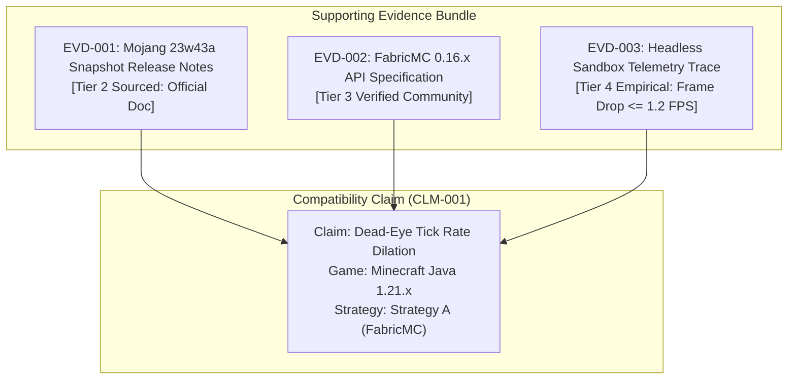

# NexLudic Engine — Evidence and Compatibility Claim Model

**Document ID:** `NLE-DOM-EVD-001`  
**Version:** 1.0.0  
**Phase:** 2 — Architecture & Development Foundation (Step 11 of 100)  
**Status:** Approved Architecture Standard  
**Date:** November 16, 2026  
**Authority:** NexLudic Architecture Review Board (ARB) & Systems Architecture  

---

## 1. Executive Summary & Purpose

The **Evidence and Compatibility Claim Model** establishes the formal domain representation connecting compatibility claims to immutable, verifiable evidence within **NexLudic Engine**.

In universal game integration, unsubstantiated claims ("this mod works with all versions") are the primary source of crashes, broken saves, and anti-cheat bans. This specification enforces that **no capability or game-pair integration can be claimed as supported without a cryptographically traceable, version-scoped audit chain**.

---

## 2. The Four Epistemic Tiers of Evidence

Every evidence record is strictly classified into one of four epistemic tiers ([TECHNICAL_FEASIBILITY_FRAMEWORK.md](file:///d:/App%20Winrar%20Files/Nexludic%20Engine%20(working)/docs/feasibility/TECHNICAL_FEASIBILITY_FRAMEWORK.md)):

```
+----------------------------------------------------------------------------------------------------+
|                                    FOUR EPISTEMIC EVIDENCE TIERS                                   |
+--------+-----------------------+---------------------+---------------------------------------------+
| Tier   | Tier Label            | Authoritative Base  | Permitted Platform Representation           |
+--------+-----------------------+---------------------+---------------------------------------------+
| **T1** | **Hypothesized**      | Unverified claim,   | Stored as research backlog only.            |
|        |                       | AI model proposal.  | **Cannot clear Gate G2 or be staged.**      |
+--------+-----------------------+---------------------+---------------------------------------------+
| **T2** | **Sourced**           | Official developer  | Clears Gate G1/G2; authorizes PoC planning. |
|        |                       | docs, published SDK.| **Cannot clear Gate G4 without testing.**   |
+--------+-----------------------+---------------------+---------------------------------------------+
| **T3** | **Verified Community**| Maintained loaders  | Authorizes Gate G3 PoC execution in staging.|
|        |                       | (Fabric, BepInEx).  | **Requires Gate G4 empirical confirmation.**|
+--------+-----------------------+---------------------+---------------------------------------------+
| **T4** | **Empirically Proven**| Reproducible logs   | **Authorizes Gate G4 & G5 integration.**    |
|        |                       | in NexLudic sandbox.| Minimum required standard for MVP release.  |
+--------+-----------------------+---------------------+---------------------------------------------+
```

---

## 3. Evidence Record Schema (`EvidenceRecord`)

An `EvidenceRecord` is an immutable, append-only value object stored in LiteDB (`CMP-05` / `CMP-14`):

```
+----------------------------------------------------------------------------------------------------+
|                                    EVIDENCE RECORD SCHEMA                                          |
+---------------------+-------------------+----------------------------------------------------------+
| Field Name          | Data Type         | Description & Invariant Rules                            |
+---------------------+-------------------+----------------------------------------------------------+
| `EvidenceId`        | String (`EVD-###`)| Unique immutable identifier (e.g. `EVD-MC-TICK-001`).    |
| `EpistemicTier`     | Enum (T1..T4)     | Tier classification defined in §2.                       |
| `TargetClaimId`     | String (`CLM-###`)| Identifies the specific compatibility claim supported.   |
| `SourceType`        | Enum              | `OfficialDoc`, `DecompiledSource`, `ActiveCommunityRepo`,|
|                     |                   | `EmpiricalSandboxTrace`, `TelemetryLogDump`.             |
| `SourceUri`         | String (URI)      | Permanent URL or local repository path hash.             |
| `SourceTimestamp`   | ISO 8601 String   | Timestamp when the source was published or logged.       |
| `ApplicableGameVer` | SemanticRange     | Exact game versions verified by this specific record.    |
| `ApplicableHash`    | SHA-256 String    | Binary executable hash of tested game build.             |
| `QuantitativeData`  | KeyValuePairs     | Measured performance metrics (e.g. `mean_latency_ms: 3.8`|
| `ObserverIdentity`  | String            | Automated Test Runner ID or Reviewing Engineer Name.     |
| `IntegritySignature`| SHA-256 Hash      | Checksum of log file to prevent post-hoc tampering.       |
+---------------------+-------------------+----------------------------------------------------------+
```

---

## 4. Claim-to-Evidence Relationships & Scoping

A **Compatibility Claim (`CLM-###`)** represents the platform's formal declaration that a capability works under bounded conditions:



### Claim Scoping Invariants:
1. **Multi-Source Rule:** A claim cannot achieve `Status = Validated` based on Tier 2 documentation alone. It must be backed by at least one Tier 4 empirical execution log (`REQ-F-011`).
2. **Version Boundary Invariant:** A claim applies **strictly** to the intersection of versions verified across its supporting evidence bundle. If evidence `EVD-003` was gathered on Minecraft `1.21.0`, the claim **cannot be automatically generalized to `1.22.0`**.

---

## 5. Contradictory Evidence & Invalidation Triggers

In game modding, documentation often contradicts empirical reality (e.g. an API is documented, but invoking it crashes the proprietary physics thread).

### 5.1 Contradiction Resolution Protocol:
- **Rule 1 (Empirical Precedence):** When a Tier 4 empirical test failure contradicts a Tier 2 official documentation claim, **the Tier 4 test failure takes absolute precedence**.
- **Rule 2 (Non-Silencing Invariant):** Contradictory evidence must **never be deleted or overwritten**. Both records are preserved in the evidence log, and the claim status transitions to `Conflicted_UnderReview`.
- **Rule 3 (Gate Hold):** Any claim with an open, unresolved contradiction cannot pass Gate G4 or Gate G5.

### 5.2 Evidence Freshness & Invalidation Triggers:
An existing `Tier 4 (Empirical)` evidence record is automatically flagged as **`Stale_PendingRevalidation`** upon the occurrence of any of the following triggers:
1. **Game Binary Hash Change:** The target game executable SHA-256 hash changes following an upstream Steam/Epic update (`REQ-F-002`).
2. **Mod Loader Major Patch:** The underlying mod loader increments its major or minor version (e.g. Fabric `0.15` $\to$ `0.16`).
3. **Hardware Environment Shift:** For Strategy B (Live Bridge), moving from a multi-GPU test rig to a constrained development workstation triggers latency re-benchmarking (`BLOCK-003`).

---

*End of Evidence and Compatibility Claim Model (NLE-DOM-EVD-001).*

