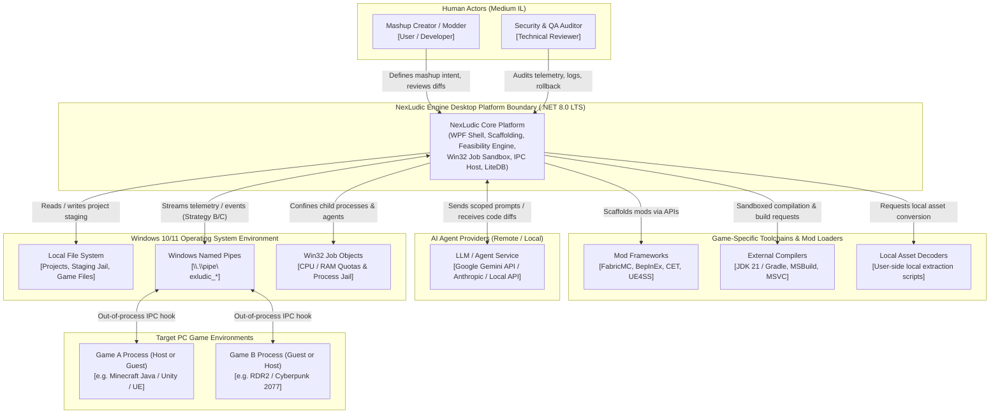

# NexLudic Engine — System Context and Boundaries

**Document ID:** `NLE-ARC-CTX-001`  
**Version:** 1.0.0  
**Phase:** 2 — Architecture & Development Foundation (Step 9 of 100)  
**Status:** Approved Architecture Standard  
**Date:** November 16, 2026  
**Authority:** NexLudic Architecture Review Board (ARB) & Systems Architecture  

---

## 1. Executive Summary & Purpose

The **System Context and Boundaries** specification defines the high-level operating context of **NexLudic Engine** within the broader software and hardware ecosystem. It establishes the authoritative C4 Level 1 System Context model, identifying the platform's external actors, target game engines, development toolchains, AI agent providers, local operating system resources, and security trust boundaries.

In accordance with Phase 1 baseline mandates ([NLE-SRS-001](file:///d:/App%20Winrar%20Files/Nexludic%20Engine%20(working)/docs/requirements-baseline/NEXLUDIC_PRODUCT_REQUIREMENTS_SPECIFICATION.md)), NexLudic Engine is designed as a **universal orchestration and evaluation platform**, strictly decoupled from any single game engine or proprietary mod format.

---

## 2. System Context Model (C4 Level 1)



---

## 3. External Actors and Roles

### 3.1 Human Actors
The platform interacts with human users executing in standard Windows user mode (`medium integrity level`):

1. **Mashup Creator (`USER-001`):**  
   - *Role:* Defines integration ideas, selects games and versions, reviews feasibility reports, and initiates sandbox test runs.  
   - *Privilege Level:* Standard non-elevated user.  
   - *Approval Authority:* Approves project configuration and initiates testing.
2. **Senior Game Modder (`USER-002`):**  
   - *Role:* Customizes generated source code, inspects build scripts, configures custom IPC schemas, and tunes in-engine hooks.  
   - *Approval Authority:* Approves code adjustments and adapter parameter overrides.
3. **Cross-Toolchain Developer (`USER-003`):**  
   - *Role:* Configures multi-language build pipelines (MSBuild, Gradle, CMake) and validates adapter contract compliance.
4. **Technical Reviewer & QA Engineer (`USER-004`):**  
   - *Role:* Inspects automated benchmark logs, verifies IPC round-trip latency ($\le 16.6\text{ ms}$), audits frame rate deltas ($\le 2\text{ FPS}$), and validates `cleanup.ps1` rollback integrity.
5. **Security & Compliance Auditor (`USER-005`):**  
   - *Role:* Verifies zero administrative elevation, audits anti-cheat hard blocks (`REQ-SAFE-001`), and confirms non-distributive asset policy compliance (`REQ-MOD-003`).

---

## 4. External Systems & Environments

### 4.1 Target Game Systems (Heterogeneous Game Executables)
The platform treats Game A and Game B as separate, external, untrusted processes. They are never assumed to be interchangeable:
- **Runtime Variance:** Games execute in disparate runtimes (JVM bytecode, Unity Mono/.NET CLR, native x64 C++, custom scripting VMs).
- **Process Independence:** Under Strategy B (Live Bridge), games run as independent processes under OS scheduling. The platform cannot assume synchronous thread execution across separate game loops.
- **Closed Binaries:** Games are treated as black boxes with fixed binary hashes (`SHA-256`). NexLudic Engine prohibits tampering with DRM wrappers (SteamStub, Denuvo) or executable binaries directly.

### 4.2 Game-Specific Development Tools & Modding Ecosystems
The core platform delegates game-specific tasks to external toolchains via decoupled driver interfaces (`ADR-0002`):
- **Mod Loaders:** FabricMC (Minecraft JVM), BepInEx (Unity Mono), Cyber Engine Tweaks (REDengine 4 Lua), UE4SS (Unreal Engine 4/5 C++/Lua).
- **Compilers & Build Systems:** OpenJDK 21 / Gradle 8 (Java), .NET 8 SDK / MSBuild (C#), MSVC v143 / CMake 3.28+ (Native C++).
- **Asset Processing Utilities:** Local user-side audio decoders, mesh converters, and texture repackers.

### 4.3 AI Providers and Coding Agent Services
AI coding agents are integrated as external, semi-trusted assistance services:
- **Outbound Data:** Strictly sanitized project context, capability contracts (`CAP-###`), and target API documentation snippets. **Zero credentials, system paths, or personal user data leave the local machine.**
- **Inbound Data:** Staged code suggestions, build script diffs, and test hypotheses.
- **Execution Boundary:** All agent-generated code is placed in `<project>/staging/` and executed exclusively inside Win32 Job Objects with zero administrative rights (`ADR-0009`).

### 4.4 Local Windows Operating System Resources
- **File System:** Confined strictly to `<workspace_root>/projects/<slug>/` and game-specific profile directories.
- **Local IPC Transport:** Windows Named Pipes (`\\.\pipe\nexludic_*`) protected by Windows Access Control Lists (ACLs) restricting access to the current user SID (`ADR-0003`).
- **Process Quotas:** Win32 Job Objects enforcing hard memory limits ($\le 2\text{ GB}$ per child compiler) and CPU execution rate limiting.
- **Local Embedded Database:** LiteDB embedded document store residing within the project directory for structured metadata and evidence tracking (`ADR-0007`).

---

## 5. Scope Boundaries: In-Scope vs. Out-of-Scope

```
+----------------------------------------------------------------------------------------------------+
|                                    SCOPE ALLOCATION BOUNDARIES                                     |
+--------------------------------------------------+-------------------------------------------------+
| IN-SCOPE (Universal Core Responsibilities)       | OUT-OF-SCOPE (External / Excluded Functions)   |
+--------------------------------------------------+-------------------------------------------------+
| - Universal project workspace orchestration      | - Developing proprietary 3D rendering engines   |
| - 14-Question feasibility evaluation engine      | - Emulating console hardware or hypervisors     |
| - Epistemic Tier evidence and gap tracking       | - Bypassing kernel anti-cheat (EAC, VAC, BattlEye)|
| - Multi-toolchain build driver orchestration     | - Cracking, patching, or circumventing DRM      |
| - Out-of-process IPC host and bridge daemon     | - Distributing copyrighted game assets or audio |
| - Win32 Job Object sandboxed staging jail        | - Injecting raw 3D meshes into closed engines   |
| - Human-in-the-loop diff review enforcement      | - Synchronizing live online multiplayer matches |
| - Automated system rollback verifier (cleanup.ps1)| - Operating with elevated administrative rights |
+--------------------------------------------------+-------------------------------------------------+
```

---

## 6. Security Trust Boundaries

The system context enforces five primary trust boundaries:

```
[ UNTRUSTED / EXTERNAL ]               [ PERIMETER ]                     [ TRUSTED CORE ]
  Cloud AI Provider    ---(TLS 1.3)---> Sanitize & Jail ---> [ NexLudic Core Monolith ]
  Target Game Process  ---(Named Pipe)-> ACL & Deserializer -> [ NexLudic Core Monolith ]
  External Mod Loader  ---(File System)-> Staging Sandbox ---> [ NexLudic Core Monolith ]
  User Input / Prompt  ---(WPF Shell)--> Input Validator ----> [ NexLudic Core Monolith ]
```

1. **Boundary TB-01 (External AI Provider $\leftrightarrow$ NexLudic Core):**  
   AI models are treated as untrusted code generators. Output cannot be executed directly; it must be written to `<project>/staging/` and reviewed by a human engineer.
2. **Boundary TB-02 (Running Game Processes $\leftrightarrow$ NexLudic Core):**  
   Game processes are untrusted external applications. Data received over Named Pipes is validated against rigid schemas (Protocol Buffers) with buffer bounds checks (`REQ-NF-001`).
3. **Boundary TB-03 (Staging Sandbox $\leftrightarrow$ Game Installation):**  
   Staged mod files cannot write to game directories without passing Gate G3/G4 and receiving explicit human confirmation via the UI diff viewer.
4. **Boundary TB-04 (Local User $\leftrightarrow$ Core Engine):**  
   The platform operates with standard non-elevated user rights (`Medium IL`). Requests for administrative elevation are rejected immediately (`REQ-SEC-001`).

---

*End of System Context and Boundaries (NLE-ARC-CTX-001).*

