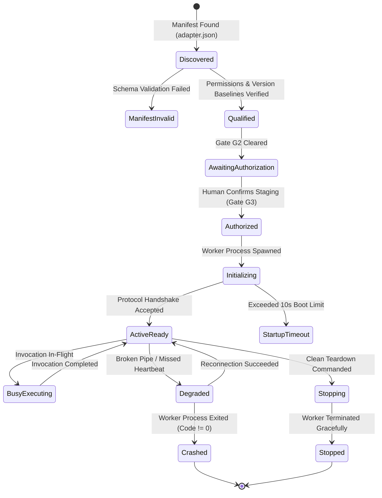

# NexLudic Engine — Universal Adapter Contract Specification

**Document ID:** `NLE-SPC-ADP-001`  
**Version:** 1.0.0  
**Phase:** 2 — Architecture & Development Foundation (Step 11 of 100)  
**Status:** Approved Architecture Specification  
**Date:** November 16, 2026  
**Authority:** NexLudic Architecture Review Board (ARB) & Systems Architecture  

---

## 1. Executive Summary & Purpose

The **Universal Adapter Contract Specification** establishes the implementation-neutral contract through which external, game-specific adapters communicate with the universal core of **NexLudic Engine**.

Adapters are decoupled worker processes ([ADR-0002](file:///d:/App%20Winrar%20Files/Nexludic%20Engine%20(working)/docs/architecture/decisions/ADR-0002.md)) that translate between the idiosyncratic modding interfaces of individual games and the universal capability contracts of NexLudic Engine. This specification defines descriptor manifests, capability declarations, lifecycle operations, invocation semantics, and error outcomes without locking the platform into a single programming language or wire transport.

> [!IMPORTANT]
> **Specification Notice:**  
> This document defines the **conceptual interface and protocol requirements** for adapter authors. It is a technical specification, **NOT a compiled SDK or working software library**.

---

## 2. Adapter Descriptor Manifest Schema (`adapter.json`)

Every game adapter must provide an untrusted declarative metadata manifest named `adapter.json`. The manifest is parsed and validated by the Adapter Catalog (`CMP-07`) prior to qualification:

```json
{
  "$schema": "https://schemas.nexludic.org/v1/adapter-manifest.json",
  "adapterId": "adapter-mcjava-fabric-western",
  "name": "Minecraft Java Fabric Western Traversal Adapter",
  "version": "1.0.0",
  "contractVersion": "1.0.0",
  "maintainer": "NexLudic Engineering Team",
  "targetGame": {
    "gameId": "minecraft-java",
    "canonicalTitle": "Minecraft: Java Edition",
    "targetPlatform": "windows-x64",
    "supportedVersionRanges": [
      {
        "minimumVersion": "1.21.0",
        "maximumVersion": "1.21.4",
        "testedBuildHash": "sha256:e3b0c44298fc1c149afbf4c8996fb92427ae41e4649b934ca495991b7852b855"
      }
    ]
  },
  "executionMode": "OutOfProcessWorker",
  "requiredToolchain": {
    "type": "JavaGradle",
    "minimumRuntimeVersion": "21.0.0",
    "buildToolVersion": "Gradle 8.8"
  },
  "capabilitiesDeclared": [
    {
      "capabilityId": "CAP-MC-DEADEYE-001",
      "category": "Mechanic_Simulation",
      "declaredSupportLevel": "Full",
      "requiredPermissions": ["StandardUser_MediumIL"]
    },
    {
      "capabilityId": "CAP-MC-WEAPON-001",
      "category": "Content_Asset",
      "declaredSupportLevel": "Full",
      "requiredPermissions": ["StandardUser_MediumIL"]
    }
  ],
  "requiredPermissions": {
    "fileSystem": "ScopedProjectStaging",
    "processElevation": "None",
    "networkAccess": "LoopbackOnly"
  }
}
```

### Descriptor Validation Checks:
1. **Permission Check:** If `requiredPermissions.processElevation != "None"`, the descriptor is **immediately rejected** (`REQ-SEC-001`).
2. **Version Overlap Check:** Supported version ranges must explicitly define a verified build hash or tested semantic boundary.
3. **Execution Mode Check:** `executionMode` must be `OutOfProcessWorker`. Any attempt to declare `InProcessDLL` is rejected under `ADR-0002`.

---

## 3. Compositional Capability Traits

In accordance with Step 10 component architecture, adapters implement generic capability traits based on their functional role:

```
+----------------------------------------------------------------------------------------------------+
|                                    COMPOSITIONAL CAPABILITY TRAITS                                 |
+--------------------------+-----------------------------------+-------------------------------------+
| Trait Interface          | Strategy / Operational Role       | Mandatory Operations                |
+--------------------------+-----------------------------------+-------------------------------------+
| `IGameAdapterContract`   | Base Trait (Mandatory for all)    | `CheckHealthAsync()`,               |
|                          |                                   | `ShutdownAsync()`                   |
+--------------------------+-----------------------------------+-------------------------------------+
| `IModScaffoldableTrait`  | Strategy A: Host Mod Scaffolding  | `GenerateScaffoldAsync()`,          |
|                          | (e.g. Fabric, BepInEx)            | `ExecuteBuildAsync()`,              |
|                          |                                   | `GenerateRollbackAsync()`           |
+--------------------------+-----------------------------------+-------------------------------------+
| `ITelemetrySourceTrait`  | Strategy B/C: Live IPC Streaming  | `InitializePipeSessionAsync()`,     |
|                          | (e.g. BakkesMod, CET Lua)         | `DisconnectSessionAsync()`          |
+--------------------------+-----------------------------------+-------------------------------------+
| `IInputTargetTrait`      | Strategy B/C: User-Mode Input     | `ForwardInputAsync()`               |
|                          | (Win32 SendInput or in-engine)    |                                     |
+--------------------------+-----------------------------------+-------------------------------------+
| `IAssetExtractableTrait` | Asset Conversion & Transcoding    | `ExtractLocalAssetsAsync()`         |
+--------------------------+-----------------------------------+-------------------------------------+
```

---

## 4. Capability Invocation & Rich Outcome Taxonomy

When the core engine requests an operation from an adapter, the invocation cannot rely on a naive binary `true/false` return. In distributed and cross-process game environments, failure states are complex.

The platform enforces a **12-outcome invocation taxonomy**:

```
+----------------------------------------------------------------------------------------------------+
|                                    INVOCATION OUTCOME TAXONOMY                                     |
+----+-----------------------------+-----------------------------------------------------------------+
| #  | Outcome Code                | Domain Meaning & System Response                                |
+----+-----------------------------+-----------------------------------------------------------------+
| 01 | `Accepted_Queued`           | Request validated and queued in adapter execution buffer.       |
| 02 | `Completed_Success`         | Operation completed fully; output matches verified postcondition|
| 03 | `Completed_Partial`         | Operation completed partially with explicit reported limitations|
| 04 | `Rejected_PreconditionFail` | Preconditions not met (e.g. game not in single-player mode).    |
| 05 | `Failed_BeforeSideEffects`  | Failed before any file, memory, or state mutation occurred.     |
| 06 | `Failed_AfterSideEffects`   | Partial failure after mutation; triggers automated rollback.    |
| 07 | `TimedOut_OutcomeKnown`     | Operation exceeded budget; state confirmed unchanged.           |
| 08 | `TimedOut_OutcomeUnknown`   | Operation timed out; state uncertain; requires manual audit.    |
| 09 | `Cancelled_ByUser`          | Operation safely aborted before side effects took effect.       |
| 10 | `Unsupported_Operation`     | Adapter does not support the requested operation variant.       |
| 11 | `Permission_Denied`         | Requested operation violates security quota or IL boundary.     |
| 12 | `Fatal_ProcessCrash`        | Adapter worker process crashed during invocation (0xC0000005).  |
+----+-----------------------------+-----------------------------------------------------------------+
```

### Idempotency & Duplicate Suppression:
- Every invocation carries an `InvocationId` (GUID) and a `CorrelationId`.
- State-mutating operations (e.g. applying a patch, spawning an item entity) must be verified for idempotency. If an invocation returns `TimedOut_OutcomeUnknown`, the engine **prohibits automatic retries** until the target game state is explicitly verified.

---

## 5. Adapter Lifecycle Protocol

Adapters transition through a formal lifecycle managed by `CMP-08` (Adapter Lifecycle Supervisor):



---

## 6. Language-Independent Wire Protocol Baselines

To allow adapters to be implemented in C++, C#, Java, or Python/Lua, the wire protocol between the universal core and adapter workers is restricted to standard OS communication primitives:

1. **Control Channel:** Standard JSON-RPC 2.0 over `stdin` / `stdout`. Used for lifecycle control, ping/pong heartbeats, and capability discovery queries.
2. **Telemetry Data Channel:** Windows Named Pipes (`\\.\pipe\nexludic_<adapter_id>`) in asynchronous byte-stream mode using **Protocol Buffers (`proto3`)** schemas for 60 Hz coordinate streaming (`ADR-0003`).

---

*End of Universal Adapter Contract Specification (NLE-SPC-ADP-001).*

