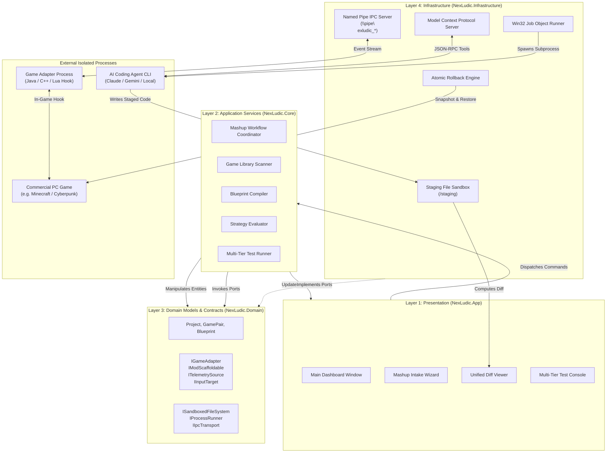

# NEXLUDIC ENGINE — UNIVERSAL PLATFORM MODULE BOUNDARIES
## Document ID: NLE-ARCH-MOD-001
**Phase:** 1 — Product Definition & Research  
**Step:** 5 of 100 — Universal Platform Technology Evaluation & Architecture Decision Records  
**Date:** November 16, 2026  
**Auditor / Architect:** Principal Software Architect & Systems Designer  

---

## 1. Architectural Style & Separation Principles

NexLudic Engine is designed as a **Clean Modular Monolith** adhering to Domain-Driven Design (DDD) principles and Inverted Dependency boundaries. 

The universal core is strictly partitioned into four logical layers, communicating with external game environments and AI coding agents via isolated, out-of-process interfaces:

```
+----------------------------------------------------------------------------------------------------+
|                                NEXLUDIC ENGINE ARCHITECTURE LAYERS                                 |
+----------------------------------------------------------------------------------------------------+
|                                                                                                    |
|  [LAYER 1: PRESENTATION LAYER] (`NexLudic.App`)                                                    |
|  - Windows Presentation Foundation (WPF) Desktop Shell                                             |
|  - MVVM ViewModels, Navigation Router, State Binders (`CommunityToolkit.Mvvm`)                     |
|  - Streaming Log Console, Side-by-Side Unified Diff Viewer, E-Stop Button                          |
|                                         |                                                          |
|                                         v (invokes)                                                |
|  [LAYER 2: APPLICATION SERVICES LAYER] (`NexLudic.Core`)                                           |
|  - Mashup Workflow Coordinator (Stages 1 through 10 Orchestrator)                                  |
|  - Game Library Scanner & Compatibility Assessor (`StrategyEvaluator`)                             |
|  - Natural Language Intake & Clarification Manager                                                 |
|  - Blueprint Compiler & Manifest Generator (`mashup-blueprint.json`)                               |
|  - Multi-Tier Test Verification Runner (`IVerificationRunner`)                                     |
|  - Backup, Rollback & Standalone Package Exporter Coordinator                                      |
|                                         |                                                          |
|                                         v (depends on contracts)                                   |
|  [LAYER 3: DOMAIN ENTITIES & CONTRACTS] (`NexLudic.Domain`)                                        |
|  - Core Entities: `Project`, `GamePair`, `CompatibilityReport`, `MashupBlueprint`                 |
|  - Strategy Models: `HostModStrategy`, `LiveBridgeStrategy`, `HybridStrategy`                      |
|  - Compositional Adapter Trait Contracts:                                                          |
|    `IGameAdapter`, `IModScaffoldable`, `ITelemetrySource`, `IInputTarget`, `IAssetExtractable`     |
|  - Ports: `ISandboxedFileSystem`, `IProcessRunner`, `IIpcTransport`, `IAgentRunner`                |
|                                         ^                                                          |
|                                         | (implements interfaces)                                  |
|  [LAYER 4: INFRASTRUCTURE & ISOLATION LAYER] (`NexLudic.Infrastructure`)                           |
|  - Sandboxed File System (`<project>/staging/` path jail & diff generator)                         |
|  - Win32 Job Object Process Runner (Timeout & memory-capped execution)                             |
|  - Local IPC Engine (`NamedPipeServer` / `NamedPipeClient` with length-prefixed JSON)               |
|  - AI Agent Bridge (Model Context Protocol [MCP] Server & CLI Process Wrapper)                     |
|  - Diagnostics: Serilog Structured File & Observable Memory Sinks                                  |
|  - Backup & Rollback Engine (Atomic directory snapshots & SHA-256 verifier)                       |
|                                         |                                                          |
+-----------------------------------------|----------------------------------------------------------+
                                          |
                      +-------------------+-------------------+
                      | (Named Pipe IPC)                      | (Process Execution)
                      v                                       v
         +--------------------------+            +--------------------------+
         | OUT-OF-PROCESS ADAPTERS  |            | AI CODING AGENT WORKERS  |
         | - Minecraft Fabric Worker|            | - Claude Code CLI Worker |
         | - Rocket League Hook     |            | - Gemini CLI Worker      |
         | - Cyberpunk CET Listener |            | - Local SLM Runner       |
         +--------------------------+            +--------------------------+
```

---

## 2. Mermaid Subsystem Interaction Diagram

The following sequence and dataflow diagram illustrates how the universal core orchestrates user requests, AI agents, and game adapters without direct coupling:



---

## 3. Subsystem Bounded Contexts & Responsibilities

### 3.1 Presentation Layer (`NexLudic.App`)
- **Technology:** WPF, XAML, C# 12, `CommunityToolkit.Mvvm`.
- **Responsibilities:**
  - Manages application lifecycle, window chrome, and system tray integration.
  - Implements responsive MVVM viewmodels with asynchronous command bindings.
  - Renders syntax-highlighted, side-by-side file diffs for user change approval.
  - Hosts the persistent, prominent Emergency Stop (E-Stop) visual trigger.
- **Boundary Rule:** The presentation layer has zero direct references to the infrastructure layer or third-party game libraries. It interacts solely with Application Service interfaces.

### 3.2 Application Services Layer (`NexLudic.Core`)
- **Technology:** C# 12 Class Library (`net8.0`).
- **Responsibilities:**
  - Coordinates the 10-stage mashup lifecycle defined in Step 2.
  - Computes strategy feasibility scores comparing game pair traits against user requests.
  - Compiles structured requirements into immutable `mashup-blueprint.json` documents.
  - Orchestrates multi-tier test pipelines (Build -> Launch -> Interact -> Soak).
  - Mediates user approvals before triggering file deployments or command executions.
- **Boundary Rule:** Contains pure application workflow logic. Implements no direct file I/O or network sockets, delegating all I/O to domain ports.

### 3.3 Domain Layer (`NexLudic.Domain`)
- **Technology:** Pure C# 12 Class Library (`net8.0`, zero external dependencies).
- **Responsibilities:**
  - Defines core domain entities: `MashupProject`, `GamePair`, `CapabilityManifest`, `MashupBlueprint`.
  - Defines compositional adapter trait interfaces: `IGameAdapter`, `IModScaffoldable`, `ITelemetrySource`, `IInputTarget`, `IAssetExtractable`.
  - Defines infrastructure port contracts: `ISandboxedFileSystem`, `IProcessRunner`, `IIpcTransport`, `IAgentRunner`.
- **Boundary Rule:** The domain layer has zero project references to any other layer in the solution, guaranteeing complete architectural independence.

### 3.4 Infrastructure & Isolation Layer (`NexLudic.Infrastructure`)
- **Technology:** C# 12 Class Library (`net8.0`, Win32 Interop, Serilog).
- **Responsibilities:**
  - Implements `ISandboxedFileSystem` ensuring all AI agent mutations remain locked inside `<project>/staging/`.
  - Implements `IProcessRunner` using Win32 Job Objects to enforce hard execution timeouts and memory limits.
  - Implements `IIpcTransport` using Windows Named Pipes (`\\.\pipe\nexludic_*`) with 4-byte length-prefixed JSON framing.
  - Implements `IAgentRunner` providing Model Context Protocol (MCP) server endpoints and local CLI wrappers.
  - Manages atomic directory backups in `<project>/backups/` and executes SHA-256 verified rollback.
- **Boundary Rule:** Encapsulates all OS-specific, filesystem, and inter-process complexity.

### 3.5 External Out-of-Process Boundaries
- **Game Adapters:** Run as independent child processes or in-game scripts (Fabric, CET, BakkesMod). If a game adapter crashes, the failure is contained by the OS process boundary; the core platform logs the exception and remains healthy.
- **AI Coding Agents:** Run as sandboxed child processes supervised by Windows Job Objects. Agents communicate solely via MCP tool calls or standard I/O streams, with zero direct access to the user's host filesystem outside the staging jail.

