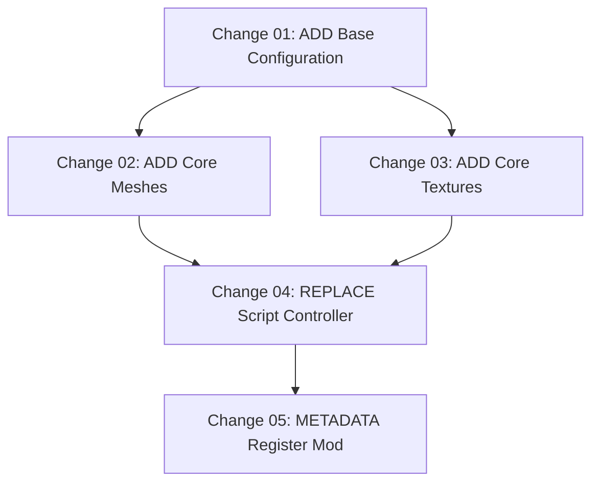

# Application Plan Change Model, Dependency and Ordering Specification

**Document Identifier:** `NLE-SPC-APD-001`  
**Lifecycle Stage:** Content Pipeline Stage I Specification  
**Parent Document:** [HOST_GAME_TARGET_VALIDATION_PACKAGE_MAPPING_AND_APPLICATION_PLANNING_SPECIFICATION.md](file:///d:/App%20Winrar%20Files/Nexludic%20Engine%20(working)/docs/content-pipeline/HOST_GAME_TARGET_VALIDATION_PACKAGE_MAPPING_AND_APPLICATION_PLANNING_SPECIFICATION.md) (`NLE-SPC-TVP-001`)  
**System Status:** Authoritative Architectural Specification  
**Classification:** Change Modeling & Dependency Graph Specification  

---

## 1. Executive Summary & Purpose

The **Application Plan Change Model, Dependency and Ordering Specification** defines the formal taxonomy of proposed target modifications, their precondition and postcondition semantics, and the dependency directed acyclic graph (DAG) governing their safe execution sequence.

The specification guarantees that every planned operation has unambiguous semantics, that destructive operations are transparently flagged, and that dependencies between file changes are strictly ordered without cycles or undefined states.

---

## 2. Operation Taxonomy & Execution Semantics

Every planned change must be categorized under one of seven distinct operation types:

| Operation Type | Destructive? | Required Precondition | Expected Postcondition |
| :--- | :--- | :--- | :--- |
| **`ADD`** | No | Destination must be `CONFIRMED_ABSENT` | File created with exact member SHA-256 |
| **`REPLACE`** | **Yes** | Destination must be `CONFIRMED_PRESENT` | Existing file backed up; replaced by member |
| **`UPDATE`** | **Yes** | Destination matches known managed baseline | Version updated to new member revision |
| **`OVERRIDE`** | No | Base file unchanged; overlay mount point used | Virtual override active in VFS layer |
| **`REMOVE`** | **Yes** | Destination must be `CONFIRMED_PRESENT` | Resource retired / deleted with backup |
| **`NO_OP`** | No | Destination already bit-for-bit identical | Zero filesystem action taken |
| **`METADATA_ONLY`**| No | Target config/registry record accessible | Config entry added or updated |

---

## 3. Formal Change Proposal Schema

```json
{
  "$schema": "https://schemas.nexludic.net/pipeline/v1/change-proposal.json",
  "change_id": "chg-20261119-0042",
  "operation": "REPLACE",
  "destination_relative_path": "Data/Scripts/QuestScript.pex",
  "package_member_id": "mem-042-script",
  "source_sha256": "sha256:7f8e9d0a1b2c3d4e5f6a7b8c9d0e1f2a3b4c5d6e7f8a9b0c1d2e3f4a5b6c7d8e",
  "preconditions": {
    "expected_presence": "CONFIRMED_PRESENT",
    "expected_prior_sha256": "sha256:112233445566778899aabbccddeeff00112233445566778899aabbccddeeff00",
    "backup_required": true
  },
  "postconditions": {
    "resulting_sha256": "sha256:7f8e9d0a1b2c3d4e5f6a7b8c9d0e1f2a3b4c5d6e7f8a9b0c1d2e3f4a5b6c7d8e"
  },
  "dependency_prerequisites": ["chg-20261119-0010"],
  "risk_rating": "HIGH_DESTRUCTIVE",
  "reversibility": "FULLY_REVERSIBLE_WITH_BACKUP"
}
```

---

## 4. Operation Dependency Graph & Ordering Constraints

Proposed changes must be assembled into a **Plan Dependency Graph (DAG)** to establish deterministic execution ordering:



### 4.1 Strict Ordering Distinctions
The engine strictly differentiates three distinct orderings:
1. **Package Member Order:** Canonical lexicographical sorting inside the `.nlpkg` container (Step 65).
2. **Dependency Resolution Order:** Topological sort order derived from package dependency contracts (Step 64).
3. **Plan Execution Order:** Deterministic topological ordering of target-state operations guaranteeing preconditions are satisfied before dependent changes execute.

### 4.2 Cycle Detection & Failure
The Planning Engine performs depth-first cycle detection on the Plan DAG. If any circular dependency is detected:
$$\text{CycleDetected}(C_1 \to C_2 \to \dots \to C_1) \implies \text{Abort with } \texttt{ERR_APD_CYCLE_DETECTED}$$

---

## 5. Specification Invariants

- Every `REPLACE` or `REMOVE` operation must mandate a corresponding pre-modification backup requirement.
- No operation may proceed if its declared preconditions are not met at execution planning time.
