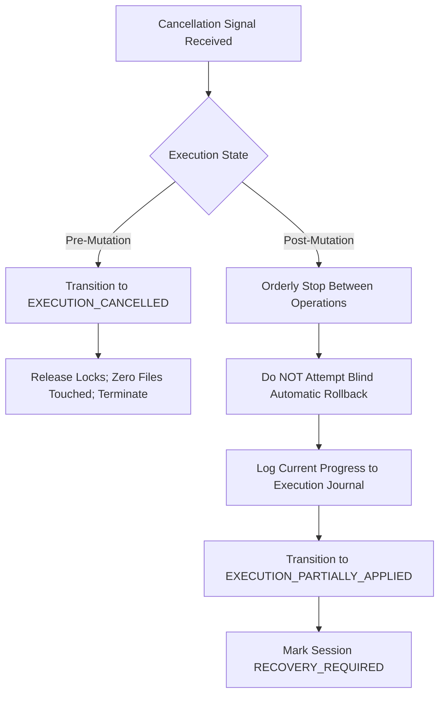

# Execution Concurrency, Cancellation and Partial Failure Policy

**Document Identifier:** `NLE-POL-CCP-001`  
**Lifecycle Stage:** Content Pipeline Stage E Operational Policy  
**Parent Document:** [HOST_GAME_EXECUTION_AUTHORIZATION_PRECONDITION_REVALIDATION_AND_TRANSACTIONAL_APPLICATION_SPECIFICATION.md](file:///d:/App%20Winrar%20Files/Nexludic%20Engine%20(working)/docs/content-pipeline/HOST_GAME_EXECUTION_AUTHORIZATION_PRECONDITION_REVALIDATION_AND_TRANSACTIONAL_APPLICATION_SPECIFICATION.md) (`NLE-SPC-ETA-001`)  
**System Status:** Authoritative Architectural Policy  
**Classification:** Concurrency Control, Cancellation & Fault Governance  

---

## 1. Concurrency Control & Target Mutual Exclusion

To prevent race conditions, corrupted game installations, or conflicting file writes:

1. **Target Installation Instance Mutex (`InstanceExecutionLock`):** Exactly one active execution session is permitted against a given `installation_instance_id` at any time.
2. **Lock Acquisition Protocol:** Before preflight revalidation, the executor must acquire an exclusive file-based lock:
   `<WorkspaceRoot>/Locks/{installation_instance_id}.lock`
   If another session holds the lock, execution is immediately rejected with `ERR_CCP_CONCURRENT_SESSION_ACTIVE`.
3. **External Mutation Detection:** If an external tool, game launcher, or user mutates a target file during execution, the executor detects the baseline drift upon attempting the next operation, immediately aborting the session (`ERR_CCP_EXTERNAL_MUTATION_DETECTED`).

---

## 2. Cancellation Lifecycle & Safe Stopping

A user or orchestrator may issue a cancellation signal (`SIG_CANCEL_EXECUTION`) during an active session:

### 2.1 Post-Mutation Cancellation Rule
Once target files have been modified, a cancellation signal **MUST NOT** trigger an unreviewed, automatic deletion or rollback. The executor stops cleanly between operations, flushes the journal, and flags the session as `RECOVERY_REQUIRED`.

---

## 3. Partial Failure Handling & State Integrity

When an individual operation fails due to I/O error, permission denial, or disk exhaustion:
1. **Immediate Execution Freeze:** The executor halts immediately (`ABORT_ON_ERROR`). No subsequent operations in the sequence are attempted.
2. **Journal Flush:** The failed operation ID, error code, and list of already-committed operations are flushed to `execution_journal.jsonl`.
3. **No Concealment:** Under no circumstances may a partial application be reported as successful or discarded from logs.

---

## 4. Policy Diagnostic Codes

| Code | Severity | Description | Action |
| :--- | :--- | :--- | :--- |
| `ERR_CCP_CONCURRENT_SESSION_ACTIVE` | FATAL | Another execution session is currently modifying target | Reject request. Wait for lock release. |
| `ERR_CCP_EXTERNAL_MUTATION_DETECTED` | FATAL | External process modified target file during execution | Abort session. Flag RECOVERY_REQUIRED. |
| `ERR_CCP_CANCELLED_POST_MUTATION` | WARNING | User cancelled session after modifications started | Halt sequence. Preserve partial journal. |
| `ERR_CCP_PARTIAL_FAILURE_HALT` | FATAL | Operation failed during sequence execution | Halt sequence. Flag RECOVERY_REQUIRED. |
