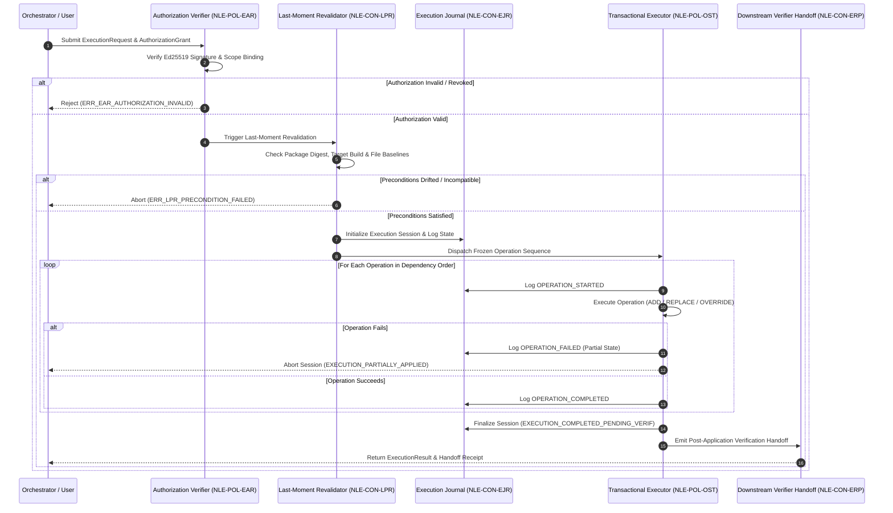

# Host-Game Modification Execution Authorization, Precondition Revalidation and Transactional Application Specification

**Document Identifier:** `NLE-SPC-ETA-001`  
**Lifecycle Stage:** Content Pipeline Architecture — Stage E (Execution & Application)  
**Parent Document:** [HOST_GAME_MODIFICATION_STRATEGY_AND_CONTENT_PIPELINE_ARCHITECTURE.md](file:///d:/App%20Winrar%20Files/Nexludic%20Engine%20(working)/docs/content-pipeline/HOST_GAME_MODIFICATION_STRATEGY_AND_CONTENT_PIPELINE_ARCHITECTURE.md) (`NLE-SPC-GMS-001`)  
**Upstream Contract:** [APPLICATION_PLAN_LIFECYCLE_FRESHNESS_AND_DOWNSTREAM_HANDOFF_CONTRACT.md](file:///d:/App%20Winrar%20Files/Nexludic%20Engine%20(working)/docs/content-pipeline/APPLICATION_PLAN_LIFECYCLE_FRESHNESS_AND_DOWNSTREAM_HANDOFF_CONTRACT.md) (`NLE-CON-ALH-001`)  
**System Status:** Authoritative Architectural Specification  
**Classification:** Core Execution Architecture, Safety & Authorization Specification  

---

## 1. Executive Summary & Purpose

The **Host-Game Modification Execution Authorization, Precondition Revalidation and Transactional Application Specification** establishes the authoritative technical framework governing Stage E of the NexLudic Engine Content Pipeline. While Stage I (Step 66) evaluates target compatibility and produces a non-destructive **Application Plan** (`ApplicationPlan`), Stage E defines the strict safety, security, and correctness requirements under which that plan may be authorized, prepared, revalidated, and safely applied to an explicitly authorized target game environment.

This specification enforces the non-negotiable architectural invariant:
$$\text{Approved Application Plan} \neq \text{Execution Request} \neq \text{Authorized Execution Session} \neq \text{Applied Changes} \neq \text{Verified Target State}$$

Execution permission must be explicit, scope-bounded, cryptographically signed, current, and revalidated at the moment of application. Stage E operates under Windows Medium Integrity Level (`DEC-002`) and strictly adheres to anti-cheat inviolability (`BLK-SEC-01`).

```
+----------------------------------------------------------------------------------------------------+
|                               STAGE E: TRANSACTIONAL APPLICATION PIPELINE                          |
+----------------------------------------------------------------------------------------------------+
|  +-------------------------+      +-------------------------+      +----------------------------+  |
|  | Stage I Approved Plan   | ---> | Scope-Bound Execution   | ---> | Last-Moment Precondition   |  |
|  | & Plan Handoff Receipt  |      | Authorization Check     |      | Revalidation Gate          |  |
|  +-------------------------+      +-------------------------+      +----------------------------+  |
|                                                                                   |                 |
|                                                                                   v                 |
|  +-------------------------+      +-------------------------+      +----------------------------+  |
|  | Post-Application        | <--- | Execution Journal &     | <--- | Bounded Transactional      |  |
|  | Verification Handoff    |      | Durable Result Audit    |      | Operation Executor (DAG)   |  |
|  +-------------------------+      +-------------------------+      +----------------------------+  |
+----------------------------------------------------------------------------------------------------+
```

---

## 2. Core Architectural Principles & Invariants

Stage E is governed by seven foundational invariants:

1. **Explicit Scope-Bound Authorization (`INV-ETA-01`):** No file modification, registration, or override may occur without an authentic, non-expired cryptographic `ExecutionAuthorizationGrant`. The grant must strictly bind to the exact package digest, plan digest, target installation instance, and operation inventory.
2. **Last-Moment Precondition Revalidation (`INV-ETA-02`):** Immediately before executing the first operation, the executor must re-verify that the physical package, target executable build, destination file hashes, and storage quotas match the frozen execution baseline. Any discrepancy triggers immediate fail-closed abort.
3. **Bounded Transactional Application (`INV-ETA-03`):** Changes must be executed in strict topological dependency order. Where the underlying operating system lacks multi-file filesystem ACID transactions, the executor must enforce pseudo-transactional safety through pre-modification backups, staging isolation, and an atomic execution journal.
4. **Protection of Existing Content (`INV-ETA-04`):** Existing user content, game configurations, and unmanaged files must never be silently overwritten or deleted. Any destructive operation (`REPLACE` or `REMOVE`) mandates verified prior baseline hashes and mandatory pre-mutation backup.
5. **Strict Target Containment & Anti-Cheat Safety (`INV-ETA-05`):** Operations must resolve strictly within the authorized target directory. Protected operating system folders, anti-cheat binaries, and core game executables are strictly forbidden targets (`BLK-SEC-01`).
6. **Accurate Journaling & Outcome Distinction (`INV-ETA-06`):** The executor must record an immutable journal of every attempted operation. Successful execution must never be conflated with verified final state; partial failures, cancellations, and uncertain outcomes must remain prominently distinguished.
7. **Least Privilege & No Untrusted Code (`INV-ETA-07`):** The executor runs without administrative elevation. Package members, scripts, installers, hooks, or executables must never be executed during Stage E application.

---

## 3. Stage E Execution Lifecycle Architecture



---

## 4. Distinction of Execution States

Stage E strictly differentiates between logical completion, physical application, and target verification:
- **`EXECUTION_READY`:** Authorized and preflight revalidated; zero files modified.
- **`EXECUTION_IN_PROGRESS`:** Operations currently executing against the target.
- **`EXECUTION_COMPLETED_PENDING_VERIF`:** All planned operations attempted and reported success; awaiting independent target verification.
- **`EXECUTION_PARTIALLY_APPLIED`:** Failure or interruption occurred after one or more modifications were applied. Target is in an inconsistent state requiring recovery.
- **`EXECUTION_OUTCOME_UNCERTAIN`:** Timeout, crash, or I/O failure during mutation leaving unknown target state.
- **`VERIFIED_SUCCESSFUL`:** Downstream Stage V independent verification confirms the target filesystem matches the intended state. (Stage E cannot declare this state).

---

## 5. Security & Boundary Governance

1. **Windows Medium Integrity Level (`DEC-002`):** Modification operations execute under standard user security tokens. Requests for elevated UAC privileges are rejected.
2. **Anti-Cheat Defense (`BLK-SEC-01`):** Operations targeting anti-cheat components (`EasyAntiCheat*`, `BattlEye*`, protected game EXEs) cause immediate session termination and security alert logging.
3. **No Process Hooking:** Stage E operates strictly at the filesystem and virtual mod mount layer; zero runtime memory injection or process hooking is performed.

---

## 6. Specification Traceability & Cross-References

This specification defines requirements `EXE-REQ-001` through `EXE-REQ-032` and cross-references:
- [HOST_GAME_TARGET_VALIDATION_PACKAGE_MAPPING_AND_APPLICATION_PLANNING_SPECIFICATION.md](file:///d:/App%20Winrar%20Files/Nexludic%20Engine%20(working)/docs/content-pipeline/HOST_GAME_TARGET_VALIDATION_PACKAGE_MAPPING_AND_APPLICATION_PLANNING_SPECIFICATION.md) (`NLE-SPC-TVP-001`)
- [APPLICATION_PLAN_LIFECYCLE_FRESHNESS_AND_DOWNSTREAM_HANDOFF_CONTRACT.md](file:///d:/App%20Winrar%20Files/Nexludic%20Engine%20(working)/docs/content-pipeline/APPLICATION_PLAN_LIFECYCLE_FRESHNESS_AND_DOWNSTREAM_HANDOFF_CONTRACT.md) (`NLE-CON-ALH-001`)
- [HOST_GAME_PACKAGE_MATERIALIZATION_SERIALIZATION_AND_INTEGRITY_VERIFICATION_SPECIFICATION.md](file:///d:/App%20Winrar%20Files/Nexludic%20Engine%20(working)/docs/content-pipeline/HOST_GAME_PACKAGE_MATERIALIZATION_SERIALIZATION_AND_INTEGRITY_VERIFICATION_SPECIFICATION.md) (`NLE-SPC-PMS-001`)
