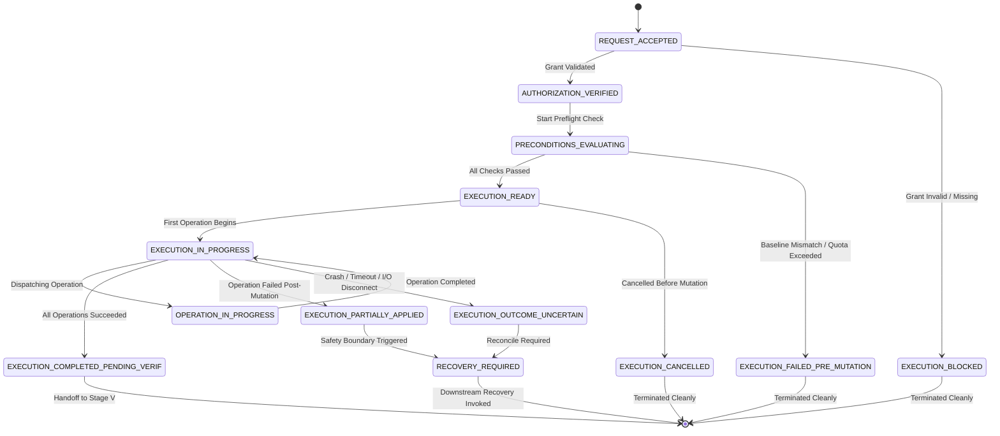

# Host-Game Execution Request and Lifecycle Contract

**Document Identifier:** `NLE-CON-ERL-001`  
**Lifecycle Stage:** Content Pipeline Stage E Request & State Contract  
**Parent Document:** [HOST_GAME_EXECUTION_AUTHORIZATION_PRECONDITION_REVALIDATION_AND_TRANSACTIONAL_APPLICATION_SPECIFICATION.md](file:///d:/App%20Winrar%20Files/Nexludic%20Engine%20(working)/docs/content-pipeline/HOST_GAME_EXECUTION_AUTHORIZATION_PRECONDITION_REVALIDATION_AND_TRANSACTIONAL_APPLICATION_SPECIFICATION.md) (`NLE-SPC-ETA-001`)  
**System Status:** Authoritative Architectural Contract  
**Classification:** Execution Request Model & Session Lifecycle Governance  

---

## 1. Objective & Scope

The **Host-Game Execution Request and Lifecycle Contract** defines the formal data contract for initiating a modification operation and establishes the 14-state lifecycle machine governing execution sessions in Stage E.

---

## 2. Formal Execution Request Schema

An `ExecutionRequest` represents an explicit, immutable demand to apply a previously assessed and approved application plan:

```json
{
  "$schema": "https://schemas.nexludic.net/pipeline/v1/execution-request.json",
  "request_id": "req-exe-20261119-0091",
  "frozen_inputs": {
    "package_id": "pkg-skyrim-nordic-armory-v1.0.0",
    "package_digest": "sha256:9a8b7c6d5e4f3a2b1c0d9e8f7a6b5c4d3e2f1a0b9c8d7e6f5a4b3c2d1e0f9a8b",
    "plan_id": "plan-skyrim-nordic-armory-v1.0.0",
    "plan_digest": "sha256:4a5b6c7d8e9f0a1b2c3d4e5f6a7b8c9d0e1f2a3b4c5d6e7f8a9b0c1d2e3f4a5b",
    "target_installation_instance_id": "inst-7788-9900-aabb",
    "target_snapshot_token": "sha256:d8b2e104f981237a6b91c0e9d1a8e97f012b3c4d5e6f7a8b9c0d1e2f3a4b5c6d"
  },
  "authorization_grant": {
    "grant_id": "grant-20261119-9941",
    "signer_public_key": "ed25519:33445566778899aabbcc...",
    "signature": "ed25519:abcdef0123456789..."
  },
  "execution_options": {
    "dry_run_only": false,
    "abort_on_first_error": true,
    "max_duration_seconds": 300
  },
  "timestamp": "2026-11-19T19:30:00Z"
}
```

---

## 3. Formal 14-State Execution Session Lifecycle



### 3.1 State Semantics & Guarantees
- **`EXECUTION_FAILED_PRE_MUTATION`:** Revalidation failed before any file was modified. Target remains 100% pristine.
- **`EXECUTION_PARTIALLY_APPLIED`:** One or more operations succeeded, but a subsequent operation failed. The system guarantees that an exact list of modified files is preserved in the journal.
- **`EXECUTION_COMPLETED_PENDING_VERIF`:** All operations were applied without runtime error. The target modification is complete from the executor's perspective, but must not be declared verified until Stage V completes.

---

## 4. Contract Diagnostic Codes

| Code | Severity | Description | Action |
| :--- | :--- | :--- | :--- |
| `ERR_ERL_REQUEST_MALFORMED` | FATAL | Mandatory request fields or hashes missing | Reject request immediately. |
| `ERR_ERL_INVALID_STATE_TRANSITION` | FATAL | Session attempted illegal state transition | Abort session. Log security violation. |
| `ERR_ERL_INPUT_REVISION_MISMATCH` | FATAL | Frozen inputs do not match current plan hashes | Reject request. Re-issue application plan. |
