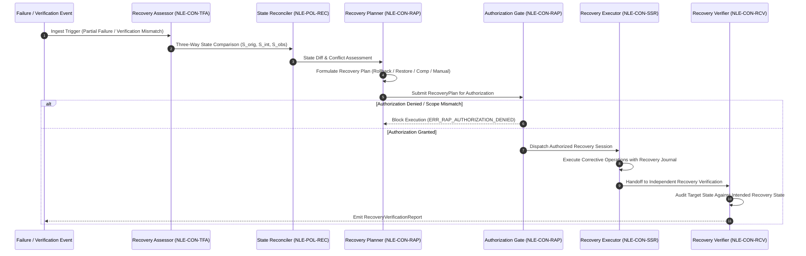

# Host-Game Modification Recovery, Rollback, Restoration and Reconciliation Specification

**Document Identifier:** `NLE-SPC-MRR-001`  
**Lifecycle Stage:** Content Pipeline Architecture — Stage R (Recovery, Rollback & Reconciliation)  
**Parent Document:** [HOST_GAME_MODIFICATION_STRATEGY_AND_CONTENT_PIPELINE_ARCHITECTURE.md](file:///d:/App%20Winrar%20Files/Nexludic%20Engine%20(working)/docs/content-pipeline/HOST_GAME_MODIFICATION_STRATEGY_AND_CONTENT_PIPELINE_ARCHITECTURE.md) (`NLE-SPC-GMS-001`)  
**Upstream Contract:** [EXECUTION_RECOVERY_PREREQUISITES_AND_POST_APPLICATION_HANDOFF_CONTRACT.md](file:///d:/App%20Winrar%20Files/Nexludic%20Engine%20(working)/docs/content-pipeline/EXECUTION_RECOVERY_PREREQUISITES_AND_POST_APPLICATION_HANDOFF_CONTRACT.md) (`NLE-CON-ERP-001`)  
**System Status:** Authoritative Architectural Specification  
**Classification:** Core Recovery Architecture, Resilience & Safety Specification  

---

## 1. Executive Summary & Purpose

The **Host-Game Modification Recovery, Rollback, Restoration and Reconciliation Specification** establishes the authoritative technical framework governing Stage R of the NexLudic Engine Content Pipeline. While Stage E (Step 67) authorizes and applies bounded modifications, Stage R defines the protocols for responding when an execution session encounters partial failure, unexpected target state, cancellation post-mutation, external drift, or post-application verification discrepancy.

This specification enforces the fundamental architectural principle:
$$\text{Recovery is a separately assessed, authorized, and verifiable operation. It must not assume that reversing the original plan is safe or sufficient.}$$
$$\text{Recovery Proposed} \neq \text{Recovery Authorized} \neq \text{Recovery Attempted} \neq \text{Recovery Completed} \neq \text{Recovery Verified}$$

Stage R does not assume every operation is reversible, nor does it blindly overwrite files with historical snapshots. It provides a formal, evidence-based mechanism to evaluate the observed target state against original baselines and intended outcomes, select appropriate recovery strategies, and execute corrective actions under explicit, scope-bound authorization.

```
+----------------------------------------------------------------------------------------------------+
|                               STAGE R: RECOVERY & RECONCILIATION PIPELINE                          |
+----------------------------------------------------------------------------------------------------+
|  +-------------------------+      +-------------------------+      +----------------------------+  |
|  | Failure / Drift Trigger | ---> | Target-State Three-Way  | ---> | Strategy Selection:        |  |
|  | & Execution Journal     |      | Reconciliation Engine   |      | Rollback / Restore / Comp. |  |
|  +-------------------------+      +-------------------------+      +----------------------------+  |
|                                                                                   |                 |
|                                                                                   v                 |
|  +-------------------------+      +-------------------------+      +----------------------------+  |
|  | Post-Recovery           | <--- | Recovery Journal &      | <--- | Scope-Bound Recovery Plan  |  |
|  | Independent Verif.      |      | Safe Execution Session  |      | & Authorization Grant      |  |
|  +-------------------------+      +-------------------------+      +----------------------------+  |
+----------------------------------------------------------------------------------------------------+
```

---

## 2. Core Architectural Invariants

Stage R is governed by seven foundational invariants:

1. **Independent Recovery Authorization (`INV-MRR-01`):** Recovery is an independent operation requiring its own authorization grant (`RecoveryAuthorizationGrant`). Approval to execute an original application plan NEVER confers permission to perform rollback, file deletion, or restoration.
2. **Protection of External & User-Owned Content (`INV-MRR-02`):** Content created or modified by the user, another application, or game update after the original execution began must never be silently overwritten or deleted.
3. **Recovery Source Integrity & Provenance (`INV-MRR-03`):** Restoration may only occur from verified recovery sources possessing cryptographic SHA-256 digests and validated provenance. Arbitrary local files or unverified backups are strictly rejected.
4. **Three-Way State Reconciliation (`INV-MRR-04`):** Corrective actions must be formulated by comparing three distinct states: Original Baseline State ($S_{\text{orig}}$), Intended State ($S_{\text{int}}$), and Currently Observed State ($S_{\text{obs}}$).
5. **Durable Recovery Journaling (`INV-MRR-05`):** All recovery decisions, operations, and outcomes must be recorded in an append-only journal (`recovery_journal.jsonl`). Recovery must preserve the original execution history rather than overwriting or erasing it.
6. **Strict Semantics: Restoration $\neq$ Compensation $\neq$ Alternative State (`INV-MRR-06`):** The system must never report exact restoration unless all original bytes and required metadata are verifiably re-established. Compensating actions and acceptable alternative states must be explicitly designated as such.
7. **Least Privilege & Anti-Cheat Inviolability (`INV-MRR-07`):** Recovery executes under Windows Medium Integrity Level (`DEC-002`). Anti-cheat drivers, game executables, and protected system paths remain on the immutable blocklist (`BLK-SEC-01`).

---

## 3. Stage R Workflow Architecture



---

## 4. Distinction of Recovery States

Stage R enforces clear state boundaries across the recovery lifecycle:
- **`RECOVERY_ASSESSMENT_PENDING`:** Failure trigger detected; target state being audited.
- **`RECOVERY_PLAN_PROPOSED`:** Corrective strategy selected; recovery plan constructed.
- **`RECOVERY_AUTHORIZED`:** Cryptographic grant issued for the exact recovery plan.
- **`RECOVERY_IN_PROGRESS`:** Corrective operations executing against the target.
- **`RECOVERY_COMPLETED_PENDING_VERIF`:** Corrective operations applied; awaiting independent verification.
- **`ORIGINAL_STATE_VERIFIED_RESTORED`:** Independent verification confirms target matches original baseline $S_{\text{orig}}$ bit-for-bit.
- **`COMPENSATION_VERIFIED`:** Target successfully transitioned to approved alternative state.
- **`RECOVERY_FAILED_POST_MUTATION`:** Recovery operation failed mid-execution; manual intervention required.
- **`RECOVERY_OUTCOME_UNCERTAIN`:** Crash or I/O failure during recovery leaving unknown state.

---

## 5. Security & Boundary Governance

1. **Windows Medium Integrity Level (`DEC-002`):** Recovery routines run without elevated UAC privileges.
2. **Anti-Cheat Defense (`BLK-SEC-01`):** Recovery operations must never target anti-cheat files (`EasyAntiCheat*`, `BattlEye*`) or core game executables.
3. **No Script Execution:** Recovery cannot run unverified scripts, batch files, or package-provided hooks to achieve rollback.

---

## 6. Specification Traceability & Cross-References

This specification defines requirements `REC-REQ-001` through `REC-REQ-032` and cross-references:
- [HOST_GAME_EXECUTION_AUTHORIZATION_PRECONDITION_REVALIDATION_AND_TRANSACTIONAL_APPLICATION_SPECIFICATION.md](file:///d:/App%20Winrar%20Files/Nexludic%20Engine%20(working)/docs/content-pipeline/HOST_GAME_EXECUTION_AUTHORIZATION_PRECONDITION_REVALIDATION_AND_TRANSACTIONAL_APPLICATION_SPECIFICATION.md) (`NLE-SPC-ETA-001`)
- [EXECUTION_RECOVERY_PREREQUISITES_AND_POST_APPLICATION_HANDOFF_CONTRACT.md](file:///d:/App%20Winrar%20Files/Nexludic%20Engine%20(working)/docs/content-pipeline/EXECUTION_RECOVERY_PREREQUISITES_AND_POST_APPLICATION_HANDOFF_CONTRACT.md) (`NLE-CON-ERP-001`)
- [HOST_GAME_TARGET_VALIDATION_PACKAGE_MAPPING_AND_APPLICATION_PLANNING_SPECIFICATION.md](file:///d:/App%20Winrar%20Files/Nexludic%20Engine%20(working)/docs/content-pipeline/HOST_GAME_TARGET_VALIDATION_PACKAGE_MAPPING_AND_APPLICATION_PLANNING_SPECIFICATION.md) (`NLE-SPC-TVP-001`)
