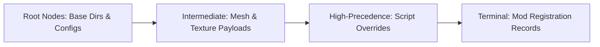
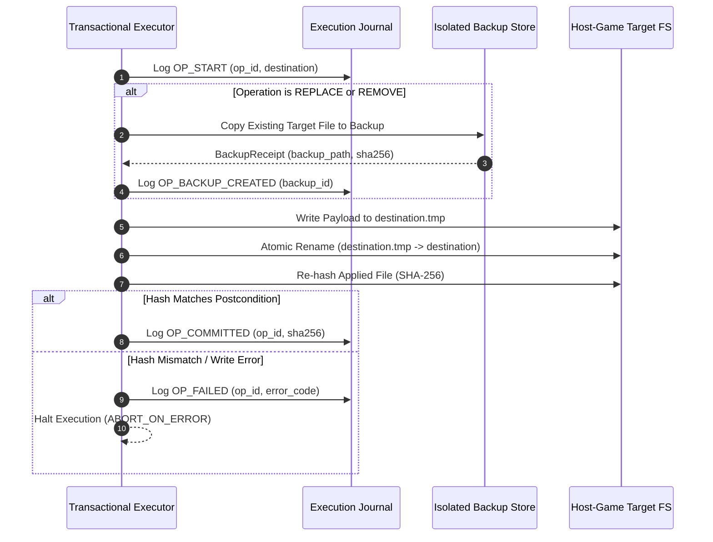

# Host-Game Operation Sequence and Transactional Application Policy

**Document Identifier:** `NLE-POL-OST-001`  
**Lifecycle Stage:** Content Pipeline Stage E Execution Policy  
**Parent Document:** [HOST_GAME_EXECUTION_AUTHORIZATION_PRECONDITION_REVALIDATION_AND_TRANSACTIONAL_APPLICATION_SPECIFICATION.md](file:///d:/App%20Winrar%20Files/Nexludic%20Engine%20(working)/docs/content-pipeline/HOST_GAME_EXECUTION_AUTHORIZATION_PRECONDITION_REVALIDATION_AND_TRANSACTIONAL_APPLICATION_SPECIFICATION.md) (`NLE-SPC-ETA-001`)  
**System Status:** Authoritative Architectural Policy  
**Classification:** Operation Sequencing & Pseudo-Transactional Safety  

---

## 1. Objective & Atomicity Reality

The **Host-Game Operation Sequence and Transactional Application Policy** governs how an approved change graph is flattened into a deterministic execution queue and defines the pseudo-transactional safety guarantees enforced during file application.

### Native Filesystem Reality
Standard operating system filesystems (NTFS, ReFS, ext4, APFS) do not provide multi-file transactional ACID semantics for user-mode desktop applications. Windows Transactional NTFS (TxF) is officially deprecated by Microsoft. Therefore, NexLudic Engine enforces **Compensating Pseudo-Transactional Application**:
1. **Isolated Pre-Mutation Backup:** Every file slated for modification or removal is copied to an isolated backup repository before target files are touched.
2. **Staging & Atomic Replace:** New files are written to `.tmp` files on the target volume and promoted via atomic `MoveFileEx` (`MOVEFILE_REPLACE_EXISTING`).
3. **Sequential Journaling:** Every state transition is recorded in an append-only journal before disk mutations occur.
4. **Immediate Stop-on-Failure:** Any operation error immediately halts execution, preventing cascade damage.

---

## 2. Operation Sequencing & DAG Flattening

Operations are executed in strict topological order derived from the Step 66 Application Plan DAG:

### 2.1 Deterministic Tie-Breaking
When multiple operations share identical topological depth, execution sequence is strictly determined by **Lexicographical Sort of Destination Relative Path**:
$$\text{Op}_A < \text{Op}_B \iff \text{UTF8}(\text{Path}_A) < \text{UTF8}(\text{Path}_B)$$

---

## 3. Per-Operation Execution Lifecycle

For every operation $k$ in the execution queue:

---

## 4. Existing Content Protection

- **No Blind Overwriting:** Existing files cannot be replaced without prior hash verification and backup creation.
- **Unmanaged Files Inviolate:** Files residing in the target directory that were not cataloged during Step 66 planning must never be touched, renamed, or deleted.

---

## 5. Policy Diagnostic Codes

| Code | Severity | Description | Action |
| :--- | :--- | :--- | :--- |
| `ERR_OST_BACKUP_CREATION_FAILED` | FATAL | Cannot create pre-mutation backup of existing file | Abort before mutation. Do NOT touch target. |
| `ERR_OST_ATOMIC_RENAME_FAILED` | FATAL | MoveFileEx failed during promotion | Log partial failure. Halt sequence. |
| `ERR_OST_POSTCONDITION_MISMATCH` | FATAL | Written file SHA-256 differs from member hash | Log corruption. Mark PARTIALLY_APPLIED. |
